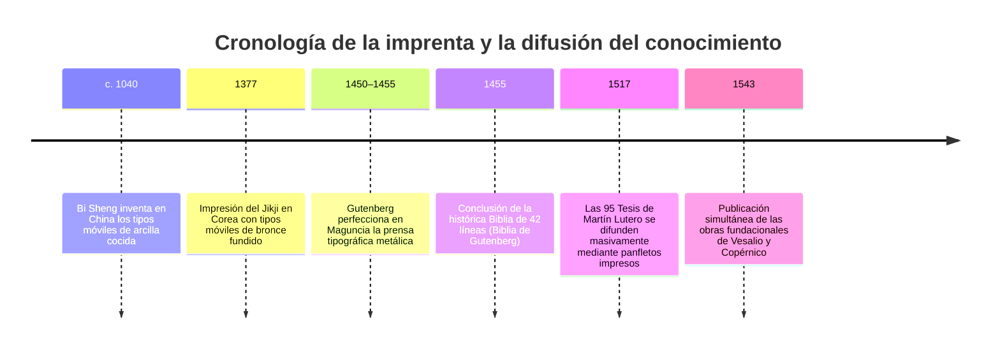
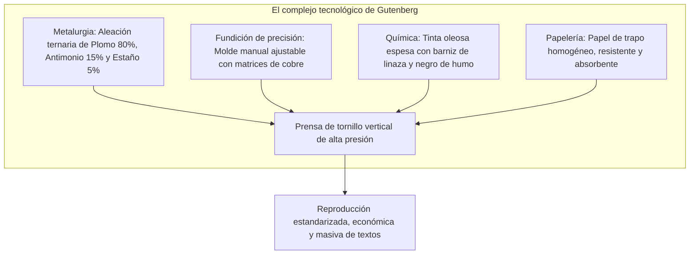
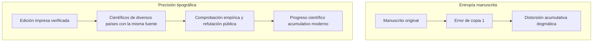

A comienzos del siglo XVII, el filósofo y estadista inglés Francis Bacon sentenció en su célebre tratado *Novum Organum* que tres inventos mecánicos habían transformado por completo la faz del mundo: la imprenta, la pólvora y la brújula marina. Ningún imperio secular, dinastía monárquica ni secta religiosa había ejercido jamás una influencia tan colosal y duradera en los asuntos humanos como estas invenciones técnicas.

Hacia el año 1450, en la ciudad renana de Maguncia (Alemania), el orfebre **Johannes Gutenberg** (c. 1400–1468) culminó el desarrollo de un sistema integral de impresión mecánica mediante tipos móviles de aleación metálica, desatando la mayor revolución informativa que conoció la humanidad hasta la era de Internet.

Antes de la imprenta, el conocimiento escrito era un bien suntuario al alcance exclusivo de las órdenes monásticas, los reyes y las altas jerarquías eclesiásticas. La confección manual de un códice completo en pergamino requería meses o años de minucioso trabajo caligráfico por parte de escribas especializados. El valor comercial de una sola Biblia correspondía al precio de una hacienda rural o una casa señorial. Además, cada copia manual acumulaba errores ortográficos, omisiones involuntarias e interpolaciones doctrinales que degradaban los textos clásicos generación tras generación.

La invención de Gutenberg redujo el coste marginal de producir un libro en más de un 99 %, multiplicando exponencialmente la circulación de ideas, quebrando el monopolio dogmático de la Iglesia de Roma y sentando las bases materiales de la ciencia empírica moderna.

---

## 1. El complejo técnico de Gutenberg: La convergencia de cuatro artes mecánicas

El verdadero mérito de Gutenberg no radicó en la concepción abstracta de caracteres móviles, sino en la **extraordinaria integración sistémica de cuatro disciplinas técnicas** hasta entonces dispares:

### 1.1 La ciencia de materiales: La anomalía física del antimonio
Para resistir decenas de miles de impresiones bajo fuerte presión mecánica sin deformarse, el tipo móvil debía ser tenaz y duro, pero conservando un punto de fusión lo bastante bajo para fundirse repetidamente con rapidez. Gutenberg creó una aleación ternaria compuesta por:
- **Plomo ($Pb$, c. 75–80 %)**: Metal maleable y económico con bajo punto de fusión ($327^\circ\text{C}$).
- **Estaño ($Sn$, c. 5–10 %)**: Reduce aún más el punto de fusión de la mezcla y aporta fluidez hidrodinámica al caldo metálico.
- **Antimonio ($Sb$, c. 15–20 %)**: El componente clave de la aleación.

Casi todos los metales se contraen al enfriarse y solidificar. El antimonio posee la propiedad microscópica anómala de **expandirse volumétricamente al cristalizar**. Esta dilatación térmica obliga al metal fundido a llenar a presión los detalles más finos y delicados de la matriz de cobre, reproduciendo con nitidez absoluta los remates, ligaduras y serifas góticas, a la vez que confiere una enorme dureza al tipo.

### 1.2 El molde manual ajustable (Hand Mould)
En el alfabeto latino, cada carácter posee un ancho proporcional específico: una letra `i` o un punto requieren un grosor mínimo, mientras que letras complejas como `M` o `W` precisan una base mucho más ancha.

Gutenberg ideó un molde manual de dos mitades simétricas de acero encajadas en forma de L:
- Un punzón de acero templado con el carácter grabado en relieve inverso se golpeaba contra una barra de cobre blando para tallar la **matriz**.
- La matriz se fijaba en la base del molde mediante un arco de muelle de acero.
- Las dos secciones deslizantes permitían ajustar al instante la anchura del bloque.
- El fundidor vertía el metal líquido con un cucharón y realizaba un movimiento ascendente con la muñeca para aprovechar la inercia e inyectar el metal hasta el fondo.
- En un segundo, la pieza se enfriaba y se expulsaba limpia y uniforme. Un artesano experto podía fabricar entre 2.000 y 3.000 tipos móviles al día.

### 1.3 La tinta oleosa y la prensa de husillo
La tinta tradicional medieval de escritura era de base acuosa. Sobre la superficie lisa y no porosa del plomo fundido, la tinta de agua formaba gotas aisladas debido a la tensión superficial, emborronando la impresión.

Gutenberg recurrió a los avances de la pintura al óleo flamenca: coció **aceite de linaza con resina de trementina y hollín de lámpara refinado**, logrando una tinta oleosa, viscosa y de secado oxidativo rápido que se adhería perfectamente a las caras metálicas y penetraba de forma homogénea en las fibras del papel de trapos.

---

## 2. El capitalismo de imprenta y el vendaval de la Reforma protestante

El 31 de octubre de 1517, Martín Lutero difundió en Wittenberg sus 95 Tesis contra la venta pontificia de indulgencias. Aunque su propósito original era un debate teológico restringido al ámbito académico en latín, los tipógrafos locales reconocieron el tremendo interés popular del texto: lo tradujeron velozmente al alemán y tiraron miles de panfletos impresos (*Flugschriften*).

Movimientos heréticos anteriores como los de John Wyclif en Inglaterra o Jan Hus en Bohemia habían sido sofocados de raíz porque la Iglesia quemaba físicamente los pocos manuscritos existentes. Ante la imprenta, el aparato censor quedó desbordado:
- **Velocidad sin precedentes**: Antes de que la bula papal de condena pudiera redactarse en Roma, las prensas de Núremberg, Basilea, Estrasburgo y Augsburgo ya habían vendido decenas de miles de opúsculos luteranos.
- **Industria descentralizada**: La imprenta operaba como un negocio privado impulsado por el beneficio comercial, burlando los bloqueos aduaneros.
- La traducción luterana del Nuevo Testamento al alemán (1522) vendió miles de ejemplares en pocas semanas, democratizando el acceso a las Escrituras e impulsando la fijación de las lenguas vernáculas nacionales.

---

## 3. El nacimiento del método científico: Conocimiento acumulativo y verificable

La célebre historiadora Elizabeth Eisenstein demostró que la Revolución Científica del siglo XVI fue, en esencia, una consecuencia directa de la estandarización tipográfica.

### 3.1 La superación de la entropía de los manuscritos
En la cultura del manuscrito, el saber se degradaba inexorablemente con cada copia manual:
- Los esquemas geométricos perdían sus proporciones matemáticas.
- Las tablas astronómicas acumulaban errores numéricos que arruinaban los cálculos de navegación.
- Los dibujos anatómicos quedaban desfigurados por amanuenses inexpertos.

Los sabios renacentistas invertían su tiempo en descifrar los errores de los textos antiguos en lugar de observar la naturaleza. Con la imprenta, por primera vez en la historia, miles de científicos en toda Europa disponían de textos, tablas de logaritmos y grabados calcográficos rigurosamente idénticos para verificar, replicar o refutar hipótesis.

### 3.2 1543: El año fundacional de Vesalio y Copérnico
El año 1543 marcó el hito inaugural de la ciencia moderna con dos obras cumbre:
1. **Andrés Vesalio: *De humani corporis fabrica*** (Basilea): Rompió con el dogma milenario de Galeno mediante disecciones directas del cuerpo humano, inmortalizadas en grabados en madera de asombrosa precisión anatómica.
2. **Nicolás Copérnico: *De revolutionibus orbium coelestium*** (Núremberg): Formuló el modelo heliocéntrico mediante minuciosas tablas trigonométricas que la tipografía preservó sin una sola errata.

---

## 4. Comparación histórica: ¿Por qué la imprenta triunfó en Europa y no en Asia?

A pesar de que los tipos móviles metálicos se crearon en Corea (dinastía Goryeo, hacia 1230, ejemplificado en el *Jikji* de 1377) más de un siglo antes de Gutenberg, y los tipos de arcilla en China (Bi Sheng, c. 1040), la revolución no sacudió a Oriente del mismo modo.

| Factor determinante | Asia Oriental (China / Corea) | Europa Occidental (Gutenberg) |
| :--- | :--- | :--- |
| **Sistema lingüístico** | Ideográfico / Logográfico (+30.000 caracteres) | Alfabético latino (26 a 30 letras) |
| **Coste de inversión** | Colosal: fundir miles de caracteres distintos | Mínimo: 200–300 matrices metálicas básicas |
| **Tecnología rival** | Xilografía en madera sumamente perfeccionada y barata | Copia manuscrita ineficiente y exorbitantemente cara |
| **Régimen político** | Estados dinásticos centralizados con monopolios editoriales | Competencia geopolítica y mercados libres descentralizados |
| **Tinta y soporte** | Tinta al agua sobre papel de arroz mediante frotado manual | Tinta grasa sobre papel de lino bajo prensa vertical de husillo |

El alfabeto latino, con su reducido repertorio fonético, era el terreno natural perfecto para que los tipos móviles mecánicos desataran una reducción de costes revolucionaria.

---

## 5. El legado imperecedero de Gutenberg

Aunque Gutenberg murió en 1468 arruinado y despojado de su imprenta tras litigios con su prestamista Johann Fust, la maquinaria que puso en marcha modeló el mundo moderno. La estandarización ortográfica, la libertad de prensa, el surgimiento de la esfera pública ciudadana y el rigor del método científico descansan sobre los cimientos de plomo y antimonio forjados en Maguncia hace más de quinientos años.
