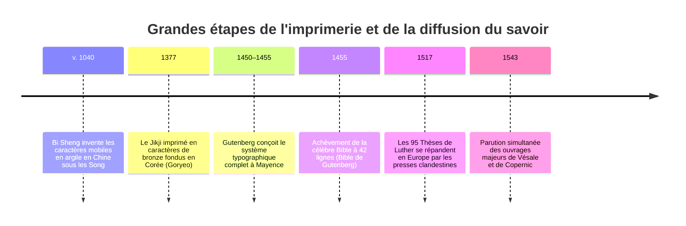
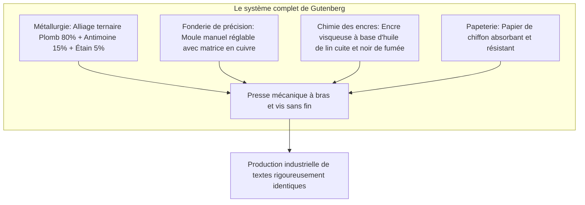
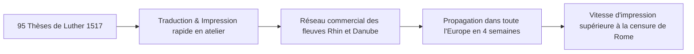
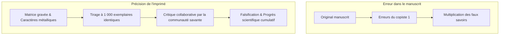

Au seuil du XVIIe siècle, dans son célèbre traité philosophique *Novum Organum*, Francis Bacon formulait un constat éclatant : trois découvertes mécaniques avaient bouleversé la face du monde et l'état des civilisations humaines – l'imprimerie, la poudre à canon et la boussole magnétique. Aucun empire politique, aucune dynastie régnante ni aucune doctrine religieuse n'avait exercé un pouvoir de transformation aussi vaste et durable sur le destin de l'humanité que ces créations techniques.

Vers 1450, à Mayence en Allemagne, l'orfèvre **Johannes Gensfleisch zur Laden zum Gutenberg** (vers 1400–1468) mit au point un ensemble mécanique et métallurgique complet : la presse à imprimer à caractères métalliques mobiles. Cet événement marqua l'acte de naissance de la modernité occidentale et la toute première grande révolution médiatique de l'histoire.

Avant l'avènement de Gutenberg, la transmission textuelle reposait exclusivement sur le labeur épuisant des moines copistes dans les scriptoriums monastiques ou les ateliers laïcs urbains. Recopier une Bible complète sur vélin ou parchemin exigeait plusieurs mois, voire plusieurs années de travail artisanal. Le coût d'un seul codex représentait la fortune d'un grand domaine terrien ou d'une maison bourgeoise. Par ailleurs, chaque copie manuscrite introduisait des glissements orthographiques, des omissions involontaires et des altérations doctrinales.

L'invention de Gutenberg engendra une chute vertigineuse des coûts marginaux de duplication de l'ordre de 99 %, brisant le monopole séculaire de l'Église romaine sur le savoir et posant les jalons de la Réforme protestante et des sciences empiriques.

---

## 1. Le complexe technologique de Gutenberg : L'intégration magistrale de quatre arts

Gutenberg n'a pas simplement inventé le concept de caractères mobiles ; son génie historique réside dans **l'intégration holistique de quatre innovations de pointe**, issues de disciplines artisanales jusque-là totalement étanches :

### 1.1 La métallurgie des alliages : L'anomalie physique de l'antimoine
Pour résister à des dizaines de milliers de pressions mécaniques successives sans s'écraser, un caractère d'imprimerie doit être rigide et dur, tout en fondant à une température accessible aux petits fourneaux d'atelier. Gutenberg élabora un alliage ternaire d'une précision remarquable :
- **Plomb ($Pb$, env. 75–80 %)** : Matrice économique et malléable à bas point de fusion ($327^\circ\text{C}$).
- **Étain ($Sn$, env. 5–10 %)** : Abaisse la température de fusion globale et assure la fluidité lors de la coulée.
- **Antimoine ($Sb$, env. 15–20 %)** : L'ingrédient métallurgique décisif.

Contrairement à la majorité des métaux qui rétrécissent lors du passage de l'état liquide à l'état solide, l'antimoine présente la propriété physique d'une **dilatation volumique lors de sa cristallisation**. Cette expansion force le métal en fusion à épouser les moindres aspérités et déliés de la matrice en cuivre, restituant avec une netteté chirurgicale les traits fins de l'écriture gothique.

### 1.2 Le moule manuel réglable (Hand Mould)
Dans l'alphabet latin, chaque glyphe possède une chasse propre : la lettre `i` ou la ponctuation demandent un encombrement horizontal très réduit, tandis qu'un `M` ou un `W` exigent un bloc bien plus large.

Gutenberg conçut un moule métallique en deux parties ajustables en acier :
1. Un poinçon d'acier trempé portant la lettre gravée en relief est frappé dans une barre de cuivre pour créer une **matrice**.
2. La matrice est verrouillée au fond du moule par un ressort métallique.
3. Les deux parties coulissantes en L permettent de régler instantanément la largeur du caractère.
4. L'artisan verse le métal en fusion d'un geste vif et secoue le moule vers le haut pour projeter le liquide au fond de la matrice sous l'effet de l'inertie.
5. Dès refroidissement (une fraction de seconde), le moule s'ouvre d'un coup sec, libérant un caractère parfaitement calibré. Un fondeur expérimenté pouvait produire entre 2 000 et 3 000 caractères par jour.

### 1.3 L'encre oléagineuse
Les encres médiévales manuscrites étaient à base aqueuse (encre métallo-gallique). Appliquées sur du plomb métallique hydrophobe, ces encres liquides glissaient et formaient des gouttelettes informes, bavochant sous l'effet de la presse.

Gutenberg emprunta la technique de la peinture à l'huile des maîtres flamands. En faisant longuement cuire de **l'huile de lin** avec de la térébenthine de pin et en y incorporant du **noir de fumée** de haute pureté, il créa une encre grasse, thixotrope et hautement visqueuse, capable d'adhérer impeccablement au métal avant d'être transférée par absorption capillaire dans les fibres du papier humidifié.

---

## 2. Le capitalisme de l'imprimé et l'ouragan de la Réforme protestante

Le 31 octobre 1517, Martin Luther rendait publiques ses 95 Thèses contre le commerce des indulgences. Alors que Luther destinait ce texte à une controverse théologique entre érudits universitaires, des imprimeurs s'emparèrent du texte latin, le traduisirent en langue vernaculaire allemande et en tirèrent des milliers de tracts volants (*Flugschriften*).

Les mouvements dissidents antérieurs (les Cathares, John Wyclif en Angleterre, Jan Hus en Bohême) avaient été étouffés par la papauté grâce à la saisie physique et au bûcher des manuscrits. 

Face à l'imprimerie, le pouvoir inquisitorial devint impuissant :
- **Vitesse de reproduction** : En quelques jours, des presses installées à Bâle, Nuremberg, Strasbourg ou Augsbourg inondèrent les marchés urbains d'écrits luthériens.
- **Réseau commercial décentralisé** : L'imprimerie s'était constituée en industrie capitaliste libre et compétitive, échappant aux décrets territoriaux.
- En 1522, la traduction du Nouveau Testament en allemand par Luther fut vendue à 3 000 exemplaires en deux semaines, et Hans Lufft en réimprima plus de 100 000 exemplaires au fil des années suivantes.

L'imprimerie donna naissance à **l'espace public démocratique**, brisant définitivement l'unicité de la chrétienté occidentale.

---

## 3. L'envol de la Révolution scientifique : Le savoir cumulatif et vérifiable

L'historienne Elizabeth Eisenstein a magistralement démontré que l'émergence des sciences modernes aurait été matériellement impossible sans la standardisation typographique.

### 3.1 La fin de la dégradation entropique des textes
À l'époque manuscrite, chaque copie représentait une dégradation progressive :
- Les diagrammes géométriques perdaient leurs proportions exactes.
- Les planches anatomiques voyaient les vaisseaux sanguins déformés par des copistes ignorants de la médecine.
- Les éphémérides et tables astronomiques accumulaient des erreurs de calcul catastrophiques.

Les savants passaient leur existence à essayer d'épurer les textes corrompus des Anciens plutôt que d'observer la nature. L'imprimerie permit pour la première fois de figer des textes, des tables trigonométriques et des gravures sur bois rigoureusement identiques, distribués simultanément à travers toute l'Europe.

### 3.2 L'année miraculeuse 1543 : Vésale et Copernic
L'année 1543 marque le tournant décisif vers la modernité scientifique avec deux chefs-d'œuvre imprimés :
1. **André Vésale : *De humani corporis fabrica*** : Imprimé à Bâle par Johannes Oporinus. Fondé sur des dissections réelles du corps humain, l'ouvrage remet en cause l'autorité dogmatique de Galien grâce à des planches anatomiques d'une virtuosité absolue gravées sur bois.
2. **Nicolas Copernic : *De revolutionibus orbium coelestium*** : Imprimé à Nuremberg par Johannes Petreius. Copernic démontre le système héliocentrique grâce à des tables mathématiques complexes que seule la rigueur de la composition mobile pouvait préserver sans altération.

---

## 4. Comparaison historique globale : Pourquoi l'Europe et non l'Asie ?

L'imprimerie à caractères mobiles en métal a été inventée en Corée (dynastie Goryeo, vers 1230, et livre *Jikji* en 1377), plus d'un siècle avant Gutenberg, et les caractères mobiles en argile remontent à Bi Sheng en Chine (vers 1040). Pourquoi n'a-t-elle pas transformé l'Asie de la même manière ?

| Paramètre d'analyse | Asie orientale (Chine / Corée) | Europe occidentale (Système Gutenberg) |
| :--- | :--- | :--- |
| **Système d'écriture** | Logographique (plus de 30 000 sinogrammes) | Alphabétique (26 à 30 lettres latines) |
| **Coût fixe initial** | Écrasant : fonte de dizaines de milliers de caractères | Extrêmement faible : 200 à 300 matrices suffisent |
| **Technologie concurrente** | Gravure sur bois (xylographie) extrêmement performante | Copie manuscrite manuelle inefficace et coûteuse |
| **Contexte politique** | Empires bureaucratiques centralisés, monopoles d'État | Morcellement féodal, concurrence commerciale féroce |
| **Chimie & Pression** | Encres à base d'eau, frottage manuel sans presse | Encre à l'huile, presse à vis exerçant une forte pression verticale |

Dans un système sinographique, la xylographie (sculpter une planche de bois entière pour chaque page) demeurait infiniment plus économique : la planche pouvait être conservée des décennies dans les bibliothèques et réimprimée à la demande. En revanche, le génie de l'alphabet latin résidait dans son nombre restreint de signes, faisant du caractère métallique interchangeable l'outil économique parfait.

---

## 5. Conclusion : L'héritage durable de Gutenberg

Bien que Johannes Gutenberg soit mort en 1468 après avoir été spolié de son atelier au terme d'un procès financier contre son commanditaire Johann Fust, son legs demeure inestimable. De la presse mécanique de Mayence jusqu'aux réseaux numériques actuels, l'imprimerie à caractères mobiles a instauré la standardisation de la pensée humaine, la démocratisation des connaissances et le triomphe de la rationalité scientifique.
