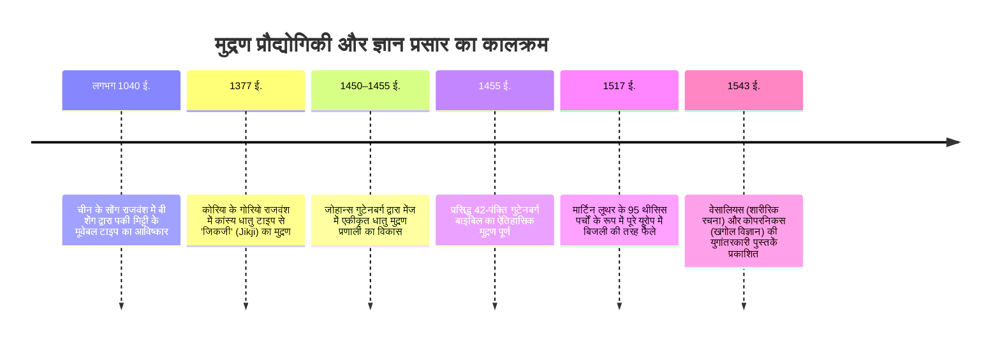
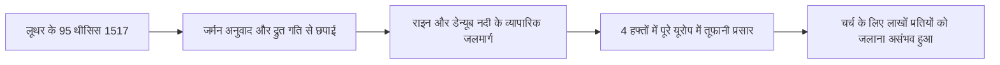

17वीं शताब्दी की शुरुआत में प्रसिद्ध अंग्रेज दार्शनिक फ्रांसिस बेकन ने अपनी महान कृति *नोवम ऑर्गेनम* में लिखा था: तीन यांत्रिक आविष्कारों ने पूरी दुनिया का चेहरा और स्थिति बदल दी है—मुद्रण (प्रिंटिंग प्रेस), बारूद और चुंबकीय कंपास। किसी भी साम्राज्य, संप्रदाय या राजवंशीय शक्ति ने मानव जीवन और इतिहास पर इन व्यावहारिक आविष्कारों से अधिक गहरा और क्रांतिकारी प्रभाव नहीं डाला।

लगभग 1450 ईस्वी में जर्मनी के मेंज (Mainz) शहर में एक कुशल सुनार **जोहान्स गुटेनबर्ग** (लगभग 1400–1468) ने एक पूर्ण एकीकृत यांत्रिक मुद्रण प्रणाली विकसित की: चल धातु प्रकार (Movable Metal Type) प्रिंटिंग प्रेस। इस ऐतिहासिक आविष्कार ने आधुनिक ज्ञान युग और सूचना क्रांति की नींव रखी।

गुटेनबर्ग से पहले पुस्तकें अत्यंत दुर्लभ और विलासिता की वस्तु थीं। चर्मपत्र (Parchment) पर एक पूरी बाइबिल हाथ से लिखने में ईसाई मठों के कुशल मुंशियों को कई महीने या वर्षों का कठोर परिश्रम करना पड़ता था। एक पांडुलिपि की कीमत एक बड़े कृषि फार्म या शहर के विशाल भवन के बराबर होती थी। इसके अलावा, हाथ से नकल करने के दौरान मानवीय भूलों, छूटे हुए शब्दों और गलत व्याख्याओं का संचय होता रहता था, जिससे प्राचीन ज्ञान सदियों में विकृत हो जाता था।

गुटेनबर्ग की बहु-विषयक इंजीनियरिंग ने पुस्तकों की उत्पादन लागत में 99 % से अधिक की भारी गिरावट की। कुछ ही दशकों में यूरोप भर में करोड़ों पुस्तकें छपकर बिकीं, जिससे चर्च के सूचना एकाधिकार का अंत हुआ, मार्टिन लूथर का प्रोटेस्टेंट धर्मसुधार आंदोलन फैला और आधुनिक विज्ञान की वैज्ञानिक क्रांति संभव हो सकी।



---

## 1. गुटेनबर्ग का तकनीकी संकुल: चार प्रमुख इंजीनियरिंग विधाओं का महा-समागम

गुटेनबर्ग का ऐतिहासिक योगदान केवल अलग-अलग अक्षरों की कल्पना करना नहीं था, बल्कि **चार पृथक उच्च-स्तरीय तकनीकों का एक अचूक यांत्रिक प्रणाली में अभूतपूर्व एकीकरण** था:

```mermaid
flowchart TD
    subgraph गुटेनबर्ग की समग्र प्रणाली
        A[धातुकर्म: सीसा 80% + एंटीमनी 15% + टिन 5% का त्रि-धात्विक मिश्रधातु] --> Press[ऊर्ध्वाधर स्क्रू प्रिंटिंग प्रेस]
        B[सटीक ढलाई: स्प्रिंग-युक्त समायोज्य हैंड मोल्ड और तांबे का मैट्रिक्स] --> Press
        C[स्याही रसायन: अलसी के तेल की वार्निश और शुद्ध कालिख आधारित गाढ़ी स्याही] --> Press
        D[कागज़ निर्माण: उच्च अवशोषण क्षमता वाला टिकाऊ सूती चिथड़े का कागज़] --> Press
    end
    Press --> Production[सटीक, तीव्र और बड़े पैमाने पर मानकीकृत पुस्तकों का उत्पादन]
```

### 1.1 धातुकर्म और मिश्र धातु: एंटीमनी का भौतिक चमत्कार
प्रिंटिंग टाइप को हजारों पाउंड के यांत्रिक दबाव को बार-बार बिना टूटे या विकृत हुए सहना पड़ता था, साथ ही उसका गलनांक इतना कम होना चाहिए था कि कार्यशाला में उसे आसानी से और तेजी से बार-बार ढाला जा सके। गुटेनबर्ग ने एक अद्वितीय त्रि-धात्विक मिश्र धातु (Type Metal) तैयार की:
- **सीसा ($Pb$, लगभग 75–80 %)**: कम गलनांक ($327^\circ\text{C}$) वाली सस्ती और नमनीय धातु आधार।
- **टिन ($Sn$, लगभग 5–10 %)**: मिश्रण के गलनांक को और कम करता है तथा पिघली हुई धातु की तरलता बढ़ाता है।
- **एंटीमनी ($Sb$, लगभग 15–20 %)**: गुटेनबर्ग की सबसे क्रांतिकारी धातुकर्म खोज।

अधिकांश धातुएं तरल से ठोस बनते समय सिकुड़ती हैं। इसके विपरीत, एंटीमनी में **क्रिस्टलीकरण के दौरान आयतन में सूक्ष्म विस्तार (Expansion)** का अनोखा भौतिक गुण होता है। यह विस्तार पिघली धातु को तांबे के मैट्रिक्स की सबसे बारीक खांचों और कोनों में जबर्दस्ती भर देता है। इसके परिणामस्वरूप गॉथिक अक्षरों की सबसे बारीक रेखाएं और सेरिफ़ बिल्कुल स्पष्ट और तीक्ष्ण ढलती हैं, तथा धातु को असाधारण कठोरता मिलती है।

### 1.2 समायोज्य हैंड मोल्ड (Hand Mould)
लैटिन वर्णमाला में अक्षरों की चौड़ाई में भारी अंतर होता है: अक्षर `i` बहुत संकरा होता है, जबकि अक्षर `M` या `W` काफी चौड़ा होता है।

गुटेनबर्ग ने दो भागों वाला L-आकार का स्लाइडिंग हैंड मोल्ड विकसित किया:
1. कठोर स्टील के पंच पर उल्टे उभरे हुए अक्षर को तराश कर मुलायम तांबे की पट्टी पर ठोककर **मैट्रिक्स (Matrix)** बनाई जाती थी।
2. मैट्रिक्स को मोल्ड के तल में एक लचीले स्टील स्प्रिंग क्लैंप से सुरक्षित किया जाता था।
3. कारीगर मोल्ड के दोनों हिस्सों को अक्षर की सटीक चौड़ाई के अनुसार सरकाकर सेट करता था।
4. चम्मच से पिघली धातु डालकर कारीगर एक झटके से हाथ ऊपर उठाता था; जड़त्व (Inertia) के कारण तरल धातु मैट्रिक्स की गहराई में पूरी तरह समा जाती थी।
5. एक सेकंड में धातु जम जाती और मोल्ड खुलते ही एक परिपूर्ण टाइप बाहर गिरता। एक कुशल कारीगर प्रतिदिन 2,000 से 3,000 टाइप ढाल सकता था।

### 1.3 तैलीय स्याही और स्क्रू प्रेस
मध्यकालीन मुंशियों की पारंपरिक स्याही जल-आधारित होती थी। धातु की चिकनी सीसा सतह पर पानी की स्याही पृष्ठ तनाव के कारण बूंदों में बंट जाती थी और कागज़ पर धब्बे बन जाते थे।

गुटेनबर्ग ने फ्लेमिश तेल चित्रकला की तकनीकों को अपनाया: उन्होंने **अलसी के तेल (Linseed Oil) को देवदार की राल और शुद्ध लैंप कालिख (Lampblack) के साथ घंटों उबाला**। इससे एक अत्यंत गाढ़ी, चिपचिपी और तैलीय स्याही तैयार हुई, जो धातु के चेहरे पर समान रूप से चिपकती थी और नम सूती कागज़ के रेशों में तेजी से सूख जाती थी।

---

## 2. प्रिंट पूंजीवाद और प्रोटेस्टेंट धर्मसुधार का आंधीनुमा प्रसार

31 अक्टूबर 1517 को मार्टिन लूथर ने विटनबर्ग में कैथोलिक चर्च द्वारा बेचे जाने वाले 'क्षमापत्रों' (Indulgences) के विरोध में अपने ऐतिहासिक 95 थीसिस प्रस्तुत किए। लूथर ने इसे विद्वानों के बीच लैटिन भाषा में अकादमिक बहस के लिए लिखा था। परंतु स्थानीय मुद्रकों ने तुरंत इसका जर्मन लोकभाषा में अनुवाद किया और हजारों सस्ते पर्चे (*Flugschriften*) छाप डाले।



जॉन विक्लिफ और यान हुस जैसे शुरुआती सुधारकों के आंदोलनों को चर्च ने उनकी गिनी-चुनी हस्तलिखित पांडुलिपियों को जलाकर दबा दिया था। लेकिन प्रिंटिंग प्रेस के सामने रूढ़िवादी सेंसरशिप असहाय हो गई:
- **अद्वितीय प्रसार गति**: जब तक रोम में लूथर के खिलाफ पोप का आदेश तैयार हुआ, तब तक नूर्नबर्ग, बासेल और स्ट्रासबर्ग के प्रेसों ने लाखों प्रतियां बेच दी थीं।
- **विकेंद्रीकृत खुला बाजार**: मुद्रण एक स्वतंत्र व्यावसायिक उद्यम था, जिसे रोका नहीं जा सकता था।
- लूथर द्वारा 1522 में जर्मन भाषा में अनूदित न्यू टेस्टामेंट की हजारों प्रतियां कुछ ही हफ्तों में बिक गईं, जिसने आधुनिक जर्मन भाषा का मानकीकरण किया और इतिहास में पहली बार **सार्वजनिक जनमत** (Public Opinion) को जन्म दिया।

---

## 3. आधुनिक वैज्ञानिक क्रांति का शुभारंभ: संचयी और सत्यापन योग्य ज्ञान

विख्यात इतिहासकार एलिजाबेथ आइज़ेंस्टीन ने रेखांकित किया कि आधुनिक विज्ञान का उदय प्रिंटिंग प्रेस द्वारा पाठ्य मानकीकरण के बिना असंभव था।

### 3.1 पांडुलिपि विकृति (Entropy) का स्थायी अंत
हाथ से नकल करने के युग में प्रत्येक नई प्रति के साथ ज्ञान का ह्रास होता था:
- ज्यामितीय आरेखों के कोण और अनुपात बिगड़ जाते थे।
- शरीर रचना के चित्रों में नसों और मांसपेशियों की स्थिति विकृत हो जाती थी।
- खगोलीय तालिकाओं और गणितीय गणनाओं में लिपिकीय त्रुटियां जमा हो जाती थीं।

वैज्ञानिक अपना जीवन प्राचीन ग्रंथों की त्रुटियां सुधारने में बर्बाद करते थे। प्रिंटिंग प्रेस के आगमन से पहली बार पूरे यूरोप के वैज्ञानिकों को बिल्कुल एक समान गणितीय सारणियां, खगोलीय आंकड़े और शरीर रचना के आरेख मिले, जिससे वे एक-दूसरे के प्रयोगों को दोहरा सके, त्रुटियों को नकार सके और ज्ञान का निरंतर संचय कर सके।

```mermaid
flowchart TD
    subgraph पांडुलिपि की विकृति
        M1[मूल हस्तलिखित पांडुलिपि] --> M2[नकलची की लिपिकीय गलतियां]
        M2 --> M3[ज्ञान का ह्रास और रूढ़िवादी जड़ता]
    end
    subgraph प्रिंटिंग प्रेस की वैज्ञानिक सटीकता
        P1[सटीक टाइप और नक्काशीदार ब्लॉक] --> P2[हजारों समान प्रतियों का वितरण]
        P2 --> P3[विभिन्न देशों के वैज्ञानिकों द्वारा स्वतंत्र सत्यापन]
        P3 --> P4[सिद्धांतों का खंडन और आधुनिक संचयी विज्ञान]
    end
```

### 3.2 चमत्कारिक वर्ष 1543: वेसालियस और कोपरनिकस
1543 का वर्ष आधुनिक विज्ञान का प्रस्थान बिंदु बना, जब दो युगांतरकारी पुस्तकें छपीं:
1. **एंड्रियास वेसालियस: *डी हुमानी कॉर्पोरिस फैब्रिका* (De humani corporis fabrica)** (बासेल): वास्तविक मानव शव विच्छेदन के आधार पर गैलेन के 1300 साल पुराने चिकित्सा सिद्धांतों को ध्वस्त किया, जिसे तीक्ष्ण काष्ठ नक्काशी चित्रों में अमर किया गया।
2. **निकोलास कोपरनिकस: *डी रिवोल्यूशनिबस ऑर्बियम कोएलेस्टियम* (De revolutionibus orbium coelestium)** (नूर्नबर्ग): सूर्यकेंद्रित ब्रह्मांड का मॉडल प्रस्तुत किया, जिसमें जटिल त्रिकोणमितीय सारणियां शामिल थीं, जिन्हें केवल धातु टाइप ही त्रुटिहीन बनाए रख सकता था।

---

## 4. वैश्विक तुलना: यह क्रांति यूरोप में ही क्यों भड़की, पूर्वी एशिया में क्यों नहीं?

यद्यपि धातु के मूवेबल टाइप का आविष्कार कोरिया के गोरियो राजवंश (13वीं सदी की शुरुआत, 1377 में *जिकजी*) में गुटेनबर्ग से पहले हो चुका था, और मिट्टी के टाइप चीन में बी शेंग ने 11वीं सदी में बनाए थे, फिर भी मुद्रण का महा-विस्फोट यूरोप में ही क्यों हुआ?

| तुलनात्मक बिंदु | पूर्वी एशिया (चीन / कोरिया) | पश्चिमी यूरोप (गुटेनबर्ग प्रणाली) |
| :--- | :--- | :--- |
| **लिपि प्रणाली** | भावचित्रात्मक (30,000+ चीनी हान्जी वर्ण) | वर्णमाला आधारित (केवल 26 से 30 लैटिन अक्षर) |
| **प्रारंभिक पूंजी लागत** | विशाल: हजारों विभिन्न वर्णों को ढालना पड़ता था | न्यूनतम: केवल 200–300 अक्षरों और प्रतीकों के सांचे |
| **प्रतिस्पर्धी तकनीक** | काष्ठ ब्लॉक प्रिंटिंग (Xylography) अत्यंत सस्ती और सुगम | हाथ से नकल करना अत्यंत धीमा और अत्यधिक महंगा |
| **राजनीतिक व्यवस्था** | केंद्रीकृत साम्राज्य और राज्य का मुद्रण एकाधिकार | सामंती विखंडन और प्रतिस्पर्धी मुक्त वाणिज्यिक बाजार |
| **स्याही और यांत्रिकी** | जल-आधारित स्याही, बिना प्रेस के कोमल हाथ से रगड़ना | तैलीय गाढ़ी स्याही, भारी स्क्रू प्रेस का ऊर्ध्वाधर दबाव |

चीनी लिपि में पूरे पृष्ठ के लकड़ी के ब्लॉक तराशना कहीं अधिक सस्ता और व्यावहारिक था; उन ब्लॉकों को सदियों तक सहेजकर आवश्यकता पड़ने पर कम प्रतियां छापी जा सकती थीं। इसके विपरीत, संक्षिप्त लैटिन वर्णमाला के कारण चल धातु प्रकार यूरोप में ज्ञान के प्रसार का सबसे सस्ता, तीव्र और क्रांतिकारी माध्यम सिद्ध हुआ।

---

## 5. निष्कर्ष: गुटेनबर्ग की अमर विरासत

यद्यपि जोहान्स गुटेनबर्ग की मृत्यु 1468 में अपने ऋणदाता जोहान फस्ट के साथ कानूनी मुकदमों में अपनी कार्यशाला खोने के बाद आर्थिक तंगी में हुई, लेकिन उनके द्वारा शुरू की गई मशीन ने सभ्यता की दिशा हमेशा के लिए बदल दी। विचार की स्वतंत्रता, सार्वजनिक शिक्षा, जनतंत्र और आधुनिक वैज्ञानिक सोच की नींव में मेंज की भट्टी में ढले वे सीसे और एंटीमनी के अक्षर आज भी अडिग खड़े हैं।
