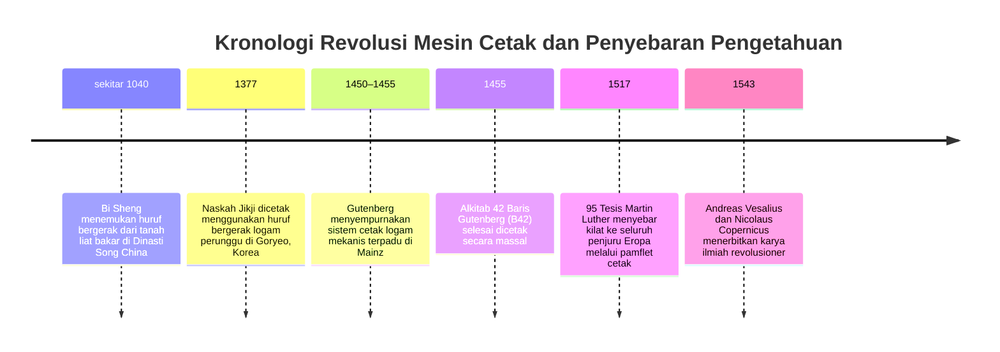
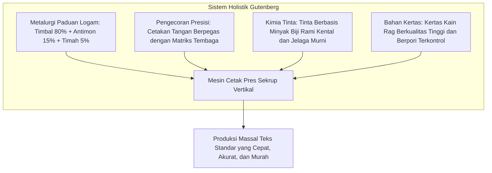
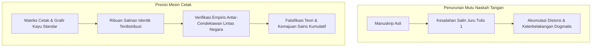

Pada awal abad ke-17, filsuf empiris terkemuka asal Inggris, Francis Bacon, menulis dalam adikaryanya *Novum Organum* bahwa ada tiga penemuan mekanis yang telah mengubah wajah dan tatanan seluruh peradaban dunia: mesin cetak, bubuk mesiu, dan kompas magnetik. Tidak ada kekaisaran, sekte keagamaan, atau dinasti kekuasaan mana pun yang mampu menandingi daya revolusioner dari ketiga penemuan praktis tersebut dalam sejarah peradaban manusia.

Sekitar tahun 1450 di kota Mainz, Jerman, seorang pandai emas bernama **Johannes Gutenberg** (sekitar 1400–1468) berhasil mewujudkan sebuah sistem mekanis terpadu: mesin cetak huruf bergerak berbahan logam (*movable metal type printing press*). Penemuan ini memicu revolusi informasi paling radikal sebelum lahirnya era komputer dan internet.

Sebelum Gutenberg, setiap buku adalah barang mewah yang sangat langka. Sebuah naskah Alkitab lengkap harus disalin dengan tangan di atas lembaran perkamen kulit hewan oleh para biarawan di biara-biara Katolik. Pengerjaannya memakan waktu berbulan-bulan hingga bertahun-tahun, dengan biaya setara harga sebuah lahan perkebunan luas atau rumah bangsawan kota. Tak hanya itu, setiap proses penyalinan manual menyisipkan kesalahan penulisan, kata yang terlewat, dan tafsiran bias yang menumpuk dari generasi ke generasi.

Gutenberg menurunkan biaya produksi buku lebih dari 99 %, melipatgandakan jumlah naskah yang beredar, mengguncang dominasi hierarki Gereja Roma, memicu Reformasi Protestan, serta meletakkan fondasi sains modern yang berbasis data terverifikasi.

---

## 1. Kompleks Teknologi Gutenberg: Konvergensi Empat Pilar Rekayasa

Keagungan karya Gutenberg tidak sekadar terletak pada gagasan menyusun huruf lepasan, melainkan pada **kemampuan integrasi holistik atas empat inovasi teknik** yang sebelumnya terpisah:

### 1.1 Ilmu Material: Keajaiban Perilaku Antimon
Huruf cetak logam harus mampu menahan ribuan kali tekanan pres vertikal tanpa melengkung atau aus, namun di sisi lain harus memiliki titik leleh rendah agar mudah dicairkan berulang kali di bengkel kerja. Gutenberg meracik paduan terner istimewa:
- **Timbal ($Pb$, sekitar 75–80 %)**: Logam lentur, murah, dan bertitik leleh rendah ($327^\circ\text{C}$).
- **Timah ($Sn$, sekitar 5–10 %)**: Menurunkan titik leleh campuran dan memberikan keenceran hidrodinamis saat dituang.
- **Antimon ($Sb$, sekitar 15–20 %)**: Kunci metalurgi Gutenberg yang paling krusial.

Sebagian besar logam menyusut volumenya ketika mendingin dan memadat. Namun, antimon memiliki anomali fisik mikroskopis: **antimon mengembang saat mengkristal dan membeku**. Pemuaian volume ini memaksa cairan logam yang membeku mendesak masuk ke dalam ceruk-ceruk terkecil pada matriks tembaga, menghasilkan reproduksi huruf gotik yang luar biasa tajam dan presisi, sekaligus memberi kekerasan struktural yang luar biasa tinggi pada kepala huruf.

### 1.2 Alat Cetak Tangan yang Dapat Disesuaikan (Hand Mould)
Setiap huruf dalam alfabet latin memiliki lebar horizontal berbeda. Huruf `i` atau tanda titik hanya membutuhkan ruang sangat sempit, sementara huruf kapital `M` atau `W` membutuhkan ruang lebar.

Gutenberg merancang cetakan tangan baja portabel dua bagian berbentuk huruf L yang bisa digeser:
1. Pukulan baja (*punch*) berukir huruf timbul dipukulkan pada balok tembaga lunak untuk membentuk **matriks cekung**.
2. Matriks dikunci pada dasar cetakan dengan penjepit pegas kawat baja.
3. Operator menyetel lebar cetakan sesuai proporsi huruf yang akan dicor.
4. Logam cair dituangkan dari sendok leleh, lalu dengan satu gerakan sentakan tangan ke atas, inersia memaksa cairan paduan mengisi detail matriks.
5. Dalam sepersekian detik logam membeku, pegas dibuka, dan sebuah huruf cetak presisi langsung terlontar keluar. Seorang pengrajin terampil mampu memproduksi 2.000 hingga 3.000 huruf per hari kerja.

### 1.3 Tinta Cetak Berbasis Minyak dan Pres Sekrup Kayu
Tinta tulis tradisional para biarawan abad pertengahan berbahan dasar air (*iron-gall ink*). Pada permukaan logam timbal yang licin dan hidrofobik, tinta air akan menggumpal membentuk tetesan-tetesan cairan yang berantakan karena tegangan permukaan, membuat cetakan belepotan.

Gutenberg mengadopsi teknik cat minyak para pelukis Flemish: ia merebus **minyak biji rami (*linseed oil*) bersama damar pinus dan jelaga jelaga lampu murni**, menciptakan tinta kental, lekat, dan cepat kering lewat oksidasi yang menempel sempurna pada muka huruf logam dan meresap stabil ke pori kertas rag.

---

## 2. Kapitalisme Percetakan dan Gelombang Reformasi Protestan

Pada tanggal 31 Oktober 1517, Martin Luther mengumumkan 95 Tesisnya di Wittenberg untuk menentang penjualan surat pengampunan dosa (*indulgensi*) oleh kepausan. Walaupun naskah aslinya ditulis dalam bahasa Latin untuk perdebatan akademis tertutup antar-cendekiawan, para pengusaha percetakan lokal segera menerjemahkannya ke dalam bahasa Jerman rakyat dan mencetaknya dalam ribuan eksemplar pamflet murah (*Flugschriften*).

Gerakan reformis sebelumnya, seperti John Wycliffe di Inggris atau Jan Hus di Bohemia, berhasil dihancurkan oleh inkuisisi kepausan dengan menyita dan membakar habis sedikit naskah tulisan tangan yang ada. 

Namun menghadapi mesin cetak, sensor penguasa menjadi lumpuh:
- **Kecepatan Industri**: Sebelum surat kutukan paus dari Roma selesai disusun dan dikirim oleh kurir kuda, puluhan bengkel cetak di Nuremberg, Basel, dan Strasbourg telah mencetak ratusan ribu salinan risalah Luther.
- **Jaringan Pasar Bebas**: Percetakan adalah bisnis komersial independen yang tersebar luas melintasi batas kerajaan feodal.
- Terjemahan Perjanjian Baru ke dalam bahasa Jerman oleh Luther pada tahun 1522 terjual habis ribuan eksemplar dalam dua pekan, membakukan bahasa Jerman modern dan melahirkan **opini publik** untuk pertama kali dalam sejarah.

---

## 3. Kelahiran Revolusi Ilmiah: Pengetahuan Kumulatif dan Terverifikasi

Sejarawan kenamaan Elizabeth Eisenstein menekankan bahwa kebangkitan sains modern pada abad ke-16 dan ke-17 adalah konsekuensi langsung dari standardisasi tipografis mesin cetak.

### 3.1 Menghentikan Peluruhan Entropi Pengetahuan
Di era salinan tangan, setiap kali naskah disalin, terjadi penurunan mutu data secara kumulatif:
- Sudut dan garis diagram geometri menjadi melenceng.
- Posisi pembuluh darah dalam risalah anatomi terdistorsi oleh juru tulis yang buta ilmu kedokteran.
- Angka pada tabel astronomi dan logaritma berantakan akibat kelalaian mata manusia.

Para ilmuwan zaman pramodern menghabiskan waktu mereka hanya untuk merekonstruksi teks-teks kuno yang rusak. Berkat mesin cetak, para saintis di berbagai penjuru benua dapat memegang buku teks, diagram, dan tabel observasi yang seratus persen identik untuk diverifikasi bersama.

### 3.2 Tahun Keajaiban 1543: Vesalius dan Copernicus
Tahun 1543 menjadi tonggak kelahiran sains modern dengan terbitnya dua mahakarya cetak:
1. **Andreas Vesalius: *De humani corporis fabrica*** (Basel): Mematahkan doktrin anatomi Galen yang keliru melalui diseksi tubuh manusia secara nyata, diabadikan dalam ilustrasi balok kayu (*woodcut*) yang sangat presisi.
2. **Nicolaus Copernicus: *De revolutionibus orbium coelestium*** (Nuremberg): Mengemukakan teori heliosentris dengan dukungan tabel trigonometri rumit yang tidak mungkin disebarkan tanpa kesalahan tanpa bantuan tipografi huruf logam.

---

## 4. Perbandingan Sejarah Global: Mengapa Eropa, Bukan Asia Timur?

Huruf bergerak dari logam sebenarnya telah diciptakan di Korea (Dinasti Goryeo, abad ke-13, melalui kitab *Jikji* tahun 1377) mendahului Gutenberg, sementara huruf bergerak dari tanah liat diciptakan oleh Bi Sheng di Tiongkok pada abad ke-11. Mengapa ledakan percetakan berskala masif justru terjadi di Eropa Barat?

| Parameter | Asia Timur (Tiongkok / Korea) | Eropa Barat (Sistem Gutenberg) |
| :--- | :--- | :--- |
| **Sistem Aksara** | Logografis (lebih dari 30.000 karakter Hanzi) | Alfabetis Latin (hanya 26–30 huruf) |
| **Biaya Modal Awal** | Amat besar: harus mencor puluhan ribu jenis huruf | Sangat ekonomis: hanya butuh 200–300 matriks huruf |
| **Teknologi Pesaing** | Cetak balok kayu (*xylography*) sangat murah & efisien | Salinan tangan manual terlampau mahal & lambat |
| **Iklim Politik** | Kekaisaran birokratis terpusat, monopoli penerbitan negara | Fragmentasi feodal, persaingan niaga bebas antar-kota |
| **Tinta & Mekanisme** | Tinta air disapu lembut dengan kuas tanpa mesin pres | Tinta minyak pekat ditekan pres sekrup vertikal bertenaga ton |

Dalam sistem aksara Hanzi, teknik balok kayu satu halaman penuh jauh lebih fleksibel dan murah: balok ukir kayu bisa disimpan bertahun-tahun di perpustakaan dan dicetak ulang sesuai kebutuhan pembeli. Namun untuk alfabet Latin yang ringkas, huruf logam yang dapat dibongkar-pasang berulang kali menjadi solusi mekanis dan ekonomis yang paling revolusioner.

---

## 5. Kesimpulan: Warisan Abadi Gutenberg

Johannes Gutenberg wafat pada tahun 1468 dalam kondisi kehilangan kepemilikan bengkel cetaknya akibat sengketa hukum dengan pemodal Johann Fust. Namun mesin yang ia ciptakan telah mengubah jalannya sejarah dunia secara permanen. Kebebasan berpendapat, penyebaran melek huruf universal, dan kebangkitan rasionalitas ilmiah berhutang budi pada paduan timbal dan antimon yang ia lebur di Mainz lebih dari setengah milenium yang lalu.
