17世紀初頭、近代経験論哲学の祖フランシス・ベーコン（Francis Bacon）は、その著書『ノヴム・オルガヌム（新機関）』の中でこう記しました。

> 「印刷術、火薬、羅針盤――この3つの発明ほど、世界の様相と状態を一変させたものはない。いかなる帝国も、いかなる宗派も、いかなる星辰も、人間の事象に対してこれら機械的発見以上の力と影響を及ぼしたことはない」

ベーコンが看破した通り、1450年頃にドイツの都市マインツにおいてヨハネス・グーテンベルク（Johannes Gutenberg、1400頃–1468）が実用化した**「可動金属活字による活版印刷術（Movable Type Printing Press）」**は、人類が経験した最初の、そして最も決定的な「情報革命」でした。

活版印刷以前、知識とは修道院の奥深くや王侯貴族の文庫に独占された、極めて希少で神聖な特権でした。1冊の聖書を手作業で筆写するには数ヶ月から数年の歳月と、数百頭分の羊皮紙、そして小さな農場1軒分に匹敵する莫大な富が必要でした。誤写は世代を経るごとに蓄積し、知は散逸と腐食の恐怖に常に晒されていたのです。

グーテンベルクの技術複合は、この状況を一変させました。書物の製造コストは瞬く間に99%以上暴落し、数十年で数百万冊、数千万冊の書物がヨーロッパ中を洪水のように駆け巡りました。それはマルティン・ルターによる宗教改革の炎を瞬く間に全土へ燃え広がらせ、コペルニクスやガリレオ、ベサリウスらによる「近代科学革命」の離陸を決定づけ、標準化された国民言語と近代市民社会を産み落としたのです。

本稿では、グーテンベルクが成し遂げた技術複合（合金工学、精密鋳造、インク化学、機械プレス）の工学的本質から、情報爆発が引き起こした社会変革、東アジア（高麗・中国）の金属活字技術との比較文明史、そして現代のインターネット・AI時代に直結するメディアの本質までを徹底解明します。

---

## 1. グーテンベルクの「技術複合」：単一の発明ではなく統合工学の奇跡

グーテンベルクの偉大さは、しばしば「活字を発明したこと」と単純化されがちです。しかし工学史の観点から見れば、彼の真の天才性は**「すでに存在していた、あるいは独自に開発した複数の異分野の要素技術を、寸分の狂いもない一つの生産システムへと統合した『技術複合（Technological Convergence）』」**にありました。

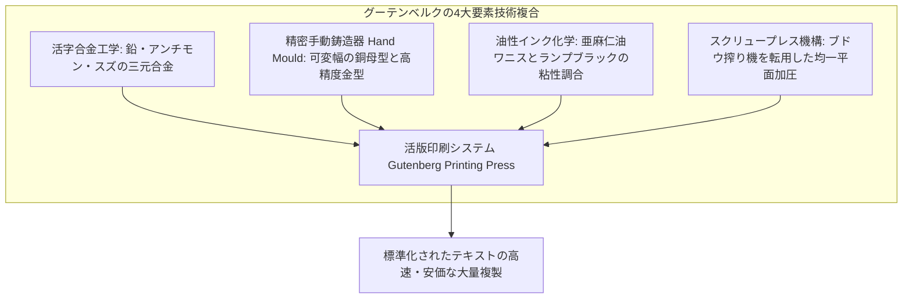

### 1.1 活字合金工学（Type Metal Metallurgy）
金属活字を作る際、鉄は融点が高すぎて加工できず、木はインクを吸って摩耗し、純鉛は柔らかすぎてプレスの圧力ですぐに潰れてしまいます。グーテンベルクは金細工師としての修行経験を活かし、冶金学的に完璧な**三元共晶合金（Type Metal）**を調合しました。

$$\text{活字合金} \approx 80\% \text{ 鉛 (Pb)} + 15\% \text{ アンチモン (Sb)} + 5\% \text{ スズ (Sn)}$$

| 合金構成元素 | 配合比率 | 工学的役割と熱力学的特性 |
| :--- | :--- | :--- |
| **鉛（Lead, Pb）** | 約 75〜80% | ベース金属。融点が比較的低く（327℃）、安価で流動性に優れる。 |
| **アンチモン（Antimony, Sb）** | 約 12〜15% | **【核心技術】液体から固体への凝固時に「体積膨張」する特異な性質**を持ち、母型の極小の隙間まで金属が行き渡り、活字の細いセリフ（ひげ飾り）をシャープに再現する。さらに合金の硬度を劇的に向上させる。 |
| **スズ（Tin, Sn）** | 約 5〜8% | 合金全体の融点を下げ（共晶点約240℃）、溶融金属の粘性を下げて鋳型への流動性を極限まで高める。また耐食性を付与する。 |

特に**アンチモンの凝固時体積膨張**の利用は、金属工学史における白眉です。通常の金属は冷えると収縮するため、鋳型の隅々まで行き届かず文字の輪郭がぼやけてしまいます。アンチモンを添加することで、冷却時にわずかに膨張し、母型に刻まれたミクロン単位の微細な彫刻を寸分違わず転写することに成功したのです。

---

### 1.2 精密調整式手動鋳造機（Adjustable Hand Mould）
数千、数万個に及ぶ活字の「高さ（Type High）」と「直角度」が完全に揃っていなければ、紙に均一な圧力をかけることはできません。1本でも高い活字があれば紙を突き破り、低い活字があれば文字がかすれます。

グーテンベルクが発明した**調整可能手動鋳造器（Hand Mould）**は、以下の精密な工程で動作しました：

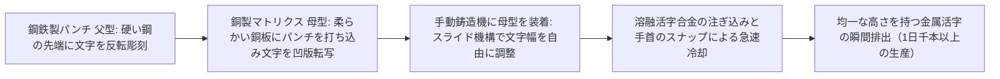

アルファベットの文字は、幅が広い文字（`M` や `W`）と、極端に細い文字（`I` や `l`）が存在します。グーテンベルクの手動鋳造器は、鋳型の横幅だけを無段階にスライド調整できるスプリング構造を備えており、あらゆる文字幅の活字を、同一の高さ・同一の深さで、熟練の職人が1分間に数本という超高速で量産することを可能にしました。

---

### 1.3 油性インク（Oil-based Ink）の化学的ブレンド
当時の写本や木版印刷で使われていたインクは、水に煤（炭素粉末）や膠（ゼラチン）を溶かした「水性インク」でした。しかし水性インクは、油膜で覆われた金属活字の表面を弾いてしまい、玉になって文字が潰れるか、紙に塗布した際に滲んでしまいます。

グーテンベルクは、初期フランドル派の油彩画技術（ヤン・ファン・エイクら）に着想を得て、**煮詰めた亜麻仁油（リンシードオイル）にテレビン油、松脂、そして高品質のランプブラック（煤）を練り込んだ高粘度の「油性インク」**を開発しました。
このインクは金属活字の表面に薄く均一に付着し、鹿皮で作ったインクボール（インキング・ドーバー）で叩くように塗布され、湿らせた紙の繊維へと強固に定着しました。500年以上経過した現代のグーテンベルク聖書を開いても、その黒色インクがなお艶やかで漆黒の輝きを失っていない理由は、この油性ワニスインクの卓越した化学的安定性にあります。

---

### 1.4 スクリュープレス機構の転用
当時のラインラント地方はワイン用ブドウの産地であり、木製の大型スクリューを用いたブドウ圧搾機（ワインプレス）やオリーブ油搾り機が普及していました。グーテンベルクはこの巨大な回転圧搾機構に目をつけ、水平な定盤（ベッド）の上に活字組版を載せ、テコ棒を回転させることで木製スクリューを締め上げ、プラテン（圧盤）によって紙全体に強力かつ均一な垂直圧力を一瞬で加える**印刷機（Printing Press）**を完成させました。

---

## 2. グーテンベルク聖書の完成と書物革命

1450年頃からマインツの工房で秘密裏に進められた印刷プロジェクトは、1455年頃、人類の印刷史の最高峰とされる**『42行聖書（Gutenberg Bible）』**として結実しました。

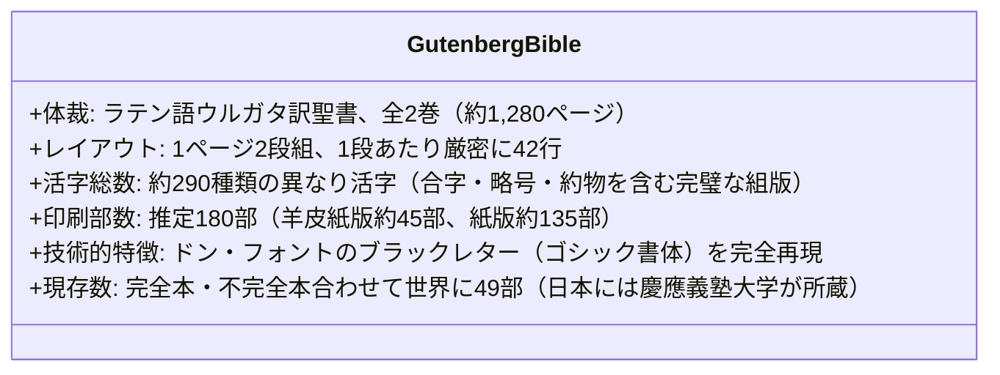

グーテンベルクは、手書き写本の優美さを損なわないため、単なる26文字のアルファベットだけでなく、中世の修道士が用いていた無数の**合字（リガチャ）や省略記号、幅の異なるスペースを290種類もの別々の活字**として鋳造し、左右のマージン（余白）がミリ単位で一直線に揃う「完全両端揃え（ジャスティフィケーション）」を実現しました。

初期の購入者であったピッコローミニ枢機卿（後のローマ教皇ピウス2世）は、友人の枢機卿への書簡でこう絶賛しています：
> 「文字は極めて明瞭で、眼鏡をかけずとも容易に読むことができる。どこにも誤りが見当たらない」

---

## 3. 知識の爆発的コスト低下：情報流通の数理モデル

活版印刷以前と以後で、書物の生産効率とコストはどの程度劇的に変化したのでしょうか。

```mermaid
graph LR
    subgraph 写本時代（1450年以前）
        Scribe[写字生による手作業の筆写] --> Slow[1冊の聖書に1年〜3年の労働]
        Slow --> HighCost[価格: 豪邸1軒分 / 生産量: 年間数千冊]
    end

    subgraph 活版印刷時代（1500年）
        Typeset[1回の活字組版] --> Fast[印刷機で1日数百枚〜千枚を印刷]
        Fast --> LowCost[価格: 数十分の1〜100分の1 / 生産量: 2000万部（インキュナブラ期）]
    end
```

### 3.1 生産関数と価格下落のオーダー
写本制作における労働投入量を $L_s$、活版印刷における固定組版時間を $T_{\text{set}}$、1枚あたりの印刷限界時間を $t_{\text{print}}$、部数を $N$ とすると、書物1冊あたりの平均生産時間 $T_{\text{avg}}(N)$ は以下のように劇的にスケーリングします。

$$T_{\text{copy}} = L_s \cdot N \quad \implies \quad \frac{T_{\text{copy}}}{N} = L_s \quad (\text{スケールメリット皆無})$$

$$T_{\text{print}}(N) = T_{\text{set}} + t_{\text{print}} \cdot N \quad \implies \quad T_{\text{avg}}(N) = \frac{T_{\text{set}}}{N} + t_{\text{print}}$$

$N \gg 100$ のとき、固定費用 $\frac{T_{\text{set}}}{N} \rightarrow 0$ となり、限界費用 $t_{\text{print}}$ のみが残ります。写字生が1ページ書くのに数時間を要したのに対し、印刷機は数秒で1ページを刷り上げました。

1450年から1500年までのわずか50年間（初期印刷本＝**インキュナブラ期: Incunabula**）に、ヨーロッパ全土の印刷工房は250都市以上に広がり、刷り出された書物の総数は**約2,000万冊**に達しました。これは、**西ローマ帝国崩壊からグーテンベルクまでの1,000年間にヨーロッパ全土で生産された全写本の総数を、わずか半世紀で凌駕した**ことを意味します。

---

## 4. 歴史的インパクトⅠ：宗教改革のロケット燃料

活版印刷がもたらした最初の世界的地殻変動が、1517年に始まる**マルティン・ルター（Martin Luther、1483–1546）の宗教改革（Reformation）**でした。

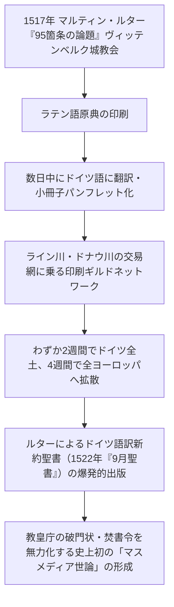

### 4.1 焚書を無力化した分散型ネットワーク
ルター以前にも、ジョン・ウィクリフやヤン・フスといった先駆的宗教改革者は存在しました。しかし彼らの思想は写本でしか伝わらなかったため、カトリック教会組織によって写本を物理的に押収・焚書され、孤立したまま異端として処刑されました。

ルターの『95箇条の論題』は全く異なる運命を辿りました。ヴィッテンベルクの印刷職人たちがこれを即座にラテン語で印刷し、さらにドイツ語の平易なパンフレット（小冊子、フリュークシュリフト）へと翻訳して刷り増したのです。数千、数万枚のパンフレットが旅商人や学生の荷物に紛れてヨーロッパ全土へ雪崩を打って運ばれました。

ローマ教皇庁が事態を把握して異端宣告を発したときには、すでに全ヨーロッパの民衆が論題を読んで議論していました。**「書物を燃やす速度より、印刷する速度のほうが圧倒的に速い」**という情報流通の逆転現象が史上初めて起きたのです。

### 4.2 ドイツ語訳聖書と「万民祭司主義」
ルターがヴァルトブルク城に潜伏中に完成させたドイツ語訳新約聖書（1522年）は、空前の大ベストセラーとなりました。聖職者を介さず、信徒一人ひとりが自らの母国語で神の言葉を直接読むという「万人祭司主義」のプロテスタンティズム教義は、印刷術という物理的複製インフラが存在して初めて成立し得た思想でした。

---

## 5. 歴史的インパクトⅡ：近代科学革命の離陸とピアレビューの誕生

科学史家エリザベス・アイゼンスタイン（Elizabeth Eisenstein）は、その記念碑的著作『印刷革命（The Printing Revolution in Early Modern Europe）』において、**活版印刷こそが近代科学革命を可能にした真の触媒である**と論証しました。

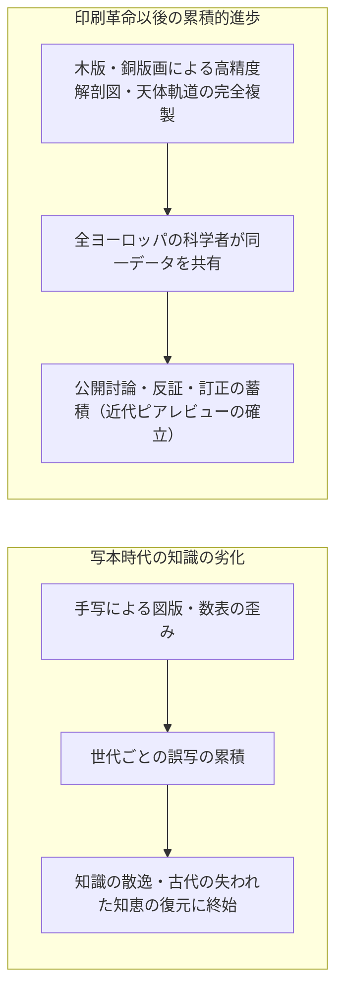

### 5.1 奇跡の年、1543年：ベサリウスとコペルニクス
近代科学の誕生を告げる2つの金字塔的書物は、奇しくも同じ**1543年**に出版されました。
1. **アンドレアス・ベサリウス『人体の構造について（ファブリカ）』**:
   精緻な木版画によって人体の骨格・筋肉・血管・神経を完璧に図解。古代の権威ガレノスの解剖学的誤りを実証的に暴いた。
2. **ニコラウス・コペルニクス『天球の回転について』**:
   地動説（太陽中心説）の数学的モデルと天体観測データを詳細な幾何学図版とともに提示。

写本時代において、複雑な幾何学図形や人体解剖図、星の運行数表を手作業で忠実に模写することは不可能でした。写字生が描き写すたびに図の比率は歪み、数値は書き間違えられ、図表は急速に劣化していきました。
活版印刷と版画技術の融合により、**ロンドン、パリ、パドヴァ、クラクフの学者たちが、1本の毛細血管の配置、1つの天体運行パラメータに至るまで、寸分違わぬ「同一のデータ」を同時に観察し、検証できるようになった**のです。

### 5.2 誤謬の修正と「自己訂正型知識体系」
印刷本には「エラッタ（正誤表: Errata）」という概念が定着しました。初版に誤りがあっても、読者の科学者から指摘を受けた著者は、第2版で数値を修正し、より高精度な観測データを上書きしていきました。
知が世代とともに退行する時代は終わり、**知が世代を超えて直線的・指数関数的に蓄積され修正されていく「近代科学の制度化」**がここに完成したのです。

---

## 6. 歴史的インパクトⅢ：言語の標準化と国民国家の形成

社会学者ベネディクト・アンダーソン（Benedict Anderson）は、名著『想像の共同体（Imagined Communities）』において、近代の「国民国家（Nation-State）」や「ナショナリズム」の起源を**「出版資本主義（Print-Capitalism）」**に見出しました。

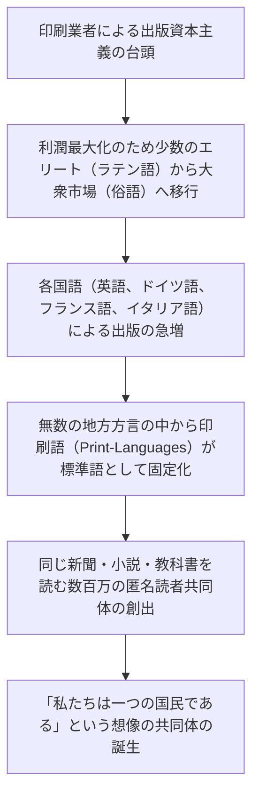

中世ヨーロッパにおいて、教養人の共通語はラテン語でした。しかしラテン語を読めるエリート層は人口の数パーセントにすぎず、印刷部数には限界がありました。初期の印刷資本家たちは、利潤を最大化するため、圧倒的多数の民衆が話す**「俗語（Vernacular Languages: 英語、ドイツ語、フランス語、スペイン語等）」**での出版へと雪崩を打ちました。

当時、地域ごとに無数に分裂していた方言（例えばロンドン方言とヨークシャー方言）の中から、印刷出版の拠点となった大都市の方言が「標準語」として活字に鋳造され、辞書や文法書を通じて固定化されました。
毎朝同じ言語で書かれた新聞を読み、同じ小説に涙する何百万人もの人々が、「顔を合わせたことはないが、私たちは一つの言葉を共有する同胞である」と自覚する――すなわち**近代の「国民（Nation）」というアイデンティティは、活版印刷というメディア技術の産物だった**のです。

---

## 7. 東アジアと西洋の比較文明論：なぜグーテンベルクだけが世界を変えたのか？

「金属活字を最初に発明したのは東アジアである」――これは歴史的事実です。

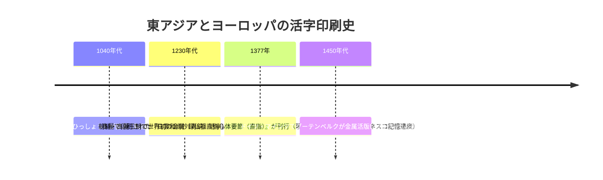

現存する世界最古の金属活字印刷本は、グーテンベルク聖書より78年も早い**1377年に高麗で印刷された『直指心体要節（仏祖直指）』**です。また中国でも宋代に畢昇が粘土活字を、元代に王禎が木活字を開発していました。

ではなぜ、東アジアの金属活字はヨーロッパのような爆発的社会革命（宗教改革や近代科学）を引き起こさず、国家や王室の限定的な事業にとどまったのでしょうか？ 比較文化史および技術経済学は、以下の決定的な相違を明らかにしています。

| 比較項目 | 東アジア（中国・朝鮮） | ヨーロッパ（グーテンベルク以後） |
| :--- | :--- | :--- |
| **文字体系の特性** | **漢字（表語文字）**: 日常的な書物の印刷に数千〜数万個の異なり文字が必要。活字鋳造と組版のコストが天文学的。 | **アルファベット（音素文字）**: わずか26文字（大文字・小文字・約物を含めても約100文字）で言語の全体系を表現可能。組版が極めて容易。 |
| **印刷機の機械化** | 平面の手摺り（バレンによる擦圧）が中心。人手による繊細な作業に依存。 | スクリュープレスによる機械的加圧。熟練を要さず、圧倒的な速度と均一圧力を実現。 |
| **インクの化学** | 水性墨（松煙墨・油煙墨）。木版や柔らかい紙には最適だが、金属活字表面では弾かれやすい。 | 油性ニスインク。金属活字に強力に定着し、濃密な漆黒を再現。 |
| **紙と素材** | 靭皮繊維（コウゾ・ガンピ・竹）による薄手でしなやかな紙。片面印刷が主流。 | 亜麻・麻ボロ布から作る厚手で強靭なラグ紙（布紙）。両面印刷に耐えうる耐久性。 |
| **経済・市場構造** | 国家・王室・官庁（鋳字都監など）による独占的管理。目的は国家正史や仏典の保存。 | 民間の印刷企業家、商業ギルド、大学、商人ネットワークによる自由な市場競争と利潤追求。 |

アルファベットの「26文字という組み合わせの圧倒的少なさ」は、活版印刷というハードウェア技術と奇跡的な相乗効果（シナジー）を生み出しました。さらに、自由都市マインツやヴェネツィアのような商業都市において、印刷職人が資本家（フーストら）から資金を調達し、大衆市場に向けて書物を売り捌く「市場経済メカニズム（出版資本主義）」が機能していたことが、ヨーロッパにおける爆発的普及を決定づけたのです。

---

---

## 8. 出版文化の開花：アルドゥス・マヌティウスと「ポケット判」の革命

グーテンベルクの聖書は、巨大なフォリオ判（二つ折り）の重厚な書物であり、教会の説教壇や貴族の書斎机の上に固定して読むものでした。この書物を「日常的に持ち歩けるメディア」へと進化させたのが、ヴェネツィアの印刷出版者**アルドゥス・マヌティウス（Aldus Manutius、1449–1515）**です。

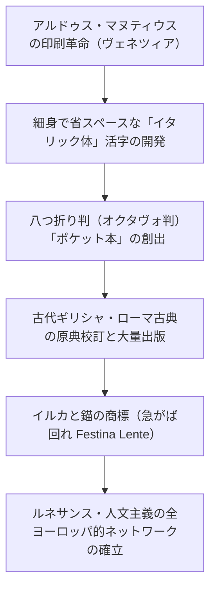

### 8.1 オクタヴォ判（ポケット本）とイタリック体の開発
アルドゥスは1501年、紙を3回折って8枚（16ページ）を作る**オクタヴォ判（Octavo）**を採用し、現代の文庫本や新書に匹敵する携帯可能な小型本を世に送り出しました。
さらに、限られた紙面に多くの文字を詰め込むため、書体設計師フランチェスコ・グリッフォに命じて、筆記体の流麗さを取り入れた細身の傾斜活字**「イタリック体（Italic）」**を世界で初めて開発しました。
このイタリック体のポケット本によって、ギリシャ・ローマの古典文学や哲学書が、旅行中の学者や商人の懐に入れられ、ヨーロッパ中を駆け巡ることになったのです。アルドゥスの工房にはオランダの人文学者エラスムスら当代一流の知識人が集い、初期近代ヨーロッパの知性ネットワークの心臓部となりました。

---

## 9. 知識の統制と検閲：カトリック教会の「禁書目録」との闘争

情報の爆発的拡散は、既存の権力構造との間で激しい摩擦を引き起こしました。宗教改革に危機感を募らせたローマ教皇庁は、印刷術の力を逆手に取った厳格な情報統制に乗り出します。

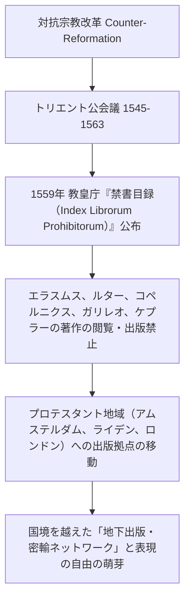

教皇庁が公布した『禁書目録（インデックス）』は、異端とみなされた神学書だけでなく、ガリレオの『天文対話』やデカルト、ヴォルテール、ルソーらの哲学・科学書を厳しく禁止しました。
しかし、活版印刷という分散型ネットワークを国家や教会が一元的に遮断することは不可能でした。カトリック圏で発禁となった書物は、出版の自由を保障したネーデルラント連邦共和国（オランダのアムステルダムやライデン）の印刷業者によって秘密裏に出版され、海路や密輸網を通じてヨーロッパ全土へと再流入しました。検閲への対抗運動そのものが、後の「言論・出版の自由（Freedom of the Press）」という近代民主主義の根幹思想を鍛え上げたのです。

---

## 10. 日本における印刷の歴史：キリシタン版と江戸の木版文化

日本における印刷の歩みもまた、グーテンベルクの技術と極めて興味深い交差を見せています。

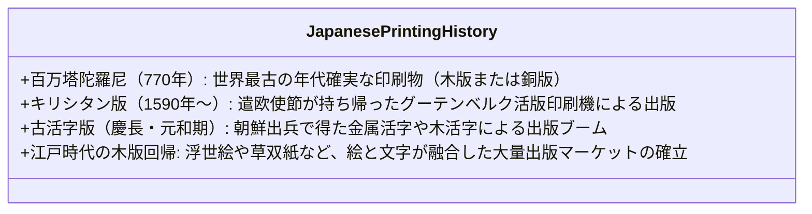

1590年、天正遣欧使節がヨーロッパから帰国した際、彼らはグーテンベルク式の**活版印刷機**を日本に持ち帰りました。イエズス会によって長崎の加津佐や天草で印刷されたこれらは**「キリシタン版（吉利支丹版）」**と呼ばれ、『平家物語』や『伊曽保物語（イソップ寓話）』、ラテン語・日本語辞書などがローマ字や漢字活字で印刷されました。

しかし、徳川幕府のキリシタン禁教令と鎖国政策により、活版印刷機は没収・破壊され、日本における西洋式活版印刷はいったん途絶します。
その後の江戸時代、日本は独自の**「木版印刷（ウッドブロック）」**を極限まで洗練させました。葛飾北斎や歌川広重の浮世絵に見られる多色摺り技術や、黄表紙・草双紙のように絵と文字が自由自在に組み合わさった出版文化は、固定的な四角い活字組版にはない柔軟性を持ち、江戸の町人層に驚異的な読書熱と高い識字率をもたらしました。日本が再び活版印刷を本格導入するのは、幕末から明治維新（本木昌造による近代活版の創始）を待つことになります。

## 11. グーテンベルク銀河系からデジタル情報社会、そしてAIへ

20世紀のメディア論の巨星マーシャル・マクルーハン（Marshall McLuhan）は、その著書『グーテンベルクの銀河系（The Gutenberg Galaxy）』において、活版印刷が人間の知覚と精神構造そのものを再配線したと喝破しました。文字が直線的に並ぶ「活字文化」は、人間の思考を**線形性、論理的分析、抽象化、個人主義**へと導いたというのです。

現代の私たちは、活版印刷以来の巨大な情報技術の転換点に生きています。

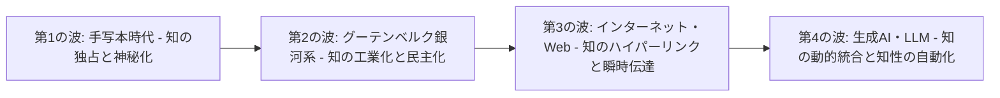

1. **複製の限界費用ゼロ**: 活版印刷が写本コストを99%下げたように、デジタル通信とインターネットは限界費用を文字通り「ゼロ」に落としました。
2. **インフォデミックと真理の危機**: 活版印刷の導入直後、魔女狩りの手引書『魔女に与える鉄槌』や過激な宗教論争パンフレットが全欧に溢れかえり、宗教戦争（三十年戦争）の惨禍を招きました。情報の爆発的拡散は、常にフェイクニュースや社会的分断という副作用を伴います。
3. **AIによるテキスト生成の自動化**: グーテンベルクが「文字の複製」を機械化したのに対し、現代の大規模言語モデル（LLM）は「思考と文脈の生成」そのものを機械化しようとしています。

---

---

## 12. 活版印刷を支えた「紙の革命」：麻ボロ布から水力製紙ミルへ

活版印刷の成功は、活字やインク、印刷機というメカニズムだけで達成されたものではありません。それらを受け止める**「安価で強靭な紙の大量供給」**という素材革命が不可欠の前提条件でした。


### 12.1 羊皮紙の物理的限界
もし中世の書物の主材料であった羊皮紙（パーチメント）しか存在しなければ、グーテンベルクの印刷機は稼働できませんでした。聖書1部を刷るだけで約170〜300頭分の羊や子牛の皮が必要であり、仮に数万冊を印刷しようとすればヨーロッパ中の家畜が絶滅してしまいます。

### 12.2 水力スタンピングミルとボロ布紙（ラグ紙）
13世紀にイスラム世界からイベリア半島やイタリア（ファブリアーノ）へと伝わった製紙技術は、アルプスを越えてライン川流域へと普及しました。水車動力を利用して麻ボロ布を叩き潰す「水力製紙ミル（Stamp Mill）」の実用化により、植物繊維（セルロース）を均一に絡み合わせた高品質な「布紙（ラグペーパー）」が水車小屋で大量生産されるようになりました。
動物性の膠（ゼラチン）で表面をコーティング（サイジング）することで、油性インクが裏面に染み出すのを防ぎ、一枚の紙の両面に鮮明に活字を押し付ける「両面印刷」が可能となったのです。紙という安価な素材インフラが整っていたからこそ、活版印刷の爆発的スケールメリットが現実のものとなりました。

## 13. 結論：知識をすべての人類へ

グーテンベルクの活版印刷工房が放った閃光は、中世の暗闇を照らし、近代という世界を切り拓きました。

金属の小さな角柱に刻まれた一文字一文字が組み合わされ、黒い油性インクを纏って白い紙へと押し付けられたその瞬間、知識は特権階級の牢獄を破り、広場へと解き放たれました。それは自由な精神、批判的理性、そして民主主義という名の果実を実らせるための、何物にも代えがたい大地となったのです。

活字という小さな鉛の粒が紡ぎ出した知識革命の精神は、媒体が紙からシリコン、そしてニューラルネットワークへと姿を変えた今もなお、人類のあらゆる知の営みの中に脈々と息づいています。


グーテンベルクが点火した活版印刷の灯火は、知識を一部の特権から万人の共有財産へと変革し、現代にいたるあらゆる知的自由と科学的進歩の揺るぎない土台であり続けているのです。
