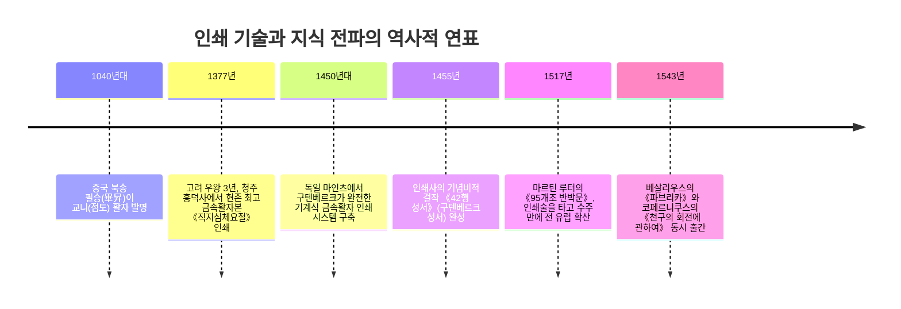
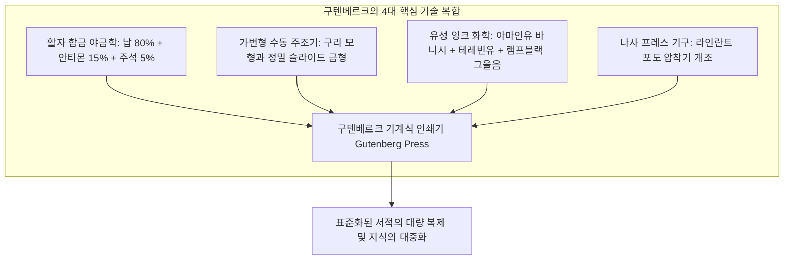

17세기 초 근대 경험론 철학의 선구자 프랜시스 베이컨은 저서 《신기관(Novum Organum)》에서 이렇게 단언했습니다.

"인쇄술, 화약, 나침반—이 세 가지 발명만큼 전 세계의 양상과 상태를 뒤바꾼 것은 없다. 어떤 제국도, 어떤 종파도, 어떤 별자리도 이 기계적 발견들보다 인간사에 더 큰 힘과 영향을 미치지 못했다."

1450년경 독일 마인츠의 금세공사 요하네스 구텐베르크(Johannes Gutenberg, c. 1400–1468)가 완성한 **가동식 금속활자 인쇄술**은 인류가 경험한 가장 위대하고 결정적인 '정보 혁명'이었습니다.

인쇄술 이전의 지식은 수도원 필사실과 귀족 서재에 갇힌 극소수의 신성한 특권이었습니다. 성경 한 권을 필사하려면 양 수백 마리의 가죽(양피지)과 필사공의 수개월~수년간의 고된 노동, 그리고 농장 한 채에 맞먹는 막대한 재산이 필요했습니다. 필사 과정에서 오류는 세대를 거듭하며 누적되었고 지식은 언제나 소실될 위험에 처해 있었습니다.

구텐베르크의 인쇄술은 책의 생산 비용을 99% 이상 폭락시켰습니다. 반세기 만에 2천만 권의 서적이 유럽 전역으로 쏟아져 나오며 마르틴 루터의 종교개혁을 순식간에 확산시켰고, 코페르니쿠스와 베살리우스의 근대 과학 혁명을 촉발했으며, 표준화된 국민 언어와 근대 시민사회를 탄생시켰습니다.

---

## 1. 구텐베르크의 '기술 복합': 다학제 공학 융합의 기적

구텐베르크의 위대함은 단순히 활자를 만든 데 있지 않고, **야금학, 정밀 기계가공, 화학 잉크, 나사식 프레스**라는 서로 다른 분야의 기술을 완벽한 양산 시스템으로 엮어낸 '기술 복합(Technological Convergence)'에 있었습니다.

### 1.1 활자 합금의 재료공학
철은 녹는점이 너무 높아 주조가 어렵고, 나무는 잉크를 흡수해 마모되며, 순수한 납은 너무 물러 프레스 압력에 뭉개집니다. 구텐베르크는 **납(약 80%), 안티몬(약 15%), 주석(약 5%)의 삼원공정합금(Type Metal)**을 완성했습니다.
핵심은 **안티몬(Antimony)**의 물리적 특성이었습니다. 대부분의 금속은 냉각 시 수축하지만, 안티몬은 **응고 시 부피가 미세하게 팽창**하는 특이한 성질을 지닙니다. 이 팽창력 덕분에 쇳물이 구리 모형의 극미한 홈까지 파고들어 고딕 서체의 섬세한 세리프(장식선)를 한 치의 오차 없이 재현해 내고 활자의 경도를 비약적으로 높였습니다.

### 1.2 가변형 수동 주조기 (Adjustable Hand Mould)
문자마다 폭이 천차만별인 알파벳(좁은 `i`와 넓은 `W`)을 동일한 활자 높이(Type-High)로 대량 생산하기 위해, 구텐베르크는 폭을 자유롭게 조절할 수 있는 슬라이딩 구조의 수동 주조기를 발명했습니다. 숙련공 한 명이 하루에 2천 개 이상의 활자를 균일하게 찍어낼 수 있었습니다.

### 1.3 유성 잉크와 스크루 프레스
기존의 수성 먹물은 금속 활자 표면에서 겉돌며 뭉치기 일쑤였습니다. 구텐베르크는 끓인 **아마인유(Linseed Oil) 바니시에 송진과 그을음(램프블랙)**을 정밀 배합하여 금속 표면에 얇게 밀착되고 종이 섬유에 번짐 없이 흡수되는 고점도 유성 잉크를 개발했습니다.
여기에 포도주 압착기의 스크루 메커니즘을 응용하여, 레버를 한 번 당기는 것만으로 수천 파운드의 수직 압력을 활자판 전체에 균일하게 가하는 인쇄기를 완성했습니다.

---

## 2. 출판 자본주의와 종교개혁의 폭풍

1517년 마르틴 루터가 비텐베르크 성 교회 문에 《95개조 반박문》을 내걸었을 때, 이전의 위클리프나 후스의 개혁 운동과 달리 이 문서는 결코 은폐될 수 없었습니다.

독일 각지의 인쇄업자들은 대중의 폭발적인 관심을 간파하고 라틴어 반박문을 즉시 독일어로 번역하여 수만 장의 소책자(Flugschriften)로 찍어냈습니다. 문서는 2주 만에 독일 전역으로, 4주 만에 전 유럽으로 퍼져나갔습니다. **"인쇄기가 책을 찍어내는 속도가 교회가 책을 불태우는 속도보다 빨랐던"** 것입니다.

---

## 3. 근대 과학 혁명의 촉매: 오류 수정과 지식의 누적

엘리자베스 아이젠스타인이 증명했듯, 인쇄술은 지식의 전승 방식을 근본적으로 바꾸었습니다.
1543년 출간된 **베살리우스의 《인체의 구조에 대하여(파브리카)》**와 **코페르니쿠스의 《천구의 회전에 관하여》**는 정밀한 목판 삽화와 기하학적 궤도 계산을 유럽 전역의 학자들에게 일점일획의 오차 없이 동시에 전달했습니다.

필사본 시대에는 필사를 거듭할수록 해부도와 천문 수표가 왜곡되어 지식이 퇴화했지만, 인쇄본 시대에는 **정오표(Errata)**를 통해 오류를 집단적으로 수정하고 다음 판본에서 더 높은 정확도로 갱신하는 '자기교정적 근대 과학 시스템'이 확립되었습니다.

---

## 4. 동서양 비교: 구텐베르크는 왜 세계사를 바꿨는가?

고려 왕조는 구텐베르크 성서보다 78년 앞선 **1377년 청주 흥덕사에서 금속활자본 《직지심체요절》**을 인쇄했습니다. 그러나 동아시아의 금속활자는 유럽과 같은 폭발적 사회 변혁을 일으키지 못했습니다.

1. **문자 수의 차이**: 수천~수만 자의 한자는 활자 주조와 조판 비용이 천문학적이어서 소량 인쇄에는 오히려 목판(목판본)이 경제적이었습니다. 반면 알파벳은 단 **26자**로 모든 언어 표현이 가능하여 조판이 비약적으로 간단했습니다.
2. **기계화와 시장 메커니즘**: 동아시아의 인쇄는 왕실과 관청(주자소) 주도의 국사 편찬이나 불경 보존 목적이었으나, 유럽은 자유도시의 인쇄업자들이 대중 시장을 상대로 이윤을 추구하는 **'출판 자본주의'** 네트워크를 형성했습니다.

구텐베르크가 지핀 인쇄술의 불꽃은 지식을 권력의 독점에서 인류 만인의 공유 자산으로 해방시켰으며, 현대의 디지털 지식 사회로 이어지는 인류 지성의 영원한 도약대가 되었습니다.
