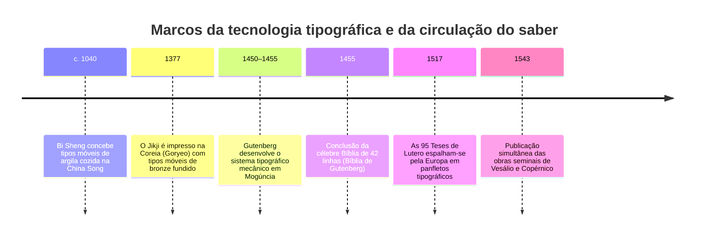
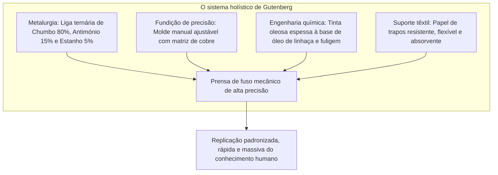
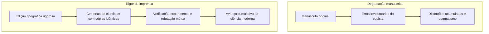

Nos primórdios do século XVII, o eminente filósofo e ensaísta britânico Francis Bacon proclamou em *Novum Organum* uma constatação fundamental: três invenções mecânicas haviam modificado radicalmente a face de todo o globo terrestre e a ordem social humana — a imprensa de tipos móveis, a pólvora e a bússola magnética. Nenhuma autoridade imperial, corrente dinástica ou seita religiosa exerceu poder transformador mais profundo sobre os destinos da civilização do que estas conquistas da engenharia prática.

Por volta de 1450, na cidade renana de Mogúncia (Mainz), o mestre ourives **Johannes Gutenberg** (c. 1400–1468) materializou um conjunto tecnológico articulado: a imprensa mecânica de tipos móveis metálicos fundidos, inaugurando a era seminal da circulação democrática do saber.

Antes da imprensa, os livros manuscritos constituíam bens sumptuosos e raros, reservados aos claustros monásticos e às cortes reais. A cópia manual de uma Bíblia integral sobre pergaminho exigia o labor exaustivo de escribas profissionais durante meses ou anos a fio. O custo de um exemplar avulso rivalizava com a posse de uma propriedade agrária inteira. Além disso, cada nova transcrição manuscrita introduzia inadvertidamente falhas ortográficas, supressões de parágrafos e deturpações exegéticas.

Ao integrar processos mecânicos, metalúrgicos e químicos, Gutenberg derrubou o custo marginal da replicação textual em mais de 99 %, estabelecendo as fundações da Reforma Protestante, da Revolução Científica e da formação dos Estados-nação modernos.

---

## 1. O complexo técnico de Gutenberg: A convergência sinérgica de quatro tecnologias

O feito histórico de Gutenberg não consistiu na simples ideia dos caracteres móveis, mas sim na **integração sinérgica e impecável de quatro ramos da técnica aplicada**:

### 1.1 A metalurgia de precisão: A singularidade do antimónio
Para resistir a milhares de pancadas sob elevadíssima compressão vertical sem se esmagar, o tipo tipográfico necessitava de grande dureza, mas devia apresentar ponto de fusão moderado para permitir o vazamento repetido em oficina. Gutenberg formulou uma liga ternária de excelência:
- **Chumbo ($Pb$, aprox. 75–80 %)**: Metal abundante, dúctil e de fusão facilitada ($327^\circ\text{C}$).
- **Estanho ($Sn$, aprox. 5–10 %)**: Reduz a temperatura de fusão da mistura e confere excelente fluidez hidrodinâmica.
- **Antimónio ($Sb$, aprox. 15–20 %)**: O grande segredo físico-químico da formulação.

A generalidade dos metais sofre contração volumétrica durante a solidificação. O antimónio, pelo contrário, exibe a propriedade excecional de **expansão volumétrica ao cristalizar**. Esta dilatação microscópica empurra a massa líquida em fusão contra cada reentrância e detalhe da matriz de cobre entalhada, reproduzindo com fidelidade cirúrgica as mais delicadas serifas góticas e garantindo dureza extrema à face tipográfica.

### 1.2 O molde manual ajustável (Hand Mould)
Na caligrafia ocidental, a largura dos caracteres varia drasticamente: a letra `i` ou um ponto ocupam um espaço milimétrico, enquanto letras como `M` ou `W` requerem uma base larga.

Gutenberg concebeu um molde de duas secções móveis em aço endurecido, encaixadas em forma de L:
- Um punção de aço com a letra gravada em relevo invertido era percutido contra uma barra de cobre para gerar a **matriz**.
- A matriz era instalada na base do molde através de uma mola flexível.
- As duas metades ajustavam-se milimetricamente conforme a largura precisa do caractere pretendido.
- O fundidor deitava o metal fundido e aplicava um golpe de pulso ascendente rápido, forçando o líquido para o fundo da matriz pela inércia mecânica.
- O molde abria-se instantaneamente libertando o tipo rígido e frio. Um artífice perito fundia entre 2.000 e 3.000 tipos por jornada de trabalho.

### 1.3 A tinta oleosa e a prensa de rosca
As tintas caligráficas medievais eram aquosas. Sobre a superfície oleosa e lisa do chumbo fundido, a água formava gotículas disformes por efeito da tensão superficial, escorrendo e borrando o pergaminho.

Gutenberg recorreu às inovações da pintura a óleo flamenga: cozinhou **óleo de linhaça com resinas de pinho e fuligem pura de candeia**, criando uma tinta viscosa, aderente e de secagem oxidativa que se fixava perfeitamente no chumbo e penetrava sem sangrar nas fibras do papel umedecido.

---

## 2. O capitalismo de imprensa e a propagação meteórica da Reforma

Em 31 de outubro de 1517, Martinho Lutero afixou em Wittenberg as suas 95 Teses contra o comércio de indulgências. Embora redigidas em latim para um debate estritamente universitário, tipógrafos atentos traduziram o texto de imediato para a língua alemã vernácula, imprimindo milhares de panfletos rápidos (*Flugschriften*).

Herésias e propostas reformistas prévias, como as de John Wyclif ou Jan Hus, haviam sido extirpadas fisicamente pela queima inquisitorial dos poucos manuscritos existentes. Perante a imprensa comercial, o mecanismo de censura faliu por completo:
- **Velocidade industrial**: Antes que a Cúria Romana pudesse redigir a bula de condenação papal, prensas espalhadas por Basileia, Nuremberga e Estrasburgo já haviam distribuído dezenas de milhares de exemplares.
- **Indústria descentralizada**: As oficinas tipográficas operavam em regime de mercado livre, motivadas pela imensa procura popular.
- A tradução luterana do Novo Testamento em alemão esgotou sucessivas edições, fixando a língua alemã moderna e inaugurando uma esfera pública incontrolável pelo clero tradicional.

---

## 3. O desabrochar da Revolução Científica: Conhecimento cumulativo e escrutinável

Conforme argumentou a historiadora Elizabeth Eisenstein em obras clássicas, a ciência moderna depende intimamente da fixação e reprodutibilidade do documento impresso.

### 3.1 A anulação do declínio entrópico do texto
Na cultura dos códices manuscritos, qualquer compêndio sofria deterioração progressiva a cada cópia sucessiva:
- Os diagramas de geometria sofriam distorções de escala.
- Os desenhos de anatomia perdiam o traçado original dos tecidos e vasos.
- As tábuas numéricas de astronomia acumulavam erros aritméticos fatais para a navegação transoceânica.

Graças à tipografia e à gravura metálica/xilográfica estandardizada, cientistas dispersos por todo o continente podiam confrontar os exatos mesmos dados empíricos, permitindo a refutação metodológica, o debate paritário e o avanço cumulativo ininterrupto.

### 3.2 O ano divisor de águas de 1543: Vesálio e Copérnico
Em 1543, a emergência da ciência empírica moderna atingiu o seu ápice com duas publicações fundamentais:
1. **André Vesálio: *De humani corporis fabrica*** (Basileia): Substituiu a autoridade imutável de Galeno através de dissecações anatómicas diretas, reproduzidas com rigor absoluto em gravuras xilográficas de alunos de Ticiano.
2. **Nicolau Copérnico: *De revolutionibus orbium coelestium*** (Nuremberga): Desafiou a cosmologia geocêntrica ptolemaica com complexos modelos matemáticos e tabelas trigonométricas que só a precisão dos tipos móveis podia resguardar de erros de cópia.

---

## 4. Análise histórica comparativa: O paradoxo euro-asiático

Embora os tipos móveis de metal tenham sido criados na Coreia (século XIII, com o notável *Jikji* em 1377) e os caracteres móveis cerâmicos na China de Bi Sheng (século XI), a revolução da imprensa disseminou-se com maior intensidade na Europa ocidental.

| Vetor de análise | Ásia Oriental (China / Coreia) | Europa Ocidental (Gutenberg) |
| :--- | :--- | :--- |
| **Sistema de escrita** | Ideográfico/Logográfico (+30.000 sinogramas) | Alfabético latino (26 a 30 caracteres) |
| **Investimento fixo inicial** | Descomunal: fundição de dezenas de milhares de tipos | Mínimo: 200–300 matrizes de tipos intercambiáveis |
| **Tecnologia concorrente** | Xilografia em bloco de madeira altamente eficiente | Cópia manuscrita lenta, cara e inacessível |
| **Ambiente político** | Monarquias centralizadas com monopólios estatais | Competição mercantil descentralizada entre cidades e Estados |
| **Tinta e suporte** | Tinta de água sobre papel de arroz por fricção suave | Tinta de óleo sobre papel de trapos sob prensa de parafuso |

O alfabeto fonético latino, devido à escassez de caracteres necessários para compor qualquer texto imaginável, tornou a tipografia de tipos móveis extraordinariamente rentável no espaço europeu.

---

## 5. O legado eterno de Gutenberg

A despeito de Johannes Gutenberg ter falecido em 1468 desprovido de fortuna após contenciosos jurídicos com o financista Johann Fust, a sua invenção transformou o destino humano de forma irrevogável. A liberdade de pensamento, o espírito crítico, a universidade contemporânea e os próprios alicerces da civilização digital encontram as suas raízes nos tipos metálicos forjados em Mogúncia há mais de quinhentos anos.
