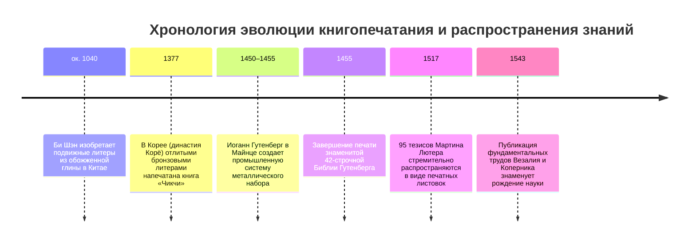
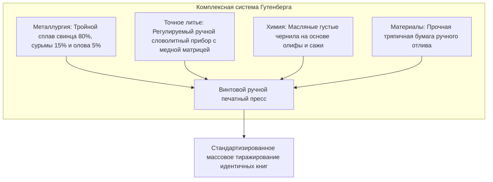
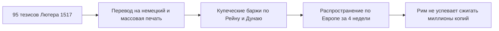
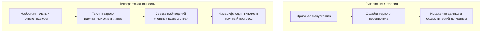

В начале XVII века выдающийся английский философ Фрэнсис Бэкон в трактате *«Новый Органон»* сформулировал наблюдение, определившее понимание человеческого прогресса: три великих изобретения полностью изменили облик и состояние всего известного мира — книгопечатание, порох и магнитный компас. Никакая империя, никакая династия и никакое религиозное учение не оказали большего преобразующего воздействия на дела человеческие, чем эти практические механические новшества.

Около 1450 года в Майнце немецкий ювелир и изобретатель **Иоганн Гутенберг** (ок. 1400–1468) создал целостную систему механической печати подвижными металлическими литерами. Это эпохальное событие открыло эру массовой коммуникации и стало фундаментом современного западного общества.

До изобретения Гутенберга книги были баснословно дорогими рукописными артефактами, сосредоточенными в монастырских скрипториях, сокровищницах королей и университетах. Переписка одного экземпляра Библии на пергаменте требовала месяцев кропотливого труда каллиграфа. Стоимость одного манускрипта равнялась цене крупного сельскохозяйственного поместья или городского особняка. Более того, при каждом новом переписывании неминуемо накапливались ошибки, пропуски и искажения текста, превращая накопление знаний в процесс постепенной энтропийной деградации.

Гутенберг объединил металлургию, химию и прецизионную механику, снизив предельную стоимость тиражирования текстов более чем на 99 %. Это разрушило информационную монополию Рима, вызвало религиозную Реформацию и обеспечило триумф научной революции.

---

## 1. Технологический комплекс Гутенберга: Слияние четырех ремесел

Величие Гутенберга заключалось не просто в абстрактной идее подвижных литер, а в **системной интеграции четырех ключевых инженерных технологий**, ранее существовавших совершенно независимо друг от друга:

### 1.1 Металлургия типографского сплава: Физическая аномалия сурьмы
Типографская литера должна отвечать двум взаимоисключающим требованиям: иметь низкую температуру плавления для быстрого серийного литья в мастерской и обладать исключительной механической прочностью, чтобы выдерживать тысячи ударов под прессом без деформации.

Гутенберг подобрал оптимальный тройной сплав (гарт):
- **Свинец ($Pb$, ок. 75–80 %)**: Пластичная, дешевая основа с невысокой температурой плавления ($327^\circ\text{C}$).
- **Олово ($Sn$, ок. 5–10 %)**: Понижает общую температуру плавления и улучшает жидкотекучесть сплава.
- **Сурьма ($Sb$, ок. 15–20 %)**: Главная металлургическая инновация Гутенберга.

Подавляющее большинство металлов при переходе из жидкого состояния в твердое сжимается в объеме. Сурьма же обладает редчайшим физическим свойством: **при кристаллизации она расширяется в объеме**. Это микровзрывное расширение заставляет жидкий металл с огромной силой впрессовываться в мельчайшие бороздки медной матрицы, идеально воспроизводя тончайшие засечки и завитки готического шрифта. Кроме того, сурьма придает сплаву высокую твердость и износостойкость.

### 1.2 Регулируемый ручной словолитный прибор
В латинском алфавите буквы обладают разной шириной кегля: узкая буква `i` занимает минимальное пространство, тогда как буквы `M` или `W` требуют широкого основания.

Гутенберг изобрел двухсекционный раздвижной **ручной словолитный прибор (Hand Mould)**:
1. Закаленный стальной пуансон с зеркально вырезанной буквой вбивался в полоску мягкой меди, формируя углубленную **матрицу**.
2. Матрица фиксировалась на дне формы пружинящей стальной скобой.
3. Мастер регулировал две L-образные скользящие половинки под точную ширину отливаемой буквы.
4. Расплавленный сплав заливался ложкой в воронку, после чего литейщик совершал резкое встряхивание рукой вверх — инерция загоняла тяжелый металл в самую глубину матрицы.
5. При нажатии на пружину форма раскрывалась, выбрасывая готовую литеру с идеальной геометрией. Опытный литейщик изготавливал от 2 000 до 3 000 литер в день.

### 1.3 Масляная краска и печатный пресс
Традиционные чернила средневековых писцов делались на водной основе (железо-галловые). На гладкой металлической поверхности свинцовой литеры вода сворачивалась в капли из-за высокого поверхностного натяжения, растекаясь грязными пятнами при прижатии к пергаменту.

Гутенберг заимствовал методы фламандской масляной живописи: он варил **льняное масло с добавлением сосновой канифоли и чистой ламповой сажи**, получив густую, тиксотропную типографскую краску. Она ровно покрывала металлический рельеф литер и мгновенно закреплялась в волокнах увлажненной тряпичной бумаги.

---

## 2. Печатный капитализм и стремительное пламя Реформации

31 октября 1517 года монах и богослов Мартин Лютер обнародовал в Виттенберге свои «95 тезисов» против торговли папскими индульгенциями. Хотя сочинение предназначалось для строго академической богословской дискуссии на латыни, местные типографы мгновенно перевели тезисы на немецкий язык и напечатали их тысячными тиражами в виде летучих листков (*Flugschriften*).

Предыдущие движения за реформу церкви (Джон Уиклиф в Англии, Ян Гус в Чехии) были подавлены папством путем физического изъятия и сожжения единичных рукописей. 

Против печатного станка инквизиция оказалась бессильна:
- **Скорость репликации**: Пока папская булла о предании анафеме готовилась в Риме, десятки типографий в Нюрнберге, Базеле, Лейпциге и Страсбурге уже распространили сотни тысяч копий лютеровских манифестов.
- **Децентрализация рынка**: Типографское дело развивалось как частное капиталистическое предприятие, движимое коммерческой прибылью и читательским спросом.
- Немецкий перевод Нового Завета, выполненный Лютером в 1522 году, был мгновенно раскуплен, заложив основу современного общенемецкого литературного языка.

---

## 3. Рождение научной революции: Кумулятивное и верифицируемое знание

Выдающийся историк Элизабет Эйзенштейн убедительно показала, что рождение современной науки было бы абсолютно невозможно без типографской стандартизации текстов.

### 3.1 Преодоление рукописной энтропии
В рукописную эпоху знания неизбежно деградировали от копии к копии:
- Искажались углы и пропорции геометрических чертежей.
- Анатомические атласы теряли точность расположения сосудов и нервов.
- Астрономические таблицы и каталоги звезд наполнялись описками уставших переписчиков.

Ученые тратили всю жизнь на текстологическую критику и попытки восстановить испорченные фрагменты Аристотеля или Галена. С появлением типографики и точной ксилографии ученые по всей Европе получили доступ к абсолютно идентичным наборам данных, что позволило проверять гипотезы, выявлять ошибки и накапливать эмпирический опыт.

### 3.2 1543 год: Везалий и Коперник
1543 год стал поворотным моментом в мировой науке благодаря выходу двух печатных шедевров:
1. **Андреас Везалий: *«О строении человеческого тела»* (*De humani corporis fabrica*)**: Книга напечатана в Базеле Иоганном Опорином. Основанная на реальных анатомических вскрытиях, она опровергла догмы Галена благодаря великолепным анатомическим гравюрам школы Тициана.
2. **Николай Коперник: *«О вращении небесных сфер»* (*De revolutionibus orbium coelestium*)**: Напечатана в Нюрнберге Иоганном Петреем. Гелиоцентрическая модель вселенной опиралась на математические таблицы, которые только печатный набор мог воспроизвести без единой численной ошибки.

---

## 4. Всемирно-историческое сравнение: Почему Европа, а не Восточная Азия?

Подвижные металлические литеры были изобретены в Корее (династия Корё, нач. XIII века, трактат «Чикчи» 1377 г.) более чем за 70 лет до Гутенберга, а глиняные литеры Би Шэна в Китае появились еще в XI веке. Почему же взрывной переворот произошел именно в Европе?

| Параметр сравнения | Восточная Азия (Китай, Корея) | Западная Европа (система Гутенберга) |
| :--- | :--- | :--- |
| **Система письменности** | Иероглифика (более 30 000 знаков) | Латинский алфавит (26–30 букв) |
| **Капитальные затраты** | Колоссальные: отливка десятков тысяч иероглифов | Минимальные: 200–300 матриц букв и знаков |
| **Конкурирующая техника** | Сверхэффективная деревянная ксилография | Дорогая и медленная ручная переписка |
| **Политическая модель** | Централизованная империя с государственной монополией | Политическая раздробленность и коммерческая конкуренция |
| **Краска и механика** | Водная тушь, ручное притирание без пресса | Масляная краска, мощный винтовой деревянный пресс |

Для иероглифической письменности ксилография (гравировка целой деревянной доски на страницу) оставалась гораздо более экономичной: доски можно было хранить веками и печатать по мере надобности малые тиражи. Напротив, алфавитная система европейских языков сделала механический набор металлическими литерами идеальным экономическим решением.

---

## 5. Заключение: Бессмертное наследие Гутенберга

Иоганн Гутенберг умер в 1468 году в бедности, потеряв мастерскую в судебных тяжбах со своим кредитором Иоганном Фустом. Однако запущенный им механизм изменил траекторию развития цивилизации. От ручного словолитного прибора до цифровых сетей XXI века подвижные металлические литеры Гутенберга стали несокрушимым материальным фундаментом свободы слова, критического мышления и всеобщего образования.
