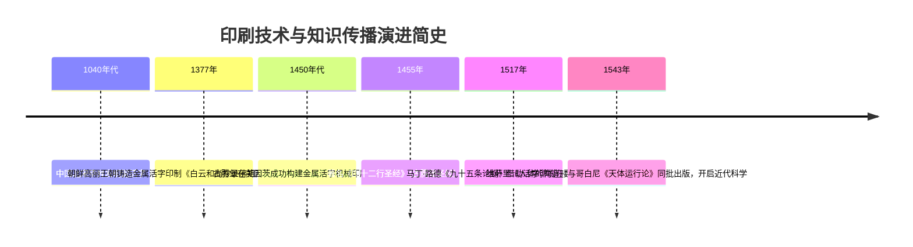
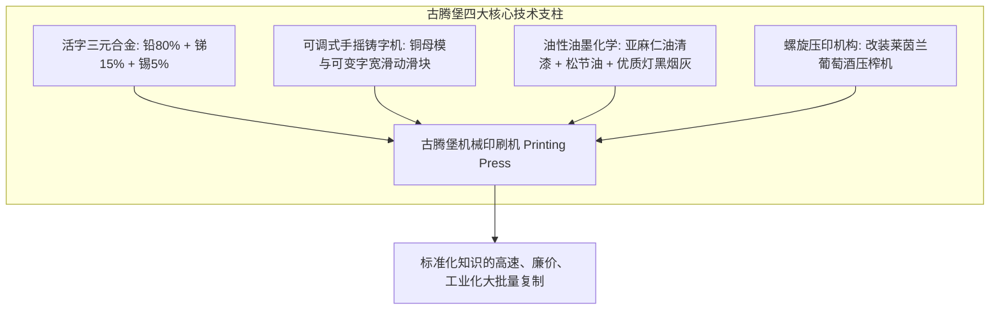
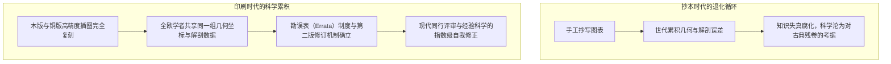

17世纪初，近代经验主义哲学的开创者弗朗西斯·培根在《新工具》中写道：印刷术、火药与指南针这三项发明改变了整个世界的面貌与状态。没有任何帝国、教派或星宿能比这些机械发明对人类事务产生更大的力量与影响。

1450年左右，德意志美因茨的金匠约翰内斯·古腾堡（Johannes Gutenberg，约1400–1468）实现的**金属活字印刷系统**，拉开了人类历史上最深远的一次“信息革命”的帷幕。

在印刷术问世之前，书籍是由修道院抄写员耗费数月甚至数年用羊皮纸手工抄写的奢侈品，价格等同于一座庄园。抄写错误代代累积，知识极度匮乏且被教会高度垄断。古腾堡通过一系列关键技术的集成，使书籍生产成本断崖式暴跌超99%，在短短半个世纪内印刷了2000万册图书，点燃了宗教改革的风暴，推动了近代科学革命的腾飞，催生了民族国家与现代公众社会。

---

## 1. 古腾堡的“技术复合”：多学科工程的惊人整合

古腾堡的伟大并非孤立发明了活字，而是实现了**“冶金学、机械学、化学配方与纸张工艺的大综合”**：

### 1.1 活字合金的材料科学
金属活字必须承受成千上万次压印而不变形，同时熔点不能过高以便快速浇铸。古腾堡配制了**铅（约80%）、锑（约15%）、锡（约5%）的三元共晶合金**。
最精妙之处在于**锑（Antimony）**的应用：绝大多数金属在冷却凝固时体积收缩，而锑在凝固结晶时表现出**反常的微观体积膨胀**。这一膨胀特性强迫液态熔融合金紧密充填进铜母模极其纤细的刻线中，完美复制出哥特字体的优雅毛刺与尖角，同时极大增强了活字硬度。

### 1.2 可调节手摇铸字机（Hand Mould）
字母宽度各不相同（如狭窄的字母 `i` 与宽大的字母 `M`）。古腾堡设计了内部带有弹簧卡销的双L型钢制滑动铸模，工匠只需单手握住铸模，将铜母模（Matrix）卡入底部，倒入熔融金属并顺势向上抖动手腕使液体压入模底，瞬间即可凝固并弹射出一枚高度完全一致的金属活字，熟练工人日产量高达两三千枚。

### 1.3 油性油墨与螺旋压榨机
传统手抄本使用的是水性墨水，但在光滑金属活字表面会因表面张力聚集成珠、无法均匀着墨。古腾堡借鉴早期弗兰德斯画派的油画技艺，用煮沸的**亚麻籽油清漆加入松脂和纯净烟灰**，制成黏稠均匀、附着力极强的油性印刷油墨。
结合莱茵河谷成熟的木制葡萄压榨机原理，工匠只需拉动木制杠杆，平盘便能以数千磅的垂直压强将整张湿润亚麻布纸压向活字版面，一击完成整版印刷。

---

## 2. 印刷资本主义与宗教改革的扩散风暴

1517年，马丁·路德在维滕贝格发表抗议赎罪券的《九十五条论纲》。在此之前，威克里夫与胡斯的改革思想因仅靠手抄本传播，极易被罗马教廷收缴焚毁。

印刷商敏锐地察觉到巨大的市民阅读需求，未经路德本人许可便将其论纲翻译为通俗德语，印制成成千上万份廉价小册子（Flugschriften），随商人货车涌向整个欧洲。罗马教廷惊恐地发现：**印刷机印书的速度远远超过了宗教裁判所焚书的速度**。1522年路德翻译的德语新约圣书在短短两周内售罄，宗教改革由此获得了无法逆转的物理技术载体。

---

## 3. 近代科学革命的起飞：可证伪与累积型知识

历史学家伊丽莎白·爱森斯坦指出，印刷术通过消灭手抄错误，构建了近代科学制度化的地基。

在1543年这个神奇的年份：
- **维萨里《人体的构造》**出版，通过精确无误的解剖插图彻底推翻了盖伦长达千年的解剖学教条；
- **哥白尼《天体运行论》**出版，严谨的几何日心说模型分发至全欧洲天文学家手中。

印刷不仅让插图与星表不再失真，还诞生了**“勘误表（Errata）”**概念。学者在收到同行批评后，可以在再版中订正参数。人类知识自此告别了“退化-丢失”的怪圈，进入了“实证-修正-积累”的现代科学上升螺旋。

---

## 4. 东西方历史对比：为何古腾堡引发了彻底的社会裂变？

朝鲜高丽王朝在**1377年**印制了现存世界上最古老的金属活字本《白云和尚抄录佛祖直指心体要节》（直指），比古腾堡圣经早了近八十年。然而，金属活字在东亚主要服务于朝廷官府编修国史或佛寺印经，未能在民间掀起翻天覆地的社会革命。

| 比较维度 | 东方（中国与朝鲜） | 西方（古腾堡及之后） |
| :--- | :--- | :--- |
| **字符集规模** | **汉字（表意文字）**：日常印书需铸造数千至数万枚不同字模，捡字与排版劳动极其繁重。雕版印刷因而更经济灵活。 | **拉丁字母（音素文字）**：仅需**26个字母**及其大小写标点（不足100种符号），排版组装极其迅捷轻便。 |
| **机械施压方式** | 主要是手工用马尾刷（棕刷）在纸背擦拭，缺乏机械压榨机的高压平整度。 | 重型螺旋压榨机，单次拉杆即可产生数吨垂直高压，实现双面高密度印刷。 |
| **纸张与墨水** | 韧皮纤维制作的宣纸配合水性松烟墨，适合木版，但金属活字易挂墨不均。 | 亚麻破布制成的厚实布纸（Rag paper），涂敷动物胶防渗，完美承接高黏度油性油墨。 |
| **商业市场机制** | 朝廷官府（如铸字都监）垄断，重在珍藏与政治赏赐，缺少自负盈亏的商人阶层。 | 自由城邦（美因茨、威尼斯）中的印刷商人以利润为导向，面向大众市场推销世俗读物。 |

正如麦克卢汉在《古腾堡星系》中所言，西方拼音文字的极简字符集与机械化活字生产形成了天衣无缝的技术啮合，而自由商品市场和出版资本主义的结合，最终彻底重构了人类社会的文明版图。
