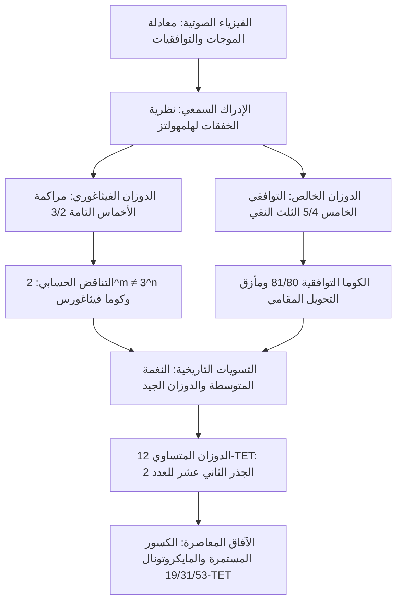

منذ أن أثبت فيثاغورس على آلة المونوكورد (أحادية الوتر) أن الانسجام الصوتي يقوم على نسب بسيطة للأعداد الصحيحة، ارتبطت الموسيقى والرياضيات برابطة جوهرية وثيقة. فالنغمات المتوافقة التي تستمتع بها الأذن البشرية هي فيزيائياً تراكب متطابق لموجات ضغط الهواء، ورياضياً صراع كلاسيكي ممتد بين الأعداد الأولية والأعداد الكسرية واللاعقلانية.

غير أن السعي نحو الانسجام الخالص اصطدم بتناقض حسابي حتمي: تراكم 12 بعداً خامساً تاماً ونقياً (النسبة $3/2$) لا يتطابق أبداً مع 7 أوكتافات نقية (النسبة $2/1$). وبموجب المبرهنة الأساسية في الحسابيات:

$$2^m \neq 3^n \quad (\forall m, n \in \mathbb{N}^*)$$

هذا الفارق الضئيل غير القابل للإلغاء — **كوما فيثاغورس** ($23{,}46\text{ سنت}$) و**الكوما التوافقية** ($21{,}51\text{ سنت}$) — أفرز تاريخاً طويلاً من ابتكار أنظمة الدوزان والضبط الموسيقي (Temperament).

## 1. الفيزياء الصوتية والسلسلة التوافقية

تخضع اهتزازات الأوتار لمعادلة الموجات الأحادية البعد:

$$\frac{\partial^2 y}{\partial t^2} = v^2 \frac{\partial^2 y}{\partial x^2}, \qquad v = \sqrt{\frac{T}{\rho}}$$

تشكل الترددات الطبيعية متوالية حسابية تامة: $f_n = n f_1$. في عام 1863، فسر هيرمان فون هلمهولتز أن التوافق النغمي ينجم عن غياب الخفقات التنافرية الخشنة داخل الحزمة الحرجة للقوقعة، حيث تتطابق التوافقيات العليا تماماً عند النسب الصحيحة البسيطة.

## 2. الدوزان الفيثاغوري وكوما فيثاغورس

بتكرار صعود 12 بعداً خامساً تاماً ($3/2$) وخفضها بمقدار 7 أوكتافات ($2^7$):

$$\frac{(3/2)^{12}}{2^7} = \frac{531441}{524288} \approx 1{,}013643 \implies 23{,}46\text{ سنت}$$

هذا الفارق، المسمى **كوما فيثاغورس**، يمنع إغلاق دائرة الأخماس؛ وإذا أغلقت قسراً تنشأ **خامسة الذئب** التنافرية المتضايقة ($678{,}5\text{ سنت}$). كما أن الثلث الكبير الفيثاغوري ($81/64 \approx 407{,}8\text{ سنت}$) يعاني من توتر حاد غير نقي.

## 3. الدوزان الخالص والكوما التوافقية

في عصر النهضة، اعتمد زارلينو التوافقي الخامس لتعريف الثلث الكبير النقي $5/4$ ($386{,}31\text{ سنت}$). الفارق بين الثلث الفيثاغوري والثلث النقي هو **الكوما التوافقية (Syntonic Comma)**:

$$\Delta_{\text{syntonic}} = \frac{81/64}{5/4} = \frac{81}{80} = 1{,}0125 \approx 21{,}51\text{ سنت}$$

تسبب ذلك في انقسام البعد الكامل إلى نغمة كبرى ($9/8$) ونغمة صغرى ($10/9$). في آلات المفاتيح، أصبح الخامس ري-لا ناقصاً بمقدار $21{,}5\text{ سنت}$، مما جعل التحويل بين المقامات مستحيلاً دون نشاز مروع.

## 4. دوزان النغمة المتوسطة والدوزان المتساوي 12-TET

قامت طريقة **دوزان النغمة المتوسطة بربع الكوما** بتضييق أربعة أخماس متتالية لتوليد أثلاث نقية. لاحقاً، وضع فيركميستر دوزانات غير متساوية سمحت بالعزف في جميع المقامات الـ 24.

أما الحل الرياضي الشامل فكان **الدوزان المتساوي باثني عشر صوتاً (12-TET)**:

$$r = \sqrt[12]{2} = 2^{1/12} \approx 1{,}059463094359$$

وكان الرياضي والأمير الصيني **تشو تساي يو** (Zhu Zaiyu) أول من حسب هذه القيمة بدقة 25 منزلة عشرية عام 1584.

| المسافة | الخالص (سنت) | الفيثاغوري (سنت) | النغمة المتوسطة (سنت) | 12-TET (سنت) | الخطأ في 12-TET |
| :--- | :--- | :--- | :--- | :--- | :--- |
| **الثلث الكبير** | 386{,}31 | 407{,}82 | 386{,}31 | 400{,}00 | **+13{,}69** |
| **الرابع التام** | 498{,}04 | 498{,}04 | 503{,}42 | 500{,}00 | +1{,}96 |
| **الخامس التام** | 701{,}96 | 701{,}96 | 696{,}58 | 700{,}00 | **-1{,}96** |
| **الأوكتاف** | 1200{,}00 | 1200{,}00 | 1200{,}00 | 1200{,}00 | 0{,}00 |

## 5. الكسور المستمرة والأنظمة الميكروتونية (19, 31, 53-TET)

ينبثق الرقم 12 بصورة طبيعية من مفكوك الكسور المستمرة للوغاريثم $\log_2(3)$:

$$\log_2(3) \approx [1; 1, 1, 2, 2, 3, 1, 5, \dots] \implies 1, 2, 8/5, \mathbf{19/12}, 65/41, \mathbf{84/53}$$

يقدم المقام **12** أدنى خطأ للبعد الخامس بمقدار $-1{,}96\text{ سنت}$. وتوفر أنظمة 31 و 53 تقسيماً نقاءً فائقاً يغذي برمجيات الدوزان الديناميكي في الموسيقى الرقمية المعاصرة.
