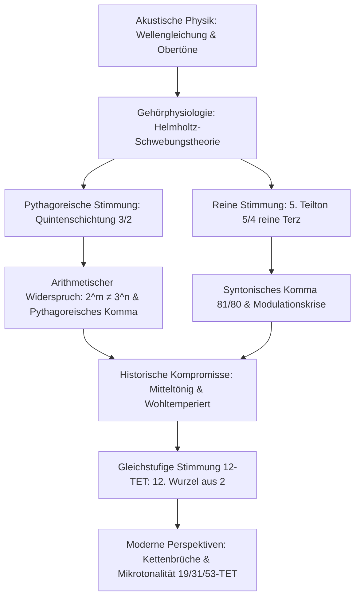

Seit Pythagoras von Samos am Monochord nachwies, dass musikalische Konsonanz auf einfachen ganzzahligen Saitenlängenverhältnissen beruht, sind Musik und Mathematik untrennbar miteinander verwoben. Was das menschliche Gehör als harmonische Reinheit empfindet, ist physikalisch eine schwingungsmechanische Überlagerung von Luftdruckwellen und mathematisch ein jahrhundertealtes Ringen zwischen Primzahlen, rationalen Brüchen und irrationalen Zahlen.

Auf der Suche nach vollkommener Harmonie stieß die Menschheit jedoch auf einen unüberwindbaren arithmetischen Widerspruch: Zwölf reine Quinten (Frequenzverhältnis $3/2$) stimmen niemals exakt mit sieben reinen Oktaven (Verhältnis $2/1$) überein. Wegen des Fundamentalsatzes der Arithmetik (Eindeutigkeit der Primfaktorzerlegung) gilt für alle positiven ganzen Zahlen:

$$2^m \neq 3^n$$

Diese winzige, unnachgiebige Differenz – das **pythagoreische Komma** ($23{,}46\text{ Cent}$) und das **syntonische Komma** ($21{,}51\text{ Cent}$) – zwang Generationen von Mathematikern und Orgelbauern zu schöpferischen Kompromissen. Die Geschichte der Stimmungen (Temperatur) ist die Chronik der Bändigung dieser mathematischen Diskrepanzen.

## 1. Akustische Grundlagen und die harmonische Obertonreihe

Die Querschwingung einer idealen Saite gehorcht der eindimensionalen Wellengleichung:

$$\frac{\partial^2 y}{\partial t^2} = v^2 \frac{\partial^2 y}{\partial x^2}, \qquad v = \sqrt{\frac{T}{\rho}}$$

Unter festen Randbedingungen ($y(0, t) = y(L, t) = 0$) bilden die Eigenfrequenzen eine diskrete arithmetische Reihe:

$$f_n = n \frac{v}{2L} = n f_1 \quad (n = 1, 2, 3, \dots)$$

Hermann von Helmholtz wies 1863 nach, dass das Konsonanzempfinden auf dem Ausbleiben von Schwebungen beruht. Bei einfachen Frequenzverhältnissen fallen die Teiltöne der Töne exakt zusammen, sodass innerhalb der kritischen Bandbreite der Basilarmembran keine störende Rauigkeit entsteht.

## 2. Pythagoreische Stimmung und das pythagoreische Komma

In der pythagoreischen Stimmung werden alle Töne ausschließlich aus reinen Quinten ($3/2$) und Oktavierungen ($1/2$) konstruiert:

$$C \to G \to D \to A \to E \to B \to F\sharp \to C\sharp \to G\sharp \to D\sharp \to A\sharp \to E\sharp \to B\sharp$$

Der zwölfte Quintschritt $B\sharp$, um 7 Oktaven abgesenkt, ergibt:

$$\frac{(3/2)^{12}}{2^7} = \frac{531441}{524288} \approx 1{,}013643$$

In Cent ausgedrückt ($C(R) = 1200 \log_2(R)$):

$$C_{\text{pyth}} = 1200 \log_2\left(\frac{531441}{524288}\right) \approx 23{,}46\text{ Cent}$$

Schließt man den Quintenzirkel gewaltsam, entsteht die gefürchtete **Wolfsquinte** (meist zwischen $G\sharp$ und $E\flat$), die um $23{,}5\text{ Cent}$ zu eng ist und wie ein heulender Wolf vibriert. Zudem ist die pythagoreische Terz ($81/64 \approx 407{,}8\text{ Cent}$) im Vergleich zur Naturterz ($386{,}3\text{ Cent}$) extrem scharf.

## 3. Reine Stimmung und das syntonische Komma

Mit dem Aufkommen der Renaissance-Polyphonie definierte Gioseffo Zarlino die reine große Terz als Naturintervall $5/4$ ($386{,}31\text{ Cent}$). Der Unterschied zur pythagoreischen Terz ist das **syntonische Komma**:

$$\Delta_{\text{syntonic}} = \frac{81/64}{5/4} = \frac{81}{80} = 1{,}0125 \approx 21{,}51\text{ Cent}$$

Dies führt zur Spaltung des Ganztons in den großen Ganzton ($9/8 \approx 203{,}9\text{ Cent}$) und den kleinen Ganzton ($10/9 \approx 182{,}4\text{ Cent}$). Auf Tasteninstrumenten führt dies zur Unspielbarkeit von Nebentonarten, da die Quinte $D-A$ um $21{,}5\text{ Cent}$ zu klein ausfällt ($680{,}5\text{ Cent}$).

## 4. Mitteltönige Stimmung und historische Lösungen

Die **viertelton-mitteltönige Stimmung** (16./17. Jahrhundert) verkleinerte vier aufeinanderfolgende Quinten um je ein Viertel des syntonischen Kommas ($\approx 5{,}38\text{ Cent}$), um lupenreine Terzen ($5/4$) zu gewährleisten. Erst Andreas Werckmeister schuf im Barock ungleichschwebende Stimmungen (Wohltemperierung), die alle 24 Tonarten spielbar machten, ohne die Tonartencharaktere völlig zu nivellieren.

## 5. Die gleichstufige 12-Ton-Temperatur (12-TET)

Die mathematische Vollendung fand das Problem in der **12-stufigen gleichstufigen Stimmung**:

$$r = \sqrt[12]{2} = 2^{1/12} \approx 1{,}059463094359$$

Jeder Halbton misst exakt $100\text{ Cent}$. Erstmals exakt berechnet wurde diese Wurzel 1584 von dem chinesischen Prinzen und Mathematiker **Zhu Zaiyu** (朱載堉) mit 25 Dezimalstellen.

| Intervall | Rein (Cent) | Pythagoreisch (Cent) | Mitteltönig (Cent) | 12-TET (Cent) | Abweichung in 12-TET |
| :--- | :--- | :--- | :--- | :--- | :--- |
| **Prime** | 0{,}00 | 0{,}00 | 0{,}00 | 0{,}00 | 0{,}00 |
| **Große Terz** | 386{,}31 | 407{,}82 | 386{,}31 | 400{,}00 | **+13{,}69** |
| **Reine Quarte** | 498{,}04 | 498{,}04 | 503{,}42 | 500{,}00 | +1{,}96 |
| **Reine Quinte** | 701{,}96 | 701{,}96 | 696{,}58 | 700{,}00 | **-1{,}96** |
| **Oktave** | 1200{,}00 | 1200{,}00 | 1200{,}00 | 1200{,}00 | 0{,}00 |

Die Quinte ist in 12-TET mit $-1{,}96\text{ Cent}$ kaum wahrnehmbar verstimmt, während die Terz mit $+13{,}69\text{ Cent}$ spürbare Schwebungen erzeugt.

## 6. Kettenbrüche und erweiterte Tonsysteme (19, 31, 53-TET)

Die Bevorzugung der Zahl 12 resultiert aus der Kettenbruchentwicklung von $\log_2(3)$:

$$\log_2(3) \approx [1; 1, 1, 2, 2, 3, 1, 5, \dots]$$

Die Näherungsbrüche lauten: $1, 2, 8/5, \mathbf{19/12}, 65/41, \mathbf{84/53}$.
Die Zahl **12** ist der Nenner mit dem besten Kompromiss aus Tastaturgröße und Quintenreinheit. Das 31-stufige System (Christiaan Huygens) und das 53-stufige System liefern noch präzisere Annäherungen an reine Terzen und Quinten, die heute in der elektronischen Musik dynamisch genutzt werden.
