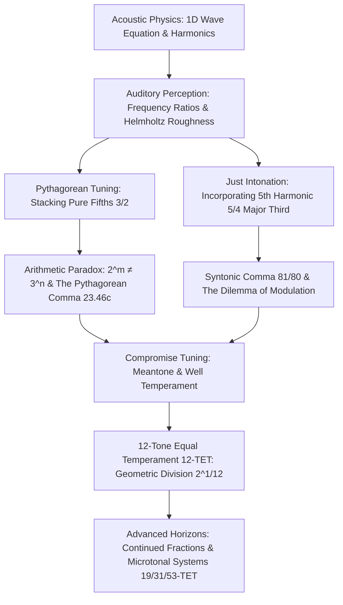
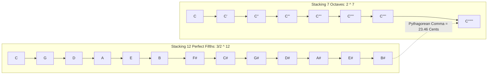
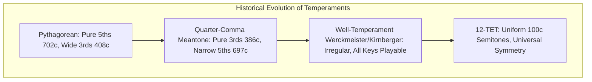

Ever since Pythagoras of Samos struck hanging anvils in a blacksmith's forge and demonstrated with a monochord that musical consonance correlates directly with small whole-number string length ratios, music and mathematics have remained inextricably linked. What the human auditory cortex perceives as serene, pleasing consonance is physically an alignment of air pressure oscillation frequencies, and mathematically an algebraic drama between primes, rational fractions, and transcendental irrational numbers.

Yet, humanity's quest for an absolute harmonic paradise was doomed to encounter an insurmountable arithmetic paradox: stacking twelve pure perfect fifths (frequency ratio $3/2$) never closes the circle to meet seven stacked pure octaves (frequency ratio $2/1$). That is, due to the Fundamental Theorem of Arithmetic (the unique factorization of integers), no positive integers $m$ and $n$ can ever satisfy:

$$2^m = 3^n$$

This minuscule, unyielding discrepancy—the **Pythagorean Comma** and its companion, the **Syntonic Comma**—forced music theorists, mathematicians, and instrument builders into centuries of ingenious compromise. The entire evolution of Western musical tuning systems—from Pythagorean tuning through Just Intonation, meantone temperaments, and well-temperaments, culminating in modern 12-Tone Equal Temperament (12-TET)—is the chronicle of how human civilization learned to distribute, camouflage, and tame these mathematical anomalies.

In this exhaustive treatise, we examine the wave mechanics of the harmonic series, derive the commas from first principles, explore the acoustical crisis of transposition in Just Intonation, dissect the algebraic construction of 12-TET, and reveal the continued fraction approximations that illuminate why twelve divisions of the octave became our prevailing acoustic reality.

---

## 1. Acoustic Physics and the Harmonic Series

### The One-Dimensional Wave Equation and Standing Waves

The vibration of an ideal musical string, clamped firmly at boundaries $x = 0$ and $x = L$, is governed by the classical one-dimensional wave equation:

$$\frac{\partial^2 y}{\partial t^2} = v^2 \frac{\partial^2 y}{\partial x^2}$$

where $y(x, t)$ denotes transverse displacement, and $v$ represents wave propagation speed determined by string tension $T$ and linear mass density $\rho$:

$$v = \sqrt{\frac{T}{\rho}}$$

Imposing Dirichlet boundary conditions $y(0, t) = y(L, t) = 0$, separation of variables yields an infinite sequence of discrete standing wave eigenmodes:

$$y_n(x, t) = A_n \sin\left(\frac{n \pi x}{L}\right) \cos\left(2 \pi f_n t + \phi_n\right), \quad n \in \{1, 2, 3, \dots\}$$

The corresponding eigenfrequencies $f_n$ and wavelengths $\lambda_n$ form an exact arithmetic progression:

$$\lambda_n = \frac{2L}{n}, \qquad f_n = n \frac{v}{2L} = n f_1$$

The fundamental frequency $f_1$ corresponds to the first harmonic, while higher modes $f_n = n f_1$ constitute the **overtones** or **upper harmonics**. When a physical string is bowed, plucked, or struck, its displacement envelope is a Fourier superposition of these integer harmonics:

$$y(x, t) = \sum_{n=1}^\infty A_n \sin\left(\frac{n \pi x}{L}\right) \cos\left(2 \pi n f_1 t + \phi_n\right)$$

| Harmonic ($n$) | Frequency Ratio ($f_n / f_1$) | Musical Interval Name | Simplest Fractional Ratio |
| :--- | :--- | :--- | :--- |
| **1st Harmonic** | 1.0000 | Fundamental / Unison | $1/1$ |
| **2nd Harmonic** | 2.0000 | Octave | $2/1$ |
| **3rd Harmonic** | 3.0000 | Octave + Perfect Fifth | $3/1$ |
| **4th Harmonic** | 4.0000 | Two Octaves | $4/1$ |
| **5th Harmonic** | 5.0000 | Two Octaves + Major Third | $5/1$ |
| **6th Harmonic** | 6.0000 | Two Octaves + Perfect Fifth | $6/1$ |
| **7th Harmonic** | 7.0000 | Two Octaves + Natural 7th | $7/1$ |
| **8th Harmonic** | 8.0000 | Three Octaves | $8/1$ |

By folding these intervals into a single octave span $[1, 2)$ via octave equivalence (dividing by powers of $2$), we extract the elementary building blocks of harmonic tonal theory:
- **Octave**: $\frac{2}{1} = 2.0000$
- **Perfect Fifth**: $\frac{3}{2} = 1.5000$
- **Perfect Fourth**: $\frac{2}{3/2} = \frac{4}{3} \approx 1.3333$
- **Major Third**: $\frac{5}{4} = 1.2500$
- **Minor Third**: $\frac{3/2}{5/4} = \frac{6}{5} = 1.2000$
- **Major Sixth**: $\frac{5}{3} \approx 1.6667$
- **Minor Sixth**: $\frac{8}{5} = 1.6000$

### Helmholtz and the Psychoacoustic Origin of Consonance

Why does human consciousness distinguish between the serenity of a pure fifth and the jarring grating of a minor second? In his landmark 1863 treatise *On the Sensations of Tone as a Physiological Basis for the Theory of Music*, Hermann von Helmholtz explained this phenomenon through the biophysics of hearing.

Inside the human cochlea, the basilar membrane behaves as a mechanical spectral analyzer, executing a spatial Fourier transform through frequency tonotopy. When two pure sinusoidal tones with proximate frequencies $f_A$ and $f_B$ stimulate adjacent hair cell clusters within a single **critical bandwidth** (approximately $30 \text{ to } 40 \text{ Hz}$ in the mid-frequency register), linear superposition produces a modulated wave packet:

$$s(t) = \sin(2\pi f_A t) + \sin(2\pi f_B t) = 2 \cos\left(\pi (f_A - f_B) t\right) \sin\left(\pi (f_A + f_B) t\right)$$

The envelope oscillates at the beat frequency $\Delta f = |f_A - f_B|$. When $\Delta f$ is small ($1 \text{ to } 5 \text{ Hz}$), the auditory system tracks a smooth, pleasant tremolo. When $\Delta f$ accelerates into the $20 \text{ to } 50 \text{ Hz}$ range, the neural firing rate cannot resolve individual fluctuations, registering instead rapid mechanical friction perceived as **sensory roughness** (*Rauigkeit*).

Crucially, real musical instruments produce complex multi-harmonic spectra. When two complex tones $A$ and $B$ are sounded simultaneously, every overtone $p f_A$ interacts pairwise with every overtone $q f_B$. If the frequency ratio $f_A / f_B$ is a fraction of small integers $p/q$, the upper harmonics coincide exactly ($p f_A = q f_B$), leaving the critical bands clear of conflicting beats. If the ratio deviates slightly from a simple rational fraction, the dense constellation of high-order overtones generates thousands of discordant, rapid beats throughout the audible spectrum. Consonance is thus the physical absence of inter-harmonic dissonance.

---

## 2. Pythagorean Tuning: The Power of 3-Limit Harmony and Its Flaw

### The Monochord and Construction of the 12-Tone Scale

Pythagoras of Samos (c. 570–495 BCE) and his disciples elevated the whole-number ratios of string lengths to cosmological doctrine: "All is number." The universe, planets, and human souls resonated with the sacred tetraktys ($1 + 2 + 3 + 4 = 10$).

In Pythagorean tuning, the scale is generated solely using the prime factors $2$ and $3$ (3-limit harmony). The construction algorithm is strikingly simple:
1. Ascend by pure perfect fifths (multiplying frequency by $3/2$).
2. Whenever the frequency equals or exceeds $2$, descend by an octave (dividing by $2$).

Starting from a reference tonic $C = 1$, twelve successive applications of the perfect fifth generate the 12 pitch classes:

$$\begin{aligned}
C_0 &= 1 \\
G_1 &= 1 \times \frac{3}{2} = \frac{3}{2} \\
D_2 &= \frac{3}{2} \times \frac{3}{2} \times \frac{1}{2} = \frac{9}{8} \\
A_3 &= \frac{9}{8} \times \frac{3}{2} = \frac{27}{16} \\
E_4 &= \frac{27}{16} \times \frac{3}{2} \times \frac{1}{2} = \frac{81}{64} \\
B_5 &= \frac{81}{64} \times \frac{3}{2} = \frac{243}{128} \\
F\sharp_6 &= \frac{243}{128} \times \frac{3}{2} \times \frac{1}{2} = \frac{729}{512} \\
C\sharp_7 &= \frac{729}{512} \times \frac{3}{2} \times \frac{1}{2} = \frac{2187}{2048} \\
G\sharp_8 &= \frac{2187}{2048} \times \frac{3}{2} = \frac{6561}{4096} \\
D\sharp_9 &= \frac{6561}{4096} \times \frac{3}{2} \times \frac{1}{2} = \frac{19683}{16384} \\
A\sharp_{10} &= \frac{19683}{16384} \times \frac{3}{2} = \frac{59049}{32768} \\
E\sharp_{11} &= \frac{59049}{32768} \times \frac{3}{2} \times \frac{1}{2} = \frac{177147}{131072} \\
B\sharp_{12} &= \frac{177147}{131072} \times \frac{3}{2} = \frac{531441}{262144}
\end{aligned}$$

Bringing $B\sharp_{12}$ down by seven octaves ($2^7 = 128$) to compare it with our starting tonic $C_0 = 1$:

$$\frac{B\sharp_{12}}{2^7} = \frac{3^{12}}{2^{19}} = \frac{531441}{524288} \approx 1.01364326477$$

Instead of landing precisely on $1.000000$, we have overshot the mark by $1.364\%$!

### The Algebraic Inevitability of the Pythagorean Comma

To see why this gap cannot be resolved within rational arithmetic, consider the condition for a chain of $n$ fifths to equal $m$ octaves:

$$\left(\frac{3}{2}\right)^n = 2^m \iff 3^n = 2^{m+n}$$

By the Fundamental Theorem of Arithmetic, any integer greater than 1 admits a unique prime factorization. The left-hand side contains only the prime factor $3$ and is strictly odd; the right-hand side contains only the prime factor $2$ and is strictly even for all non-zero powers. Consequently, no integers $n, m \ge 1$ exist such that a sequence of pure fifths closes upon a sequence of pure octaves.

We quantify this discrepancy using the **cent scale**, established by Alexander J. Ellis in 1885. The cent measures musical intervals on a logarithmic scale where an octave is defined as exactly 1200 cents:

$$C(R) = 1200 \log_2(R)$$

Applying this to the Pythagorean comma:

$$\begin{aligned}
C_{\text{pyth}} &= 1200 \log_2\left(\frac{531441}{524288}\right) \\
&= 1200 \times \left(12 \log_2 3 - 19 \log_2 2\right) \\
&= 1200 \times \left(12 \times 1.5849625 - 19\right) \\
&\approx 23.460010 \text{ cents}
\end{aligned}$$

A deviation of $23.46$ cents is nearly a quarter of a semitone (which is $100$ cents). It is well beyond the human pitch discrimination threshold ($\approx 2 \text{ to } 3 \text{ cents}$ for trained listeners) and causes unmistakable out-of-tune sensations.

### The Wolf Fifth and the Harsh Major Third

If a 12-key keyboard instrument is tuned using eleven pure fifths ($701.96 \text{ cents}$), the twelfth fifth (typically assigned between $G\sharp$ and $E\flat$) must absorb the entire accumulated error:

$$C_{\text{wolf}} = 701.955 - 23.460 = 678.495 \text{ cents}$$

This interval is $23.46$ cents too narrow. Sounded together, it generates an aggressive, throbbing beat frequency of around $25 \text{ to } 35 \text{ Hz}$, resembling the howl of a wolf—hence the moniker **Wolf Fifth**.

Furthermore, in Pythagorean tuning, the major third (e.g., $C$ to $E$) is constructed by four ascending fifths ($C \to G \to D \to A \to E$), yielding the ditone ratio:

$$\frac{E}{C} = \frac{81}{64} \approx 1.265625 \quad (407.82 \text{ cents})$$

As medieval and Renaissance musicians turned from open organum (fifths and octaves) toward rich polyphonic triads, this $407.82$-cent third sounded intolerably harsh and restless compared to the natural acoustic major third.

---

## 3. Just Intonation: 5-Limit Harmony and the Syntonic Comma

### Zarlino and the Triadic Ideal

In the 16th century, Italian theorist Gioseffo Zarlino championed the inclusion of the prime factor $5$ into the harmonic canon (5-limit harmony). By drawing upon the 5th harmonic of the vibrating string, Zarlino defined the **pure major third** as:

$$\text{Major Third} = \frac{5}{4} = 1.250000 \quad (386.31 \text{ cents})$$

The major triad ($C - E - G$) thus attained the pure integer proportion $4 : 5 : 6$:

$$4 : 5 : 6 \iff C = 1, \quad E = \frac{5}{4}, \quad G = \frac{3}{2}$$

This chord rings with glass-like transparency, completely free of beating overtones.

| Note | Just Ratio (rel. to C) | Decimal | Cents | Interval Description |
| :--- | :--- | :--- | :--- | :--- |
| **C** | 1/1 | 1.0000 | 0.00 | Fundamental |
| **D** | 9/8 | 1.1250 | 203.91 | Major Whole Tone |
| **E** | 5/4 | 1.2500 | 386.31 | Pure Major Third |
| **F** | 4/3 | 1.3333 | 498.04 | Pure Perfect Fourth |
| **G** | 3/2 | 1.5000 | 701.96 | Pure Perfect Fifth |
| **A** | 5/3 | 1.6667 | 884.36 | Pure Major Sixth |
| **B** | 15/8 | 1.8750 | 1088.27 | Pure Major Seventh |
| **C'** | 2/1 | 2.0000 | 1200.00 | Octave |

### Derivation of the Syntonic Comma

The adoption of the 5-limit pure major third introduces a fundamental discrepancy against the 3-limit Pythagorean ditone:

$$\Delta_{\text{syntonic}} = \frac{81/64}{5/4} = \frac{81}{64} \times \frac{4}{5} = \frac{81}{80} = 1.0125$$

This ratio is the **Syntonic Comma** (also known as the Didymean Comma). In cents:

$$C_{\text{syntonic}} = 1200 \log_2\left(\frac{81}{80}\right) = 1200 \left(4 \log_2 3 - \log_2 5 - 4\right) \approx 21.50629 \text{ cents}$$

### The Fragmentation of Whole Tones: Major vs. Minor Tones

The presence of the syntonic comma destroys the uniformity of whole steps within the diatonic scale:
- The interval from $C$ to $D$ is:
  $$\frac{D}{C} = \frac{9}{8} \approx 203.91 \text{ cents} \quad \text{(Major Tone)}$$
- The interval from $D$ to $E$ is:
  $$\frac{E}{D} = \frac{5/4}{9/8} = \frac{10}{9} \approx 1.1111 \approx 182.40 \text{ cents} \quad \text{(Minor Tone)}$$

Their difference is precisely the syntonic comma:

$$\frac{9/8}{10/9} = \frac{81}{80} \approx 21.51 \text{ cents}$$

On an instrument with fixed pitches (such as an organ, harpsichord, or fretted lute), this dual whole-step creates catastrophic harmonic fractures upon modulation.
Consider sounding a minor triad built on $D$ ($D - F - A$):
- The interval from $D$ to $A$ should be a pure fifth ($3/2 = 1.5000$, $701.96 \text{ cents}$).
- In Just Intonation:
  $$\frac{A}{D} = \frac{5/3}{9/8} = \frac{40}{27} \approx 1.4815 \quad (680.45 \text{ cents})$$

The fifth $D-A$ is deficient by an entire syntonic comma ($21.51 \text{ cents}$), producing a sickening, unstable wolf fifth right within the home key of C major! A choir of unaccompanied human voices can continuously adjust pitch dynamically to resolve this, but for keyboard instruments, Just Intonation rendered modulation outside of one or two closely related keys utterly unplayable.

---

## 4. Meantone and Historic Compromise Temperaments

To rescue keyboard instruments from the paralysis of Just Intonation while avoiding the abrasive thirds of Pythagorean tuning, Renaissance theorists devised **temperaments**—systematic distortions applied to pure intervals.

### Quarter-Comma Meantone Temperament

Pietro Aron (1523) formulated **Quarter-Comma Meantone**, the dominant tuning of the 16th and 17th centuries. Its governing philosophy was to distribute the syntonic comma evenly across four contiguous fifths:

$$C \to G \to D \to A \to E$$

By reducing each of these four fifths by exactly one-quarter of a syntonic comma ($\frac{1}{4} C_{\text{syntonic}} \approx 5.377 \text{ cents}$), the resulting third $C-E$ becomes completely pure ($5/4 = 386.31 \text{ cents}$):

$$C_{5,\text{meantone}} = 701.955 - \frac{21.506}{4} \approx 696.579 \text{ cents}$$

Furthermore, the major whole step and minor whole step are equalized into a single geometric "mean tone":

$$\text{Meantone} = \sqrt{\frac{5}{4}} = \frac{\sqrt{5}}{2} \approx 193.157 \text{ cents}$$

While meantone provides eight ravishing major triads (from $E\flat$ to $E$ major), its remaining wolf interval ($G\sharp - E\flat$, measuring $737.6 \text{ cents}$, a staggering $35.6 \text{ cents}$ wider than pure) stood as an impassable barrier against distant keys like $F\sharp$ or $B$.

---

## 5. Twelve-Tone Equal Temperament (12-TET)

### The Algebraic Solution: The Twelfth Root of Two

The ultimate mathematical resolution that unifies all twelve keys into complete structural equivalence is **Twelve-Tone Equal Temperament (12-TET)**. Instead of pursuing pure rational fractions, 12-TET treats the octave as a continuous logarithmic space and subdivides it into twelve mathematically identical geometric intervals.

Let $r$ denote the frequency ratio of one semitone. Twelve successive multiplications by $r$ must double the frequency:

$$r^{12} = 2 \implies r = \sqrt[12]{2} = 2^{1/12} \approx 1.059463094359295$$

In cents, every semitone is defined as identically 100 cents:

$$\text{Interval}_{\text{semitone}} = 1200 \log_2\left(2^{1/12}\right) = 1200 \times \frac{1}{12} = 100.00 \text{ cents}$$

The frequency of the $k$-th semitone above a reference pitch $f_0$ (such as $A_4 = 440 \text{ Hz}$) is:

$$f_k = f_0 \times 2^{k/12}$$

### Zhu Zaiyu: The First Exact Calculation in World History

The rigorous mathematical solution to 12-TET was first calculated not in Europe, but in Ming-dynasty China by the brilliant prince, mathematician, and acoustician **Zhu Zaiyu (朱載堉, 1536–1611)**. In his 1584 treatise *Lüxue Xinshuo* (A New Theory of the Tone System), Zhu employed large abacuses with strings of beads to perform multi-digit square-root and cube-root extractions, determining the exact length ratios for twelve pitch pipes to 25 decimal digits:

$$\sqrt[12]{2} \approx 1.059463094359295264561825$$

In the West, Flemish mathematician Simon Stevin independently formulated the calculation around 1585, and Marin Mersenne published accurate pipe measurements in his 1636 *Harmonie Universelle*.

### Bach's "Well-Tempered Clavier": Historical Fact vs. Myth

For decades, popular history asserted that Johann Sebastian Bach composed *The Well-Tempered Clavier* (1722, 1742) to champion 12-TET. Modern musicology has firmly dismantled this myth. Bach titled his collection *Das Wohltemperirte Clavier*—meaning "well-tempered," not "equally tempered" (*Gleichschwebende Temperatur*).

Bach was utilizing one of the circulating **well-temperaments** developed by Andreas Werckmeister (e.g., Werckmeister III) or Johann Philipp Kirnberger. These irregular tuning schemes eliminated wolf fifths so that all 24 keys were harmonically viable, but kept subtle variations in third-sizes across keys. In a well-tempered system, C major sounded placid and pure, while F# minor sounded pungent and stormy. 12-TET's absolute uniformity was initially resisted by many Romantic composers because it eradicated the unique emotional "flavor" (*Affekt*) of individual keys.

---

## 6. Comprehensive Interval Comparison Across All Systems

The following reference matrix summarizes all twelve chromatic intervals across the four primary tuning architectures (referenced to $C = 0 \text{ cents}$):

| Pitch | Interval | Pythagorean (cents) | Just 5-Limit (cents) | 1/4-Comma Meantone (cents) | 12-TET (cents) | Just Rational Ratio | Deviation in 12-TET |
| :--- | :--- | :--- | :--- | :--- | :--- | :--- | :--- |
| **C** | Unison | 0.00 | 0.00 | 0.00 | 0.00 | 1/1 | 0.00 |
| **C# / Db** | Minor Second | 90.22 (Db) | 111.73 (Db) | 76.05 (C#) | 100.00 | 16/15 | -11.73 |
| **D** | Major Second | 203.91 | 203.91 (Major) | 193.16 | 200.00 | 9/8 | -3.91 |
| **D# / Eb** | Minor Third | 294.13 (Eb) | 315.64 (Eb) | 310.26 (Eb) | 300.00 | 6/5 | -15.64 |
| **E** | Major Third | 407.82 | 386.31 | 386.31 | 400.00 | 5/4 | **+13.69** |
| **F** | Perfect Fourth | 498.04 | 498.04 | 503.42 | 500.00 | 4/3 | +1.96 |
| **F# / Gb** | Tritone | 611.73 (F#) | 590.22 (F#) | 579.47 (F#) | 600.00 | 45/32 | +9.78 |
| **G** | Perfect Fifth | 701.96 | 701.96 | 696.58 | 700.00 | 3/2 | **-1.96** |
| **G# / Ab** | Minor Sixth | 792.18 (Ab) | 813.69 (Ab) | 813.69 (Ab) | 800.00 | 8/5 | -13.69 |
| **A** | Major Sixth | 905.87 | 884.36 | 889.74 | 900.00 | 5/3 | +15.64 |
| **A# / Bb** | Minor Seventh | 996.09 (Bb) | 1017.60 (Bb) | 1006.84 (Bb) | 1000.00 | 9/5 | -17.60 |
| **B** | Major Seventh | 1109.78 | 1088.27 | 1082.89 | 1100.00 | 15/8 | +11.73 |
| **C'** | Octave | 1200.00 | 1200.00 | 1200.00 | 1200.00 | 2/1 | 0.00 |

### The Physical Cost of 12-TET

Equal temperament is a geometric compromise with clear acoustical drawbacks:
1. **The Sharp Major Third (+13.69 cents)**:
   In 12-TET, every major third is tuned to $400 \text{ cents}$, compared to the pure ratio $5/4$ ($386.31 \text{ cents}$). At middle C ($261.63 \text{ Hz}$) and E ($329.63 \text{ Hz}$), the 5th harmonic of C ($1308.15 \text{ Hz}$) and the 4th harmonic of E ($1318.51 \text{ Hz}$) generate an audible beat rate of:
   $$\Delta f = 1318.51 - 1308.15 \approx 10.36 \text{ Hz}$$
   This rapid ten-beat-per-second shudder gives equal-tempered triads an energetic brilliance, but robs them of contemplative purity.
2. **The Narrow Perfect Fifth (-1.96 cents)**:
   At $700 \text{ cents}$, the fifth is barely $1.96 \text{ cents}$ flatter than the pure fifth ($701.96 \text{ cents}$). At $C_4 \to G_4$, this produces a faint beat rate of less than one beat per second, an imperceptible defect to nearly all human ears.

---

## 7. Continued Fractions and Alternative Equal Divisions (19, 31, 53-TET)

Why did human musical culture converge on twelve divisions of the octave instead of ten, fourteen, or twenty? The answer lies in number theory, specifically the **continued fraction expansion** of $\log_2(3)$.

### The Continued Fraction Expansion of $\log_2(3)$

To find an optimal division of the octave into $N$ equal parts that best approximates the pure fifth ($3/2$), we set:

$$\left(\frac{3}{2}\right) \approx 2^{k/N} \iff 3 \approx 2^{(k+N)/N}$$

Taking the base-2 logarithm on both sides:

$$\log_2(3) \approx \frac{k+N}{N} = 1 + \frac{k}{N}$$

The transcendental number $\log_2(3) \approx 1.58496250072$ possesses a unique continued fraction expansion:

$$\log_2(3) = [1; 1, 1, 2, 2, 3, 1, 5, 2, 23, \dots] = 1 + \cfrac{1}{1 + \cfrac{1}{1 + \cfrac{1}{2 + \cfrac{1}{2 + \cfrac{1}{3 + \cfrac{1}{1 + \dots}}}}}}$$

Truncating this expansion step-by-step generates the canonical best rational approximations (convergents):

$$\begin{aligned}
c_0 &= [1] = 1 \\
c_1 &= [1; 1] = 1 + \frac{1}{1} = 2 \\
c_2 &= [1; 1, 1] = 1 + \frac{1}{1 + 1} = \frac{3}{2} \implies \text{Division by 2} \\
c_3 &= [1; 1, 1, 2] = 1 + \frac{3}{5} = \frac{8}{5} \implies \text{Division by 5} \\
c_4 &= [1; 1, 1, 2, 2] = 1 + \frac{7}{12} = \frac{19}{12} \implies \mathbf{Division\ by\ 12} \\
c_5 &= [1; 1, 1, 2, 2, 3] = 1 + \frac{24}{41} = \frac{65}{41} \implies \mathbf{Division\ by\ 41} \\
c_6 &= [1; 1, 1, 2, 2, 3, 1] = 1 + \frac{31}{53} = \frac{84}{53} \implies \mathbf{Division\ by\ 53}
\end{aligned}$$

| Order | Convergent Fraction | Decimal | Octave Division ($N$) | Steps for Fifth ($k$) | Fifth Size (cents) | Error vs Pure Fifth |
| :--- | :--- | :--- | :--- | :--- | :--- | :--- |
| 1 | 1/1 | 1.0000 | 1 | 0 | 0.00 | -701.96 |
| 2 | 2/1 | 2.0000 | 1 | 1 | 1200.00 | +498.04 |
| 3 | 8/5 | 1.6000 | 5 | 3 | 720.00 | +18.04 |
| 4 | **19/12** | **1.5833** | **12** | **7** | **700.00** | **-1.96** |
| 5 | **65/41** | **1.5854** | **41** | **24** | **702.44** | **+0.48** |
| 6 | **84/53** | **1.5849** | **53** | **31** | **701.89** | **-0.07** |

The number **12** emerges naturally as the fourth convergent! It offers an astonishingly low error of $-1.96 \text{ cents}$ while requiring only twelve keys per octave.

### Prominent Microtonal Equal Temperament Systems

Beyond 12-TET, other equal temperament systems possess distinct mathematical and acoustical virtues:
1. **19-TET (19-Tone Equal Temperament)**:
   - Semitone $= 63.16 \text{ cents}$.
   - The fifth is slightly narrower ($694.74 \text{ cents}$), but the major third ($378.95 \text{ cents}$) and minor third ($315.79 \text{ cents}$) approximate Just Intonation far more closely than 12-TET.
2. **31-TET (Christiaan Huygens' System)**:
   - Formulated by Dutch physicist Christiaan Huygens in 1691.
   - Divides the octave into 31 equal intervals of $38.71 \text{ cents}$.
   - Replicates 1/4-comma meantone with near-perfection: its major third is $387.10 \text{ cents}$ (error of only $+0.79 \text{ cents}$ vs pure $5/4$).
   - Completely closes the circle of fifths without any wolf interval.
3. **53-TET (Mercator's Scale)**:
   - Step size $= 22.64 \text{ cents}$ (very close to both the Pythagorean and syntonic commas).
   - Its perfect fifth ($701.89 \text{ cents}$) deviates by a microscopic **$0.07 \text{ cents}$** from the pure acoustic fifth ($3/2$).
   - Matches the pure 5-limit major third ($386.31 \text{ cents}$) within $1.4 \text{ cents}$.

In our 21st-century digital landscape, MIDI Polyphonic Expression (MPE) and real-time algorithmic retuning engines allow digital instruments to transcend the rigid compromises of physical keyboards. A modern synthesizer can dynamically sound pure Pythagorean intervals in scalar melodic runs, collapse instantaneously into beating-free Just triads on sustained chords, and modulate through all twenty-four keys with equal-tempered flexibility. The mathematics of tuning, born of vibrating gut strings and hammer blows, continues to shape the harmonic architecture of sound.
