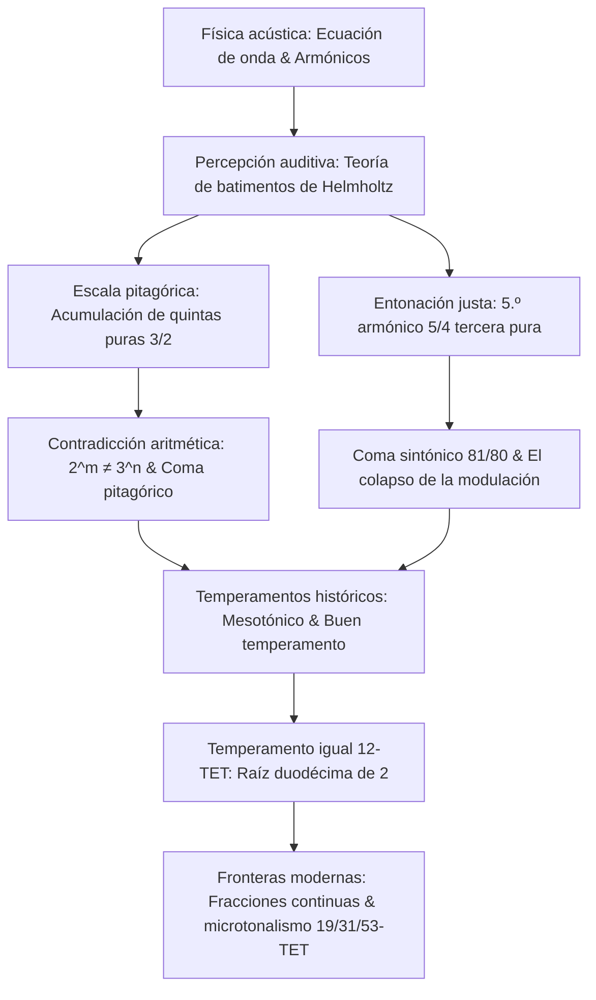

Desde que Pitágoras descubrió en el monocordio que la consonancia sonora se rige por razones de números enteros simples, la música y las matemáticas han compartido una conexión indisoluble. Lo que el oído percibe como armonía pura es la coincidencia periódica de ondas sonoras; en el plano matemático, representa un dilema milenario entre números primos, racionales e irracionales.

Sin embargo, la búsqueda de una afinación perfecta tropieza con una incompatibilidad aritmética inevitable: doce quintas justas puras (razón $3/2$) nunca igualan a siete octavas perfectas (razón $2/1$). Debido al teorema fundamental de la aritmética:

$$2^m \neq 3^n \quad (\forall m, n \in \mathbb{N}^*)$$

Esta discrepancia irreducible —el **coma pitagórico** ($23{,}46\text{ cents}$) y el **coma sintónico** ($21{,}51\text{ cents}$)— dio origen a los diversos temperamentos históricos.

## 1. Acústica física y la serie armónica

La vibración de una cuerda tensa está descrita por la ecuación de onda unidimensional:

$$\frac{\partial^2 y}{\partial t^2} = v^2 \frac{\partial^2 y}{\partial x^2}, \qquad v = \sqrt{\frac{T}{\rho}}$$

Bajo extremos fijos, las frecuencias de los modos propios forman una serie armónica: $f_n = n f_1$. Hermann von Helmholtz demostró en 1863 que la consonancia es la ausencia de batimientos audibles y asperezas sensoriales dentro del ancho de banda crítico del oído interno.

## 2. La afinación pitagórica y el coma pitagórico

Al encadenar 12 quintas justas y descender 7 octavas, se obtiene la razón:

$$\frac{(3/2)^{12}}{2^7} = \frac{531441}{524288} \approx 1{,}013643 \implies 23{,}46\text{ cents}$$

Este desajuste, el **coma pitagórico**, crea una **quinta del lobo** ($678{,}5\text{ cents}$) si se fuerza el cierre del círculo tonal, inutilizando tonalidades lejanas. Además, la tercera mayor pitagórica ($81/64 \approx 407{,}8\text{ cents}$) resulta excesivamente tensa y disonante.

## 3. Entonación justa y el coma sintónico

En el Renacimiento, Gioseffo Zarlino incorporó el 5.º armónico para lograr una tercera mayor pura de $5/4$ ($386{,}31\text{ cents}$). La diferencia entre la tercera pitagórica y la pura es el **coma sintónico**:

$$\Delta_{\text{syntonic}} = \frac{81/64}{5/4} = \frac{81}{80} = 1{,}0125 \approx 21{,}51\text{ cents}$$

Esto divide el tono en tono mayor ($9/8$) y tono menor ($10/9$). En instrumentos de teclado, la quinta re-la sufre una merma de $21{,}5\text{ cents}$ ($680{,}5\text{ cents}$), haciendo imposible modular libremente.

## 4. Temperamento mesotónico y temperamento igual (12-TET)

El **temperamento mesotónico de un cuarto de coma** estrechó cuatro quintas en un cuarto de coma sintónico para preservar terceras mayores puras. Posteriormente, en el Barroco surgieron los buenos temperamentos (Werckmeister), permitiendo tocar en las 24 tonalidades.

La solución matemática final y simétrica fue el **temperamento igual de 12 tonos (12-TET)**:

$$r = \sqrt[12]{2} = 2^{1/12} \approx 1{,}059463094359$$

El príncipe y matemático chino **Zhu Zaiyu** (朱載堉) fue el primero en calcular con precisión este valor con 25 decimales en 1584.

| Intervalo | Justo (cents) | Pitagórico (cents) | Mesotónico (cents) | 12-TET (cents) | Error en 12-TET |
| :--- | :--- | :--- | :--- | :--- | :--- |
| **Tercera mayor** | 386{,}31 | 407{,}82 | 386{,}31 | 400{,}00 | **+13{,}69** |
| **Cuarta justa** | 498{,}04 | 498{,}04 | 503{,}42 | 500{,}00 | +1{,}96 |
| **Quinta justa** | 701{,}96 | 701{,}96 | 696{,}58 | 700{,}00 | **-1{,}96** |
| **Octava** | 1200{,}00 | 1200{,}00 | 1200{,}00 | 1200{,}00 | 0{,}00 |

## 5. Fracciones continuas y sistemas avanzados (19, 31, 53-TET)

La elección del número 12 procede de la expansión en fracciones continuas de $\log_2(3)$:

$$\log_2(3) \approx [1; 1, 1, 2, 2, 3, 1, 5, \dots] \implies 1, 2, 8/5, \mathbf{19/12}, 65/41, \mathbf{84/53}$$

El denominador **12** es el balance perfecto entre economía instrumental y pureza armónica. Las divisiones de 31 y 53 partes afinan terceras y quintas con precisión asombrosa en la era de los sintetizadores y la microtonalidad digital.
