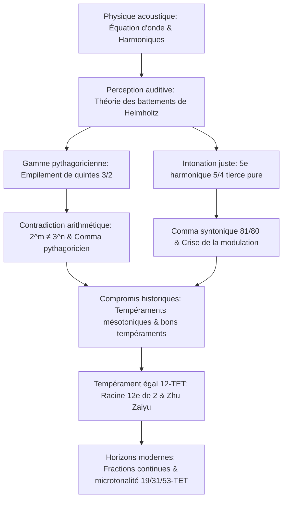

Depuis que Pythagore démontra sur son monocorde que la consonance musicale correspond à des rapports de nombres entiers simples, musique et mathématiques partagent une intimité conceptuelle profonde. Ce que l'oreille humaine perçoit comme une consonance pure est, en physique ondulatoire, l'alignement précis des harmoniques acoustiques et, en algèbre, un dilemme millénaire entre nombres premiers, rationnels et irrationnels.

Cependant, la quête d'harmonie absolue se heurte à une contradiction arithmétique fondamentale : douze quintes justes successives (rapport $3/2$) ne coïncident jamais exactement avec sept octaves pures (rapport $2/1$). En vertu du théorème fondamental de l'arithmétique :

$$2^m \neq 3^n \quad (\forall m, n \in \mathbb{N}^*)$$

Cette infime discordance – le **comma pythagoricien** ($23{,}46\text{ cents}$) et son corollaire le **comma syntonique** ($21{,}51\text{ cents}$) – a contraint les théoriciens et facteurs d'instruments à inventer les tempéraments.

## 1. Acoustique physique et série harmonique

La vibration transversale d'une corde vibrante est régie par l'équation des ondes :

$$\frac{\partial^2 y}{\partial t^2} = v^2 \frac{\partial^2 y}{\partial x^2}, \qquad v = \sqrt{\frac{T}{\rho}}$$

Les fréquences propres forment une progression arithmétique rigoureuse : $f_n = n f_1$. En 1863, Hermann von Helmholtz démontre que la consonance résulte de l'absence de battements rugueux dans la bande critique de la cochlée. Lorsque le rapport de fréquence est une fraction d'entiers simples, les harmoniques coïncident sans frottement acoustique.

## 2. L'échelle pythagoricienne et le comma pythagoricien

L'algorithme pythagoricien repose sur la multiplication répétée par la quinte pure ($3/2$). Après 12 quintes rabattues de 7 octaves, le rapport résiduel est :

$$\frac{(3/2)^{12}}{2^7} = \frac{531441}{524288} \approx 1{,}013643 \implies 23{,}46\text{ cents}$$

Ce **comma pythagoricien** crée une impasse : fermer le cercle impose une **quinte du loup** trop étroite de $23{,}5\text{ cents}$ (entre sol# et mi bémol), générant un battement sauvage. De plus, la tierce majeure pythagoricienne ($81/64 \approx 407{,}8\text{ cents}$) est extrêmement agressive.

## 3. L'intonation juste et le comma syntonique

Au XVIe siècle, Gioseffo Zarlino officialise l'harmonie à 5 limites, introduisant la tierce majeure pure $5/4$ ($386{,}31\text{ cents}$). L'écart entre la tierce pythagoricienne et la tierce pure constitue le **comma syntonique** :

$$\Delta_{\text{syntonic}} = \frac{81/64}{5/4} = \frac{81}{80} = 1{,}0125 \approx 21{,}51\text{ cents}$$

Le ton se scinde alors en ton majeur ($9/8 \approx 203{,}9\text{ cents}$) et ton mineur ($10/9 \approx 182{,}4\text{ cents}$). Sur un clavier fixe, cela engendre une quinte faussée ré-la ($680{,}5\text{ cents}$), rendant toute modulation impossible sans désaccord majeur.

## 4. Tempérament mésotonique et tempérament égal à 12 demi-tons

Le **tempérament mésotonique au quart de comma** réduit quatre quintes consécutives d'un quart de comma syntonique pour obtenir des tierces pures. Plus tard, Werckmeister imagine des tempéraments inégaux permettant de jouer dans tous les tons (le *Clavier bien tempéré* de Bach).

La solution universelle définitive fut le **tempérament égal à 12 demi-tons (12-TET)** :

$$r = \sqrt[12]{2} = 2^{1/12} \approx 1{,}059463094359$$

Calculé avec 25 décimales en 1584 par le prince mathématicien chinois **Zhu Zaiyu** (朱載堉), ce système découpe l'octave en 12 demi-tons égaux de 100 cents.

| Intervalle | Juste (cents) | Pythagoricien (cents) | Mésotonique (cents) | 12-TET (cents) | Erreur 12-TET |
| :--- | :--- | :--- | :--- | :--- | :--- |
| **Tierce majeure** | 386{,}31 | 407{,}82 | 386{,}31 | 400{,}00 | **+13{,}69** |
| **Quarte juste** | 498{,}04 | 498{,}04 | 503{,}42 | 500{,}00 | +1{,}96 |
| **Quinte juste** | 701{,}96 | 701{,}96 | 696{,}58 | 700{,}00 | **-1{,}96** |
| **Octave** | 1200{,}00 | 1200{,}00 | 1200{,}00 | 1200{,}00 | 0{,}00 |

## 5. Fractions continues et systèmes à 19, 31 et 53 divisions

La prééminence de 12 s'explique par les fractions continues de $\log_2(3)$ :

$$\log_2(3) \approx [1; 1, 1, 2, 2, 3, 1, 5, \dots] \implies \text{convergents : } 1, 2, 8/5, \mathbf{19/12}, 65/41, \mathbf{84/53}$$

Le dénominateur **12** est l'approximation optimale minimale. Les divisions en 31 (Huygens) et 53 parties fournissent des approximations quasi parfaites qui nourrissent aujourd'hui les algorithmes de réaccordage dynamique en musique électronique.
