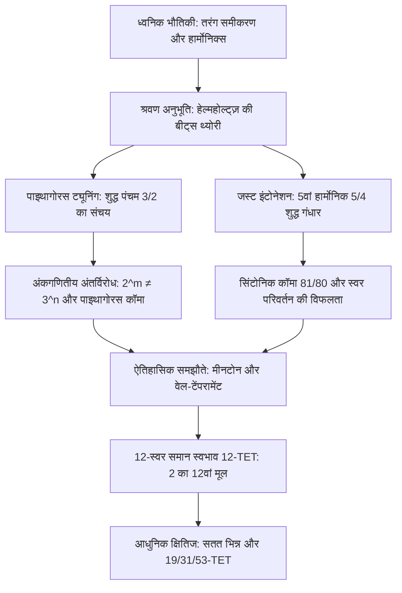

जब प्राचीन दार्शनिक पाइथागोरस ने एकतंत्री (Monochord) पर सिद्ध किया कि संगीत की मधुरता और समस्वरता सरल पूर्णांकों के अनुपातों से जुड़ी है, तब से संगीत और गणित एक अटूट बंधन में बंधे हुए हैं। मानव कान जिस ध्वनि को परम समरसता के रूप में ग्रहण करता है, वह भौतिक रूप से वायुदाब तरंगों का सटीक समकालिक मिलन है, और गणितीय रूप से अभाज्य संख्याओं, परिमेय भिन्न और अपरिमेय संख्याओं के बीच का संघर्ष है।

परंतु पूर्ण समरसता की खोज एक अनिवार्य अंकगणितीय अंतर्विरोध से टकराती है: 12 शुद्ध पंचम स्वरों (अनुपात $3/2$) का क्रमिक संचय कभी भी 7 शुद्ध सप्तकों (अनुपात $2/1$) के बराबर नहीं हो सकता। अंकगणित के मूलभूत प्रमेय के अनुसार:

$$2^m \neq 3^n \quad (\forall m, n \in \mathbb{N}^*)$$

यह सूक्ष्म अंतर — **पाइथागोरस कॉमा** ($23{,}46\text{ सेंट}$) और **सिंटोनिक कॉमा** ($21{,}51\text{ सेंट}$) — संगीत के इतिहास में विभिन्न स्वभावों (Temperament) के विकास का मूल कारण बना।

## 1. ध्वनिक भौतिकी और हार्मोनिक अधिस्वर श्रृंखला

कंपित तार की गति एक-आयामी तरंग समीकरण द्वारा निर्धारित होती है:

$$\frac{\partial^2 y}{\partial t^2} = v^2 \frac{\partial^2 y}{\partial x^2}, \qquad v = \sqrt{\frac{T}{\rho}}$$

स्वाभाविक आवृत्तियाँ एक सटीक अंकगणितीय प्रगति बनाती हैं: $f_n = n f_1$। 1863 में हरमन वॉन हेल्महोल्ट्ज़ ने स्पष्ट किया कि जब दो आवृत्तियों का अनुपात सरल पूर्णांक होता है, तो उच्च अधिस्वर आपस में पूरी तरह मेल खाते हैं, जिससे अंतःकर्ण में खुरदुरी बीट्स (धड़कनें) उत्पन्न नहीं होतीं और ध्वनि अत्यंत मधुर प्रतीत होती है।

## 2. पाइथागोरस ट्यूनिंग और पाइथागोरस कॉमा

12 शुद्ध पंचम स्वरों ($3/2$) को जोड़कर उन्हें 7 सप्तक ($2^7$) नीचे उतारने पर अनुपात प्राप्त होता है:

$$\frac{(3/2)^{12}}{2^7} = \frac{531441}{524288} \approx 1{,}013643 \implies 23{,}46\text{ सेंट}$$

यह **पाइथागोरस कॉमा** चक्र को बंद होने से रोकता है। चक्र को जबरन बंद करने पर एक **भेड़िया पंचम (Wolf Fifth)** उत्पन्न होता है जो $23{,}5\text{ सेंट}$ संकीर्ण होता है और कर्कश धड़कन उत्पन्न करता है। साथ ही, पाइथागोरस का शुद्ध गंधार ($81/64 \approx 407{,}8\text{ सेंट}$) अत्यधिक कठोर होता है।

## 3. जस्ट इंटोनेशन और सिंटोनिक कॉमा

पुनर्जागरण काल में ज़ारलिनो ने 5वें अधिस्वर पर आधारित शुद्ध गंधार $5/4$ ($386{,}31\text{ सेंट}$) को अपनाया। पाइथागोरस और शुद्ध गंधार का अंतर **सिंटोनिक कॉमा** कहलाता है:

$$\Delta_{\text{syntonic}} = \frac{81/64}{5/4} = \frac{81}{80} = 1{,}0125 \approx 21{,}51\text{ सेंट}$$

इसके कारण पूर्ण स्वर दो भागों (प्रमुख स्वर $9/8$ और गौण स्वर $10/9$) में विभाजित हो जाता है। कीबोर्ड वाद्ययंत्रों पर D-A पंचम स्वर $21{,}5\text{ सेंट}$ छोटा होकर कर्कश हो जाता है, जिससे राग या स्केल बदलना असंभव हो जाता है।

## 4. मीनटोन स्वभाव और 12-स्वर समान स्वभाव (12-TET)

**क्वार्टर-कॉमा मीनटोन** ने शुद्ध गंधार प्राप्त करने के लिए चार पंचम स्वरों को छोटा किया। बाद में बार्क काल में वर्कमीस्टर ने ऐसी ट्यूनिंग बनाई जिससे सभी 24 स्केल्स में वादन संभव हुआ।

समस्या का पूर्ण ज्यामितीय समाधान **12-स्वर समान स्वभाव (12-TET)** द्वारा दिया गया:

$$r = \sqrt[12]{2} = 2^{1/12} \approx 1{,}059463094359$$

चीनी विद्वान और गणितज्ञ **झू ज़ाइयू** (Zhu Zaiyu) ने 1584 में 25 दशमलव स्थानों तक इस मान की विश्व में पहली बार सटीक गणना की थी।

| अंतराल | शुद्ध (सेंट) | पाइथागोरस (सेंट) | मीनटोन (सेंट) | 12-TET (सेंट) | 12-TET में अंतर |
| :--- | :--- | :--- | :--- | :--- | :--- |
| **शुद्ध गंधार** | 386{,}31 | 407{,}82 | 386{,}31 | 400{,}00 | **+13{,}69** |
| **शुद्ध मध्यम** | 498{,}04 | 498{,}04 | 503{,}42 | 500{,}00 | +1{,}96 |
| **शुद्ध पंचम** | 701{,}96 | 701{,}96 | 696{,}58 | 700{,}00 | **-1{,}96** |
| **सप्तक** | 1200{,}00 | 1200{,}00 | 1200{,}00 | 1200{,}00 | 0{,}00 |

## 5. सतत भिन्न और उन्नत प्रणालियाँ (19, 31, 53-TET)

12 का चयन $\log_2(3)$ के सतत भिन्न विस्तार से स्वाभाविक रूप से आता है:

$$\log_2(3) \approx [1; 1, 1, 2, 2, 3, 1, 5, \dots] \implies 1, 2, 8/5, \mathbf{19/12}, 65/41, \mathbf{84/53}$$

हर **12** पंचम स्वर में केवल $-1{,}96\text{ सेंट}$ की न्यूनतम त्रुटि देता है। 31-TET और 53-TET अत्यंत उच्च शुद्धता प्रदान करते हैं, जिनका उपयोग आज के डिजिटल सिंथेसाइज़र और माइक्रोफोनिक संगीत में किया जा रहा है।
