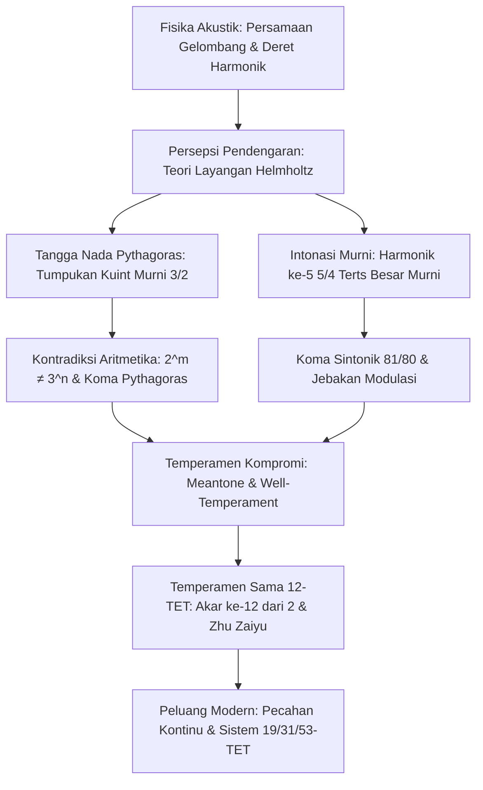

Sejak Pythagoras membuktikan pada monokord bahwa keindahan konsonansi nada berakar pada rasio bilangan bulat sederhana, musik dan matematika terikat dalam satu simfoni intelektual. Keselarasan suara yang dinikmati telinga manusia secara fisik adalah tumpang tindih gelombang getaran udara, dan secara matematis merupakan pergulatan antara bilangan prima, rasional, dan irasional.

Namun, pencarian keselarasan murni terhalang oleh sebuah kontradiksi aritmetika mutlak: menumpuk 12 interval kuint murni (rasio $3/2$) tidak akan pernah tepat sama dengan 7 oktaf murni (rasio $2/1$). Berdasarkan Teorema Fundamental Aritmetika:

$$2^m \neq 3^n \quad (\forall m, n \in \mathbb{N}^*)$$

Ketidaksesuaian kecil namun keras kepala ini — **Koma Pythagoras** ($23{,}46\text{ sen}$) dan **Koma Sintonik** ($21{,}51\text{ sen}$) — telah mendorong lahirnya berbagai sistem penyeteman (temperamen) selama berabad-abad.

## 1. Fisika Akustik dan Deret Harmonik

Getaran dawai ideal diatur oleh persamaan gelombang 1 dimensi:

$$\frac{\partial^2 y}{\partial t^2} = v^2 \frac{\partial^2 y}{\partial x^2}, \qquad v = \sqrt{\frac{T}{\rho}}$$

Frekuensi eigen membentuk deret aritmetika sempurna: $f_n = n f_1$. Pada 1863, Hermann von Helmholtz membuktikan bahwa konsonansi muncul karena tidak adanya layangan (beats) kasar di pita kritis koklea. Rasio bilangan bulat sederhana membuat nada atas harmonik berimpit sempurna.

## 2. Penyeteman Pythagoras dan Koma Pythagoras

Dengan menumpuk 12 interval kuint murni ($3/2$) dan menurunkannya sebanyak 7 oktaf ($2^7$):

$$\frac{(3/2)^{12}}{2^7} = \frac{531441}{524288} \approx 1{,}013643 \implies 23{,}46\text{ sen}$$

**Koma Pythagoras** ini menyebabkan lingkaran kuint tidak dapat menutup. Jika dipaksa menutup, timbul **kuint serigala (Wolf Fifth)** yang menyempit sebesar $23{,}5\text{ sen}$ ($678{,}5\text{ sen}$) dan menghasilkan suara berdengung liar. Selain itu, terts besar Pythagoras ($81/64 \approx 407{,}8\text{ sen}$) terdengar sangat tegang dan kasar.

## 3. Intonasi Murni dan Koma Sintonik

Pada era Renaisans, Gioseffo Zarlino memasukkan harmonik ke-5 untuk membentuk terts besar murni $5/4$ ($386{,}31\text{ sen}$). Selisih antara terts Pythagoras dan terts murni disebut **Koma Sintonik**:

$$\Delta_{\text{syntonic}} = \frac{81/64}{5/4} = \frac{81}{80} = 1{,}0125 \approx 21{,}51\text{ sen}$$

Hal ini membelah nada utuh menjadi nada utuh besar ($9/8$) dan kecil ($10/9$). Pada alat musik tuts, kuint D-A menjadi menyempit drastis ($680{,}5\text{ sen}$), memicu ketidakharmonisan fatal saat berpindah nada dasar (modulasi).

## 4. Temperamen Meantone dan Revolusi 12-TET

**Temperamen Meantone Seperempat Koma** mempersempit empat kuint berturut-turut sebesar seperempat koma sintonik agar menghasilkan terts murni. Di era Barok, Werckmeister menciptakan "Well-Temperament" yang memungkinkan ke-24 tangga nada dimainkan.

Solusi matematis simetris yang menyatukan segalanya adalah **12 Nada Temperamen Sama (12-TET)**:

$$r = \sqrt[12]{2} = 2^{1/12} \approx 1{,}059463094359$$

Pangeran dan matematikawan Tiongkok **Zhu Zaiyu** (朱載堉) adalah orang pertama di dunia yang menghitung nilai ini dengan presisi 25 digit desimal pada tahun 1584.

| Interval | Murni (sen) | Pythagoras (sen) | Meantone (sen) | 12-TET (sen) | Galat 12-TET |
| :--- | :--- | :--- | :--- | :--- | :--- |
| **Terts Besar** | 386{,}31 | 407{,}82 | 386{,}31 | 400{,}00 | **+13{,}69** |
| **Kuart Murni** | 498{,}04 | 498{,}04 | 503{,}42 | 500{,}00 | +1{,}96 |
| **Kuint Murni** | 701{,}96 | 701{,}96 | 696{,}58 | 700{,}00 | **-1{,}96** |
| **Oktaf** | 1200{,}00 | 1200{,}00 | 1200{,}00 | 1200{,}00 | 0{,}00 |

## 5. Pecahan Kontinu dan Sistem Mikrotonal (19, 31, 53-TET)

Pemilihan angka 12 diturunkan secara alami dari ekspansi pecahan kontinu $\log_2(3)$:

$$\log_2(3) \approx [1; 1, 1, 2, 2, 3, 1, 5, \dots] \implies 1, 2, 8/5, \mathbf{19/12}, 65/41, \mathbf{84/53}$$

Penyebut **12** memberikan efisiensi instrumen optimal dengan deviasi kuint hanya $-1{,}96\text{ sen}$. Sistem 31-TET dan 53-TET memberikan kemurnian harmonik yang jauh lebih tinggi dan kini digunakan dalam musik elektronik modern serta mikrotonalitas terprogram.
