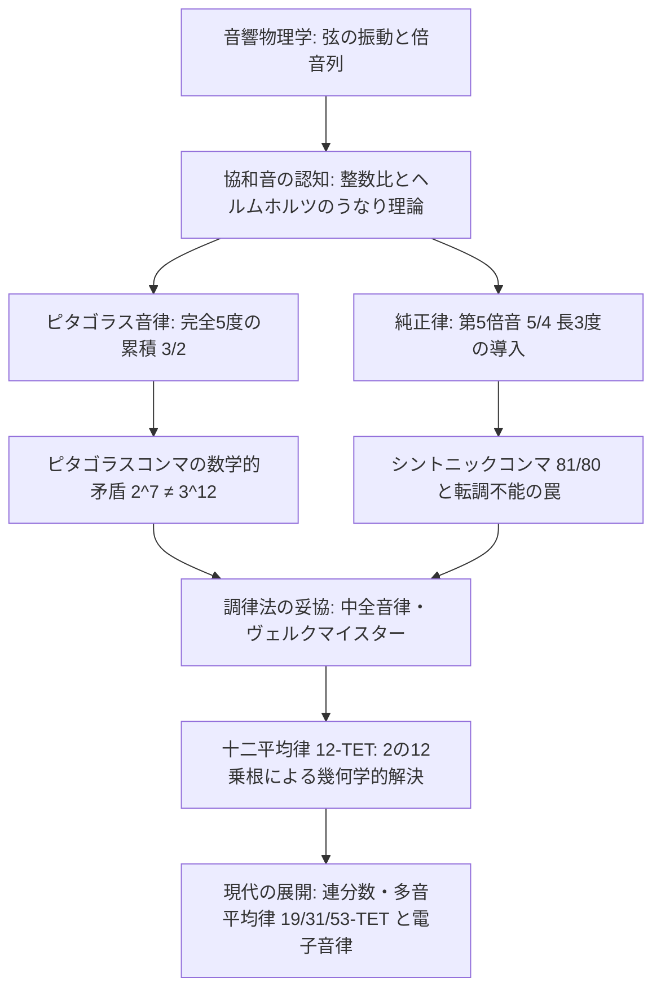
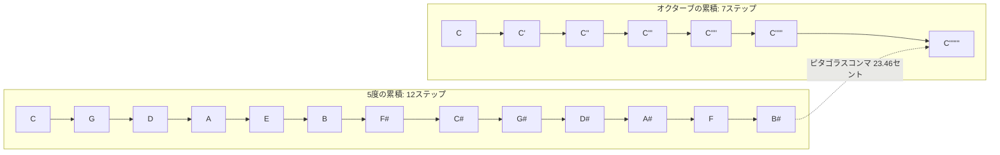
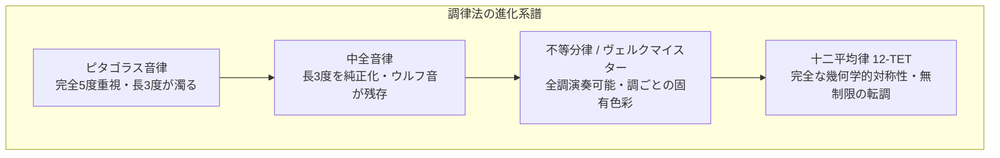

古代ギリシャの哲学者ピタゴラスが鍛冶屋の金槌の音に調和の神秘を見出し、モノコード（一弦琴）を用いて弦長比の美を数理として定式化して以来、音楽と数学は不可分の関係として探求されてきました。人間の耳が「心地よい協和音」として感知する響きは、物理的には空気の圧力振動における整数比の重なり合いであり、数学的には素数と有理数、そして無理数の織りなす代数学的葛藤の歴史でもあります。

しかし、協和性を極限まで追求した「純正な響き」を求めた人類は、純粋な数学的矛盾に直面することになりました。完全5度（3:2）を12回積み重ねても、オクターブ（2:1）を7回積み重ねた周波数とは永久に一致しない——すなわち「$2^m \neq 3^n$」という素因数分解の一意性に起因する超越的ギャップです。この微小なずれである「ピタゴラスコンマ」や「シントニックコンマ」をいかに分配し、いかに飼い慣らすかという試行錯誤こそが、西洋音楽史における調律法（Temperament）の変遷そのものでした。

本稿では、音響物理学における倍音列の発生機構から出発し、ピタゴラス音律、純正律、中全音律、そして現代の世界標準である十二平均律（12-TET）に至る数学的原理、セント値による微小音程計算、連分数展開による多音平均律理論までを徹底的に解き明かします。

---

## 1. 音の物理学と調和振動（Harmonics and Overtones）

### 弦の振動方程式と定在波

弦楽器やピアノの弦が振動するとき、その運動は1次元の波動方程式によって支配されます。弦の線密度を $\rho$、張力を $T$ とすると、波の伝播速度 $v$ は次式で与えられます：

$$v = \sqrt{\frac{T}{\rho}}$$

弦の両端（$x = 0$ および $x = L$）が固定されている境界条件のもとで、波動方程式：

$$\frac{\partial^2 y}{\partial t^2} = v^2 \frac{\partial^2 y}{\partial x^2}$$

の一般解は、無限個の固有振動モード（定在波）の重ね合わせとして展開されます。境界条件 $y(0, t) = y(L, t) = 0$ を満たす固有振動の波長 $\lambda_n$ および固有振動数 $f_n$ は、次のように離散化されます：

$$\lambda_n = \frac{2L}{n}, \quad f_n = n \frac{v}{2L} = n f_1 \quad (n = 1, 2, 3, \dots)$$

ここで $f_1$ は**基音（Fundamental frequency）**であり、$f_n = n f_1$ は**第 $n$ 倍音（$n$-th harmonic）**と呼ばれます。弦が撥弦または擦弦されたとき、発生する音は単一の正弦波ではなく、これら整数倍の周波数を持つ無限の倍音成分がフーリエ級数として合成された複合波となります。

| 倍音番号 ($n$) | 周波数比 ($f_n / f_1$) | 音楽的音程 | 周波数比の既約分数 |
| :--- | :--- | :--- | :--- |
| **第1倍音** | 1.000 | 基音（Unison） | 1/1 |
| **第2倍音** | 2.000 | 1オクターブ上（Octave） | 2/1 |
| **第3倍音** | 3.000 | オクターブ＋完全5度（Fifth） | 3/1 |
| **第4倍音** | 4.000 | 2オクターブ上（2 Octaves） | 4/1 |
| **第5倍音** | 5.000 | 2オクターブ＋長3度（Major Third） | 5/1 |
| **第6倍音** | 6.000 | 2オクターブ＋完全5度 | 6/1 |
| **第7倍音** | 7.000 | 2オクターブ＋自然7度（Natural Seventh） | 7/1 |
| **第8倍音** | 8.000 | 3オクターブ上 | 8/1 |

1オクターブ内にこれらの音程を折り返す（周波数を2の累乗で割って $[1, 2)$ の区間に収める）ことにより、純粋な整数比を持つ音楽的音程が得られます：
- **オクターブ（Octave）**: $\frac{2}{1} = 2.0$
- **完全5度（Perfect Fifth）**: $\frac{3}{2} = 1.5$
- **完全4度（Perfect Fourth）**: $\frac{2}{3/2} = \frac{4}{3} \approx 1.3333$
- **長3度（Major Third）**: $\frac{5}{4} = 1.25$
- **短3度（Minor Third）**: $\frac{3/2}{5/4} = \frac{6}{5} = 1.20$

### ヘルムホルツの不協和音論とうなり理論

19世紀の偉大な物理学者ヘルマン・フォン・ヘルムホルツ（Hermann von Helmholtz）は、名著『音感覚論』（1863年）において、なぜ人間が特定の音程を協和音として心地よく感じ、他の音程を不協和音として拒絶するのかを生理物理学的に解明しました。

2つの純音の周波数を $f_A$ および $f_B$ とするとき、その周波数差 $\Delta f = |f_A - f_B|$ が小さい場合、振幅の周期的な干渉による「うなり（Beats）」が生じます。
うなりの周波数が毎秒1回から十数回程度であれば緩やかなトレモロとして聞こえますが、周波数差が内耳の基底膜における**臨界帯域（Critical Bandwidth）**の約 $30 \sim 40 \text{ Hz}$ 付近に達すると、耳は激しい「ざらつき（Roughness）」を感知し、強い不協和感・不快感を覚えます。

複合音同士を同時に鳴らした場合、それぞれの基音だけでなく、無数に含まれる高次倍音同士が干渉し合います。周波数比が単純な整数比（例：完全5度の $3:2$）である場合、基音 $f_1$ の倍音列 $\{2f_1, 3f_1, 4f_1, 5f_1, 6f_1, \dots\}$ と、完全5度上の音 $\frac{3}{2}f_1$ の倍音列 $\{\frac{3}{2}f_1, 3f_1, \frac{9}{2}f_1, 6f_1, \dots\}$ は、第2倍音と第3倍音、第4倍音と第6倍音というように周期的に完全に一致するため、倍音間での不快なうなりが原理的に発生しません。これが「協和音」の物理的正体です。

---

## 2. ピタゴラス音律：完全5度の累積とピタゴラスコンマ

### モノコードと5度圏の生成

紀元前6世紀、ピタゴラスとその教団は、長さ $L$ の弦の中央（$L/2$）を押さえると正確に1オクターブ高い音（周波数比 $2:1$）が鳴り、弦長の $2/3$ を振動させると完全5度高い音（周波数比 $3:2$）が鳴ることを発見しました。ピタゴラス学派にとって、宇宙の根源は数であり、神聖な数「1, 2, 3, 4」（テトラクティス、合計すると10）の比率こそが万物の調和を司る絶対の真理でした。

ピタゴラス音律（Pythagorean Tuning）の原理は極めて明快です。
**「完全5度（周波数比 $3/2$）の上昇と、オクターブ（周波数比 $1/2$）の下降のみを用いて、12の半音をすべて生成する」**。

基音を $C = 1$ とすると、5度上の音は次々と以下のように求められます：
1. $G = C \times \frac{3}{2} = \frac{3}{2}$
2. $D = G \times \frac{3}{2} \times \frac{1}{2} = \frac{9}{8}$（オクターブ内に収めるため $1/2$ を乗じる）
3. $A = D \times \frac{3}{2} = \frac{27}{16}$
4. $E = A \times \frac{3}{2} \times \frac{1}{2} = \frac{81}{64}$
5. $B = E \times \frac{3}{2} = \frac{243}{128}$
6. $F\sharp = B \times \frac{3}{2} \times \frac{1}{2} = \frac{729}{512}$
7. $C\sharp = F\sharp \times \frac{3}{2} \times \frac{1}{2} = \frac{2187}{2048}$
8. $G\sharp = C\sharp \times \frac{3}{2} = \frac{6561}{4096}$
9. $D\sharp = G\sharp \times \frac{3}{2} \times \frac{1}{2} = \frac{19683}{16384}$
10. $A\sharp = D\sharp \times \frac{3}{2} = \frac{59049}{32768}$
11. $E\sharp / F = A\sharp \times \frac{3}{2} \times \frac{1}{2} = \frac{177147}{131072}$
12. $B\sharp = E\sharp \times \frac{3}{2} = \frac{531441}{262144}$

12回完全5度を積み重ねた音 $B\sharp$ を、7オクターブ下げて基音 $C$ のオクターブ帯に収めると、その周波数は以下のようになります：

$$\frac{(3/2)^{12}}{2^7} = \frac{3^{12}}{2^{19}} = \frac{531441}{524288} \approx 1.01364326477$$

基音の完全オクターブであるはずの音（比率 1.000000）に対して、約 $1.364\%$ だけ高くなってしまうのです！

### ピタゴラスコンマの厳密な数学的必然性

なぜこのような不一致が起きるのでしょうか？
数学的に見れば、完全5度の周波数比は $3/2$、オクターブの周波数比は $2/1$ です。もし5度圏が完全に閉じ、ある回数 $n$ 回の5度上昇が $m$ 回のオクターブ上昇と完全に一致するならば、次の方程式が整数解 $n, m \in \mathbb{N}$ を持たなければなりません：

$$\left(\frac{3}{2}\right)^n = 2^m \iff 3^n = 2^{m+n}$$

しかし、算術の基本定理（素因数分解の一意性）により、左辺の素因数は $3$ のみ、右辺の素因数は $2$ のみです。$n > 0$ である限り、奇数である $3^n$ が偶数である $2^{m+n}$ と等しくなることは数学的に絶対にあり得ません。

この差分を**ピタゴラスコンマ（Pythagorean Comma）**と呼びます。

音程の対数単位である**セント（Cent）**を用いてこのギャップを計算してみましょう。セント値はオクターブ（周波数比2）を1200等分した対数尺度であり、任意の周波数比 $R$ に対するセント値 $C(R)$ は次式で定義されます：

$$C(R) = 1200 \times \log_2(R)$$

ピタゴラスコンマのセント値を計算すると：

$$C_{\text{pyth}} = 1200 \times \log_2\left(\frac{531441}{524288}\right) = 1200 \times \left(12 \log_2 3 - 19\right) \approx 23.460010 \text{ cents}$$

半音が100セントですから、ピタゴラスコンマは約四分の一半音（約23.5セント）という、人間の耳で明確に音痴として知覚できる無視できない巨大なズレとなります。

### ウルフの5度（Wolf Fifth）

ピタゴラス音律で12音の音階を構成し、円環を無理やり閉じる（例えば $G\sharp$ から $E\flat$ の音程）と、12個のうち1つの5度にしわ寄せの全負荷が集中します。その5度は通常の純正な完全5度（約701.96セント）からピタゴラスコンマ分（23.46セント）削られた、約678.49セントの極度に狭い音程となります。

この音程を同時に鳴らすと、秒間数十回もの激しい濁ったうなりが発生し、まるで飢えた狼の遠吠えのように聞こえることから、**「ウルフの5度（Wolf Fifth / 狼音）」**と名付けられました。ピタゴラス音律の鍵盤楽器では、ウルフの5度を含む和音（例えば $A\flat - E\flat$ や $C\sharp - A\flat$ など）は完全に演奏不能であり、許容される調性が著しく制限されていました。

さらに、ピタゴラス音律の長3度（$C$ に対する $E$）は $\frac{81}{64} \approx 1.2656$（約407.82セント）であり、後述する自然な第5倍音の純正長3度（$\frac{5}{4} = 1.25$、約386.31セント）に比べて約21.5セントも高く、三和音として鳴らすと非常に緊張感の高い、濁った響きとなってしまいます。

---

## 3. 純正律：第5倍音の導入とシントニックコンマ

### ルネサンスの多声音楽とザルリーノのシンフォニア

中世までの西洋音楽は、グレゴリオ聖歌に代表される単旋律（モノフォニー）や、完全8度・完全5度・完全4度のみを協和音とするオルガヌムでした。そのため、旋律の美しさと完全5度の純粋さを優先するピタゴラス音律で何の問題もありませんでした。

しかしルネサンス期（15〜16世紀）に入ると、3度の和音を豊かな協和音として多用するポリフォニー（多声音楽）が開花します。イタリアの音楽理論家ジョゼッフォ・ザルリーノ（Gioseffo Zarlino, 1517–1590）らは、ピタゴラスの「3リミット（素因数2と3のみ）」の音律体系を打破し、自然界の第5倍音を取り入れた**「5リミット（素因数2, 3, 5）」による純正律（Just Intonation）**を体系化しました。

純正律における主要三和音（ド・ミ・ソ、ファ・ラ・ド、ソ・シ・レ）の周波数比は、完全に $4 : 5 : 6$ という最小の整数比に統一されます：

$$\text{Major Triad} = 4 : 5 : 6 \iff \text{根音 } 1, \quad \text{長3度 } \frac{5}{4}, \quad \text{完全5度 } \frac{3}{2}$$

これにより、長3度はうなりが一切発生しない透き通った完全無欠の美しい響きを獲得しました。

| 音名 | 周波数比（対C） | 小数点表記 | セント値 | 構成倍音比 |
| :--- | :--- | :--- | :--- | :--- |
| **C** | 1/1 | 1.0000 | 0.00 | 基音 |
| **D** | 9/8 | 1.1250 | 203.91 | 大全音 |
| **E** | 5/4 | 1.2500 | 386.31 | 純正長3度 |
| **F** | 4/3 | 1.3333 | 498.04 | 純正完全4度 |
| **G** | 3/2 | 1.5000 | 701.96 | 純正完全5度 |
| **A** | 5/3 | 1.6667 | 884.36 | 純正長6度 |
| **B** | 15/8 | 1.8750 | 1088.27 | 純正長7度 |
| **C'** | 2/1 | 2.0000 | 1200.00 | オクターブ |

### シントニックコンマの数理的導出

純正律の導入によって、ピタゴラス音律の長3度（$\frac{81}{64}$）と、純正な長3度（$\frac{5}{4}$）の間に新たな差分が生じることになりました。この比率を**シントニックコンマ（Syntonic Comma）**、またはディデュモスのコンマと呼びます：

$$\Delta_{\text{syntonic}} = \frac{81/64}{5/4} = \frac{81}{64} \times \frac{4}{5} = \frac{81}{80} = 1.0125$$

セント値に換算すると：

$$C_{\text{syntonic}} = 1200 \times \log_2\left(\frac{81}{80}\right) = 1200 \times \left(4 \log_2 3 - \log_2 5 - 4\right) \approx 21.50629 \text{ cents}$$

シントニックコンマは約21.5セントであり、ピタゴラスコンマ（23.46セント）に匹敵する大きなズレです。

### 全音の分裂：大全音と小全音の致命的ジレンマ

シントニックコンマの存在は、純正律において極めて深刻な代数学的破綻を引き起こします。
CからDへの全音の比率は：

$$\frac{D}{C} = \frac{9}{8} = 1.125 \quad (\approx 203.91 \text{ cents}) \quad \text{【大全音: Major Tone】}$$

これに対して、DからEへの全音の比率を計算すると：

$$\frac{E}{D} = \frac{5/4}{9/8} = \frac{5}{4} \times \frac{8}{9} = \frac{10}{9} \approx 1.1111 \quad (\approx 182.40 \text{ cents}) \quad \text{【小全音: Minor Tone】}$$

全音の幅が均一ではなく、周波数比 $\frac{9}{8}$ の「大全音」と $\frac{10}{9}$ の「小全音」の2種類に分裂してしまったのです。その差はまさにシントニックコンマそのものです：

$$\frac{9/8}{10/9} = \frac{81}{80}$$

この全音の分裂は、固定ピッチを持つ鍵盤楽器において壊滅的な結果をもたらします。
例えば、D音を根音とする和音（D - F - A）を鳴らそうとした場合、DからAへの音程を計算すると：

$$\frac{A}{D} = \frac{5/3}{9/8} = \frac{5}{3} \times \frac{8}{9} = \frac{40}{27} \approx 1.4815 \quad (\approx 680.45 \text{ cents})$$

完全5度（$\frac{3}{2} = 1.5000$、701.96セント）であるべき音程が、シントニックコンマ分（21.51セント）も狭い不完全な音程になってしまいます。この狂ったD-Aの和音は激しくうなり、実用上全く使い物になりません。

さらに、ハ長調（C major）に合わせて調律された純正律のオルガンで、ト長調（G major）やヘ長調（F major）に転調しようとすると、すべての和音の周波数関係が崩壊し、耐え難い不協和音の嵐となります。**「純正律は、単一の調の中では天国のような純正な響きを奏でるが、転調した瞬間に地獄の不協和音と化す」**という致命的な代償を抱えていたのです。

---

## 4. 中全音律（Meantone Temperament）と古典調律の妥協

16世紀から18世紀にかけての音楽家・数学者たちは、このジレンマを解決するために様々な「折衷案（Temperament：妥協、調律）」を考案しました。その代表格が**中全音律（Meantone Temperament）**です。

### 1/4コミュ中全音律の数学

中全音律の基本思想は、大全音（$\frac{9}{8}$）と小全音（$\frac{10}{9}$）の違いを解消するため、シントニックコンマ（$\frac{81}{80}$）を4つの完全5度に等分に分散させ、長3度（$\frac{5}{4}$）を完全に純正に保つというものです。

$$C \to G \to D \to A \to E$$

この4つの完全5度を積み重ねるとピタゴラス長3度（$\frac{81}{64}$）になりますが、これを純正長3度（$\frac{5}{4}$）と一致させるためには、4つの5度の積が元の比率より $\frac{81}{80}$ だけ小さくなればよいことになります。
したがって、各完全5度 $R_5$ をシントニックコンマの4乗根で割って狭めます：

$$R_{5,\text{meantone}} = \frac{3}{2} \times \left(\frac{80}{81}\right)^{1/4} \approx 1.495349$$

セント値で表すと：

$$C_{5,\text{meantone}} = C(3/2) - \frac{1}{4} C_{\text{syntonic}} \approx 701.955 - \frac{21.506}{4} \approx 696.579 \text{ cents}$$

純正5度（701.96セント）より約5.38セント狭い5度を採用することで、主要な8つの調（変ロ長調からイ長調程度）において純正な長3度（386.31セント）が得られ、バロック初期のオルガンやチェンバロ音楽に豊かで甘美な和音をもたらしました。

しかし、中全音律でも12音すべてを均等に閉じることはできず、残された $G\sharp - E\flat$ などの音程には、ピタゴラス音律を上回る凄まじいウルフ音（約737.6セント、純正5度より約35.6セントも広い！）が生じ、遠隔調への転調は依然として不可能でした。

---

## 5. 十二平均律（12-TET）の数学的勝利

### 幾何平均と2の12乗根

オクターブ内に存在する12の半音の比率を完全に同一にし、あらゆる調への自由な転調・移調を可能にする唯一の数学的解——それが**十二平均律（12-Tone Equal Temperament, 12-TET）**です。

12回半音を掛け合わせると周波数がちょうど2倍（オクターブ）になるため、半音の周波数比を $r$ と置くと、次の代数方程式が得られます：

$$r^{12} = 2 \implies r = \sqrt[12]{2} = 2^{1/12} \approx 1.059463094359295$$

この無理数 $2^{1/12}$ は、対数尺度であるセント系においては正確に100セントとなります。各音の周波数は、基音 $f_0$ に対して指数関数的に配置されます：

$$f_k = f_0 \times 2^{k/12} \quad (k = 0, 1, 2, \dots, 12)$$

### 朱載堉（ジュ・ザイユー）とステヴィンによる独立発見

十二平均律の数学的厳密解を世界で初めて導出したのは、中国・明朝の皇族であり数学者・音楽理論家であった**朱載堉（Zhu Zaiyu, 1536–1611）**です。
彼は1584年の著書『律学新説』において、大型の算盤を用いて81桁に及ぶ驚異的な開平・開立方計算を繰り返し、2の12乗根：

$$\sqrt[12]{2} \approx 1.059463094359295264561825$$

を極めて高い精度で計算し、精密な基準竹管（十二律）を製作しました。西洋においては、オランダの数学者シモン・ステヴィン（Simon Stevin, 1548–1620）が1585年頃に独自に $2^{1/12}$ の計算法を提示し、フランスのマラン・メルセンヌ（Marin Mersenne, 1636年『汎調和論』）によって理論が確立されました。

### バッハ『平均律クラヴィーア曲集』の史実と誤解

ヨハン・ゼバスティアン・バッハ（J. S. Bach）の不朽の傑作『Das Wohltemperirte Clavier』（よく調律された鍵盤楽器のための曲集、1722年）は、24のすべての長調・短調による前奏曲とフーガを含んでおり、長年「十二平均律の普及のための記念碑」と信じられてきました。

しかし現代の音楽学の研究により、バッハが意図した「Wohltemperirt（良好に調律された）」とは、現代の機械的な十二平均律ではなく、アンドレアス・ヴェルクマイスター（Andreas Werckmeister）やヨハン・フィリップ・キルンベルガー（Kirnberger）らが提唱した**「不等分律（Well Temperament）」**であったことが判明しています。
不等分律は、24のすべての調が破綻なく演奏可能でありながら、調ごとに和音の濁り具合や響きの緊張感が微妙に異なり、調性ごとの「固有の感情的色彩（Affekt）」を色濃く残していました。十二平均律の完全な定着は、19世紀中盤以降のピアノ工業の発展と近代音響学の成立を待つ必要がありました。

---

## 6. 音律の包括的比較対照とセント値マトリクス

各調律法における12の音程のセント値と、純正比率からの偏差を詳細に比較した対照表を以下に示します（基音 C = 0 セント）。

| 音名 | 音程 | ピタゴラス音律 | 純正律 (5-Limit) | 1/4コミュ中全音律 | 十二平均律 (12-TET) | 純正比率 (純正律) |
| :--- | :--- | :--- | :--- | :--- | :--- | :--- |
| **C** | 完全1度 | 0.00 | 0.00 | 0.00 | 0.00 | 1/1 (0.00) |
| **C# / Db** | 短2度 | 90.22 (Db) | 111.73 (Db) | 76.05 (C#) | 100.00 | 16/15 (111.73) |
| **D** | 長2度 | 203.91 | 203.91 (大全音) | 193.16 | 200.00 | 9/8 (203.91) |
| **D# / Eb** | 短3度 | 294.13 (Eb) | 315.64 (Eb) | 310.26 (Eb) | 300.00 | 6/5 (315.64) |
| **E** | 長3度 | 407.82 | 386.31 | 386.31 | 400.00 | 5/4 (386.31) |
| **F** | 完全4度 | 498.04 | 498.04 | 503.42 | 500.00 | 4/3 (498.04) |
| **F# / Gb** | 増4度 / 減5度 | 611.73 (F#) | 590.22 (F#) | 579.47 (F#) | 600.00 | 45/32 (590.22) |
| **G** | 完全5度 | 701.96 | 701.96 | 696.58 | 700.00 | 3/2 (701.96) |
| **G# / Ab** | 短6度 | 792.18 (Ab) | 813.69 (Ab) | 813.69 (Ab) | 800.00 | 8/5 (813.69) |
| **A** | 長6度 | 905.87 | 884.36 | 889.74 | 900.00 | 5/3 (884.36) |
| **A# / Bb** | 短7度 | 996.09 (Bb) | 1017.60 (Bb) | 1006.84 (Bb) | 1000.00 | 9/5 (1017.60) |
| **B** | 長7度 | 1109.78 | 1088.27 | 1082.89 | 1100.00 | 15/8 (1088.27) |
| **C'** | 完全8度 | 1200.00 | 1200.00 | 1200.00 | 1200.00 | 2/1 (1200.00) |

### 十二平均律の「代償」

十二平均律は万能の解決策に見えますが、音響物理学的には重大な妥協を内包しています：
1. **長3度（Major Third）の濁り**:
   純正長3度（386.31セント）に対して、十二平均律の長3度は400.00セントと、**+13.69セント（約1.14%）も高い**。ピアノやオーケストラで長三和音（C-E-G）を強く鳴らすと、E音が高すぎるために毎秒数回のうなりが生じ、純正律のような澄み切った静謐な響きは得られません。
2. **完全5度のわずかな縮小**:
   純正完全5度（701.96セント）に対し、平均律は700.00セントと、**-1.96セント狭い**。幸いにもこのズレは人間の耳の弁別閾（約2〜3セント）の境界線上にあるため、旋律や和音の中でほとんど気になりません。

---

## 7. 連分数展開と多音平均律（19, 31, 53平均律）

十二平均律はなぜ「12」という分割数を選んだのでしょうか？ なぜ10や15や20分割ではいけなかったのでしょうか？
この問いに対する完璧な解答を与えるのが、数論における**連分数展開（Continued Fraction Expansion）**です。

### $\log_2(3)$ の連分数近似

私たちが求めているのは、完全5度の周波数比 $3/2$ をオクターブ周波数比 $2$ の有理数乗で近似することです：

$$\left(\frac{3}{2}\right) \approx 2^{p/q} \iff 3 \approx 2^{(p+q)/q}$$

両辺の2を底とする対数を取ると：

$$\log_2(3) \approx \frac{p+q}{q} = 1 + \frac{p}{q}$$

ここで $\log_2(3) \approx 1.58496250072$ の連分数展開を計算します：

$$\log_2(3) = 1 + \frac{1}{1 + \frac{1}{1 + \frac{1}{2 + \frac{1}{2 + \frac{1}{3 + \frac{1}{1 + \frac{1}{5 + \dots}}}}}}}$$

この連分数を途中で打ち切ることで、以下の最良有理数近似（Convergents）が得られます：

| 次数 | 連分数近似分数 | 小数値 | 分割数 $N$（分母） | 5度のステップ数 | 5度のセント値 | 純正5度との誤差 |
| :--- | :--- | :--- | :--- | :--- | :--- | :--- |
| 1 | 1/1 | 1.0000 | 1 | 0 | 0.00 | -701.96 |
| 2 | 2/1 | 2.0000 | 1 | 1 | 1200.00 | +498.04 |
| 3 | 8/5 | 1.6000 | 5 | 3 | 720.00 | +18.04 |
| 4 | **19/12** | **1.5833** | **12** | **7** | **700.00** | **-1.96** |
| 5 | **65/41** | **1.5853** | **41** | **24** | **702.44** | **+0.48** |
| 6 | **84/53** | **1.5849** | **53** | **31** | **701.89** | **-0.07** |

連分数の近似分数に、見事に分母 **12** が現れます！
すなわち、オクターブを12等分したとき、7ステップ進んだ音程（$700.00 \text{ cents}$）が、純正完全5度（$701.96 \text{ cents}$）に対して誤差わずか 1.96 セントという驚異的な精度で合致するのです。12という数は、完全5度を極めて少ない鍵盤数で実用化するための「数学的奇跡の最小公倍数」でした。

さらに高度な多音平均律系も理論化されています：
- **19平均律（19-TET）**: 短3度と短6度の近似が極めて優秀で、長3度も平均律より純正律に近い。
- **31平均律（31-TET）**: オランダの物理学者クリスティアーン・ホイヘンス（Christiaan Huygens, 1629–1695）が提唱。1/4コミュ中全音律の純正長3度をほぼ完璧に再現し、ウルフ音を完全に消去した夢の調律法。
- **53平均律（53-TET / メルカートルの音律）**: 誤差わずか 0.07 セント。純正5度も純正長3度も事実上完璧に包括する究極の調律体系。

現代の電子音楽、MIDI Polyphonic Expression（MPE）、ダイナミック・マイクロチューニングソフトウェアの登場により、演奏中にリアルタイムで和音の響きを感知し、旋律ではピタゴラス音律、和音では純正律へと瞬時にピッチを自動補正するアルゴリズムが実用化されています。数学と物理学が紡ぎ出した調律の探求は、デジタル時代の音響空間においてさらなる調和の地平を切り拓き続けています。
