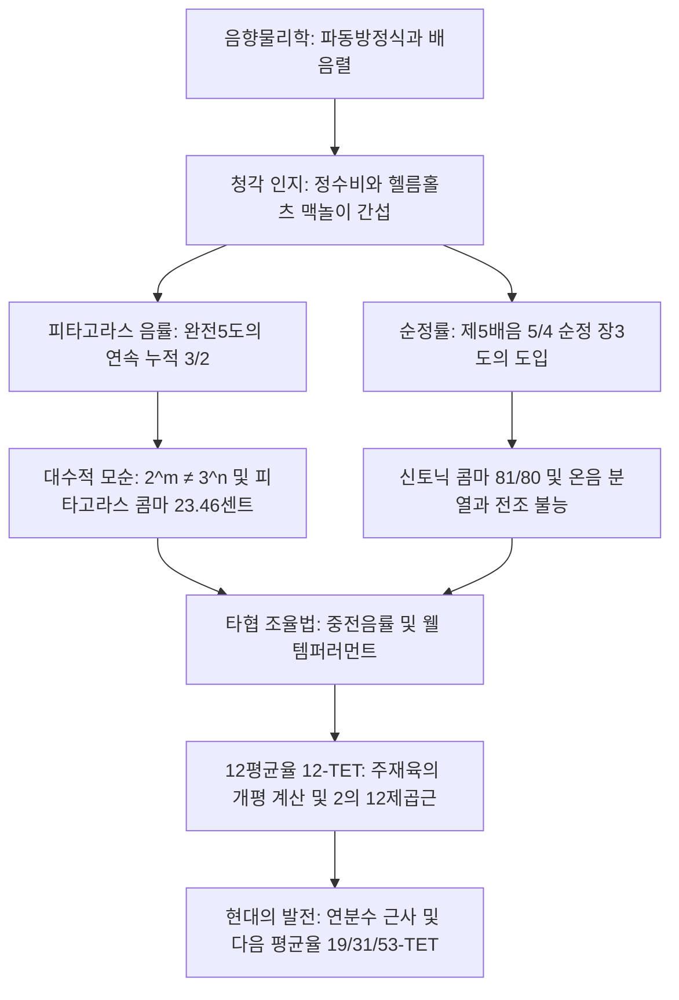

고대 그리스의 철학자 피타고라스가 대장간 망치 소리의 조화에서 출발하여 모노코드(단현금)를 통해 음정과 현의 길이 비율을 정식화한 이래, 음악과 수학은 분리할 수 없는 학문적 유대를 이어왔습니다. 인간의 귀가 평온하고 완벽한 협화음으로 인지하는 소리는 물리적으로 공기 압력 진동의 정수비 중첩이며, 수학적으로는 소수(Prime)와 유리수, 무리수가 엮어내는 대수학적 갈등의 역사입니다.

그러나 순수한 화음을 극한까지 추구하던 인류는 필연적인 수학적 모순에 직면했습니다. 완전5도(주파수비 $3/2$)를 12번 쌓아 올린 주파수는 옥타브(주파수비 $2/1$)를 7번 쌓아 올린 주파수와 결코 일치할 수 없습니다. 산술의 기본정리(소인수분해의 유일성)에 따라 $2^m \neq 3^n$이라는 대수적 절대 법칙이 성립하기 때문입니다. 이 미세하지만 지울 수 없는 불일치인 **피타고라스 콤마(Pythagorean Comma)**와 **신토닉 콤마(Syntonic Comma)**를 어떻게 분배하고 길들일 것인가의 탐구가 서양과 동양 음악의 조율사(Temperament)를 형성해 왔습니다.

본 글에서는 현의 파동 방정식과 배음렬의 물리학에서 시작하여 피타고라스율, 순정률의 전조 불능 딜레마, 중전음률의 타협, 주재육의 12평균율 계산, 연분수 전개에 의한 미분음 음률 이론까지 총체적으로 해부합니다.

## 1. 소리의 물리학과 배음렬(Harmonic Series)

현악기 줄의 횡진동은 고전 1차원 파동 방정식에 의해 결정됩니다:

$$\frac{\partial^2 y}{\partial t^2} = v^2 \frac{\partial^2 y}{\partial x^2}, \quad v = \sqrt{\frac{T}{\rho}}$$

양 끝이 고정된 경계조건($y(0, t) = y(L, t) = 0$)에서 정상파의 고유진동수는 완벽한 산술수열을 이룹니다:

$$f_n = n \frac{v}{2L} = n f_1 \quad (n = 1, 2, 3, \dots)$$

기본주파수 $f_1$이 음높이를 결정하며, $f_n$은 정수배 배음(Harmonics)을 구성합니다. 현을 튕겼을 때 발생하는 음은 무한한 배음들의 푸리에 급수 합입니다.

| 배음 번호 ($n$) | 주파수비 ($f_n / f_1$) | 음악적 음정 | 가장 단순한 기약분수비 |
| :--- | :--- | :--- | :--- |
| **제1배음** | 1.0000 | 기음 (유니즌) | 1/1 |
| **제2배음** | 2.0000 | 1옥타브 위 | 2/1 |
| **제3배음** | 3.0000 | 옥타브 + 완전5도 | 3/1 |
| **제4배음** | 4.0000 | 2옥타브 위 | 4/1 |
| **제5배음** | 5.0000 | 2옥타브 + 장3도 | 5/1 |
| **제6배음** | 6.0000 | 2옥타브 + 완전5도 | 6/1 |

헤르만 폰 헬름홀츠(Hermann von Helmholtz)는 1863년 생리음향학을 통해 인간이 협화음을 느끼는 원리를 규명했습니다. 주파수비가 단순한 정수비일 경우 고차 배음들이 서로 정확히 겹치며 달팽이관 기저막 임계대역 내에서 거친 **맥놀이(Beats, Rauigkeit)**가 발생하지 않습니다. 반면 비율이 어긋나면 고차 배음 간에 초당 수십 회의 맥놀이가 발생하여 불협화음으로 지각됩니다.

## 2. 피타고라스 음률과 피타고라스 콤마

피타고라스 학파는 완전5도($3/2$)와 옥타브($2/1$)만을 사용하여 음계를 구축했습니다. 기음 $C = 1$에서 출발하여 5도를 12번 연속 쌓아 올리면 12개 반음이 생성됩니다:

$$C \to G \to D \to A \to E \to B \to F\sharp \to C\sharp \to G\sharp \to D\sharp \to A\sharp \to E\sharp \to B\sharp$$

12번째 5도 음인 $B\sharp$를 7옥타브 내려 기음 $C$와 비교하면 다음과 같은 오차가 발생합니다:

$$\frac{(3/2)^{12}}{2^7} = \frac{3^{12}}{2^{19}} = \frac{531441}{524288} \approx 1.013643$$

센트(Cent) 단위($C(R) = 1200 \log_2(R)$)로 환산하면:

$$C_{\text{pyth}} = 1200 \log_2\left(\frac{531441}{524288}\right) \approx 23.46 \text{ cents}$$

이 차이가 **피타고라스 콤마(Pythagorean Comma)**입니다. 반음(100센트)의 거의 4분의 1에 달하는 거대한 오차로, 원환을 강제로 닫을 경우 $G\sharp - E\flat$ 사이에 약 23.5센트나 좁은 불협화 5도인 **울프 5도(Wolf Fifth)**가 발생합니다.

또한 피타고라스율의 장3도($81/64 \approx 407.82 \text{ cents}$)는 자연스러운 순정 장3도($386.31 \text{ cents}$)보다 약 21.5센트나 높아 화음으로 연주할 때 매우 거칠고 탁합니다.

## 3. 순정률과 신토닉 콤마: 전조 불능의 덫

르네상스 시대 다성음악이 발전하면서 5번째 배음을 차용한 **순정률(Just Intonation)**이 확립되었습니다. 순정 장3도를 $5/4 = 1.25$($386.31 \text{ cents}$)로 정의하여 $4:5:6$의 완벽한 으뜸화음을 구현했습니다.

그러나 피타고라스 장3도($81/64$)와 순정 장3도($5/4$) 사이의 오차인 **신토닉 콤마(Syntonic Comma)**가 발생합니다:

$$\Delta_{\text{syntonic}} = \frac{81/64}{5/4} = \frac{81}{80} = 1.0125 \approx 21.51 \text{ cents}$$

이로 인해 온음이 **대온음($9/8 \approx 203.9 \text{ cents}$)**과 **소온음($10/9 \approx 182.4 \text{ cents}$)**으로 분열되며, 순정률 건반에서 $D-A$ 5도는 순정 5도(702센트)보다 21.5센트나 좁은 $680.45 \text{ cents}$의 치명적 울프 음정이 되어 버립니다. 조성을 조금만 바꾸어도 전체 화음이 깨지는 전조 불능의 덫에 빠지게 됩니다.

## 4. 중전음률과 12평균율의 혁명

대온음과 소온음의 차이를 해결하기 위해 신토닉 콤마를 4개의 5도에 균등 분배한 **중전음률(Meantone Temperament)**이 16~17세기 건반음악을 지배했으나 여전히 원격 조로의 전조는 불가능했습니다.

이 모든 한계를 기하학적으로 해결한 체계가 **12평균율(12-TET)**입니다. 옥타브를 12개의 완전 동일한 기하학적 반음으로 분할합니다:

$$r = \sqrt[12]{2} = 2^{1/12} \approx 1.059463094359$$

1584년, 명나라의 수학자이자 왕족인 **주재육(Zhu Zaiyu)**은 《율학신설》에서 대형 주판을 사용하여 25자리 정밀도로 2의 12제곱근을 세계 최초로 완벽하게 계산해 냈습니다.

| 조율 방식 | 완전5도 (센트) | 장3도 (센트) | 전조 자유도 | 화음 순정도 |
| :--- | :--- | :--- | :--- | :--- |
| **피타고라스율** | 701.96 (순정) | 407.82 (+21.51c 탁함) | 매우 낮음 | 선율 우수, 화음 거침 |
| **순정률 (5-Limit)** | 701.96 (주5도) | 386.31 (완전 순정) | 전조 불가 | 단일조 극상, 전조 시 붕괴 |
| **중전음률 (1/4)** | 696.58 (-5.38c) | 386.31 (순정) | 제한적 | 기본조 우수, 원격조 불능 |
| **12평균율 (12-TET)**| 700.00 (-1.96c) | 400.00 (+13.69c 다소 넓음)| 완전 무제한 | 균등한 미세 맥놀이, 범용성 |

## 5. 연분수 전개와 다음 평균율 (19, 31, 53평균율)

인류가 왜 12라는 숫자를 선택했는지는 $\log_2(3)$의 연분수 전개에서 드러납니다:

$$\log_2(3) \approx [1; 1, 1, 2, 2, 3, 1, 5, \dots]$$

근사 유리수 분모는 $1, 2, 5, \mathbf{12}, 41, \mathbf{53}$으로 나타납니다. 12는 5도 오차를 불과 $-1.96$ 센트로 줄여주는 최소의 기적적 분모입니다. 31평균율(중전음률 완벽 재현)과 53평균율(오차 0.07센트)은 현대 전자음악과 미분음 음악에서 새로운 지평을 열어가고 있습니다.
