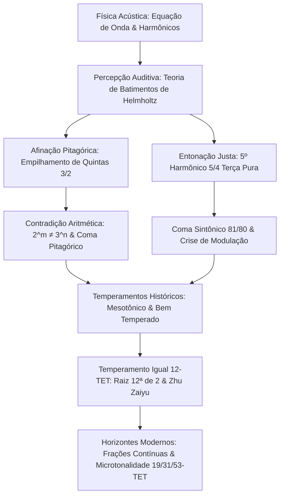

Desde que Pitágoras demonstrou no monocórdio que a consonância musical decorre de razões de números inteiros simples, a música e a matemática mantêm um laço inquebrantável. A beleza harmônica percebida pelo ouvido humano é a superposição ordenada de ondas acústicas no ar e, no plano analítico, um embate milenar entre números primos, números racionais e grandezas irracionais.

Todavia, a busca pela perfeição acústica esbarra numa barreira aritmética intransponível: a acumulação de 12 quintas justas puras (razão $3/2$) jamais coincide com 7 oitavas perfeitas (razão $2/1$). Conforme o Teorema Fundamental da Aritmética:

$$2^m \neq 3^n \quad (\forall m, n \in \mathbb{N}^*)$$

Essa divergência inevitável — o **coma pitagórico** ($23{,}46\text{ cents}$) e o **coma sintônico** ($21{,}51\text{ cents}$) — impulsionou séculos de experimentação em busca de temperamentos que pudessem domesticar essas dissonâncias.

## 1. Física Acústica e a Série Harmônica

A oscilação de uma corda sob tensão é ditada pela equação da onda unidimensional:

$$\frac{\partial^2 y}{\partial t^2} = v^2 \frac{\partial^2 y}{\partial x^2}, \qquad v = \sqrt{\frac{T}{\rho}}$$

As frequências modais formam uma sequência aritmética exata: $f_n = n f_1$. Em 1863, Hermann von Helmholtz elucidou que a consonância decorre da ausência de batimentos ásperos na banda crítica da cóclea. Razões inteiras simples fazem com que os sobretons superiores coincidam sem interferências destrutivas.

## 2. Afinação Pitagórica e o Coma Pitagórico

Empilhando doze quintas justas ($3/2$) e reduzindo o resultado por sete oitavas ($2^7$), atinge-se o valor:

$$\frac{(3/2)^{12}}{2^7} = \frac{531441}{524288} \approx 1{,}013643 \implies 23{,}46\text{ cents}$$

O **coma pitagórico** impossibilita o fechamento perfeito do círculo de quintas. Fechar o sistema à força gera uma **quinta do lobo** ($678{,}5\text{ cents}$), que soa com batimentos violentos. Além disso, a terça maior pitagórica ($81/64 \approx 407{,}8\text{ cents}$) é extremamente áspera frente à terça harmônica pura.

## 3. Entonação Justa e o Coma Sintônico

Com a polifonia renascentista, Gioseffo Zarlino adotou o 5º harmônico para consagrar a terça maior pura $5/4$ ($386{,}31\text{ cents}$). A diferença entre a terça pitagórica e a terça pura é o **coma sintônico**:

$$\Delta_{\text{syntonic}} = \frac{81/64}{5/4} = \frac{81}{80} = 1{,}0125 \approx 21{,}51\text{ cents}$$

Essa proporção bifurca o tom inteiro em tom maior ($9/8$) e tom menor ($10/9$). Em teclados com afinação fixa, a quinta ré-lá fica comprimida em $21{,}5\text{ cents}$ ($680{,}5\text{ cents}$), inviabilizando modulações para tons vizinhos.

## 4. Temperamentos Históricos e o Temperamento Igual 12-TET

O **temperamento mesotônico** estreitou quatro quintas consecutivas em um quarto de coma para preservar terças perfeitas. No período barroco, os "temperamentos bem temperados" de Werckmeister permitiram a execução em todas as tonalidades.

A resolução matemática universal veio com o **Temperamento Igual de Doze Sons (12-TET)**:

$$r = \sqrt[12]{2} = 2^{1/12} \approx 1{,}059463094359$$

O príncipe chinês **Zhu Zaiyu** (朱載堉) calculou essa constante com 25 casas decimais já em 1584, precedendo os pioneiros europeus.

| Intervalo | Justo (cents) | Pitagórico (cents) | Mesotônico (cents) | 12-TET (cents) | Desvio em 12-TET |
| :--- | :--- | :--- | :--- | :--- | :--- |
| **Terça Maior** | 386{,}31 | 407{,}82 | 386{,}31 | 400{,}00 | **+13{,}69** |
| **Quarta Justa** | 498{,}04 | 498{,}04 | 503{,}42 | 500{,}00 | +1{,}96 |
| **Quinta Justa** | 701{,}96 | 701{,}96 | 696{,}58 | 700{,}00 | **-1{,}96** |
| **Oitava** | 1200{,}00 | 1200{,}00 | 1200{,}00 | 1200{,}00 | 0{,}00 |

## 5. Frações Contínuas e Sistemas Estendidos (19, 31, 53-TET)

A fundamentação do número 12 repousa na expansão em frações contínuas de $\log_2(3)$:

$$\log_2(3) \approx [1; 1, 1, 2, 2, 3, 1, 5, \dots] \implies 1, 2, 8/5, \mathbf{19/12}, 65/41, \mathbf{84/53}$$

O denominador **12** é a aproximação mínima ideal. Divisões em 31 e 53 tons proporcionam pureza harmônica ainda superior, sendo exploradas hoje pela música eletrônica e softwares de microafinação dinâmica.
