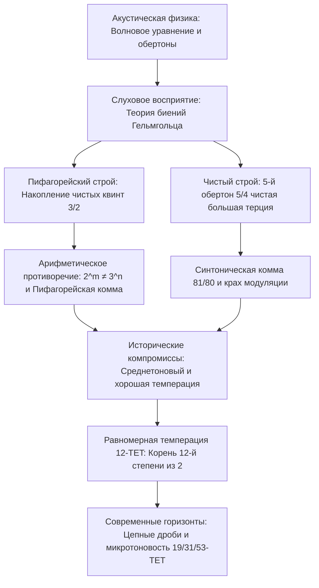

С тех пор как Пифагор Самосский с помощью монохорда доказал, что музыкальный консонанс подчиняется простым целочисленным соотношениям длин струн, музыка и математика развиваются в неразрывном единстве. То, что человеческий слух воспринимает как кристальную чистоту гармонии, в волновой физике является синфазным наложением колебаний давления воздуха, а в математике — вековой драмой между простыми числами, рациональными дробями и иррациональностями.

Стремление к абсолютной гармонии неизбежно столкнулось с непреодолимым алгебраическим барьером: цепочка из двенадцати чистых квинт (отношение $3/2$) никогда не совпадет с цепочкой из семи чистых октав (отношение $2/1$). В силу основной теоремы арифметики:

$$2^m \neq 3^n \quad (\forall m, n \in \mathbb{N}^*)$$

Это неустранимое расхождение — **пифагорейская комма** ($23{,}46\text{ цента}$) и **синтоническая комма** ($21{,}51\text{ цента}$) — породило многовековую историю темпераций.

## 1. Акустическая физика и гармонический обертоновый ряд

Поперечные колебания натянутой струны описываются одномерным волновым уравнением:

$$\frac{\partial^2 y}{\partial t^2} = v^2 \frac{\partial^2 y}{\partial x^2}, \qquad v = \sqrt{\frac{T}{\rho}}$$

Собственные частоты образуют целочисленную арифметическую прогрессию: $f_n = n f_1$. Герман фон Гельмгольц в 1863 году доказал, что ощущение консонанса возникает благодаря отсутствию резких биений в критической полосе слуха. Простые целочисленные отношения частот обеспечивают идеальное совпадение высших гармоник.

## 2. Пифагорейский строй и пифагорейская комма

Построение 12-ступенного звукоряда последовательным откладыванием чистых квинт ($3/2$) с понижением на 7 октав ($2^7$) дает соотношение:

$$\frac{(3/2)^{12}}{2^7} = \frac{531441}{524288} \approx 1{,}013643 \implies 23{,}46\text{ цента}$$

Эта **пифагорейская комма** препятствует замыканию квинтового круга. Попытка замкнуть его порождает **волчью квинту** (обычно между $G\sharp$ и $E\flat$), звучащую на $23{,}5\text{ цента}$ уже нормы с невыносимыми биениями. Кроме того, пифагорейская терция ($81/64 \approx 407{,}8\text{ цента}$) звучит крайне жестко и резко.

## 3. Чистый строй и синтоническая комма

В эпоху Возрождения Джозеффо Царлино ввел чистую большую терцию $5/4$ ($386{,}31\text{ цента}$). Разница между ней и пифагорейской терцией называется **синтонической коммой**:

$$\Delta_{\text{syntonic}} = \frac{81/64}{5/4} = \frac{81}{80} = 1{,}0125 \approx 21{,}51\text{ цента}$$

Это привело к расщеплению целого тона на большой ($9/8$) и малый ($10/9$). На клавишных инструментах квинта ре-ля оказывалась зауженной на $21{,}5\text{ цента}$ ($680{,}5\text{ цента}$), делая невозможной модуляцию в другие тональности.

## 4. Среднетоновый строй и 12-ступенная равномерная темперация

**Четвертькоммовый среднетоновый строй** сужал четыре квинты на четверть синтонической коммы для получения идеальных терций. Позднее Веркмейстер создал хорошие темперации, позволившие играть во всех 24 тональностях.

Окончательное математическое решение принесла **равномерно темперированная шкала (12-TET)**:

$$r = \sqrt[12]{2} = 2^{1/12} \approx 1{,}059463094359$$

Впервые с точностью до 25 знаков это значение вычислил китайский ученый **Чжу Цзайюй** (Zhu Zaiyu) в 1584 году.

| Интервал | Чистый (центы) | Пифагорейский (центы) | Среднетоновый (центы) | 12-TET (центы) | Погрешность в 12-TET |
| :--- | :--- | :--- | :--- | :--- | :--- |
| **Большая терция** | 386{,}31 | 407{,}82 | 386{,}31 | 400{,}00 | **+13{,}69** |
| **Чистая кварта** | 498{,}04 | 498{,}04 | 503{,}42 | 500{,}00 | +1{,}96 |
| **Чистая квинта** | 701{,}96 | 701{,}96 | 696{,}58 | 700{,}00 | **-1{,}96** |
| **Октава** | 1200{,}00 | 1200{,}00 | 1200{,}00 | 1200{,}00 | 0{,}00 |

## 5. Цепные дроби и системы с 19, 31 и 53 делениями

Выбор числа 12 математически обусловлен разложением $\log_2(3)$ в цепную дробь:

$$\log_2(3) \approx [1; 1, 1, 2, 2, 3, 1, 5, \dots] \implies 1, 2, 8/5, \mathbf{19/12}, 65/41, \mathbf{84/53}$$

Знаменатель **12** дает наилучшее приближение при минимальном числе клавиш. Системы на 31 и 53 деления дают поразительную чистоту интервалов и активно применяются сегодня в микрохроматике и динамическом цифровом синтезе.
