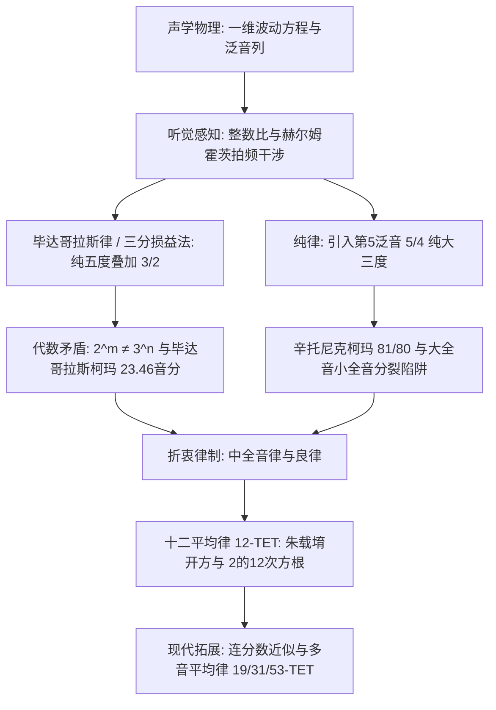

自古希腊哲学家毕达哥拉斯在铁匠铺的锤击声中捕捉到和声的奥秘、以单弦琴（Monochord）论证弦长与整数比例的完美关联以来，音乐与数学便结下了不可分割的渊源。人类听觉所感知的“协和之音”，在物理本质上是空气压力波动的简单整数比叠加；在数论层面上，则是素数、有理数与无理数之间跨越千年的代数博弈。

然而，追求终极和谐的人类必然撞上一堵不可逾越的数学高墙：将12个纯正的纯五度（频率比 $3/2$）连续叠加，其总音高永远无法与7个纯八度（频率比 $2/1$）完全吻合。由算术基本定理（质因数分解的唯一性）所决定，$2^m \neq 3^n$ 是永恒的代数铁律。这个微小却无法消除的差距——**毕达哥拉斯柯玛（最大音差）**与**辛托尼克柯玛（普通音差）**，成为了西方与东方律学史上无数音乐家、数学家与制琴师不断求索妥协的核心命题。

从泛音列的驻波力学，到纯律在大三度上的突破，再到明代律学巨擘朱载堉以八十一档大算盘求出十二平均律的精确数学解，本篇专著将系统剖析音阶的数理机制。

## 1. 声音的物理学与简谐泛音列

弦乐器琴弦的横向振动受经典一维波动方程支配：

$$\frac{\partial^2 y}{\partial t^2} = v^2 \frac{\partial^2 y}{\partial x^2}, \quad v = \sqrt{\frac{T}{\rho}}$$

在两端固定（$y(0, t) = y(L, t) = 0$）的边界条件下，驻波固有频率呈现出完美的算术级数：

$$f_n = n \frac{v}{2L} = n f_1 \quad (n = 1, 2, 3, \dots)$$

基频 $f_1$ 决定音高基准，而各级高次泛音 $f_n$ 则是基频的整倍数。当琴弦被拨动时，声音由各个泛音的傅里叶级数叠加而成。

| 泛音阶数 ($n$) | 频率比 ($f_n / f_1$) | 音乐音程 | 纯正整数比 |
| :--- | :--- | :--- | :--- |
| **第1泛音** | 1.0000 | 基音（纯一度） | 1/1 |
| **第2泛音** | 2.0000 | 纯八度 | 2/1 |
| **第3泛音** | 3.0000 | 纯八度加纯五度 | 3/1 |
| **第4泛音** | 4.0000 | 两个纯八度 | 4/1 |
| **第5泛音** | 5.0000 | 双八度加纯大三度 | 5/1 |
| **第6泛音** | 6.0000 | 双八度加纯五度 | 6/1 |

德国物理学家赫尔姆霍茨（Hermann von Helmholtz）在1863年的经典名著中揭示：人类感知协和音的生理根源，在于两音的高次泛音重合，消除了耳蜗基底膜临界带内的粗糙“拍频（Beats）”。若频率比为简单整数比，泛音彼此共振；若偏离整数比，高次泛音相互产生每秒数十次的强烈拍频，使人耳感知为刺耳与不协和。

## 2. 毕达哥拉斯律与三分损益法：纯五度的累积

在西方，毕达哥拉斯学派利用单弦琴确立了纯五度（$3/2$）与纯八度（$2/1$）的生成法则；在古代中国，《管子·地员篇》记载的**“三分损益法”**以“三分损一”（乘以 $2/3$）和“三分益一”（乘以 $4/3$）同样独立推导出了五度相生律体系。

以基音 $C = 1$ 出发，连续进行12次纯五度相生：

$$C \to G \to D \to A \to E \to B \to F\sharp \to C\sharp \to G\sharp \to D\sharp \to A\sharp \to E\sharp \to B\sharp$$

当我们将第12个五度音 $B\sharp$ 降下7个八度（乘以 $1/2^7$）与起点 $C$ 比较时，赫然发现：

$$\frac{(3/2)^{12}}{2^7} = \frac{3^{12}}{2^{19}} = \frac{531441}{524288} \approx 1.013643$$

按照音分（Cent，一个纯八度等于1200音分）公式 $C(R) = 1200 \log_2(R)$：

$$C_{\text{pyth}} = 1200 \log_2\left(\frac{531441}{524288}\right) \approx 23.46 \text{ cents}$$

这就是著名的**毕达哥拉斯柯玛（最大音差）**。它意味着五度循环无法闭合。若强行闭合，在 $G\sharp$ 与 $E\flat$ 之间就会留下一个窄了约23.5音分的“**狼音五度（Wolf Fifth）**”，演奏时如同群狼哀嚎般刺耳，使远关系调完全无法演奏。

此外，毕达哥拉斯律的大三度（$81/64 \approx 407.82 \text{ cents}$）比纯大三度（$386.31 \text{ cents}$）高出21.5音分，在和声中极为干瘪紧张。

## 3. 纯律与辛托尼克柯玛：转调不能的悲剧

文艺复兴时期复调和声兴起，意大利音乐理论家扎利诺（Gioseffo Zarlino）引入自然界第5泛音，将纯大三度定义为纯正的 $5/4 = 1.25$（$386.31 \text{ cents}$），构成 $4:5:6$ 的纯正大三和弦。这种律制被称为**纯律（Just Intonation）**。

纯律大三度（$5/4$）与毕达哥拉斯大三度（$81/64$）之间的差值称为**辛托尼克柯玛（Syntonic Comma）**：

$$\Delta_{\text{syntonic}} = \frac{81/64}{5/4} = \frac{81}{80} = 1.0125 \approx 21.51 \text{ cents}$$

这引发了极其严重的代数灾难：全音分裂为**大全音（$9/8 \approx 203.9 \text{ cents}$）**与**小全音（$10/9 \approx 182.4 \text{ cents}$）**。当在纯律键盘上演奏二级和弦（D-F-A）时，$D$ 到 $A$ 的五度为：

$$\frac{A}{D} = \frac{5/3}{9/8} = \frac{40}{27} \approx 680.45 \text{ cents}$$

原本应为702音分的纯五度，直接缩水了21.5音分，成为严重的狼音！只要稍微转调，纯律的纯美便立刻瓦解为无法忍受的噪音。

## 4. 中全音律与妥协的艺术

为解决全音分裂与狼音困境，16世纪发展出了**中全音律（Meantone Temperament）**，尤其是四分之一音差中全音律。其核心是将辛托尼克柯玛均摊到4个五度上，使每个五度缩短约 $5.38 \text{ cents}$（$696.58 \text{ cents}$），从而保证主调上的大三度达到完全纯正的 $5/4$。

中全音律为文艺复兴和早期巴洛克音乐提供了甜美饱满的和声，但其残余的狼音仍旧将转调限制在少数几个近关系调之内。

## 5. 十二平均律与朱载堉的千古发明

彻底打破调性牢笼的终极数学武器，是**十二平均律（12-TET）**。它将一个纯八度在对数尺度上分为12个绝对相等的半音，半音频率比为无理数：

$$r = \sqrt[12]{2} = 2^{1/12} \approx 1.059463094359$$

明万历十二年（1584年），中国明朝宗室、博学多才的数学家与律学家**朱载堉（Zhu Zaiyu）**在《律学新说》中，利用超大算盘反复进行25位有效数字的开方与开立方运算，世界上首次精确给出了十二平均律的数值：

$$\sqrt[12]{2} \approx 1.059463094359295264561825$$

朱载堉依据此数学比例制造出了全世界第一套十二平均律精密律管，领先欧洲数学家西蒙·斯蒂文（Simon Stevin）与梅森（Mersenne）数十年。

| 音律制式 | 纯五度音分 (C-G) | 大三度音分 (C-E) | 转调自由度 | 和声纯净度 |
| :--- | :--- | :--- | :--- | :--- |
| **毕达哥拉斯律** | 701.96 (极纯) | 407.82 (+21.51c 极浊) | 极低（有狼音） | 旋律优美，和声差 |
| **纯律 (5-Limit)** | 701.96 (主五度) | 386.31 (完全纯正) | 无法转调 | 单调纯正，转调崩溃 |
| **中全音律 (1/4)** | 696.58 (-5.38c) | 386.31 (纯正) | 有限（常用调） | 常用调优美，远调不可用 |
| **十二平均律 (12-TET)**| 700.00 (-1.96c) | 400.00 (+13.69c 偏宽) | 完全无限 | 均匀微浊，全调通用 |

## 6. 连分数展开与多音平均律（19, 31, 53平均律）

为何人类普遍选择将八度分割为“12”份，而非10或15份？答案深藏于 $\log_2(3)$ 的连分数展开中：

$$\log_2(3) \approx [1; 1, 1, 2, 2, 3, 1, 5, \dots]$$

其渐近有理分数序列为：$1, 2, 8/5, \mathbf{19/12}, 65/41, \mathbf{84/53}$。
分母 **12** 是第四个最佳渐近逼近！以12分割八度，7个半音构成的五度（700音分）与纯五度（701.96音分）的误差仅为 $-1.96$ 音分。

此外，**31平均律**（完美拟合中全音律）与**53平均律**（五度误差仅 $0.07$ 音分，大三度误差仅 $1.4$ 音分）在现代微音程音乐与电子合成器算法中大放异彩。在数字音乐时代，借助自适应微调技术，音乐正在重新拥抱纯律的和声天籁与平均律的无限自由。
