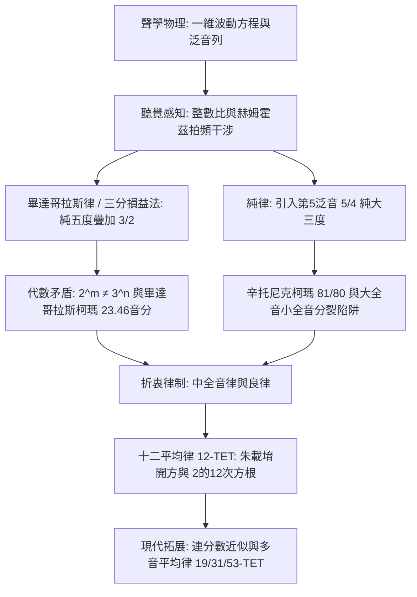

自古希臘哲學家畢達哥拉斯在鐵匠鋪的錘擊聲中捕捉到和聲的奧秘、以單弦琴（Monochord）論證弦長與整數比例的完美關聯以來，音樂與數學便結下了不可分割的淵源。人類聽覺所感知的「協和之音」，在物理本質上是空氣壓力波動的簡單整數比疊加；在數論層面上，則是質數、有理數與無理數之間跨越千年的代數博弈。

然而，追求終極和諧的人類必然撞上一堵不可逾越的數學高牆：將12個純正的純五度（頻率比 $3/2$）連續疊加，其總音高永遠無法與7個純八度（頻率比 $2/1$）完全吻合。由算術基本定理（質因數分解的唯一性）所決定，$2^m \neq 3^n$ 是永恆的代數鐵律。這個微小卻無法消除的差距——**畢達哥拉斯柯瑪（最大音差）**與**辛托尼克柯瑪（普通音差）**，成為了西方與東方律學史上無數音樂家、數學家與製琴師不斷求索妥協的核心命題。

從泛音列的駐波力學，到純律在大三度上的突破，再到明代律學巨擘朱載堉以八十一檔大算盤求出十二平均律的精確數學解，本篇專著將系統剖析音階的數理機制。

## 1. 聲音的物理學與簡諧泛音列

弦樂器琴弦的橫向振動受經典一維波動方程支配：

$$\frac{\partial^2 y}{\partial t^2} = v^2 \frac{\partial^2 y}{\partial x^2}, \quad v = \sqrt{\frac{T}{\rho}}$$

在兩端固定（$y(0, t) = y(L, t) = 0$）的邊界條件下，駐波固有頻率呈現出完美的算術級數：

$$f_n = n \frac{v}{2L} = n f_1 \quad (n = 1, 2, 3, \dots)$$

基頻 $f_1$ 決定音高基準，而各級高次泛音 $f_n$ 則是基頻的整倍數。當琴弦被撥動時，聲音由各個泛音的傅立葉級數疊加而成。

| 泛音階數 ($n$) | 頻率比 ($f_n / f_1$) | 音樂音程 | 純正整數比 |
| :--- | :--- | :--- | :--- |
| **第1泛音** | 1.0000 | 基音（純一度） | 1/1 |
| **第2泛音** | 2.0000 | 純八度 | 2/1 |
| **第3泛音** | 3.0000 | 純八度加純五度 | 3/1 |
| **第4泛音** | 4.0000 | 兩個純八度 | 4/1 |
| **第5泛音** | 5.0000 | 雙八度加純大三度 | 5/1 |
| **第6泛音** | 6.0000 | 雙八度加純五度 | 6/1 |

德國物理學家赫姆霍茨（Hermann von Helmholtz）在1863年的經典名著中揭示：人類感知協和音的生理根源，在於兩音的高次泛音重合，消除了耳蝸基底膜臨界帶內的粗糙「拍頻（Beats）」。若頻率比為簡單整數比，泛音彼此共振；若偏離整數比，高次泛音相互產生每秒數十次的強烈拍頻，使人耳感知為刺耳與不協和。

## 2. 畢達哥拉斯律與三分損益法：純五度的累積

在西方，畢達哥拉斯學派利用單弦琴確立了純五度（$3/2$）與純八度（$2/1$）的生成法則；在古代中國，《管子·地員篇》記載的**「三分損益法」**以「三分損一」（乘以 $2/3$）和「三分益一」（乘以 $4/3$）同樣獨立推導出了五度相生律體系。

以基音 $C = 1$ 出發，連續進行12次純五度相生：

$$C \to G \to D \to A \to E \to B \to F\sharp \to C\sharp \to G\sharp \to D\sharp \to A\sharp \to E\sharp \to B\sharp$$

當我們將第12個五度音 $B\sharp$ 降下7個八度（乘以 $1/2^7$）與起點 $C$ 比較時，赫然發現：

$$\frac{(3/2)^{12}}{2^7} = \frac{3^{12}}{2^{19}} = \frac{531441}{524288} \approx 1.013643$$

按照音分（Cent，一個純八度等於1200音分）公式 $C(R) = 1200 \log_2(R)$：

$$C_{\text{pyth}} = 1200 \log_2\left(\frac{531441}{524288}\right) \approx 23.46 \text{ cents}$$

這就是著名的**畢達哥拉斯柯瑪（最大音差）**。它意味著五度循環無法閉合。若強行閉合，在 $G\sharp$ 與 $E\flat$ 之間就會留下一個窄了約23.5音分的「**狼音五度（Wolf Fifth）**」，演奏時如同群狼哀號般刺耳，使遠關係調完全無法演奏。

此外，畢達哥拉斯律的大三度（$81/64 \approx 407.82 \text{ cents}$）比純大三度（$386.31 \text{ cents}$）高出21.5音分，在和聲中極為乾癟緊張。

## 3. 純律與辛托尼克柯瑪：轉調不能的悲劇

文藝復興時期複調和聲興起，義大利音樂理論家扎利諾（Gioseffo Zarlino）引入自然界第5泛音，將純大三度定義為純正的 $5/4 = 1.25$（$386.31 \text{ cents}$），構成 $4:5:6$ 的純正大三和弦。這種律制被稱為**純律（Just Intonation）**。

純律大三度（$5/4$）與畢達哥拉斯大三度（$81/64$）之間的差值稱為**辛托尼克柯瑪（Syntonic Comma）**：

$$\Delta_{\text{syntonic}} = \frac{81/64}{5/4} = \frac{81}{80} = 1.0125 \approx 21.51 \text{ cents}$$

這引發了極其嚴重的代數災難：全音分裂為**大全音（$9/8 \approx 203.9 \text{ cents}$）**與**小全音（$10/9 \approx 182.4 \text{ cents}$）**。當在純律鍵盤上演奏二級和弦（D-F-A）時，$D$ 到 $A$ 的五度為：

$$\frac{A}{D} = \frac{5/3}{9/8} = \frac{40}{27} \approx 680.45 \text{ cents}$$

原本應為702音分的純五度，直接縮水了21.5音分，成為嚴重的狼音！只要稍微轉調，純律的純美便立刻瓦解為無法忍受的噪音。

## 4. 中全音律與妥協的藝術

為解決全音分裂與狼音困境，16世紀發展出了**中全音律（Meantone Temperament）**，尤其是四分之一音差中全音律。其核心是將辛托尼克柯瑪均攤到4個五度上，使每個五度縮短約 $5.38 \text{ cents}$（$696.58 \text{ cents}$），從而保證主調上的大三度達到完全純正的 $5/4$。

中全音律為文藝復興和早期巴洛克音樂提供了甜美飽滿的和聲，但其殘餘的狼音仍舊將轉調限制在少數幾個近關係調之內。

## 5. 十二平均律與朱載堉的千古發明

徹底打破調性牢籠的終極數學武器，是**十二平均律（12-TET）**。它將一個純八度在對數尺度上分為12個絕對相等的半音，半音頻率比為無理數：

$$r = \sqrt[12]{2} = 2^{1/12} \approx 1.059463094359$$

明萬曆十二年（1584年），中國明朝宗室、博學多才的數學家與律學家**朱載堉（Zhu Zaiyu）**在《律學新說》中，利用超大算盤反覆進行25位有效數字的開方與開立方運算，世界上首次精確給出了十二平均律的數值：

$$\sqrt[12]{2} \approx 1.059463094359295264561825$$

朱載堉依據此數學比例製造出了全世界第一套十二平均律精密律管，領先歐洲數學家西蒙·斯蒂文（Simon Stevin）與梅森（Mersenne）數十年。

| 音律制式 | 純五度音分 (C-G) | 大三度音分 (C-E) | 轉調自由度 | 和聲純淨度 |
| :--- | :--- | :--- | :--- | :--- |
| **畢達哥拉斯律** | 701.96 (極純) | 407.82 (+21.51c 極濁) | 極低（有狼音） | 旋律優美，和聲差 |
| **純律 (5-Limit)** | 701.96 (主五度) | 386.31 (完全純正) | 無法轉調 | 單調純正，轉調崩潰 |
| **中全音律 (1/4)** | 696.58 (-5.38c) | 386.31 (純正) | 有限（常用調） | 常用調優美，遠調不可用 |
| **十二平均律 (12-TET)**| 700.00 (-1.96c) | 400.00 (+13.69c 偏寬) | 完全無限 | 均勻微濁，全調通用 |

## 6. 連分數展開與多音平均律（19, 31, 53平均律）

為何人類普遍選擇將八度分割為「12」份，而非10或15份？答案深藏於 $\log_2(3)$ 的連分數展開中：

$$\log_2(3) \approx [1; 1, 1, 2, 2, 3, 1, 5, \dots]$$

其漸近有理分數序列為：$1, 2, 8/5, \mathbf{19/12}, 65/41, \mathbf{84/53}$。
分母 **12** 是第四個最佳漸近逼近！以12分割八度，7個半音構成的五度（700音分）與純五度（701.96音分）的誤差僅為 $-1.96$ 音分。

此外，**31平均律**（完美擬合中全音律）與**53平均律**（五度誤差僅 $0.07$ 音分，大三度誤差僅 $1.4$ 音分）在現代微音程音樂與電子合成器算法中大放異彩。在數位音樂時代，借助自適應微調技術，音樂正在重新擁抱純律的和聲天籟與平均律的無限自由。
