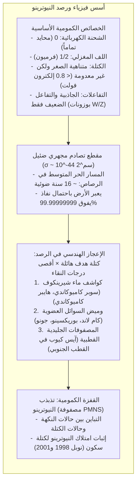

في هذه اللحظة بالذات، يخترق نحو 65 مليار جسيم دون ذري كل سنتيمتر مربع من ظفر إبهامك بسرعة تكاد تطابق سرعة الضوء. وُلدت هذه الجسيمات في قلب الاندماج النووي للشمس، واخترقت مئات آلاف الكيلومترات من البلازما الشمسية الكثيفة وكأنها فراغ تام، وقطعت 150 مليون كيلومتر عبر الفضاء، ثم نفذت عبر قشرة الأرض ووشاحها ولبها المنصهر لتخرج من الجانب المقابل نحو أعماق الكون.

تُعرف هذه الجسيمات باسم <strong>النيوترينو (Neutrino)</strong>.

لا يحمل النيوترينو أي شحنة كهربائية، وكتلته متناهية في الصغر (أقل بملايين المرات من كتلة الإلكترون)، وهو منيع تماماً ضد التآثر الكهرومغناطيسي والقوة النووية القوية. يتفاعل النيوترينو مع المادة العادية حصرياً عبر <strong>القوة النووية الضعيفة</strong>. ولإيقاف نيوترينو شمسي قياسي باحتمال 50%، سنحتاج إلى جدار من الرصاص المصمت <strong>بسماكة تزيد عن سنة ضوئية كاملة</strong> (نحو 10 تريليونات كيلومتر من المعدن الصلب).

فكيف نجح الفيزيائيون في رصد هذه الجسيمات الشبحية وقياس كتلتها؟



---

## 1. فرضية باولي ونظرية فيرمي

بدأت قصة النيوترينو في عشرينيات القرن العشرين مع أزمة هددت <strong>قانون بقاء الطاقة</strong>.
في اضمحلال بيتا ($\beta$)، كان من المفترض أن يخرج الإلكترون بطاقة محددة وثابتة، لكن التجارب كشفت عن <strong>طيف مستمر للطاقة</strong>، حيث اختفى جزء كبير من الطاقة في العدم.

في ديسمبر 1930، اقترح الفيزيائي النمساوي <strong>فولفغانغ باولي</strong> حلاً جريئاً: انبعاث جسيم محايد خفي مع الإلكترون يحمل الطاقة المفقودة دون أن يرصده أحد:

$$n \longrightarrow p + e^- + \bar{\nu}_e$$

وفي عام 1934، أطلق الفيزيائي الإيطالي <strong>إنريكو فيرمي</strong> على الجسيم اسم <strong>النيوترينو</strong> («المحايد الصغير» بالإيطالية)، وصاغ نظرية القوة الضعيفة.

---

## 2. لماذا يخترق النيوترينو كل شيء؟

المادة اليومية صلبة بسبب التنافر الكهرومغناطيسي بين السحب الإلكترونية للذرات. أما النيوترينو:
1. <strong>عديم الشحنة الكهربائية</strong>؛
2. <strong>لا يشعر بالقوة النووية القوية</strong>؛
3. يتفاعل فقط عبر بوزونات $W^\pm$ و$Z^0$ فائقة الكتلة ($M_W \approx 80.4 \, \text{GeV}/c^2$).

يبلغ مقطع التصادم نحو $10^{-44} \, \text{cm}^2$، مما يجعل مساره الحر في الرصاص المصمت يصل إلى <strong>16 سنة ضوئية</strong>.

---

## 3. تجربة راينس وكوان التاريخية (1956)

في عام 1956، نجح <strong>فريدريك راينس</strong> و<strong>كلايد كوان</strong> في تعويض ضعف الاحتمال عبر تدفق هائل بلغ $10^{13} \, \bar{\nu}_e / \text{cm}^2 / \text{s}$ قرب مفاعل سافانا ريفر النووي:

$$\bar{\nu}_e + p \longrightarrow n + e^+$$

```mermaid
flowchart LR
    subgraph DELAYED_AR ["طريقة التطابق الزمني المتأخر لراينس وكوان"]
        direction TB
        NU_AR["نيوترينو مضاد من المفاعل"] --> P_AR["بروتون حر في الماء"]
        P_AR --> IBD_AR["اضمحلال بيتا العكسي: بوزيترون ونيوترون"]
        
        IBD_AR --> PROMPT_AR["إشارة فورية (t = 0):\nفناء البوزيترون يطلق فوتوني غاما 511 keV متعاكسين 180°"]
        IBD_AR --> DELAYED_AR["إشارة متأخرة (t ≈ 10 μs):\nأسر النيوترون البطيء في الكادميوم يطلق شلال غاما 8 MeV"]
        
        PROMPT_AR --> GATE_AR["بوابة التزامن الزمني: عزل 99.999% من التشويش الخلفي!"]
        DELAYED_AR --> GATE_AR
        GATE_AR --> CONFIRM_AR["أول رصد مؤكد للنيوترينو (جائزة نوبل 1995)!"]
    end
```

باستخدام <strong>تقنية التطابق المتأخر</strong>، تمكن الفريق من إثبات وجود النيوترينو ونال راينس جائزة نوبل عام 1995.

---

## 4. مراصد النيوترينو العملاقة

### ① سوبر كاميوكاندي (Super-Kamiokande)
يقع على عمق 1000 متر تحت جبل إيكينوياما في اليابان، ويحتوي على <strong>50 ألف طن من الماء فائق النقاء</strong> محاطة بـ <strong>11,129 أنبوب تضاعف ضوئي (PMT)</strong>.
- <strong>إشعاع شيرينكوف:</strong> عندما تسير الجسيمات المشحونة في الماء بسرعة تفوق سرعة الضوء فيه ($0.75c$)، ينبعث مخروط ضوء أزرق بزاوية $\theta_C \approx 41.4^\circ$.
- <strong>تمييز الجسيمات:</strong> الإلكترونات تنتج حلقات شيرينكوف ضبابية ومشوشة، بينما تنتج الميونات حلقات حادة وحاسمة.

### ② آيس كيوب (IceCube) في القطب الجنوبي
يرصد النيوترينوات الكونية فائقة الطاقة (TeV إلى PeV) عبر تحويل <strong>كيلومتر مكعب كامل من الجليد القطبي</strong> إلى كاشف عملاق بأعماق تصل إلى 2450 متراً.

---

## 5. لغز النيوترينو الشمسي وتذبذب النيوترينو

طوال 30 عاماً، رصدت تجربة ديفيس <strong>ثلث النيوترينوات المتوقعة فقط</strong> من الشمس.
وحل اللغز يكمن في <strong>تذبذب النيوترينو</strong>:
حالات النكهة ($\nu_e, \nu_\mu, \nu_\tau$) تتركب كمومياً من حالات الكتلة ($\nu_1, \nu_2, \nu_3$) وفق <strong>مصفوفة PMNS</strong>، فتتحول النيوترينوات دورياً من نكهة لأخرى أثناء سفرها.

أثبت تاكاكي كاجيتا في سوبر كاميوكاندي (1998) وآرثر ماكدونالد في كندا (2001) هذا التحول، ونالا جائزة نوبل لعام 2015.

---

## 6. آفاق ما بعد النموذج القياسي

كتلة النيوترينو تفتح آفاقاً جديدة:
1. <strong>فرميونات مايورانا:</strong> هل النيوترينو هو جسيمه المضاد؟ يجري اختبار ذلك عبر <strong>اضمحلال بيتا المزدوج عديم النيوترينو ($0\nu\beta\beta$)</strong>؛
2. <strong>آلية الأرجوحة (Seesaw):</strong> تفسير خفة كتلة النيوترينو مقارنة ببقية الجسيمات؛
3. <strong>تولد اللبتونات (Leptogenesis):</strong> سر بقاء المادة وسيادتها في الكون بعد الانفجار العظيم.
