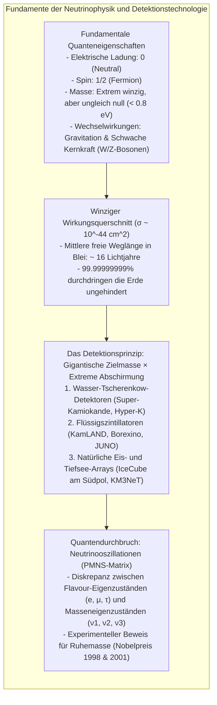

In diesem Augenblick rasen rund 65 Milliarden winzige Elementarteilchen durch jeden Quadratzentimeter Ihrer Daumennagelfläche – mit nahezu Lichtgeschwindigkeit. Sie entstanden im thermonuklearen Fusionsfeuer im Zentrum unserer Sonne, durchdrangen Hunderttausende Kilometer solaren Plasmas wie das reinste Vakuum, legten 150 Millionen Kilometer im interplanetaren Raum zurück, durchquerten die Erdkruste, den flüssigen Erdkern und schossen auf der gegenüberliegenden Seite der Erde wieder hinaus in die Tiefen des Weltalls.

Diese flüchtigen Boten des Kosmos heißen <strong>Neutrinos</strong>.

Sie tragen keine elektrische Ladung, besitzen eine verschwindend geringe Masse und spüren weder die elektromagnetische Kraft noch die starke Kernkraft. Sie interagieren fast ausschließlich über die <strong>schwache Kernkraft</strong>. Um ein typisches Sonnen-Neutrino mit einer Energie von einigen Megaelektronenvolt (MeV) mit einer Wahrscheinlichkeit von 50 % abzubremsen, bräuchte man eine <strong>Wand aus massivem Blei von mehr als einem Lichtjahr Dicke</strong> – das entspricht rund 10 Billionen Kilometern Metall.

Wie war es der Menschheit dennoch möglich, diese unsichtbaren Geisterteilchen nachzuweisen, ihre Richtung zu bestimmen und zu beweisen, dass sie eine Masse besitzen?



---

## 1. Die Rettung der Physik: Paulis Verzweiflungstat und Fermis Theorie

Die Geschichte des Neutrinos begann mit einer existentiellen Krise der Physik in den 1920er Jahren: dem drohenden Zusammenbruch des <strong>Energieerhaltungssatzes</strong>.

Beim radioaktiven Betazerfall ($\beta$-Zerfall), bei dem sich ein Atomkern unter Aussendung eines Elektrons umwandelt, sollte nach den Gesetzen der klassischen Zweikörpermechanik das Elektron eine scharfe, feste Energie besitzen. Experimentelle Messungen von James Chadwick zeigten jedoch ein völlig unerwartetes <strong>kontinuierliches Energiespektrum</strong>. Ein beträchtlicher Teil der Energie schien spurlos im Nichts zu verschwinden. Sogar Niels Bohr zog in Erwägung, dass die Energieerhaltung auf atomarer Ebene nur noch statistisch gelte.

Am 4. Dezember 1930 verfasste der österreichische Physiker <strong>Wolfgang Pauli</strong> seinen berühmten Brief an eine Tagung in Tübingen:
> „Liebe Radioaktive Damen und Herren... Ich habe einen verzweifelten Ausweg getroffen, um den Energiesatz zu retten.“

Pauli postulierte ein neues, elektrisch neutrales Teilchen mit Spin 1/2, das beim Zerfall gemeinsam mit dem Elektron ausgestoßen wird und die fehlende Energie unbemerkt davonträgt:

$$n \longrightarrow p + e^- + \bar{\nu}_e$$

1934 formulierte der italienische Großmeister <strong>Enrico Fermi</strong> die exakte mathematische Theorie der schwachen Wechselwirkung und taufte das Teilchen <strong>Neutrino</strong> („kleines Neutrales“). Fermi berechnete erstmals den Wirkungsquerschnitt $\sigma_\nu$ – und das Ergebnis schockierte die Fachwelt: Die Wahrscheinlichkeit einer Kollision war so astronomisch gering, dass Pauli klagte: *„Ich habe ein Teilchen vorausgesagt, das man niemals beobachten kann.“*

---

## 2. Warum Neutrinos alles durchdringen: Wirkungsquerschnitt und freie Weglänge

Gewöhnliche Materie bildet feste Barrieren, weil die Elektronenhüllen der Atome über elektromagnetische Coulomb-Kräfte stark miteinander wechselwirken. Neutrinos hingegen tragen <strong>keine elektrische Ladung</strong> und <strong>keine Farbladung der starken Wechselwirkung</strong>. Sie interagieren nur über den Austausch extrem schwerer $W^\pm$- und $Z^0$-Eichbosonen der elektroschwachen Kraft ($M_W \approx 80{,}4 \, \text{GeV}/c^2$).

Bei typischen Sonnenneutrino-Energien im MeV-Bereich liegt der Wirkungsquerschnitt bei:

$$\sigma_\nu \sim 10^{-44} \, \text{cm}^2 = 10^{-20} \, \text{barn}$$

Das ist <strong>hundert Trillionen Mal ($10^{20}$) kleiner</strong> als die geometrische Fläche eines Atomkerns!

Berechnet man die mittlere freie Weglänge $\lambda = \frac{1}{n \cdot \sigma_\nu}$ in festem Blei ($\text{Pb}$), ergibt sich:

$$\lambda \approx 1{,}5 \times 10^{14} \, \text{km} \approx 16 \, \text{Lichtjahre}$$

Ein Neutrino müsste im Durchschnitt eine <strong>sechzehn Lichtjahre dicke Bleiwand</strong> durchqueren, um auch nur einen einzigen Zusammenstoß zu erleiden. Für ein Neutrino ist der gesamte Planet Erde ein praktisch leeres Vakuum.

---

## 3. Das Experiment von Reines und Cowan (1956): Der Nachweis am Kernreaktor

Wie kann man ein Teilchen nachweisen, dessen Reaktionswahrscheinlichkeit nahezu null ist? 1956 fanden die US-Physiker <strong>Frederick Reines</strong> und <strong>Clyde Cowan</strong> die Lösung: <strong>Man kompensiert die winzige Reaktionswahrscheinlichkeit durch einen gigantischen Teilchenstrom.</strong>

$$\text{Ereignisrate} = \text{Neutrinofluss} \times \text{Anzahl der Zielatome} \times \text{Wirkungsquerschnitt}$$

Am Savannah-River-Kernreaktor nutzten sie den gigantischen Fluss von $10^{13} \, \text{Antineutrinos / (cm}^2 \cdot \text{s)}$ aus Spaltproduktzerfällen und beobachteten den inversen Betazerfall an Wasserstoffkernen (Protonen):

$$\bar{\nu}_e + p \longrightarrow n + e^+$$

```mermaid
flowchart LR
    subgraph DELAYED_DE ["Verzögerte Koinzidenzmethode nach Reines & Cowan"]
        direction TB
        NU_DE["Elektron-Antineutrino aus Reaktor"] --> P_DE["Proton im Wasser (H)"]
        P_DE --> IBD_DE["Inverser Betazerfall: Positron (e+) & Neutron (n)"]
        
        IBD_DE --> PROMPT_DE["PROMPTES SIGNAL (t = 0):\nPositron zerstrahlt mit Elektron -> 2x 511 keV Gamma (180° entgegengesetzt)"]
        IBD_DE --> DELAYED_DE["VERZÖGERTES SIGNAL (t ≈ 10 μs):\nNeutron wird abgebremst und von Cadmium-108 eingefangen -> 8 MeV Gamma-Kaskade"]
        
        PROMPT_DE --> COINC_DE["Koinzidenz-Gatter: Signal wird NUR gezählt, wenn beide Signale im Mikrosekundenfenster aufeinanderfolgen!"]
        DELAYED_DE --> COINC_DE
        COINC_DE --> CONFIRM_DE["Hintergrundrauschen um 99,999% eliminiert! Nobelpreis 1995!"]
    end
```

Um das natürliche kosmische Hintergrundrauschen zu eliminieren, erfanden sie die <strong>verzögerte Koinzidenzmessung</strong>:
1. <strong>Promptes Signal ($t = 0$):</strong> Das erzeugte Positron zerstrahlt sofort mit einem Hüllenelektron in zwei $511 \, \text{keV}$-Gammastrahlen, die exakt entgegengesetzt ($180^\circ$) auseinanderfliegen.
2. <strong>Verzögertes Signal ($t \approx 10 \, \mu\text{s}$):</strong> Das entstandene Neutron wird im Wasser thermisch abgebremst und nach einigen Mikrosekunden von gelöstem Cadmium eingefangen, was eine charakteristische Kaskade von $8 \, \text{MeV}$-Gammablitzen auslöst.

Nur wenn beide Signale im präzisen Mikrosekundenabstand auftraten, wurde ein Neutrino registriert. Pauli telegraphierte begeistert zurück. Frederick Reines erhielt dafür 1995 den Nobelpreis für Physik.

---

## 4. Die Ikonen der modernen Neutrinoforschung

### ① Super-Kamiokande: Die Kathedrale des Tscherenkow-Lichts
In einer Zinkmine unter dem Berg Ikenoyama in Japan befindet sich <strong>Super-Kamiokande</strong>, ein Edelstahlzylinder mit <strong>50.000 Tonnen Reinstwasser</strong>, überwacht von <strong>11.129 riesigen 20-Zoll-Photomultipliern (PMTs)</strong>.
- <strong>Tscherenkow-Effekt:</strong> Wenn ein geladenes Teilchen im Wasser schneller ist als die lokale Lichtgeschwindigkeit ($c/n \approx 0{,}75c$), entsteht ein bläulicher Lichtkegel mit dem Öffnungswinkel $\theta_C \approx 41{,}4^\circ$.
- <strong>Teilchenidentifikation:</strong> Ein Elektron aus einer $\nu_e$-Kollision erzeugt durch elektromagnetische Schauer einen <strong>verwaschenen, ausgefransten Tscherenkow-Ring</strong>, während ein 207-mal schwereres Myon aus einer $\nu_\mu$-Reaktion kerzengerade fliegt und einen <strong>randscharfen, sauberen Kreis</strong> projiziert.

### ② IceCube: Ein Kubikkilometer Südpol-Eis
Für hochenergetische kosmische Neutrinos (TeV bis PeV) aus fernen Blazaren instrumentierten Forscher den antarktischen Eisschild: <strong>IceCube</strong> überwacht mit 5.160 optischen Sensoren in Tiefen bis 2.450 Metern einen <strong>Milliarden Tonnen schweren Eisblock ($1 \, \text{km}^3$)</strong> und begründete die Ära der Multi-Messenger-Astronomie.

---

## 5. Das Sonnenneutrino-Rätsel und die Neutrinooszillation

In den 1960er Jahren berechnete John Bahcall mit dem Standard-Sonnenmodell die exakte Neutrinorate der Sonne. Doch Ray Davis Jr. maß in der Homestake-Goldmine mit seinem Chlor-Tank über 30 Jahre hinweg <strong>nur ein Drittel der erwarteten Neutrinos</strong>. 

Die Auflösung brachte die <strong>Neutrinooszillation</strong>:
Neutrinos werden in schwachen <strong>Flavour-Zuständen</strong> ($\nu_e, \nu_\mu, \nu_\tau$) erzeugt, bewegen sich jedoch als quantenmechanische Überlagerung von <strong>Masseneigenzuständen</strong> ($\nu_1, \nu_2, \nu_3$) fort, verknüpft über die <strong>PMNS-Matrix</strong> (Pontecorvo-Maki-Nakagawa-Sakata).

$$P(\nu_e \to \nu_\mu) = \sin^2(2\theta) \sin^2\left( 1{,}27 \cdot \frac{\Delta m^2 \, [\text{eV}^2] \cdot L \, [\text{km}]}{E \, [\text{GeV}]} \right)$$

Da die Massen unterschiedlich sind ($\Delta m^2 \neq 0$), verschieben sich die quantenmechanischen Phasen während des Flugs: <strong>Neutrinos wechseln periodisch ihre Identität.</strong>

- <strong>1998 (Super-Kamiokande):</strong> Takaaki Kajita bewies die Oszillation atmosphärischer Myon-Neutrinos.
- <strong>2001 (SNO, Kanada):</strong> Arthur McDonald wies mit Schwerem Wasser ($\text{D}_2\text{O}$) über Neutral-Strom-Reaktionen nach, dass die Gesamtanzahl aller Neutrinos exakt Bahcalls Vorhersage entsprach – zwei Drittel hatten sich unterwegs schlicht in Myon- und Tau-Neutrinos verwandelt. Beide Forscher erhielten 2015 den Nobelpreis.

---

## 6. Jenseits des Standardmodells: Majorana-Mysterium und Kosmologie

Die Entdeckung der Neutrinomasse war der erste experimentelle Bruch des Standardmodells. Heutige Schlüsselthemen sind:
1. <strong>Majorana-Fermionen:</strong> Ist das Neutrino sein eigenes Antiteilchen ($\nu = \bar{\nu}$)? Der Nachweis des <strong>neutrinolosen doppelten Betazerfalls ($0\nu\beta\beta$)</strong> würde die Erhaltung der Leptonenzahl widerlegen.
2. <strong>Seesaw-Mechanismus:</strong> Extrem schwere hypothetische rechtshändige Neutrinos erklären auf natürliche Weise, warum normale Neutrinos millionenfach leichter als Elektronen sind.
3. <strong>Leptogenese:</strong> Eine CP-Verletzung bei Neutrinos könnte erklären, warum nach dem Urknall Materie übrig blieb und das Universum nicht in reiner Strahlung verging.

Die Erforschung des ungreifbaren Neutrinos bleibt eine der triumphalsten Reisen des menschlichen Geistes zur Entschlüsselung des Kosmos.
