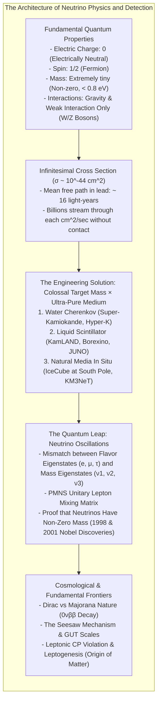
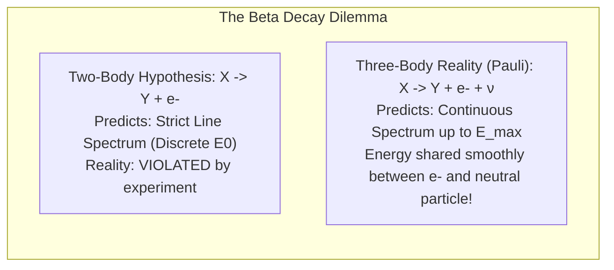
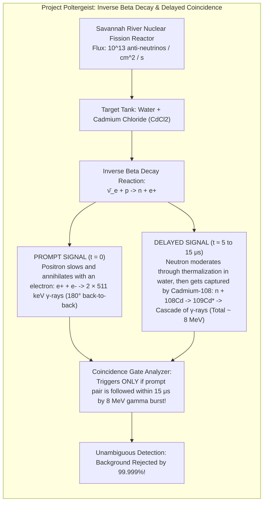
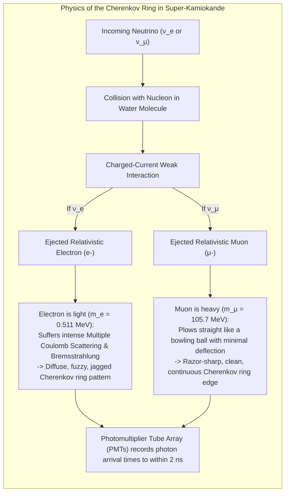
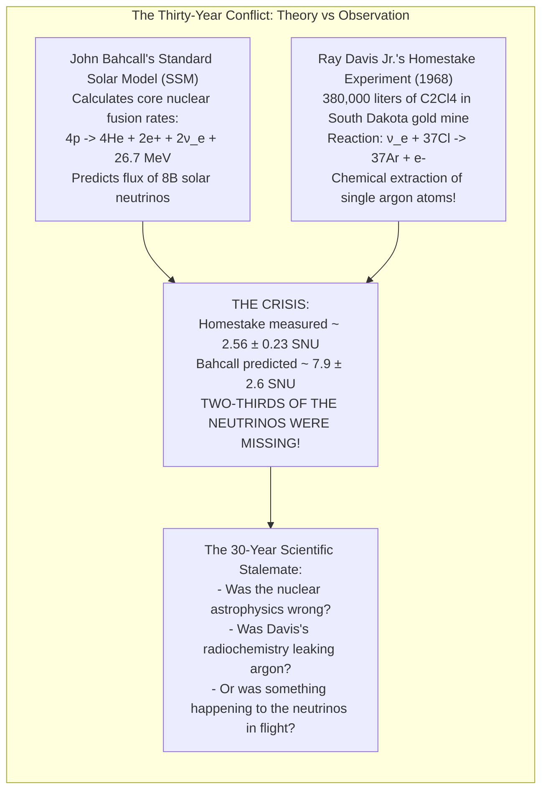
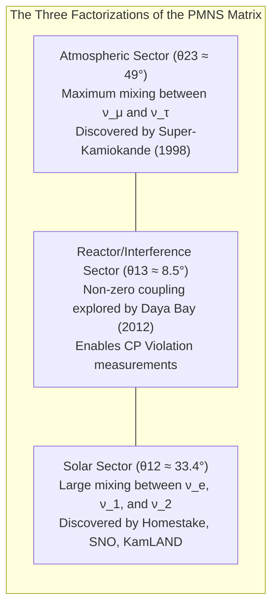
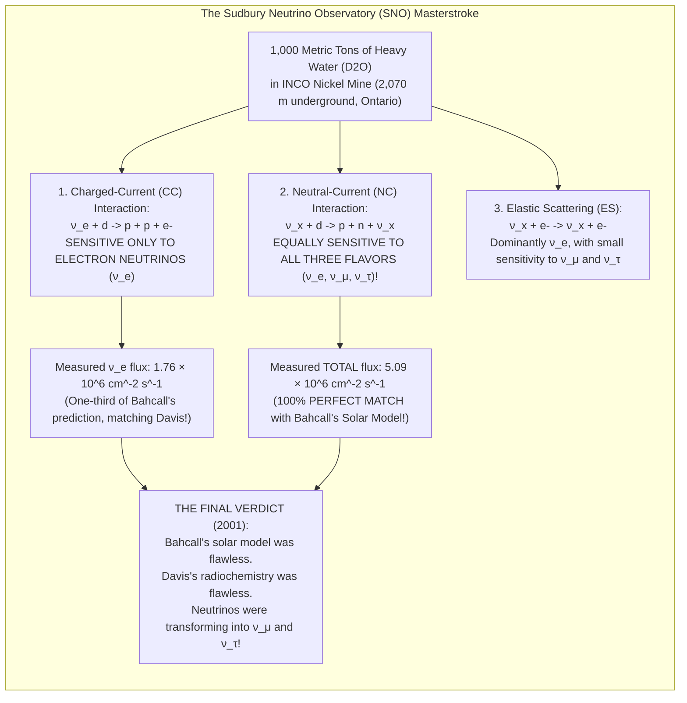
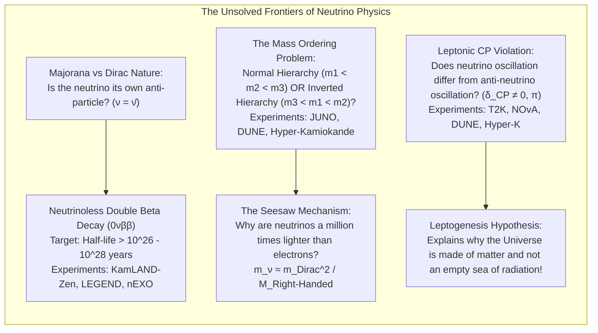
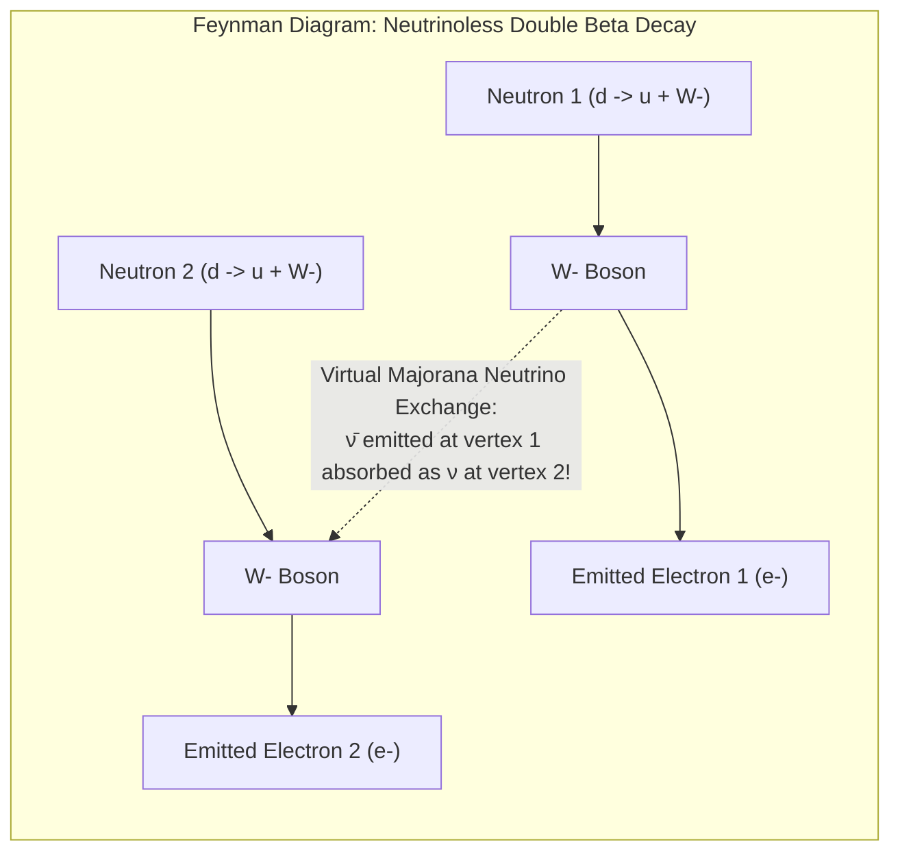

At this very millisecond, approximately 65 billion subatomic particles are streaming through every square centimeter of your fingernail. Born in the thermonuclear inferno at the core of the Sun, they traversed hundreds of thousands of kilometers of dense solar plasma as if it were absolute vacuum, crossed 150 million kilometers of interplanetary space in eight minutes, plunged through the Earth's crust, mantle, and molten iron core without slowing down, and exited out the other side into the cold expanse of the cosmos.

These phantom entities are <strong>neutrinos</strong>.

Uncharged, almost infinitesimally light, and utterly immune to both electromagnetism and the strong nuclear force, the neutrino interacts with ordinary matter almost solely through the weakest of all non-gravitational fundamental interactions: the <strong>weak nuclear force</strong>. To stop a typical mega-electronvolt (MeV) neutrino emitted by a stellar core with a 50% probability, one would need a solid slab of lead <strong>more than one light-year thick</strong>—roughly 10 trillion kilometers of dense metal.

Yet, despite this near-total imperceptibility, physicists have built colossal underground cathedrals of pure water, filled vast subterranean spheres with glowing organic scintillators, instrumented cubic kilometers of ancient Antarctic ice with photodetectors, and proven beyond any shadow of doubt that these ghost particles not only exist, but hold the key to why the universe is composed of matter rather than barren radiation.

How can humanity detect a particle that passes through everything? This comprehensive analysis explores the history, mathematics, detector engineering, and profound quantum mysteries of neutrino science.



---

## 1. The Desperate Remedy: Wolfgang Pauli and Enrico Fermi

The genesis of neutrino physics began not with an observation, but with a theoretical crisis of existential proportions that threatened the foundations of twentieth-century physics: <strong>the apparent breakdown of the law of conservation of energy</strong>.

### The Paradox of the Continuous Beta Spectrum
During the early 1910s and 1920s, experimentalists led by James Chadwick and Lise Meitner investigated <strong>beta decay ($\beta$-decay)</strong>—a radioactive process in which an unstable parent nucleus transforms into a daughter nucleus by ejecting an electron:

$$^A_Z X \longrightarrow \, ^A_{Z+1} Y + e^-$$

If beta decay were a simple two-body transition, the principles of relativistic energy and momentum conservation dictate that the ejected electron must possess a single, discrete, monochromatic energy. Because the parent nucleus is initially at rest and the daughter nucleus is vastly heavier than the electron, the electron's kinetic energy $E_e$ should be fixed precisely by the mass difference $\Delta M = M_X - M_Y$:

$$E_e = \frac{M_X^2 - M_Y^2 + m_e^2}{2 M_X} c^2 \approx (M_X - M_Y) c^2$$

However, when Chadwick calibrated the momentum and energy of emitted beta rays using magnetic spectrometers in 1914, he observed a <strong>continuous energy spectrum</strong>. The electron energies formed a smooth continuum stretching from zero up to an endpoint $E_{\max}$. 

Where was the missing energy going? The data seemed to indicate that in individual nuclear transformations, energy was simply vanishing. The situation became so desperate that even Niels Bohr proposed abandoning the strict conservation of energy, arguing that the first law of thermodynamics might hold only statistically on macroscopic averages, while being routinely violated in microscopic quantum processes.



### Pauli's "Desperate Way Out"
In December 1930, the brilliant Austrian theorist <strong>Wolfgang Pauli</strong> formulated a daring proposal. Unable to attend a physics conference in Tübingen because of a ball he wished to attend in Zurich, Pauli sent an open letter to the delegates, famously addressed to the "Dear Radioactive Ladies and Gentlemen":

> "I have hit upon a desperate way out regarding the 'wrong' statistics of the N and Li-6 nuclei and the continuous beta spectrum to save the law of conservation of energy. Namely, the possibility that there could exist in the nuclei electrically neutral particles, which I will call neutrons, which have spin 1/2 and satisfy the exclusion principle and in addition differ from light quanta in that they do not travel with the speed of light: the mass of the neutrons should be of the same order of magnitude as the electron mass and in any case not larger than 0.01 proton masses. The continuous beta spectrum would then become understandable from the assumption that in beta decay a neutron is emitted along with the electron, in such a way that the sum of the energies of neutron and electron is constant."

Pauli postulated a neutral, highly penetrating particle that escaped unnoticed from the detector, carrying away the variable missing balance of momentum, energy, and angular momentum. Yet Pauli was deeply uneasy with his own invention, lamenting to astronomer Walter Baade: *"I have done a terrible thing. I have postulated a particle that cannot be detected."*

### Fermi's Four-Fermion Theory
In 1932, James Chadwick discovered the heavy neutral constituent of the atomic nucleus, which took the name <strong>neutron</strong>. To distinguish Pauli’s hypothetical lightweight particle from Chadwick’s massive nuclear partner, the Italian physicist <strong>Enrico Fermi</strong> coined the diminutive Italian name <strong>"neutrino"</strong> ("little neutral one").

In late 1933 and 1934, Fermi published his seminal mathematical theory of beta decay. Drawing an analogy to Quantum Electrodynamics (QED), where a photon is created when an electron transitions between atomic orbits, Fermi proposed that the electron and the neutrino are not pre-existing entities confined inside the nucleus, but are <strong>created ex nihilo</strong> at the moment of nuclear transformation:

$$n \longrightarrow p + e^- + \bar{\nu}_e$$

Fermi formulated the interaction Hamiltonian as a contact coupling between four fermion field operators at a single spacetime point $x^\mu$:

$$\mathcal{H}_{\text{int}} = \frac{G_F}{\sqrt{2}} \left[ \bar{\psi}_p(x) \gamma^\mu \psi_n(x) \right] \left[ \bar{\psi}_e(x) \gamma_\mu \psi_\nu(x) \right]$$

Here, $G_F$ is the fundamental <strong>Fermi coupling constant</strong>:

$$G_F \approx 1.166 \times 10^{-5} \, \text{GeV}^{-2} \approx 1.436 \times 10^{-62} \, \text{J} \cdot \text{m}^3$$

Fermi’s theory not only fitted the experimental shape of the beta decay continuum with flawless accuracy, but also provided the mathematical machinery required to calculate the exact probability of a neutrino colliding with matter.

---

## 2. Why Neutrinos Slip Through Matter: Cross Sections and Mean Free Path

To understand why a neutrino can penetrate a wall of lead light-years thick, one must examine the dimensional physics of the weak interaction.

### The Vanishingly Small Cross Section
When an electron travels through matter, it interacts with surrounding atomic electrons via the electromagnetic force, mediated by massless photons ($q=0, m_\gamma=0$). The cross section for electromagnetic processes scales as:

$$\sigma_{\text{EM}} \sim \frac{\alpha^2}{m_e^2} \approx 10^{-25} \, \text{cm}^2 \quad (\alpha \approx 1/137)$$

In contrast, the weak interaction is mediated by the massive gauge bosons of the Standard Model: the charged $W^\pm$ bosons ($M_W \approx 80.4 \, \text{GeV}/c^2$) and the neutral $Z^0$ boson ($M_Z \approx 91.2 \, \text{GeV}/c^2$). 

At low energies ($E_\nu \ll M_W$), the propagator term in the Feynman amplitude reduces to the inverse square of the boson mass:

$$\frac{1}{q^2 - M_W^2 c^2} \xrightarrow{q^2 \ll M_W^2} -\frac{1}{M_W^2 c^2} \propto G_F$$

Because the interaction cross section is proportional to the square of the transition matrix element, dimensional analysis dictates that for a neutrino with center-of-mass energy $E_\nu$ striking a nucleon of mass $m_N$:

$$\sigma_\nu \propto G_F^2 \cdot s \approx G_F^2 \cdot (2 m_N E_\nu)$$

For a typical $3 \, \text{MeV}$ solar or reactor neutrino, evaluating this expression yields:

$$\sigma_\nu \sim 10^{-44} \, \text{cm}^2 = 10^{-20} \, \text{barn}$$

```
   Scale Comparison of Interaction Cross Sections:
   - Strong interaction (Hadronic size)     : ~ 10^-24 cm^2 (1 barn)
   - Electromagnetic interaction (Thomson)   : ~ 6.6 × 10^-25 cm^2
   - Weak interaction (3 MeV Neutrino)       : ~ 10^-44 cm^2 (0.00000000000000000001 barn)
```

The neutrino's cross section is <strong>twenty orders of magnitude smaller</strong> than the geometrical area of an atomic nucleus.

### Calculating the Mean Free Path
The mean free path $\lambda$ of a projectile passing through a material of particle number density $n$ is defined by:

$$\lambda = \frac{1}{n \cdot \sigma_\nu}$$

Consider solid elemental lead ($\text{Pb}$), with a density $\rho = 11.34 \, \text{g/cm}^3$ and molar mass $A = 207.2 \, \text{g/mol}$. The number density of target nucleons (protons and neutrons) $n_N$ is:

$$n_N = \frac{\rho \cdot N_A}{1 \, \text{g}} = 11.34 \times 6.022 \times 10^{23} \approx 6.83 \times 10^{24} \, \text{nucleons/cm}^3$$

Substituting $\sigma_\nu \sim 10^{-44} \, \text{cm}^2$:

$$\lambda = \frac{1}{(6.83 \times 10^{24} \, \text{cm}^{-3}) \times (10^{-44} \, \text{cm}^2)} \approx 1.46 \times 10^{19} \, \text{cm} = 1.46 \times 10^{14} \, \text{km}$$

Given that one light-year is approximately $9.46 \times 10^{12} \, \text{km}$:

$$\lambda \approx \frac{1.46 \times 10^{14}}{9.46 \times 10^{12}} \approx 15.4 \, \text{light-years}$$

A typical MeV neutrino would have to travel through <strong>fifteen light-years of solid lead</strong> before suffering, on average, a single collision. For the Earth, whose diameter is roughly $12,742 \, \text{km}$, the optical depth $\tau = d/\lambda \approx 10^{-10}$. Thus, out of every 10 billion neutrinos aimed directly through the center of our planet, 9,999,999,999 pass through without touching a single atom.

---

## 3. Project Poltergeist: The Reines-Cowan Discovery (1956)

If a single neutrino has an infinitesimal chance of interacting, how can one ever hope to detect it? The solution, conceived by American physicists <strong>Frederick Reines</strong> and <strong>Clyde Cowan Jr.</strong> in the 1950s, was statistical brute force: <strong>compensate for the microscopic cross section with an astronomical flux of particles.</strong>

$$\text{Event Rate } R = \Phi_\nu \times N_{\text{target}} \times \sigma_\nu$$

To maximize $R$, one needs:
1. An immense neutrino flux $\Phi_\nu$ (particles per $\text{cm}^2 \cdot \text{s}$).
2. A massive target containing an enormous count of protons $N_{\text{target}}$.
3. An unambiguous experimental signature that completely eliminates background cosmic rays.



### The Nuclear Reactor as an Anti-Neutrino Factory
In a nuclear fission reactor, uranium and plutonium fuel elements split into neutron-rich fission fragments. These radioactive daughters undergo cascades of beta decays, pouring out an intense, isotropic torrent of <strong>electron anti-neutrinos ($\bar{\nu}_e$)</strong>: roughly $2 \times 10^{20} \, \bar{\nu}_e$ per second from a 1,000 MW thermal reactor.

In 1953, Reines and Cowan launched <strong>Project Poltergeist</strong> at Hanford, and in 1956 relocated their refined apparatus to the newly constructed Savannah River Plant in South Carolina, shielding their detector under 12 meters of earth and heavy concrete to block cosmic muons.

### The Inverse Beta Decay Signature
Reines and Cowan utilized the <strong>Inverse Beta Decay (IBD)</strong> process, in which an electron anti-neutrino strikes a free proton (the nucleus of a hydrogen atom in water):

$$\bar{\nu}_e + p \longrightarrow n + e^+$$

This reaction produces two simultaneous daughters: a positron ($e^+$) and a neutron ($n$). To suppress environmental radioactivity, Reines and Cowan pioneered the <strong>delayed coincidence technique</strong>:
1. <strong>The Prompt Signal ($t = 0$):</strong> The newly minted positron immediately decelerates and undergoes matter-antimatter annihilation with an ambient atomic electron ($e^+ + e^- \to 2\gamma$). This produces two identical $511 \, \text{keV}$ gamma rays flying in strictly opposite directions ($180^\circ$ apart), which are registered simultaneously by surrounding liquid scintillation tanks.
2. <strong>The Delayed Signal ($t \approx 5\text{--}15 \, \mu\text{s}$):</strong> Simultaneously, the newly created neutron bounces through the water, losing its kinetic energy via collisions with hydrogen nuclei (moderation). Reines and Cowan dissolved <strong>cadmium chloride ($\text{CdCl}_2$)</strong> into the water. Cadmium-108 has an exceptionally large thermal neutron capture cross section. Once the neutron thermalizes, it is swallowed by a cadmium nucleus, causing it to de-excite by emitting a cascade of gamma photons totaling approximately $8 \, \text{MeV}$.

By requiring that an $8 \, \text{MeV}$ gamma burst occur within a tightly specified window of several microseconds following a $511 \, \text{keV}$ annihilation pair, the experimenters eliminated virtually all cosmic-ray background noise.

In June 1956, Cowan and Reines sent their historic telegram to Wolfgang Pauli: *"We are happy to inform you that we have definitely detected neutrinos from fission fragments by observing inverse beta decay of protons."* Pauli interrupted a meeting to share the news and consumed a case of champagne with his colleagues. Reines was awarded the 1995 Nobel Prize in Physics for this monumental feat.

---

## 4. The Three Pillars of Modern Neutrino Detectors

Since Reines and Cowan's triumph, neutrino physics has evolved into an observational science spanning solar astrophysics, cosmology, and particle physics. To capture neutrinos across eighteen orders of magnitude in energy—from sub-MeV solar neutrinos to PeV cosmic rays—physicists developed three primary detector technologies.

| Detector Class | Premier Examples | Detection Medium | Primary Physical Mechanism | Target Energy Regime | Key Physics Goals |
| :--- | :--- | :--- | :--- | :--- | :--- |
| <strong>Water Cherenkov</strong> | Super-Kamiokande, Hyper-Kamiokande, SNO | Ultra-pure water ($\text{H}_2\text{O}$) or heavy water ($\text{D}_2\text{O}$) | Imaging Cherenkov light cones with photomultiplier tubes (PMTs) | $5 \, \text{MeV} \text{ to } 100 \, \text{GeV}$ | Atmospheric neutrinos, proton decay, solar $^8\text{B}$, supernova bursts, accelerator beams (T2K) |
| <strong>Liquid Scintillator</strong> | KamLAND, Borexino, JUNO, SNO+ | Organic aromatic hydrocarbons (pseudocumene, LAB) | Direct ionization scintillation fluorescence ($10^4$ photons/MeV) | $0.2 \, \text{MeV} \text{ to } 10 \, \text{MeV}$ | Sub-MeV solar neutrinos ($pp$, $^7\text{Be}$, $\text{CNO}$), geo-neutrinos, reactor oscillation ($L \sim 180 \, \text{km}$) |
| <strong>Deep Natural Media Arrays</strong> | IceCube (South Pole), KM3NeT (Mediterranean), Baikal-GVD | Glacial Antarctic ice sheets or deep abyssal seawater | Sparse arrays of optical modules mapping kilometer-scale muon tracks | $100 \, \text{GeV} \text{ to } 10 \, \text{PeV}+$ | Astrophysical point sources, blazars, tidal disruption events, cosmic-ray origins |

---

### Pillar 1: Water Cherenkov Detectors (Super-Kamiokande)
Located 1,000 meters beneath Mount Ikenoyama in the Mozumi Mine in Gifu Prefecture, Japan, <strong>Super-Kamiokande (Super-K)</strong> is an engineering wonder: a stainless-steel cylindrical tank 41.4 meters tall and 39.3 meters in diameter, holding <strong>50,000 metric tons of ultra-pure water</strong>. Its inner walls are lined with 11,129 hand-blown, 20-inch (50 cm) photomultiplier tubes (PMTs), each capable of registering single photons.



#### The Cherenkov Radiation Phenomenon
Nothing can exceed the speed of light in vacuum, $c$. However, in a transparent dielectric medium with refractive index $n > 1$, light propagates at a reduced phase velocity:

$$v_{\text{light}} = \frac{c}{n}$$

For ultra-pure water, $n \approx 1.334$, meaning light travels at roughly $0.75c$ (approximately $225,000 \, \text{km/s}$). When a charged particle—such as an electron or muon produced by a neutrino collision—travels through water at a velocity $v = \beta c$ exceeding $c/n$ ($\beta > 1/n \approx 0.75$), it creates an electromagnetic shockwave analogous to the acoustic sonic boom generated by a supersonic jet.

The coherent wavefront forms a forward-directed cone of bluish light with half-angle $\theta_C$:

$$\cos\theta_C = \frac{1}{n \beta} \xrightarrow{\beta \to 1} \cos\theta_C = \frac{1}{1.334} \approx 0.7496 \implies \theta_C \approx 41.4^\circ$$

As this cone expands across the dark tank, its intersection with the cylindrical wall projects a circular ring of Cherenkov light onto the PMTs. By measuring the timing of photon arrivals with nanosecond precision and analyzing the charge deposited across each PMT, computers reconstruct the vertex position, energy, and directional trajectory of the primary neutrino with exquisite fidelity.

#### Particle Identification (PID): Distinguishing Electrons from Muons
Super-Kamiokande’s defining capability is its ability to distinguish electron-neutrino ($\nu_e$) interactions from muon-neutrino ($\nu_\mu$) interactions:
- <strong>Electron Neutrino Event ($\nu_e + n \to p + e^-$):</strong> The ejected electron is light ($m_e \approx 0.511 \, \text{MeV}/c^2$). As it streaks through water, it is buffeted by the electric fields of water nuclei (multiple Coulomb scattering) and emits Bremsstrahlung photons, which in turn pair-produce electrons and positrons. This cascading electromagnetic shower blurs the Cherenkov cone, creating a <strong>fuzzy, jagged, diffuse ring</strong> with ill-defined boundaries.
- <strong>Muon Neutrino Event ($\nu_\mu + n \to p + \mu^-$):</strong> The ejected muon is 207 times heavier than the electron ($m_\mu \approx 105.7 \, \text{MeV}/c^2$). Its inertia carries it along a straight, pencil-like trajectory without radiative showers, creating a <strong>crisp, sharp, perfectly defined ring</strong> with distinct margins.

This automated topological pattern-recognition algorithm achieved greater than 99% accuracy in flavor identification, providing the foundation for the discovery of atmospheric neutrino oscillations.

---

### Pillar 2: Liquid Scintillator Detectors (KamLAND and Borexino)
While water Cherenkov detectors excel at directional reconstruction for energies above $5 \, \text{MeV}$, they are blind to low-energy processes: a particle whose velocity drops below the Cherenkov threshold ($\beta < 1/n$) becomes completely dark.

Liquid scintillator detectors replace water with transparent organic solvents (such as pseudocumene, dodecane, or linear alkylbenzene) spiked with fluorescent fluor compounds. When a low-energy charged particle loses energy via ionization, the organic molecules become electronically excited and emit isotropic fluorescence light:
- <strong>Light Yield:</strong> Water Cherenkov produces only about $40$ photons per MeV of deposited energy. Liquid scintillators produce <strong>$10,000$ to $12,000$ photons per MeV</strong>—a 250-fold increase!
- <strong>Threshold:</strong> Scintillator detectors can detect particle interactions down to a fraction of an MeV ($E_{\text{threshold}} \sim 0.2 \, \text{MeV}$).

Experiments like <strong>KamLAND</strong> (in Japan) monitored reactor anti-neutrinos from 55 commercial reactors across Japan at an average baseline of $180 \, \text{km}$, definitively demonstrating the disappearance and reappearance of reactor neutrinos. In Italy's Gran Sasso underground laboratory, the <strong>Borexino</strong> experiment attained unprecedented radiopurity (less than one radioactive decay per day in 100 tons of core fluid), directly observing the elusive $pp$, $^7\text{Be}$, $pep$, and $\text{CNO}$ cycle solar neutrinos in real time.

---

### Pillar 3: Instrumenting the South Pole (IceCube)
At the high-energy frontier ($E_\nu > 100 \, \text{GeV}$ up to PeV scales), neutrino fluxes from deep space become so dilute that even a 50,000-ton detector would wait centuries to capture an event. Physicists required a detector volume measured in <strong>cubic kilometers</strong>.

The <strong>IceCube Neutrino Observatory</strong> turned the Antarctic polar ice sheet into a gargantuan particle detector:
- Between 2005 and 2010, specialized hot-water drills melted 86 holes into the polar glacier to depths between $1,450$ and $2,450$ meters.
- Suspended along these 86 vertical cables are <strong>5,160 Digital Optical Modules (DOMs)</strong>, frozen permanently into the dark, pristine, ultra-transparent deep ice.
- IceCube monitors a fiducial volume of <strong>one billion metric tons of ice ($1 \, \text{km}^3$)</strong>.

When an ultra-high-energy muon neutrino from an active galactic nucleus interacts in the bedrock or ice below the detector, it produces a relativistic muon that travels for several kilometers through the glacier. The resulting Cherenkov light illuminates a string of DOMs along its track, pointing back to the astrophysical source with sub-degree angular accuracy. 

In 2018, IceCube announced the first correlation between a high-energy neutrino (IceCube-170922A, $E \approx 290 \, \text{TeV}$) and an active blazar (<strong>TXS 0506+056</strong>), confirmed by coincident gamma-ray flaring observed by the Fermi-LAT and MAGIC telescopes, inaugurating the era of <strong>Multi-Messenger High-Energy Astrophysics</strong>.

---

## 5. The Thirty-Year Mystery: The Solar Neutrino Problem

In the late 1960s, astrophysics and particle physics collided over a glaring contradiction known as the <strong>Solar Neutrino Problem</strong>.



### The Standard Solar Model vs. Homestake
The Sun shines by fusing hydrogen into helium via the proton-proton ($pp$) chain:

$$4p \longrightarrow \, ^4\text{He} + 2e^+ + 2\nu_e + 26.73 \, \text{MeV}$$

Theoretician <strong>John Bahcall</strong> assembled detailed nuclear cross sections, solar opacity models, equation-of-state calculations, and helioseismology data to predict the exact energy-dependent flux of solar neutrinos. The most energetic of these—the rare neutrinos from the beta decay of Boron-8 ($^8\text{B} \to \, ^8\text{Be}^* + e^+ + \nu_e$, $E_{\max} \approx 14 \, \text{MeV}$)—were energetic enough to initiate nuclear reactions in terrestrial targets.

At the Homestake gold mine in Lead, South Dakota, <strong>Raymond Davis Jr.</strong> constructed a 380,000-liter tank filled with tetrachloroethylene ($\text{C}_2\text{Cl}_4$, dry-cleaning fluid). Chlorine-37 absorbs an electron neutrino to produce radioactive Argon-37:

$$\nu_e + {}^{37}\text{Cl} \longrightarrow {}^{37}\text{Ar} + e^- \quad (E_{\text{threshold}} = 0.814 \, \text{MeV})$$

Argon-37 decays back to chlorine with a half-life of 35 days. Every several months, Davis bubbled helium gas through the 600-ton liquid vat to extract the few atoms of argon produced—often <strong>fewer than fifteen individual Argon-37 atoms from a swimming-pool-sized tank</strong>—and counted their radioactive decays in tiny proportional counters.

The result was staggering:
- <strong>Bahcall's theoretical expectation:</strong> $\sim 8.5 \, \text{SNU}$ (Solar Neutrino Units, where $1 \, \text{SNU} = 10^{-36}$ captures/target atom/sec).
- <strong>Davis's measured rate:</strong> $\sim 2.56 \pm 0.23 \, \text{SNU}$.

<strong>Two-thirds of the solar neutrinos predicted by the laws of physics were missing.</strong>

For three decades, mainstream physicists questioned whether Davis was losing argon atoms or whether Bahcall’s solar interior temperature was off by just a few percent. But both men stood their ground, continually refining their measurements. Subsequent radiochemical experiments in Europe (GALLEX in Italy) and Russia (SAGE in the Caucasus) confirmed the deficit using Gallium targets ($^{71}\text{Ga} \to \, ^{71}\text{Ge}$), which were sensitive to the fundamental low-energy $pp$ neutrinos. The deficit was real.

---

## 6. The Quantum Breakthrough: Neutrino Oscillations and the PMNS Matrix

The resolution to the solar neutrino mystery did not lie in astronomical models of the Sun, but in the quantum nature of the neutrino itself: <strong>neutrinos change their identity in flight.</strong>

### Flavor States versus Mass States
In quantum mechanics, a neutrino is produced and detected via the weak interaction in a definite <strong>flavor eigenstate</strong> ($|\nu_e\rangle, |\nu_\mu\rangle, |\nu_\tau\rangle$), defined by the specific charged lepton ($e, \mu, \tau$) to which it couples in the weak current.

However, the states that propagate through spacetime as plane waves with definite mass and frequency are the <strong>mass eigenstates</strong> ($|\nu_1\rangle, |\nu_2\rangle, |\nu_3\rangle$ with masses $m_1, m_2, m_3$).

The flavor eigenstates are quantum-mechanical superpositions of mass eigenstates, related by the <strong>Pontecorvo-Maki-Nakagawa-Sakata (PMNS) unitary mixing matrix</strong> $U$:

$$|\nu_\alpha\rangle = \sum_{i=1}^3 U_{\alpha i}^* |\nu_i\rangle \quad (\alpha = e, \mu, \tau)$$

In matrix notation:

$$\begin{pmatrix} |\nu_e\rangle \\ |\nu_\mu\rangle \\ |\nu_\tau\rangle \end{pmatrix} = \begin{pmatrix} U_{e1} & U_{e2} & U_{e3} \\ U_{\mu 1} & U_{\mu 2} & U_{\mu 3} \\ U_{\tau 1} & U_{\tau 2} & U_{\tau 3} \end{pmatrix} \begin{pmatrix} |\nu_1\rangle \\ |\nu_2\rangle \\ |\nu_3\rangle \end{pmatrix}$$

The PMNS matrix is conventionally parameterized by three mixing angles ($\theta_{12}, \theta_{23}, \theta_{13}$) and one Dirac CP-violating phase $\delta_{\text{CP}}$:

$$U = \begin{pmatrix} 1 & 0 & 0 \\ 0 & c_{23} & s_{23} \\ 0 & -s_{23} & c_{23} \end{pmatrix} \begin{pmatrix} c_{13} & 0 & s_{13} e^{-i\delta_{\text{CP}}} \\ 0 & 1 & 0 \\ -s_{13} e^{i\delta_{\text{CP}}} & 0 & c_{13} \end{pmatrix} \begin{pmatrix} c_{12} & s_{12} & 0 \\ -s_{12} & c_{12} & 0 \\ 0 & 0 & 1 \end{pmatrix}$$

where $c_{ij} = \cos\theta_{ij}$ and $s_{ij} = \sin\theta_{ij}$.



### Derivation of the Two-Flavor Oscillation Probability
To elucidate the quantum mechanics of oscillations, consider a simplified two-flavor system mixing $\nu_e$ and $\nu_\mu$ with a single mixing angle $\theta$:

$$|\nu_e\rangle = \cos\theta |\nu_1\rangle + \sin\theta |\nu_2\rangle$$
$$|\nu_\mu\rangle = -\sin\theta |\nu_1\rangle + \cos\theta |\nu_2\rangle$$

Suppose a pure electron neutrino is born at time $t = 0$:

$$|\psi(0)\rangle = |\nu_e\rangle = \cos\theta |\nu_1\rangle + \sin\theta |\nu_2\rangle$$

Each mass eigenstate evolves in time according to the time-dependent Schrödinger equation as a stationary state with energy $E_i = \sqrt{p^2 c^2 + m_i^2 c^4}$:

$$|\psi(t)\rangle = \cos\theta \, e^{-i E_1 t / \hbar} |\nu_1\rangle + \sin\theta \, e^{-i E_2 t / \hbar} |\nu_2\rangle$$

In the ultra-relativistic limit ($p c \gg m_i c^2$), the energy can be expanded via the Taylor series:

$$E_i = \sqrt{p^2 c^2 + m_i^2 c^4} \approx p c + \frac{m_i^2 c^3}{2 p} \approx E + \frac{m_i^2 c^4}{2 E}$$

The quantum transition amplitude $\mathcal{A}_{\nu_e \to \nu_\mu}(t)$ to detect this particle as a muon neutrino at time $t$ is the inner product $\langle \nu_\mu | \psi(t) \rangle$:

$$\mathcal{A}_{\nu_e \to \nu_\mu}(t) = \left( -\sin\theta \langle\nu_1| + \cos\theta \langle\nu_2| \right) \left( \cos\theta e^{-i E_1 t / \hbar} |\nu_1\rangle + \sin\theta e^{-i E_2 t / \hbar} |\nu_2\rangle \right)$$

Using the orthonormality of mass eigenstates ($\langle \nu_i | \nu_j \rangle = \delta_{ij}$):

$$\mathcal{A}_{\nu_e \to \nu_\mu}(t) = -\sin\theta \cos\theta \, e^{-i E_1 t / \hbar} + \sin\theta \cos\theta \, e^{-i E_2 t / \hbar} = \sin\theta \cos\theta \left( e^{-i E_2 t / \hbar} - e^{-i E_1 t / \hbar} \right)$$

Factoring out an overall phase:

$$\mathcal{A}_{\nu_e \to \nu_\mu}(t) = \sin(2\theta) \cdot e^{-i \frac{E_1+E_2}{2\hbar} t} \cdot \left[ -i \sin\left( \frac{E_2 - E_1}{2\hbar} t \right) \right]$$

The transition probability $P(\nu_e \to \nu_\mu)$ is the square modulus of this amplitude. Setting propagation distance $L \approx c t$:

$$\Delta E = E_2 - E_1 \approx \frac{(m_2^2 - m_1^2) c^4}{2 E} = \frac{\Delta m^2 c^4}{2 E}$$

$$P(\nu_e \to \nu_\mu) = |\mathcal{A}_{\nu_e \to \nu_\mu}|^2 = \sin^2(2\theta) \sin^2\left( \frac{\Delta m^2 c^3 L}{4 \hbar E} \right)$$

Restoring standard experimental units ($\Delta m^2$ in $\text{eV}^2$, $L$ in $\text{km}$, $E$ in $\text{GeV}$):

$$P(\nu_e \to \nu_\mu) = \sin^2(2\theta) \sin^2\left( 1.27 \times \frac{\Delta m^2 [\text{eV}^2] \cdot L [\text{km}]}{E [\text{GeV}]} \right)$$

This elegant formula carries revolutionary consequences:
1. <strong>Neutrinos Must Have Non-Zero Mass:</strong> If neutrino masses were identical or zero ($m_1 = m_2 = 0$), then $\Delta m^2 = 0$, and the transition probability would vanish identically. <strong>The observation of neutrino flavor transformation is absolute experimental proof that neutrino masses are strictly non-zero.</strong>
2. <strong>Periodic Flavor Metamorphosis:</strong> A neutrino created as an electron neutrino oscillates back and forth into other flavors as it travels across space. Because Davis’s detector could only register electron neutrinos, the "missing" two-thirds had simply morphed into muon and tau neutrinos during their transit through the Sun and space!

---

## 7. The Double Triumph: Super-Kamiokande (1998) and SNO (2001)

The theoretical framework of neutrino oscillations was definitively verified by two landmark experiments at the turn of the millennium.

### 1998: Super-Kamiokande and Atmospheric Neutrino Oscillations
High-energy cosmic rays (primarily protons) constantly strike atomic nuclei in Earth's upper atmosphere, producing showers of charged pions ($\pi^\pm$) that decay in flight:

$$\pi^+ \longrightarrow \mu^+ + \nu_\mu, \quad \mu^+ \longrightarrow e^+ + \nu_e + \bar{\nu}_\mu$$

This atmospheric decay chain implies a strict 2:1 ratio of muon neutrinos to electron neutrinos:

$$\frac{N(\nu_\mu + \bar{\nu}_\mu)}{N(\nu_e + \bar{\nu}_e)} \approx 2$$

In 1998, the Super-Kamiokande collaboration, led by <strong>Takaaki Kajita</strong>, analyzed atmospheric neutrino events as a function of the <strong>zenith angle $\theta_z$</strong> (the angle relative to the vertical):
- Neutrinos coming from directly overhead ($\cos\theta_z = 1$) travel only <strong>$15 \, \text{km}$</strong> through the atmosphere to the underground tank.
- Neutrinos coming from directly below ($\cos\theta_z = -1$) are created on the opposite side of the planet and travel <strong>$12,800 \, \text{km}$</strong> through the entire diameter of the Earth.

```
   Super-Kamiokande Atmospheric Results:
   - Electron Neutrinos (Shower-like fuzzy rings):
       Upward-going flux == Downward-going flux (Perfect symmetry, ~1.0)
   - Muon Neutrinos (Sharp-edged track rings):
       Downward-going flux: Matches theoretical prediction
       Upward-going flux: EXACTLY 50% DEFICIT!
```

Muon neutrinos traveling $15 \, \text{km}$ had insufficient time to oscillate. But those traveling $12,800 \, \text{km}$ through the Earth had undergone quantum oscillations into <strong>tau neutrinos ($\nu_\tau$)</strong>, which, at these energies, could not produce tau leptons and were thus invisible. 

On June 5, 1998, at the Neutrino '98 conference in Takayama, Kajita presented the undeniable deficit of upward-going muon neutrinos. The physics world erupted in ovation: the Standard Model had officially been broken.



### 2001: The Sudbury Neutrino Observatory (SNO)
While Super-K conquered atmospheric neutrinos, the definitive solution to the solar neutrino problem was achieved in 2001 at the <strong>Sudbury Neutrino Observatory (SNO)</strong> in Ontario, Canada, directed by <strong>Arthur B. McDonald</strong>.

SNO consisted of an acrylic vessel suspended 2,070 meters underground in an active nickel mine, filled with <strong>1,000 metric tons of pure heavy water ($\text{D}_2\text{O}$)</strong> loaned by Atomic Energy of Canada Limited. Because heavy water contains <strong>deuterons</strong> (nuclei consisting of one proton and one neutron bound together), SNO could simultaneously measure three distinct reactions:

1. <strong>Charged-Current (CC) Reaction:</strong>
   $$\nu_e + d \longrightarrow p + p + e^-$$
   Mediated exclusively by the $W^+$ boson; <strong>only electron neutrinos</strong> have sufficient energy to create an electron.
2. <strong>Neutral-Current (NC) Reaction:</strong>
   $$\nu_x + d \longrightarrow p + n + \nu_x \quad (x = e, \mu, \tau)$$
   Mediated by the $Z^0$ boson; <strong>all three neutrino flavors break the deuteron apart with identical cross sections!</strong>
3. <strong>Elastic Scattering (ES) Reaction:</strong>
   $$\nu_x + e^- \longrightarrow \nu_x + e^-$$
   Sensitive to all flavors, but with a cross section for $\nu_e$ six times larger than for $\nu_\mu$ or $\nu_\tau$.

When the SNO team analyzed the neutral-current data, the result was historic:
- The <strong>Charged-Current flux</strong> ($\nu_e$ alone) was <strong>$1.76 \times 10^6 \, \text{cm}^{-2} \, \text{s}^{-1}$</strong>—precisely one-third of the total, replicating Davis's measurement!
- The <strong>Neutral-Current flux</strong> (sum of all three flavors $\nu_e + \nu_\mu + \nu_\tau$) was <strong>$5.09 \times 10^6 \, \text{cm}^{-2} \, \text{s}^{-1}$</strong>—<strong>matching John Bahcall’s Standard Solar Model prediction to within a single standard deviation.</strong>

The mystery was solved. The Sun was producing exactly the number of neutrinos predicted by nuclear astrophysics, but by the time they reached Earth, two-thirds had transformed into muon and tau neutrinos. In 2015, Takaaki Kajita and Arthur B. McDonald shared the <strong>Nobel Prize in Physics</strong> *"for the discovery of neutrino oscillations, which shows that neutrinos have mass."*

---

## 8. Beyond the Standard Model: Majorana Particles and the Origin of the Universe

The discovery that neutrinos possess non-zero mass delivered the first definitive crack in the Minimal Standard Model of particle physics, where neutrinos were postulated to be strictly massless and purely left-handed. Today, neutrino physics stands at the precipice of answering the deepest cosmological questions.



### Mystery 1: Dirac or Majorana? Neutrinoless Double Beta Decay ($0\nu\beta\beta$)
All charged fundamental fermions (electrons, quarks) are <strong>Dirac fermions</strong>: their anti-particles carry opposite electric charges and are distinctly separate physical entities ($e^- \neq e^+$).

However, because neutrinos carry <strong>zero electric charge and zero color charge</strong>, Italian theorist <strong>Ettore Majorana</strong> demonstrated in 1937 that a neutrino could theoretically be <strong>its own anti-particle</strong>:

$$\nu = \bar{\nu}$$

The definitive experimental test of the Majorana hypothesis is the search for <strong>neutrinoless double beta decay ($0\nu\beta\beta$)</strong>.

In standard two-neutrino double beta decay ($2\nu\beta\beta$), allowed by the Standard Model and observed in isotopes like Xenon-136 and Germanium-76, two neutrons inside a nucleus simultaneously decay into two protons, two electrons, and two anti-neutrinos:

$$(A, Z) \longrightarrow (A, Z+2) + 2e^- + 2\bar{\nu}_e$$

If neutrinos are Majorana particles, the virtual anti-neutrino emitted by one neutron can be absorbed as a neutrino by the second neutron inside the same nucleus! The process emits <strong>only two electrons and zero neutrinos</strong>:

$$(A, Z) \longrightarrow (A, Z+2) + 2e^-$$



If $0\nu\beta\beta$ is detected:
1. It proves that the neutrino is a <strong>Majorana fermion</strong>.
2. It proves that <strong>Lepton Number Conservation ($\Delta L = 2$) is violated</strong> in nature.
3. The decay rate directly measures the absolute effective Majorana mass scale: $\Gamma_{0\nu\beta\beta} \propto |m_{\beta\beta}|^2$.

Ultra-low-background experiments like <strong>KamLAND-Zen</strong> (using 745 kg of enriched Xenon-136 dissolved in liquid scintillator in Kamioka) and <strong>LEGEND</strong> (using enriched Germanium-76 crystals in Gran Sasso) have established that the half-life of this decay exceeds <strong>$2.3 \times 10^{26}$ years</strong>—more than ten quadrillion times the age of the universe!

### Mystery 2: The Seesaw Mechanism and the Mass Hierarchy
Why is the neutrino’s mass so absurdly tiny? The electron has a mass of $511,000 \, \text{eV}/c^2$, while neutrino masses are less than $0.1 \, \text{eV}/c^2$—a disparity of at least <strong>six orders of magnitude</strong>.

The most compelling theoretical explanation is the <strong>Type-I Seesaw Mechanism</strong>, proposed by Minkowski, Yanagida, Gell-Mann, Ramond, and Slansky. It posits that alongside the familiar left-handed neutrinos, there exist ultra-heavy, right-handed "sterile" Majorana neutrinos with masses near the Grand Unified Theory (GUT) scale ($M_R \sim 10^{14}\text{--}10^{15} \, \text{GeV}$):

$$m_\nu \approx \frac{m_D^2}{M_R}$$

Just like a playground seesaw, as the right-handed partner mass $M_R$ is pushed up to the cosmic unification scale, the observed light neutrino mass $m_\nu$ is forced down toward zero. The tininess of the neutrino mass is an echo from the highest energy scales of the cosmos.

### Mystery 3: Leptogenesis and Why the Universe Exists
In the fiery aftermath of the Big Bang, equal quantities of matter and antimatter should have been forged from pure energy. When matter and antimatter meet, they annihilate into photons. If the laws of physics were completely symmetric, every quark would have paired with an antiquark, leaving a sterile universe devoid of atoms, stars, and galaxies—a cold void filled only with light.

Yet we exist. Out of every billion antimatter particles in the early universe, there were <strong>one billion and one matter particles</strong>. That single surviving particle in a billion formed every star, planet, and living organism in the cosmos.

The leading explanation for this baryonic asymmetry is <strong>Leptogenesis</strong> (proposed by Fukugita and Yanagida). In the ultra-hot early universe, the decay of heavy right-handed Majorana neutrinos violated both lepton number and <strong>CP symmetry (Charge-Parity Conjugation)</strong>, decaying slightly more frequently into leptons than anti-leptons:

$$\Gamma(N_R \to \ell^- + H^+) \neq \Gamma(N_R \to \ell^+ + H^-)$$

Non-perturbative electroweak processes known as <strong>sphalerons</strong> subsequently converted this primordial lepton asymmetry into the matter-antimatter asymmetry of the universe.

Today, long-baseline accelerator experiments—such as <strong>T2K</strong> in Japan (shooting neutrinos 295 km from J-PARC to Super-K), <strong>NOvA</strong> in the United States, the upcoming <strong>Hyper-Kamiokande</strong> (starting in 2027), and the <strong>Deep Underground Neutrino Experiment (DUNE)</strong> in the US (shooting neutrinos 1,300 km from Fermilab to a 70,000-ton liquid argon detector in South Dakota)—are measuring the Dirac CP-violating phase $\delta_{\text{CP}}$. If $\sin\delta_{\text{CP}} \neq 0$, it will prove that neutrinos and anti-neutrinos oscillate differently, providing the missing empirical link to explain why the universe is made of matter.

---

## Conclusion: Gazing into the Invisible

The quest to observe the neutrino is physics at its most audacious. What began as Wolfgang Pauli's "embarrassing" mathematical crutch has unfolded into one of the grandest intellectual journeys in human history.

To catch a particle that passes through worlds, humanity built instruments of sublime scale: sinking thousands of electronic eyes miles into the frozen abyss of the South Pole, carving massive subterranean cathedrals lined with tens of thousands of golden photo-tubes beneath Japanese mountains, and refining heavy water beneath Canadian rock beds to count single atoms.

In catching the uncatchable, we discovered that neutrinos hold the blueprint of nuclear fusion at the Sun’s core, broke open the Standard Model by proving that quantum flavors shift across the cosmos, and reached toward the cosmic dawn to understand why anything exists at all. The ghost particle, once thought undetectable, has become our most profound window into the fundamental architecture of reality.
