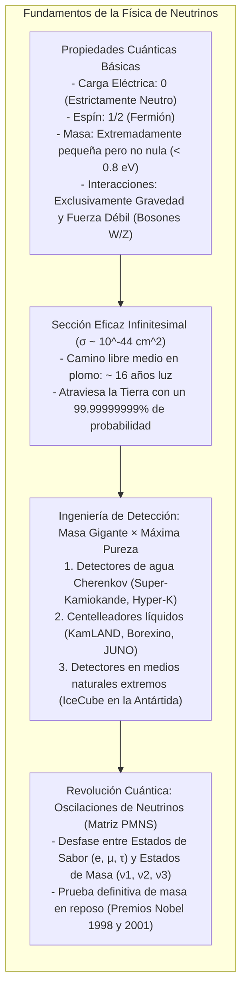

En este preciso instante, aproximadamente 65.000 millones de partículas subatómicas atraviesan cada centímetro cuadrado de la uña de su pulgar a una velocidad prácticamente idéntica a la de la luz. Se originaron en las reacciones termonucleares del núcleo solar, atravesaron cientos de miles de kilómetros de plasma hirviente como si fuera el vacío más absoluto, cruzaron 150 millones de kilómetros de espacio interplanetario, perforaron la corteza, el manto y el núcleo de hierro fundido de la Tierra, y salieron por el otro extremo hacia el cosmos.

Estas partículas reciben el nombre de <strong>neutrinos</strong>.

Sin carga eléctrica, con una masa millones de veces inferior a la del electrón e inmunes al electromagnetismo y a la fuerza nuclear fuerte, los neutrinos interactúan con la materia ordinaria casi exclusivamente a través de la <strong>interacción nuclear débil</strong>. Para detener con un 50% de probabilidad un neutrino solar común de unos pocos megaelectronvoltios (MeV), se necesitaría un bloque de plomo macizo de <strong>más de un año luz de grosor</strong> (cerca de diez billones de kilómetros de metal sólido).

¿Cómo logró la física moderna detectar estas entidades casi intangibles, medir su masa y utilizarlas para desentrañar los secretos del universo?



---

## 1. La hipótesis desesperada de Pauli y la teoría de Fermi

El nacimiento del neutrino se remonta a una crisis dramática en la física de los años 1920: la aparente violación de la <strong>ley de conservación de la energía</strong>.

En la desintegración beta ($\beta$), en la que un núcleo atómico emite un electrón, la cinemática relativista exigía que el electrón saliera con una energía discreta y fija. Sin embargo, los experimentos mostraron un <strong>espectro de energía continuo</strong>. Parte de la energía parecía desvanecerse en el vacío.

En diciembre de 1930, el físico austríaco <strong>Wolfgang Pauli</strong> envió una célebre carta a un congreso en Tubinga:
> «Estimadas señoras y señores radiactivos... He recurrido a una solución desesperada para salvar la ley de conservación de la energía.»

Pauli propuso la existencia de una partícula neutra de espín 1/2 que se emitía junto con el electrón y escapaba inadvertida llevándose la energía faltante:

$$n \longrightarrow p + e^- + \bar{\nu}_e$$

En 1934, el italiano <strong>Enrico Fermi</strong> bautizó a la partícula como <strong>neutrino</strong> («pequeño neutro») y formuló la teoría de la fuerza débil ($G_F \approx 1{,}166 \times 10^{-5} \, \text{GeV}^{-2}$). El diminuto valor del choque calculado llevó a Pauli a lamentar haber propuesto una partícula «imposible de detectar».

---

## 2. ¿Por qué el neutrino lo atraviesa todo?

La materia que tocamos es sólida porque las nubes electrónicas de los átomos se repelen mediante fuerzas electromagnéticas. El neutrino:
1. Carece de carga eléctrica (ignora la repulsión de Coulomb);
2. No siente la fuerza nuclear fuerte;
3. Solo interactúa a través de los pesadísimos bosones $W^\pm$ y $Z^0$ de la fuerza débil ($M_W \approx 80{,}4 \, \text{GeV}/c^2$).

La sección eficaz de interacción para un neutrino típico es de solo:

$$\sigma_\nu \sim 10^{-44} \, \text{cm}^2 = 10^{-20} \, \text{barn}$$

¡Es <strong>cien trillones de veces menor</strong> que el tamaño de un núcleo atómico!

Su camino libre medio en plomo macizo es de <strong>16 años luz</strong>. Para un neutrino, atravesar la Tierra de lado a lado es prácticamente equivalente a volar en el vacío.

---

## 3. El experimento de Reines y Cowan (1956)

En 1956, los físicos estadounidenses <strong>Frederick Reines</strong> y <strong>Clyde Cowan</strong> lograron lo que parecía imposible: compensar la microscópica probabilidad de choque con un flujo descomunal de partículas ($10^{13} \, \bar{\nu}_e / \text{cm}^2 / \text{s}$) junto al reactor nuclear de Savannah River.

Aprovecharon la reacción de desintegración beta inversa:

$$\bar{\nu}_e + p \longrightarrow n + e^+$$

```mermaid
flowchart LR
    subgraph DELAYED_ES ["Método de Coincidencia Retardada de Reines y Cowan"]
        direction TB
        NU_ES["Antineutrino electrónico del reactor"] --> P_ES["Protón libre en agua"]
        P_ES --> IBD_ES["Desintegración beta inversa: Positrón (e+) y Neutrón (n)"]
        
        IBD_ES --> PROMPT_ES["SEÑAL INMEDIATA (t = 0):\nAniquilación e+ con e- -> 2 fotones gamma de 511 keV (a 180° opuestos)"]
        IBD_ES --> DELAYED_ES["SEÑAL RETARDADA (t ≈ 10 μs):\nCaptura del neutrón moderado en cadmio-108 -> Cascada gamma de 8 MeV"]
        
        PROMPT_ES --> GATE_ES["Ventana de coincidencia temporal: ¡Filtra el 99,999% del ruido ambiental!"]
        DELAYED_ES --> GATE_ES
        GATE_ES --> DETECT_ES["¡Detección inequívoca del neutrino confirmada! (Premio Nobel 1995)"]
    end
```

Mediante la <strong>técnica de coincidencia retardada</strong>, exigieron que tras el destello de los dos rayos gamma de $511 \, \text{keV}$ por aniquilación del positrón se registrara en unos pocos microsegundos la emisión gamma de $8 \, \text{MeV}$ de la captura del neutrón por cadmio. Esto eliminó el ruido de fondo cósmico y confirmó experimentalmente la existencia del neutrino.

---

## 4. Grandes observatorios de la física moderna

### ① Super-Kamiokande y el efecto Cherenkov
Ubicado a 1.000 metros bajo tierra en Japón, <strong>Super-Kamiokande</strong> alberga <strong>50.000 toneladas de agua ultrapura</strong> y <strong>11.129 fotomultiplicadores (PMT)</strong> gigantes de 50 cm.
- <strong>Radiación de Cherenkov:</strong> Cuando una partícula cargada viaja en el agua a mayor velocidad que la luz en ese medio ($v > c/n \approx 0{,}75c$), genera un cono de luz azulada con un ángulo $\theta_C \approx 41{,}4^\circ$.
- <strong>Identificación de partículas:</strong> Los electrones ligeros generan <strong>anillos borrosos y difusos</strong>, mientras que los muones pesados producen <strong>anillos nítidos y perfectamente definidos</strong>.

### ② IceCube en la Antártida
Para capturar neutrinos cósmicos de energías colosales (TeV a PeV), <strong>IceCube</strong> convirtió <strong>un kilómetro cúbico del manto de hielo del Polo Sur</strong> en un detector astronómico con 5.160 módulos ópticos enterrados hasta los 2.450 metros de profundidad.

---

## 5. El enigma solar y las oscilaciones de neutrinos

Durante tres décadas, los experimentos de Ray Davis midieron solo <strong>un tercio de los neutrinos solares</strong> predichos por el modelo solar de John Bahcall. 

La respuesta fue un prodigio de la mecánica cuántica: <strong>las oscilaciones de neutrinos</strong>.
Los estados de sabor ($\nu_e, \nu_\mu, \nu_\tau$) no coinciden con los estados de masa ($\nu_1, \nu_2, \nu_3$), sino que están mezclados por la <strong>matriz PMNS</strong>:

$$P(\nu_e \to \nu_\mu) = \sin^2(2\theta) \sin^2\left( 1{,}27 \cdot \frac{\Delta m^2 \, [\text{eV}^2] \cdot L \, [\text{km}]}{E \, [\text{GeV}]} \right)$$

Al propagarse por el espacio, los neutrinos cambian periódicamente de sabor. En 1998, Takaaki Kajita confirmó la oscilación en Super-Kamiokande, y en 2001, Arthur McDonald en el observatorio SNO de Canadá probó que el flujo total coincidía exactamente con las predicciones solares. Ambos recibieron el Premio Nobel en 2015.

---

## 6. Más allá del Modelo Estándar

El hecho de que los neutrinos tengan masa obliga a ampliar el Modelo Estándar:
1. <strong>Fermiones de Majorana:</strong> ¿Es el neutrino su propia antipartícula? Experimentos buscan la <strong>doble desintegración beta sin neutrinos ($0\nu\beta\beta$)</strong> para comprobarlo.
2. <strong>Mecanismo del balancín (Seesaw):</strong> Neutrinos pesados a la escala de gran unificación explicarían por qué los neutrinos conocidos son tan ligeros.
3. <strong>Leptogénesis:</strong> La asimetría en la desintegración de neutrinos primordiales podría explicar por qué el universo está hecho de materia y no se aniquiló por completo.

La búsqueda de esta partícula esquiva ha transformado nuestra comprensión de las leyes fundamentales de la naturaleza y del cosmos.
