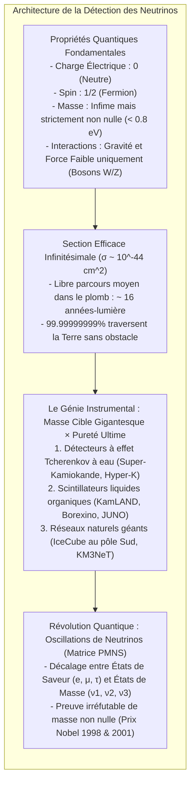

À chaque milliseconde qui s'écoule, environ 65 milliards de particules élémentaires traversent chaque centimètre carré de votre ongle. Nées au cœur de la fournaise thermonucléaire du Soleil, elles ont traversé des centaines de milliers de kilomètres de plasma dense comme s'il s'agissait du vide le plus absolu, franchi 150 millions de kilomètres d'espace interplanétaire en huit minutes, traversé la croûte, le manteau et le noyau de fer liquide de la Terre, pour ressortir de l'autre côté vers les profondeurs du cosmos.

Ces insaisissables voyageurs portent le nom de <strong>neutrinos</strong>.

Dépourvu de charge électrique, d'une masse presque infinitésimale et totalement insensible à l'électromagnétisme ainsi qu'à l'interaction nucléaire forte, le neutrino n'interagit avec la matière ordinaire que par l'intermédiaire de <strong>l'interaction nucléaire faible</strong>. Pour arrêter avec une probabilité de 50 % un neutrino solaire typique de quelques mégaélectronvolts (MeV), il faudrait ériger une <strong>muraille de plomb massif d'une épaisseur supérieure à une année-lumière</strong> (environ dix mille milliards de kilomètres).

Comment les physiciens ont-ils réussi à capturer ces particules fantômes, à identifier leur saveur et à démontrer qu'elles possèdent une masse ?



---

## 1. L'hypothèse désespérée de Pauli et la théorie de Fermi

L'épopée du neutrino débute dans les années 1920 face à une énigme qui menaçait d'ébranler le principe le plus sacré de la science : <strong>la conservation de l'énergie</strong>.

Lors de la désintégration bêta ($\beta$), au cours de laquelle un noyau instable émet un électron, la mécanique quantique imposait que l'électron soit éjecté avec une énergie cinétique discrète et fixe. Pourtant, les mesures de James Chadwick révélèrent un <strong>spectre continu d'énergie</strong>. Une part variable de l'énergie s'évanouissait dans la nature.

En décembre 1930, le théoricien autrichien <strong>Wolfgang Pauli</strong> adressa une lettre devenue légendaire aux participants d'un congrès à Tübingen :
> « Chers dames et messieurs radioactifs... J'ai découvert un remède désespéré pour sauver le principe de conservation de l'énergie. »

Pauli postula l'existence d'une particule neutre de spin 1/2, émise simultanément avec l'électron, emportant l'énergie manquante sans être détectée :

$$n \longrightarrow p + e^- + \bar{\nu}_e$$

En 1934, le physicien italien <strong>Enrico Fermi</strong> baptisa cette particule <strong>neutrino</strong> (« petit neutre » en italien) et fonda la théorie mathématique de l'interaction faible avec la constante de couplage $G_F \approx 1{,}166 \times 10^{-5} \, \text{GeV}^{-2}$.

---

## 2. Pourquoi les neutrinos traversent-ils tout ?

Les objets du quotidien paraissent solides car les cortèges électroniques des atomes se repoussent violemment sous l'action de la force électromagnétique. Le neutrino, lui :
1. N'a <strong>aucune charge électrique</strong> ;
2. Ne ressent <strong>pas la force nucléaire forte</strong> ;
3. N'interagit que par les bosons massifs $W^\pm$ et $Z^0$ de l'interaction faible ($M_W \approx 80{,}4 \, \text{GeV}/c^2$).

La section efficace d'interaction d'un neutrino de quelques MeV est d'environ :

$$\sigma_\nu \sim 10^{-44} \, \text{cm}^2 = 10^{-20} \, \text{barn}$$

Soit <strong>cent trillions de fois ($10^{20}$) plus petite</strong> que la section géométrique d'un noyau atomique.

Son libre parcours moyen $\lambda = \frac{1}{n \cdot \sigma_\nu}$ dans du plomb solide atteint <strong>16 années-lumière</strong>. Pour un neutrino, la Terre tout entière est transparente à 99,99999999 %.

---

## 3. L'expérience de Reines et Cowan (1956)

En 1956, <strong>Frederick Reines</strong> et <strong>Clyde Cowan</strong> résolurent le problème par la méthode statistique : compenser l'infime probabilité individuelle par un flux torrentiel de particules auprès du réacteur nucléaire de Savannah River ($10^{13} \, \bar{\nu}_e / \text{cm}^2 / \text{s}$).

Ils exploitèrent la réaction de désintégration bêta inverse :

$$\bar{\nu}_e + p \longrightarrow n + e^+$$

```mermaid
flowchart LR
    subgraph DELAYED_FR ["Méthode de Coïncidence Retardée de Reines & Cowan"]
        direction TB
        NU_FR["Antineutrino électronique du réacteur"] --> P_FR["Proton libre de l'eau (H)"]
        P_FR --> IBD_FR["Désintégration bêta inverse : Positron (e+) & Neutron (n)"]
        
        IBD_FR --> PROMPT_FR["SIGNAL IMMÉDIAT (t = 0) :\nAnnihilation e+ et e- -> 2 photons gamma de 511 keV (à 180° opposés)"]
        IBD_FR --> DELAYED_FR["SIGNAL RETARDÉ (t ≈ 10 μs) :\nCapture du neutron ralenti par le cadmium-108 -> Cascade gamma de 8 MeV"]
        
        PROMPT_FR --> GATE_FR["Porte de coïncidence temporelle : Rejet de 99,999% des bruits parasites !"]
        DELAYED_FR --> GATE_FR
        GATE_FR --> DISCOVERY_FR["Détection historique confirmée (Prix Nobel 1995) !"]
    end
```

Grâce à la technique de <strong>coïncidence retardée</strong> (les deux photons gamma de $511 \, \text{keV}$ de l'annihilation du positron suivis quelques microsecondes plus tard par l'émission gamma de $8 \, \text{MeV}$ de la capture du neutron par le cadmium), ils confirmèrent sans équivoque la première détection d'un neutrino. Reines reçut le prix Nobel en 1995.

---

## 4. Les géants de l'observation moderne

### ① Super-Kamiokande : L'œil d'eau Tcherenkov
Niché à 1 000 mètres sous terre dans la mine de Kamioka au Japon, <strong>Super-Kamiokande</strong> contient <strong>50 000 tonnes d'eau ultra-pure</strong> entourées de <strong>11 129 photomultiplicateurs (PMT)</strong> de 50 cm.
- <strong>Effet Tcherenkov :</strong> Lorsque la vitesse d'une particule chargée dépasse la vitesse de la lumière dans l'eau ($c/n \approx 0{,}75c$), une onde de choc lumineuse bleuâtre est émise sous un angle de $\theta_C \approx 41{,}4^\circ$.
- <strong>Identification des particules :</strong> Les électrons légers créent des <strong>anneaux Tcherenkov diffus et flous</strong>, tandis que les muons lourds tracent des <strong>anneaux d'une netteté chirurgicale</strong>.

### ② IceCube au pôle Sud
Pour les neutrinos cosmiques d'énergie colossale (TeV à PeV), <strong>IceCube</strong> transforme <strong>un kilomètre cube de glace antarctique</strong> en détecteur géant grâce à 5 160 capteurs optiques forés jusqu'à 2 450 mètres de profondeur.

---

## 5. Le mystère solaire et les oscillations de neutrinos

Pendant trente ans, l'expérience de Ray Davis à Homestake mesura systématiquement <strong>trois fois moins de neutrinos solaires</strong> que ne le prédisait le modèle standard solaire de John Bahcall.

La solution vint de la mécanique quantique : <strong>les oscillations de neutrinos</strong>.
Les états de saveur faibles ($\nu_e, \nu_\mu, \nu_\tau$) sont des superpositions quantiques d'états de masse ($\nu_1, \nu_2, \nu_3$), décrites par la <strong>matrice PMNS</strong> :

$$P(\nu_e \to \nu_\mu) = \sin^2(2\theta) \sin^2\left( 1{,}27 \cdot \frac{\Delta m^2 \, [\text{eV}^2] \cdot L \, [\text{km}]}{E \, [\text{GeV}]} \right)$$

En transit entre le Soleil et la Terre, les neutrinos électroniques se métamorphosent périodiquement en neutrinos muoniques et tauiques.

En 1998, Takaaki Kajita démontra ce phénomène avec Super-Kamiokande pour les neutrinos atmosphériques ; en 2001, Arthur McDonald et l'observatoire SNO au Canada confirmèrent le modèle solaire grâce à l'eau lourde. Tous deux reçurent le prix Nobel de physique en 2015.

---

## 6. Au-delà du Modèle Standard

Aujourd'hui, la physique des neutrinos explore les ultimes énigmes cosmologiques :
1. <strong>Fermions de Majorana :</strong> Le neutrino est-il sa propre antiparticule ? La traque de la <strong>double désintégration bêta sans neutrino ($0\nu\beta\beta$)</strong> pourrait prouver la violation du nombre leptonique ;
2. <strong>Mécanisme de bascule (Seesaw) :</strong> Des neutrinos droits ultra-lourds expliquent naturellement pourquoi les neutrinos ordinaires sont un million de fois plus légers que les électrons ;
3. <strong>Leptogenèse :</strong> La violation de symétrie CP dans le secteur des neutrinos pourrait être la raison pour laquelle notre univers est fait de matière et non de vide.

La traque de l'insaisissable neutrino demeure l'une des plus éclatantes aventures intellectuelles de l'histoire des sciences.
