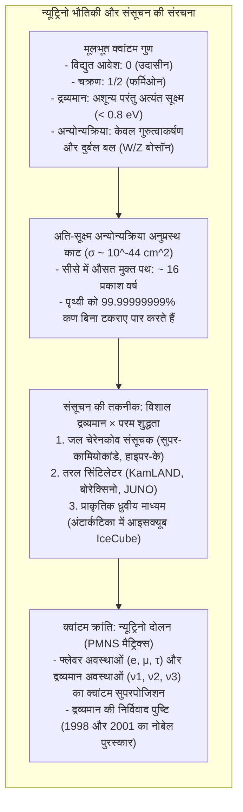

इस समय भी आपके अंगूठे के नाखून के प्रत्येक वर्ग सेंटीमीटर से प्रति सेकंड लगभग 65 अरब उप-परमाण्विक कण प्रकाश की गति से आर-पार निकल रहे हैं। ये सूर्य के केंद्र में होने वाले संलयन से उत्पन्न हुए, सूर्य के सघन प्लाज्मा को पार किया, 15 करोड़ किलोमीटर अंतरिक्ष की यात्रा की, पृथ्वी की चट्टानों और पिघले लोहे के कोर को बिना रुके पार करते हुए अंतरिक्ष में विलीन हो गए।

इन्हें <strong>न्यूट्रिनो (Neutrino)</strong> कहा जाता है।

विद्युत आवेश रहित, अत्यंत सूक्ष्म द्रव्यमान वाले और विद्युत-चुंबकीय तथा प्रबल बलों से अप्रभावित ये कण केवल <strong>दुर्बल नाभिकीय बल</strong> द्वारा पदार्थ से अंतःक्रिया करते हैं। एक सामान्य सौर न्यूट्रिनो को रोकने के लिए <strong>एक प्रकाश वर्ष (लगभग 10 ट्रिलियन किमी) मोटे ठोस सीसे की दीवार</strong> की आवश्यकता होगी।

फिर भी वैज्ञानिकों ने इन अदृश्य कणों को खोज निकाला और इनके पास द्रव्यमान होने का प्रमाण जुटाया।



---

## 1. पाउली का साहसिक कदम और फर्मी का सिद्धांत

1920 के दशक में बीटा क्षय में ऊर्जा संरक्षण नियम के टूटने का संकट पैदा हुआ। उत्सर्जित इलेक्ट्रॉन असतत स्पेक्ट्रम के स्थान पर <strong>सतत ऊर्जा स्पेक्ट्रम</strong> प्रदर्शित कर रहे थे।

दिसंबर 1930 में <strong>वोल्फगैंग पाउली</strong> ने सुझाव दिया कि बीटा क्षय में इलेक्ट्रॉन के साथ एक उदासीन, अत्यंत भेदी कण भी निकलता है जो लुप्त ऊर्जा को ले जाता है:

$$n \longrightarrow p + e^- + \bar{\nu}_e$$

1934 में इतालवी वैज्ञानिक <strong>एनरिको फर्मी</strong> ने इसे <strong>न्यूट्रिनो</strong> का नाम दिया और दुर्बल बल का गणितीय सिद्धांत प्रतिपादित किया।

---

## 2. न्यूट्रिनो सब कुछ क्यों भेद जाता है?

न्यूट्रिनो पर कोई विद्युत आवेश नहीं होता और न ही यह प्रबल बल महसूस करता है। भारी $W^\pm$ और $Z^0$ बोसॉन के कारण इसका अन्योन्यक्रिया अनुप्रस्थ काट लगभग $10^{-44} \, \text{cm}^2$ होता है। सीसे में इसका औसत मुक्त पथ <strong>16 प्रकाश वर्ष</strong> है, जिससे पूरी पृथ्वी इसके लिए शून्य के समान है।

---

## 3. राइनस और कोवान का ऐतिहासिक प्रयोग (1956)

1956 में <strong>फ्रेडरिक राइनस</strong> और <strong>क्लाइड कोवान</strong> ने सवाना रिवर परमाणु रिएक्टर से निकलने वाले $10^{13} \, \bar{\nu}_e / \text{cm}^2 / \text{s}$ के विशाल न्यूट्रिनो प्रवाह का उपयोग करके प्रतिगामी बीटा क्षय को पकड़ा:

$$\bar{\nu}_e + p \longrightarrow n + e^+$$

```mermaid
flowchart LR
    subgraph DELAYED_HI ["राइनस और कोवान की विलंबित संपाती विधि"]
        direction TB
        NU_HI["रिएक्टर से एंटी-न्यूट्रिनो"] --> P_HI["जल में मुक्त प्रोटॉन"]
        P_HI --> IBD_HI["उत्पाद: पॉज़िट्रॉन (e+) और न्यूट्रॉन (n)"]
        
        IBD_HI --> PROMPT_HI["तत्काल संकेत (t = 0):\nपॉज़िट्रॉन विलोपन -> दो 511 keV गामा किरणें (180° विपरीत)"]
        IBD_HI --> DELAYED_HI["विलंबित संकेत (t ≈ 10 μs):\nकैडमियम द्वारा न्यूट्रॉन प्रग्रहण -> 8 MeV गामा किरणें"]
        
        PROMPT_HI --> GATE_HI["संपाती द्वार: 99.999% पृष्ठभूमि शोर समाप्त!"]
        DELAYED_HI --> GATE_HI
        GATE_HI --> DETECT_HI["न्यूट्रिनो की ऐतिहासिक पुष्टि (1995 नोबेल पुरस्कार)!"]
    end
```

<strong>विलंबित संपाती तकनीक (Delayed Coincidence)</strong> द्वारा शोर को खत्म करके उन्होंने न्यूट्रिनो को पहली बार पकड़ा।

---

## 4. आधुनिक विशाल संसूचक

### ① सुपर-कामियोकांडे (Super-Kamiokande)
जापान में 1,000 मीटर भूमिगत स्थित इस संयंत्र में <strong>50,000 टन अति-शुद्ध जल</strong> और <strong>11,129 फोटोमल्टीप्लायर ट्यूब्स</strong> हैं।
- <strong>चेरेनकोव प्रभाव:</strong> जल में प्रकाश की गति ($0.75c$) से तेज चलने वाले आवेशित कण नीला प्रकाश शंकु ($\theta_C \approx 41.4^\circ$) बनाते हैं।
- <strong>कण पहचान:</strong> इलेक्ट्रॉन धुंधले वलय बनाते हैं जबकि म्यूऑन तीक्ष्ण वलय बनाते हैं।

### ② आइसक्यूब (IceCube)
अंटार्कटिका में एक घन किलोमीटर स्वच्छ हिमनद को 5,160 प्रकाश संवेदकों द्वारा संसूचक में बदल दिया गया है जो PeV ऊर्जा वाले ब्रह्मांडीय न्यूट्रिनो पकड़ता है।

---

## 5. सौर न्यूट्रिनो समस्या और न्यूट्रिनो दोलन

रे डेविस के प्रयोग में सिद्धांत की तुलना में <strong>केवल एक तिहाई न्यूट्रिनो</strong> मिले।
इसका रहस्य <strong>न्यूट्रिनो दोलन</strong> था:
फ्लेवर अवस्थाएँ ($\nu_e, \nu_\mu, \nu_\tau$) द्रव्यमान अवस्थाओं ($\nu_1, \nu_2, \nu_3$) का मिश्रण हैं (PMNS मैट्रिक्स)। यात्रा के दौरान न्यूट्रिनो अन्य फ्लेवर में बदल जाते हैं।

1998 में सुपर-कामियोकांडे (ताकाकी काजिता) और 2001 में एसएनओ (आर्थर मैकडोनाल्ड) ने इसे सिद्ध कर 2015 का नोबेल पुरस्कार जीता।

---

## 6. मानक मॉडल से आगे

न्यूट्रिनो द्रव्यमान कई नए रहस्य खोलता है:
1. <strong>मायोराना फर्मिओन:</strong> क्या न्यूट्रिनो स्वयं का प्रतिकण है? <strong>न्यूट्रिनो-रहित द्वि-बीटा क्षय ($0\nu\beta\beta$)</strong> की खोज जारी है;
2. <strong>सीसॉ तंत्र (Seesaw Mechanism):</strong> न्यूट्रिनो के अत्यंत हल्के होने की व्याख्या;
3. <strong>लेप्टोजेनेसिस (Leptogenesis):</strong> ब्रह्मांड में केवल पदार्थ बचने का रहस्य।
