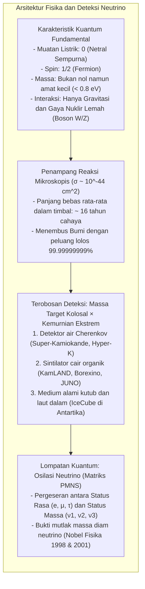

Detik ini juga, sekitar 65 miliar partikel subatomik melesat menembus setiap sentimeter persegi kuku jempol Anda dengan kecepatan mendekati kecepatan cahaya. Partikel-partikel ini tercipta dari tungku fusi termonuklir di pusat Matahari, melintasi ratusan ribu kilometer plasma surya yang pekat seolah ruang hampa murni, menempuh 150 juta kilometer ruang angkasa, menembus kerak, mantel, dan inti besi cair Bumi, lalu melesat keluar ke kedalaman kosmos.

Partikel ini bernama <strong>neutrino</strong>.

Tanpa muatan listrik, bermassa luar biasa kecil, dan kebal terhadap gaya elektromagnetik maupun gaya nuklir kuat, neutrino berinteraksi dengan materi biasa hampir semata-mata melalui <strong>gaya nuklir lemah</strong>. Untuk menghentikan sebuah neutrino biasa berenergi beberapa mega-elektronvolt (MeV) dengan peluang 50%, diperlukan dinding timbal padat dengan <strong>ketebalan lebih dari satu tahun cahaya</strong> (sekitar 10 triliun kilometer logam pekat).

Lantas, bagaimana para fisikawan berhasil menangkap partikel tak kasat mata ini dan membuktikan bahwa mereka memiliki massa?



---

## 1. Hipotesis Putus Asa Pauli dan Teori Interaksi Lemah Fermi

Lahirnya neutrino berakar dari krisis besar fisika pada tahun 1920-an: ancaman runtuhnya <strong>hukum kekekalan energi</strong>.

Pada peluruhan beta ($\beta$), elektron yang terpancar seharusnya membawa energi diskret tunggal. Namun, eksperimen justru menunjukkan <strong>spektrum energi kontinu</strong>: sebagian energi tampak lenyap begitu saja tanpa jejak.

Pada Desember 1930, fisikawan Austria <strong>Wolfgang Pauli</strong> mengirim surat bersejarah yang mengusulkan adanya partikel netral berputar 1/2 yang turut terpancar bersama elektron dan membawa pergi energi yang hilang:

$$n \longrightarrow p + e^- + \bar{\nu}_e$$

Pada tahun 1934, ilmuwan besar Italia <strong>Enrico Fermi</strong> menamai partikel ini <strong>neutrino</strong> ("yang netral dan kecil") serta merumuskan teori interaksi lemah dengan konstanta $G_F \approx 1{,}166 \times 10^{-5} \, \text{GeV}^{-2}$.

---

## 2. Mengapa Neutrino Menembus Segalanya?

Materi tampak padat karena awan elektron atom saling tolak-menolak secara elektromagnetik. Neutrino:
1. <strong>Tidak memiliki muatan listrik</strong>;
2. <strong>Tidak merasakan gaya nuklir kuat</strong>;
3. Hanya berinteraksi melalui pertukaran boson masif $W^\pm$ dan $Z^0$ ($M_W \approx 80{,}4 \, \text{GeV}/c^2$).

Penampang lintang reaksi neutrino tipikal adalah:

$$\sigma_\nu \sim 10^{-44} \, \text{cm}^2 = 10^{-20} \, \text{barn}$$

Panjang bebas rata-rata neutrino dalam timbal padat mencapai <strong>16 tahun cahaya</strong>. Bagi neutrino, planet Bumi tak ubahnya ruang kosong tanpa rintangan.

---

## 3. Eksperimen Bersejarah Reines dan Cowan (1956)

Pada tahun 1956, <strong>Frederick Reines</strong> dan <strong>Clyde Cowan</strong> memanfaatkan fluks masif neutrino ($10^{13} \, \bar{\nu}_e / \text{cm}^2 / \text{detik}$) di reaktor nuklir Savannah River untuk memicu peluruhan beta terbalik:

$$\bar{\nu}_e + p \longrightarrow n + e^+$$

```mermaid
flowchart LR
    subgraph DELAYED_ID ["Metode Kebetulan Tertunda Reines dan Cowan"]
        direction TB
        NU_ID["Antineutrino elektron dari reaktor"] --> P_ID["Proton bebas dalam air"]
        P_ID --> IBD_ID["Peluruhan beta terbalik: Positron (e+) & Neutron (n)"]
        
        IBD_ID --> PROMPT_ID["SINYAL SEKETIKA (t = 0):\nAnihilasi e+ dengan e- -> 2 sinar gama 511 keV (arah 180° berlawanan)"]
        IBD_ID --> DELAYED_ID["SINYAL TERTUNDA (t ≈ 10 μs):\nPenyerapan neutron oleh kadmium-108 -> Emisi kaskade gama 8 MeV"]
        
        PROMPT_ID --> GATE_ID["Gerbang waktu kebetulan: Menyaring 99,999% derau radiasi alami!"]
        DELAYED_ID --> GATE_ID
        GATE_ID --> DETECT_ID["Penemuan neutrino terbukti secara definitif! (Nobel 1995)"]
    end
```

Dengan teknik <strong>kebetulan tertunda (delayed coincidence)</strong>, mereka mendeteksi dua foton $511 \, \text{keV}$ dari anihilasi positron yang disusul beberapa mikrosekon kemudian oleh pancaran gama $8 \, \text{MeV}$ dari penyerapan neutron pada kadmium, membuktikan keberadaan neutrino secara mutlak.

---

## 4. Raksasa Pengamat Neutrino Modern

### ① Super-Kamiokande: Katedral Cahaya Cherenkov
Terletak 1.000 meter di bawah tanah tambang Kamioka Jepang, <strong>Super-Kamiokande</strong> menampung <strong>50.000 ton air supermurni</strong> yang dipantau oleh <strong>11.129 tabung fotomultiplier (PMT)</strong> berdiameter 50 cm.
- <strong>Radiasi Cherenkov:</strong> Ketika partikel bermuatan bergerak di air melampaui kecepatan cahaya dalam medium tersebut ($0{,}75c$), terbentuk gelombang kejut cahaya biru dengan sudut bukaan $\theta_C \approx 41{,}4^\circ$.
- <strong>Identifikasi Partikel:</strong> Elektron menghasilkan <strong>cincin Cherenkov yang buram dan berpendar</strong>, sedangkan muon yang berat menghasilkan <strong>cincin bertepi tajam dan presisi</strong>.

### ② IceCube di Kutub Selatan
Untuk neutrino kosmik berenergi raksasa (TeV hingga PeV), <strong>IceCube</strong> menyulap <strong>satu kilometer kubik gletser es Antartika</strong> menjadi detektor dengan 5.160 sensor optik yang ditanam hingga kedalaman 2.450 meter.

---

## 5. Teka-Teki Neutrino Surya dan Osilasi Neutrino

Selama tiga dekade, eksperimen Ray Davis hanya mendeteksi <strong>sepertiga neutrino surya</strong> dibandingkan prediksi model matahari John Bahcall.

Jawaban atas misteri ini adalah <strong>osilasi neutrino</strong>:
Status rasa neutrino ($\nu_e, \nu_\mu, \nu_\tau$) merupakan superposisi kuantum dari status massa ($\nu_1, \nu_2, \nu_3$), yang dihubungkan melalui <strong>matriks PMNS</strong>:

$$P(\nu_e \to \nu_\mu) = \sin^2(2\theta) \sin^2\left( 1{,}27 \cdot \frac{\Delta m^2 \, [\text{eV}^2] \cdot L \, [\text{km}]}{E \, [\text{GeV}]} \right)$$

Di sepanjang perjalanan dari Matahari ke Bumi, neutrino elektron bertransformasi menjadi neutrino muon dan tau. Pada tahun 1998, Takaaki Kajita membuktikan osilasi ini di Super-Kamiokande, dan pada 2001, Arthur McDonald mengonfirmasi fluks total surya di SNO Kanada. Keduanya meraih Penghargaan Nobel Fisika 2015.

---

## 6. Menembus Model Standar

Massa neutrino membuktikan adanya fisika baru di luar Model Standar:
1. <strong>Fermion Majorana:</strong> Apakah neutrino merupakan antipartikel bagi dirinya sendiri? Riset <strong>peluruhan beta ganda tanpa neutrino ($0\nu\beta\beta$)</strong> berupaya menjawabnya.
2. <strong>Mekanisme Seesaw:</strong> Menjelaskan mengapa massa neutrino jutaan kali lebih ringan dibanding elektron.
3. <strong>Leptogenesis:</strong> Pelanggaran simetri CP pada neutrino purba berpotensi menjawab mengapa alam semesta tersusun atas materi dan terhindar dari pemusnahan total.

Pencarian partikel hantu ini membuktikan ketajaman akal budi manusia dalam mengungkap rahasia terdalam semesta.
