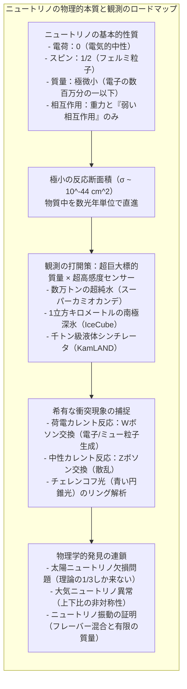
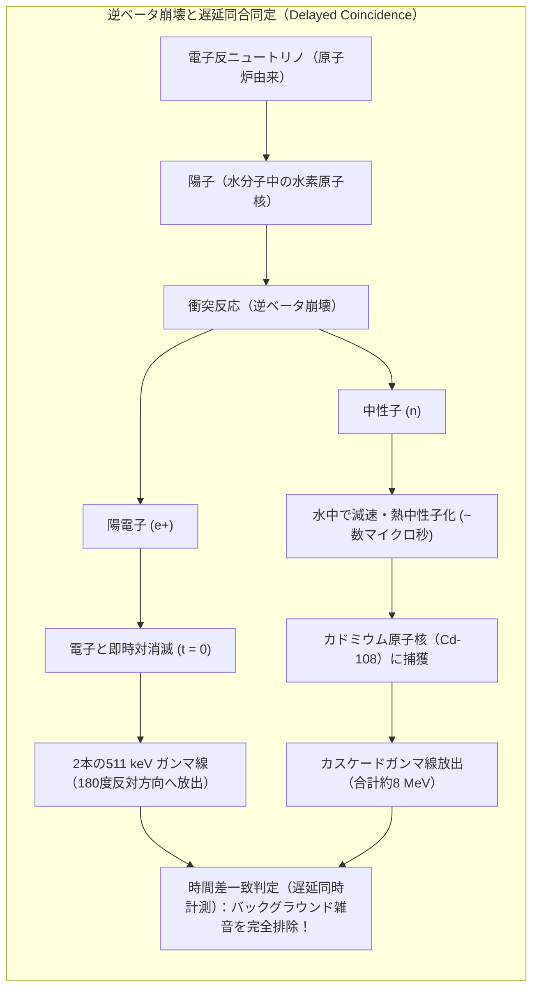
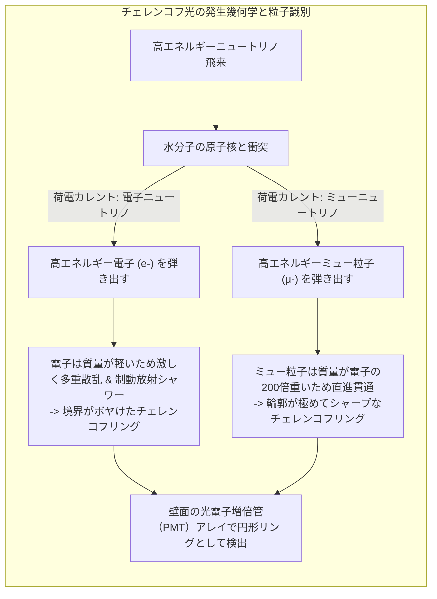
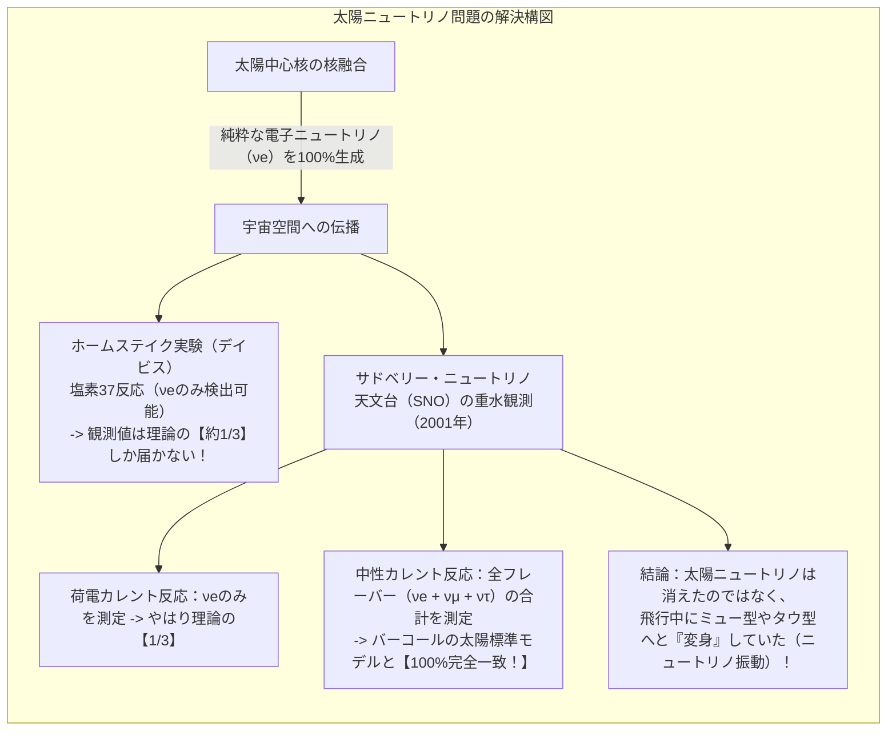
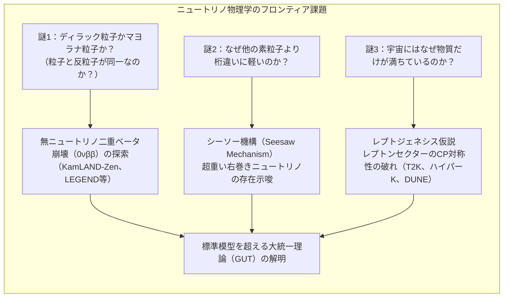

今この瞬間も、あなたの爪の先（約1平方センチメートル）を、毎秒約660億個もの微小な粒子が光速に近い速度で突き抜けています。それらは太陽の中心核で起きる核融合反応によって生まれ、太陽の分厚いプラズマ層を何事もなかったかのように抜け出し、宇宙空間を旅して地球へと降り注ぎ、私たちの身体や足元の分厚い岩盤、さらには地球の核を完全に素通りして、裏側の宇宙空間へと飛び去っていきます。

その粒子の名は<strong>「ニュートリノ（Neutrino）」</strong>。

電荷を持たず、光を除くすべての既知の物質を構成する素粒子の中で最も軽く、電磁気力も原子核を縛る強い力も感じないこの粒子は、物理学者たちからしばしば「幽霊粒子（Ghost Particle）」と呼ばれます。1個のニュートリノが鉄のブロックにぶつかって止まるまでには、<strong>「約1光年（約9兆4600億キロメートル）の厚みの鉛の壁」</strong>が必要であると計算されるほどです。

では、なぜ現代の物理学者は、物質とほとんど相互作用しないこの見えない粒子を「発見」し、その個数を数え、その飛来方向を特定し、あまつさえ「質量がある」ことまで突き止めることができたのでしょうか？

本稿では、ニュートリノという素粒子の誕生の劇的な歴史から、スーパーカミオカンデやIceCubeに代表される巨大検出器の物理的原理、太陽ニュートリノの謎を巡る激闘、ニュートリノ振動によるノーベル賞のブレークスルー、そして「なぜ宇宙には反物質ではなく物質だけが残ったのか」という究極の問いに挑む最前線までを、数式と幾何学的構造を交えて徹底的に解き明かします。



---

## 1. 絶望から生まれた「幽霊粒子」：パウリの救済策とフェルミの理論

ニュートリノの物語は、20世紀初頭の物理学を揺るがした深刻な理論的危機、すなわち<strong>「エネルギー保存則の破れ」という悪夢</strong>から始まりました。

### ベータ崩壊の連続スペクトルのパラドックス
1920年代、原子核が電子を放出して別の原子核に変わる「ベータ崩壊（$\beta$崩壊）」の測定が行われていました。
もし原子核 $A$ が原子核 $B$ と電子 $e^-$ の2体に分裂するだけなら、2体崩壊の運動量保存則とエネルギー保存則から、放出される電子のエネルギーは厳密に定まった「単一の値（離散的な線スペクトル）」にならなければなりません。

$$A \longrightarrow B + e^-$$

しかし、ジェームズ・チャドウィックらによる精密な実験結果は、電子のエネルギーがゼロから最大値（$E_{\max}$）まで連続的に分布していることを示していました。電子が持ち去るエネルギーは、理論上期待される値よりも明らかに小さく、差し引き分のエネルギーがどこかへ消えてしまっていたのです。

当時、量子力学の巨頭ニールス・ボーアですら、「微視的な原子核の世界では、熱力学第一法則（エネルギー保存則）は統計的にしか成り立たず、個々の過程では破れているのかもしれない」という絶望的な仮説を口にするほどでした。

### ヴォルフガング・パウリの「恥ずかしい救済策」
この危機を救うため、1930年12月、排他原理の提唱者として知られる天才物理学者<strong>ヴォルフガング・パウリ</strong>は、チューリッヒからチュービンゲンで開催されていた放射能研究会に宛てて、有名な一通の書簡を送りました。冒頭はこう始まっていました：

> 「親愛なる放射能の淑女および紳士の皆様へ……私はエネルギー保存則を救うため、絶望的な救済手段に打って出ることを決意しました。」

パウリは、ベータ崩壊に際して、電子と同時に<strong>「質量が極めて小さく（あるいはゼロ）、電荷を持たず、物質との相互作用が極めて弱い未知の中性粒子」</strong>が放出されており、それが観測をすり抜けてエネルギーの一部を持ち去っているのだと提案したのです。

$$A \longrightarrow B + e^- + \text{未知の中性粒子}$$

未知の中性粒子が持ち去るエネルギーの分だけ電子のエネルギーが目減りし、3体崩壊となるため、電子のエネルギーは連続的に分布する――これで保存則は完全に救われます。しかし、パウリ自身はこの仮説を公に学術論文として発表することを躊躇しました。彼は同僚の天文学者ヴァルター・バーデにこう漏らしています：
「私はとんでもないことをしてしまった。決して実験で検出することのできない粒子を予言してしまったのだから。」

### エンリコ・フェルミの命名と「弱い相互作用」の定式化
1932年、チャドウィックが重い中性粒子である「中性子（Neutron）」を発見したことで、パウリの軽い粒子との混同が生じました。イタリアの大物理学者<strong>エンリコ・フェルミ</strong>は、イタリア語で「小さくて中性のもの」を意味する愛称として<strong>「ニュートリノ（Neutrino）」</strong>と命名しました。

1934年、フェルミは量子電磁力学の形式を取り入れ、現代の素粒子物理学の礎となる<strong>「弱い相互作用のベータ崩壊理論」</strong>を打ち立てました。中性子が陽子へと変わり、電子と反ニュートリノが放出される点相互作用です：

$$n \longrightarrow p + e^- + \bar{\nu}_e$$

フェルミの理論によって、ニュートリノが物質と相互作用する強さ、すなわち「反応断面積（Cross Section）」が初めて計算可能となりました。その計算結果は、実験物理学者たちを驚愕させるに十分なものでした。

---

## 2. なぜニュートリノはすり抜けるのか：反応断面積と平均自由行程の極限

日常の物質が硬い壁にぶつかって跳ね返る理由は、原子の周囲を取り巻く電子同士が<strong>「電磁気力（クーロン反発力）」</strong>によって強く反発し合うからです。また、陽子や中性子は原子核の中で<strong>「強い相互作用（核力）」</strong>によってガッチリと結びついています。

ところが、ニュートリノは：
1. <strong>電荷がゼロ</strong>であるため、クーロン力を全く受けません。電子雲も原子核のプラスの電荷も無視して通り抜けます。
2. <strong>強い力を感じない（クォークではなくレプトンである）</strong>ため、原子核の中を通り抜ける際にも核力による散乱を受けません。
3. ニュートリノに働くのは、全宇宙で最も微弱な<strong>「重力」</strong>と、到達距離が極めて短い（約 $10^{-18}$ メートル、陽子の半径の千分の一以下）<strong>「弱い相互作用」</strong>だけです。

### 散乱断面積の絶望的な小ささ
素粒子物理学において、粒子同士がどれくらいの確率で衝突するかを表す標的面積を「反応断面積（$\sigma$）」と呼び、通常 $10^{-24} \, \text{cm}^2$ を基準単位「1バーン（barn）」と定めます。

数メガ電子ボルト（$\text{MeV}$）という、太陽ニュートリノや原子炉ニュートリノの標準的なエネルギー領域において、ニュートリノが陽子や中性子と反応する断面積はおよそ次の桁になります：

$$\sigma_\nu \sim 10^{-44} \, \text{cm}^2 = 10^{-20} \, \text{barn}$$

これは通常の原子核の幾何学的断面積（約 $10^{-24} \, \text{cm}^2$）に比べて、<strong>実に1億分の1の、さらに1億分の1（$10^{-20}$ 倍）</strong>という途方もない小ささです。

```
   ニュートリノ相互作用のスケール比較：
   ・原子の大きさ（電子軌道）   : ~ 10^-8 cm
   ・原子核の大きさ             : ~ 10^-13 cm
   ・核反応断面積（強い力）     : ~ 10^-24 cm^2 (1 barn)
   ・ニュートリノ反応断面積     : ~ 10^-44 cm^2 (10^-20 barn)
```

### 平均自由行程の計算：なぜ1光年の鉛を透過するのか
物質中を進む粒子が平均して何回の衝突を起こさずに進めるかを示す距離を「平均自由行程（$\lambda$）」と呼びます。物質の数密度を $n$（個/$\text{cm}^3$）、反応断面積を $\sigma$ とすると：

$$\lambda = \frac{1}{n \cdot \sigma}$$

鉛（密度 $\rho = 11.34 \, \text{g/cm}^3$、原子量 $A \approx 207$）を例にとると、核子（陽子・中性子）の数密度 $n_N$ はアボガドロ数 $N_A$ を用いて：

$$n_N \approx \frac{\rho \cdot N_A}{1 \, \text{g}} \approx 11.34 \times 6.022 \times 10^{23} \approx 6.8 \times 10^{24} \, \text{個/cm}^3$$

ここにニュートリノの断面積 $\sigma \sim 10^{-44} \, \text{cm}^2$ を代入すると：

$$\lambda = \frac{1}{(6.8 \times 10^{24} \, \text{cm}^{-3}) \times (10^{-44} \, \text{cm}^2)} \approx 1.5 \times 10^{19} \, \text{cm} = 1.5 \times 10^{14} \, \text{km}$$

1光年は約 $9.46 \times 10^{12} \, \text{km}$ ですから：

$$\lambda \approx \frac{1.5 \times 10^{14}}{9.46 \times 10^{12}} \approx 16 \, \text{光年}$$

つまり、数$\text{MeV}$のニュートリノにとって、<strong>分厚い純鉛の塊であっても10光年以上の厚みがなければ半数すら衝突させることができない</strong>のです。地球の直径（約1万2742キロメートル）などは、ニュートリノにとっては事実上の完全な真空同然であり、99.99999999%以上のニュートリノが一切の抵抗を受けずに突き抜けてしまいます。

---

## 3. 人類はいかにして「幽霊」を捕らえたのか：ライネスとコーワンの奇跡

「検出不能」と諦めかけたパウリの予言から26年後の1956年、アメリカの物理学者<strong>フレデリック・ライネス（Frederick Reines）</strong>と<strong>クライド・コーワン（Clyde Cowan）</strong>は、物理学史上に残るエレガントな方法でニュートリノの実在を実験的に証明しました。

### 発想の転換：確率が低いなら「流束（フラックス）」を極大にする
1個のニュートリノが反応する確率が $10^{-20}$ しかないのであれば、<strong>毎秒 $10^{20}$ 個以上のニュートリノを巨大な標的に浴びせれば、1秒間に数回は確実に衝突が起きるはずだ</strong>――これがライネスとコーワンの導き出した結論でした。

彼らは当初、ネバダ核実験場での原子爆弾の爆発の瞬間に生じる超高密度ニュートリノ束を観測する狂気じみた計画すら検討しましたが、最終的に建設されたばかりのサバンナ・リバー原子力発電所の強力な原子炉（熱出力700メガワット）の地下を利用することを選択しました。原子炉のウラン核分裂では、中性子過剰な核分裂片が次々とベータ崩壊を起こすため、毎秒 $10^{13} \, \text{個/cm}^2$ もの猛烈な電子反ニュートリノ（$\bar{\nu}_e$）が全方位に放射されます。



### 必殺の「遅延同時計測法（Delayed Coincidence）」
微弱な信号を捕らえる際の最大の敵は、宇宙線や周囲の岩盤から出る自然放射線などの「環境ノイズ（バックグラウンド）」です。ライネスとコーワンは、水分子中の陽子（水素原子核）に反ニュートリノが衝突する<strong>「逆ベータ崩壊」</strong>を利用しました：

$$\bar{\nu}_e + p \longrightarrow n + e^+$$

この反応では、陽電子（$e^+$）と中性子（$n$）の2つの粒子が同時に生成されます。彼らは水の中に塩化カドミウム（$\text{CdCl}_2$）を溶かした水槽を設置し、次のような時間差の二重合図を監視しました：
1. <strong>第1の信号（即時）：</strong> 生じた陽電子は、周囲の電子と直ちに対消滅し、互いに180度反対向きに飛ぶ2本の $511 \, \text{keV}$ のガンマ線を瞬時に放出する。
2. <strong>第2の信号（遅延）：</strong> 一方、同時に生まれた中性子は水中を跳ね回ってエネルギーを失い（減速）、約数マイクロ秒〜数十マイクロ秒後に中性子吸収断面積が極めて大きいカドミウム原子核に捕獲される。カドミウムは励起され、合計約 $8 \, \text{MeV}$ の特徴的なガンマ線をカスケード状に放出する。

「まず $511 \, \text{keV}$ のガンマ線ペアが光り、その正確に数マイクロ秒後に $8 \, \text{MeV}$ のガンマ線が光る」という、時間的・空間的に完全に一致したシグナルだけを選別することで、彼らは膨大な環境ノイズの中から1時間に数回という真のニュートリノ事象を完璧に分離・同定することに成功したのです。

1956年6月、ライネスとコーワンはチューリッヒのパウリへ祝電を打ちました：「我々は逆ベータ崩壊によるニュートリノの検出に成功したことを謹んでご報告申し上げます」。パウリは返信しました：「確固たる確信を抱いて待つ術を知る者には、すべてが報われるのである」。ライネスはこの功績により、1995年のノーベル物理学賞を受賞しました。

---

## 4. 巨大検出器の物理学：見えないものを捉える3大テクノロジー

ニュートリノの存在が確認された後、物理学者たちの興味は「宇宙から降り注ぐニュートリノ」へと向かいました。太陽の中心核、超新星爆発、超巨大ブラックホール、大気と宇宙線の衝突などから飛来するニュートリノを捉えるため、現代の実験装置は空前のスケールへと巨大化していきました。

現在、世界のニュートリノ物理学を牽引しているのは、主に以下の3つの観測技術です。

| 検出技術 | 代表的な検出器 | 標的物質 | 主な検出原理 | 主な対象エネルギーとターゲット |
| :--- | :--- | :--- | :--- | :--- |
| <strong>水チェレンコフ型</strong> | カミオカンデ、スーパーカミオカンデ、ハイパーカミオカンデ | 超純水（数万〜数十万トン） | 水中荷電粒子の円錐チェレンコフ光を光電子増倍管（PMT）で撮像 | 太陽ニュートリノ（数MeV〜）、大気ニュートリノ、超新星、人工ビーム（GeV） |
| <strong>液体シンチレータ型</strong> | KamLAND、ボレキシノ（Borexino）、JUNO | 鉱物油ベースの発光液体（千〜数万トン） | 荷電粒子の電離エネルギーによるシンチレーション蛍光発光 | 極低エネルギー（< 1 MeV）、太陽ppニュートリノ、地球ニュートリノ、原子炉 |
| <strong>天然媒体巨大アレイ型</strong> | IceCube（南極氷床）、KM3NeT（地中海）、バイカルGVD | 天然の透明氷・深海水（立方キロメートル規模） | 氷中・海水中をキロメートル単位で走るミューオンのチェレンコフ光 | 超高エネルギー宇宙ニュートリノ（TeV〜PeV）、活動銀河核、ガンマ線バースト |

---

### ① 水チェレンコフ光の物理：スーパーカミオカンデの機構
日本の岐阜県飛騨市神岡鉱山の地下1000メートルの岩盤内に鎮座する<strong>スーパーカミオカンデ（Super-Kamiokande）</strong>は、高さ41.4メートル、直径39.3メートルの円筒形ステンレスタンクに、<strong>5万トンもの超純水</strong>を蓄えた世界最高峰のニュートリノ検出器です。内壁には直径50センチメートル（20インチ）という世界最大の光電子増倍管（PMT）が1万1129本も敷き詰められています。



#### 光速を超える粒子：チェレンコフ放射の条件
アインシュタインの特殊相対性理論によれば、真空中において光速 $c$ を超える速度で運動する物質は存在しません。しかし、水などの屈折率 $n > 1$ を持つ媒質中では、光の伝播速度は $c/n$ へと減速します。水の屈折率は $n \approx 1.333$ ですから、水中の光速は約 $0.75c$（秒速約22.5万キロメートル）まで落ちます。

ニュートリノが水中の水分子の陽子や中性子、あるいは電子と衝突すると、高エネルギーの荷電粒子（電子やミュー粒子）が水中へ勢いよく弾き出されます。この荷電粒子の速度 $v = \beta c$ が水中の局所的な光速 $c/n$ を超えるとき（すなわち $\beta > 1/n$、水の場合は光速の75%を超えるとき）、電磁気的な衝撃波が発生します。超音速航空機が音の壁を突破したときに生じる「ソニックブーム」の光バージョンであり、これが青白く輝く<strong>「チェレンコフ光（Cherenkov Radiation）」</strong>です。

チェレンコフ光は、粒子の進行方向に対して特定の開き角 $\theta_C$ を持った円錐状に放射されます：

$$\cos\theta_C = \frac{1}{n \beta} = \frac{c/n}{v}$$

超純水中で光速に極めて近い粒子（$\beta \approx 1$）の場合：

$$\cos\theta_C = \frac{1}{1.333} \approx 0.75 \implies \theta_C \approx 41.4^\circ$$

この円錐状に広がる光がタンクの内壁に衝突すると、壁面には綺麗な<strong>「光のリング（円形パターン）」</strong>が投影されます。光電子増倍管がそのフォトンを1個単位で検出し、光が到達した時刻（ナノ秒精度）と位置をコンピュータで解析することで、衝突した時刻、位置、エネルギー、そしてニュートリノが飛んできた正確な方角を逆算できるのです。

#### 電子とミュー粒子の識別技術（リングの鮮明さ）
スーパーカミオカンデの真骨頂は、衝突によって生じた荷電粒子の種類（フレーバー）を瞬時に見分けられる点にあります：
- <strong>電子（電子ニュートリノ反応）：</strong> 電子は質量が軽いため、水中を進む際に水分子の原子核の電場によって激しく進路を曲げられ（多重クーロン散乱）、制動放射によってガンマ線を放出して電子・陽電子対を生成する「電磁シャワー」を引き起こします。そのため、投影されるチェレンコフリングの縁は<strong>モヤモヤとぼやけたファジーなリング</strong>になります。
- <strong>ミュー粒子（ミューニュートリノ反応）：</strong> ミュー粒子は電子の約207倍の質量を持つため、散乱を受けにくく、水の中を一直線に突き進みます。そのため、チェレンコフリングの縁は<strong>ナイフで切り取ったかのように極めてシャープで鮮明なリング</strong>になります。

この鮮明なパターン認識能力こそが、後述する大気ニュートリノ振動の決定的証拠を掴む最大の武器となったのです。

---

### ② 氷床を丸ごと検出器にする：IceCubeの狂気と達成
数$\text{GeV}$（ギガ電子ボルト）を超える超高エネルギー宇宙ニュートリノになると、反応断面積は大きくなるものの、飛来する流束（フラックス）そのものが極端に少なくなります。5万トンのスーパーカミオカンデですら小さすぎて捉えきれません。

物理学者たちが選んだ舞台は、地球上で最も過酷な場所、<strong>南極点の氷床</strong>でした。<strong>IceCubeニュートリノ観測所</strong>は、南極の分厚い氷河を深さ1450メートルから2450メートルまで高圧の熱水ドリルで掘削し、合計86本の縦穴に、バスケットボール大のデジタル光検出器（DOM）を吊り下げて凍結・固定したものです。

検出器が網羅する体積は、実に<strong>1立方キロメートル（1ギガトン＝10億トンの氷）</strong>に達します。
何万年もかけて圧縮された南極深部の氷は、気泡が完全に押し出され、地球上で最も透明度の高い個体媒体となっています。宇宙の彼方のアクティブなブラックホールやガンマ線バーストから放たれたペタ電子ボルト（$\text{PeV} = 10^{15} \, \text{eV}$）級のニュートリノがこの氷に衝突すると、数キロメートルに及ぶ光の航跡（ミューオントラック）が生じ、宇宙の最も暴力的な天体現象を直接観測する「ニュートリノ天文学」の扉を開きました。

---

## 5. 太陽ニュートリノ問題とニュートリノ振動：物理学のパラダイムシフト

20世紀後半、ニュートリノ研究は物理学の根底を揺るがす最大のミステリーに直面しました。それが<strong>「太陽ニュートリノ問題（Solar Neutrino Problem）」</strong>です。

### ジョン・バーコールとレイ・デイビスの30年戦争
1960年代、理論天体物理学者のジョン・バーコール（John Bahcall）は、太陽の中心核で水素がヘリウムへと核融合する詳細な連鎖反応（ppチェインやCNOサイクル）を計算し、地球に届くはずの太陽ニュートリノの量を高精度に予測する「標準太陽モデル（SSM）」を確立しました。

一方、実験物理学者のレイ・デイビス（Raymond Davis Jr.）は、サウスダコタ州のホームステイク金鉱の地下1500メートルに、約38万リットルの塩素系ドライクリーニング洗浄液（テトラクロロエチレン、$\text{C}_2\text{Cl}_4$）を満たしたタンクを建設しました。塩素37（$^{37}\text{Cl}$）が電子ニュートリノを吸収してアルゴン37（$^{37}\text{Ar}$）に変わる反応を利用したのです：

$$\nu_e + {}^{37}\text{Cl} \longrightarrow {}^{37}\text{Ar} + e^-$$

アルゴン37は放射性同位体（半減期35日）であるため、デイビスは数ヶ月ごとにタンク内にヘリウムガスを吹き込んで、プール一杯の溶液の中から<strong>「わずか数個から十数個のアルゴン原子」</strong>を回収し、その放射壊変を数えるという超人的な実験を行いました。

しかし、デイビスが測定した太陽ニュートリノの数は、バーコールの理論予測値の<strong>「わずか3分の1程度」</strong>しかありませんでした。
- 「デイビスの実験がアルゴンを取り落としているのではないか？」
- 「バーコールの太陽中心温度の計算が数パーセントずれているのではないか？」

二人は互いの正確さを巡って30年以上にわたり激論を交わし、実験と理論の双方で検証を重ねましたが、両者ともに一切の誤りは見つかりませんでした。太陽から地球へ飛んでくる途中で、ニュートリノの約3分の2が「消えて」しまっていたのです。



### ポンテコルボ・牧・中川・坂田の予言：ニュートリノ振動
この謎を解決する鍵は、素粒子物理学者たちが温めていた驚くべき量子力学的現象、<strong>「ニュートリノ振動（Neutrino Oscillation）」</strong>でした。

1957年にブルーノ・ポンテコルボがニュートリノ・反ニュートリノの振動を論じ、1962年には日本の牧二郎、中川公雄、坂田昌一の3人が、異なるフレーバーのニュートリノ同士が飛行中に移り変わる理論を提唱しました（<strong>PMNS行列</strong>：Pontecorvo-Maki-Nakagawa-Sakata Matrix）。

#### 量子の二重性：フレーバー固有状態と質量固有状態のズレ
ニュートリノには、相互作用を通じて観測される3つの「フレーバー固有状態（Flavor Eigenstates）」が存在します：
- 電子ニュートリノ（$\nu_e$）
- ミューニュートリノ（$\nu_\mu$）
- タウニュートリノ（$\nu_\tau$）

しかし、真空中を波として伝播していく際の「質量固有状態（Mass Eigenstates）」は、これらとは異なる3つの固有状態（$\nu_1, \nu_2, \nu_3$、それぞれの固有質量を $m_1, m_2, m_3$ とする）の線形結合（重ね合わせ）として表されます。

$$|\nu_\alpha\rangle = \sum_{i=1}^3 U_{\alpha i}^* |\nu_i\rangle \quad (\alpha = e, \mu, \tau)$$

ここで $U$ がPMNSユニタリ混合行列です。2つのフレーバーの混合（単純化モデル）で考えると、混合角 $\theta$ を用いて次のように書けます：

$$|\nu_e\rangle = \cos\theta |\nu_1\rangle + \sin\theta |\nu_2\rangle$$
$$|\nu_\mu\rangle = -\sin\theta |\nu_1\rangle + \cos\theta |\nu_2\rangle$$

時刻 $t=0$ で太陽から純粋な電子ニュートリノ $|\nu_e\rangle$ として生成された波束は、固有状態 $|\nu_1\rangle$ と $|\nu_2\rangle$ を含んでいます。時間とともにそれぞれの波は固有のエネルギー $E_i = \sqrt{p^2 + m_i^2 c^4} \approx p + \frac{m_i^2 c^3}{2p}$ に応じた位相速度で進みます。

もし質量 $m_1$ と $m_2$ が異なっていれば（$\Delta m^2 = m_2^2 - m_1^2 \neq 0$）、両者の波の位相に<strong>「うなり（干渉）」</strong>が生じます。

距離 $L$（光速伝播として時間 $t \approx L/c$）を飛行した地点で、ミューニュートリノ $|\nu_\mu\rangle$ として観測される遷移確率は、量子力学的計算により次の美しい公式で与えられます：

$$P(\nu_e \to \nu_\mu) = \sin^2(2\theta) \sin^2\left( \frac{\Delta m^2 c^3 L}{4 \hbar E} \right)$$

自然単位系（$\hbar = c = 1$）および実用的な実験単位（$\Delta m^2$ を $\text{eV}^2$、$L$ を $\text{km}$、$E$ を $\text{GeV}$）に変換すると：

$$P(\nu_e \to \nu_\mu) = \sin^2(2\theta) \sin^2\left( 1.27 \times \frac{\Delta m^2 [\text{eV}^2] \cdot L [\text{km}]}{E [\text{GeV}]} \right)$$

この数式が意味する物理的含意は極めて深遠です：
1. <strong>質量の存在の証明：</strong> 振動確率がゼロでないためには、$\Delta m^2 \neq 0$、すなわち<strong>少なくともどちらかのニュートリノの質量が厳密にゼロであってはならない</strong>！
2. <strong>変身の繰り返し：</strong> 飛行距離 $L$ とエネルギー $E$ の比に応じて、電子ニュートリノはミューニュートリノやタウニュートリノへと周期的に姿を変え、また元に戻る。

デイビスの塩素検出器は「電子ニュートリノ」にしか感度がありませんでした。太陽から地球までの1億5000万キロメートルの旅路の間に、物質効果（MSW効果：太陽内部の高密度電子プラズマによる共鳴転換）と真空振動によって、電子ニュートリノの多くが検出器には見えないミューニュートリノやタウニュートリノへと姿を変えていたため、測定値が3分の1に激減していたのです！

---

## 6. 歴史の審判：スーパーカミオカンデとSNOの決定打

このニュートリノ振動仮説を実験的に確定させ、素粒子標準模型の書き換えを迫ったのが、日本とカナダの2大プロジェクトでした。

### 1998年：スーパーカミオカンデによる大気ニュートリノ振動の発見
宇宙から地球大気に高エネルギー宇宙線（陽子）が飛び込むと、窒素や酸素の原子核と衝突してパイ中間子（$\pi^\pm$）が生成され、それが崩壊してミューニュートリノと電子ニュートリノが生まれます（大気ニュートリノ）：

$$\pi^+ \longrightarrow \mu^+ + \nu_\mu, \quad \mu^+ \longrightarrow e^+ + \nu_e + \bar{\nu}_\mu$$

崩壊の分岐比から、ミューニュートリノと電子ニュートリノの発生比率は理論上<strong>約 2 : 1</strong> になるはずです。

東京大学宇宙線研究所の<strong>梶田隆章</strong>らは、スーパーカミオカンデで頭上から降ってくる大気ニュートリノ（飛行距離 $L \sim 10\text{--}20 \, \text{km}$）と、地球の裏側で生成されて地球を丸ごと貫通して下から突き抜けてくる大気ニュートリノ（飛行距離 $L \sim 1万2000 \, \text{km}$）の数を精密に比較しました。

```
   大気ニュートリノの上下比の観測結果：
   ・電子ニュートリノ（シャワー型）:
       [上から来る数] / [下から来る数] ≈ 1.0 （対称で変化なし）
   ・ミューニュートリノ（トラック型）:
       [上から来る数] ≈ 期待値通り
       [下から来る数] ≈ 期待値の【ちょうど半分】に激減！
```

上から降ってくるミューニュートリノは飛行距離が短いため振動する時間がありません。しかし、地球の裏側から1万キロメートル以上を旅してきたミューニュートリノは、途中でタウニュートリノへと振動（変身）してしまい、スーパーカミオカンデのエネルギー領域ではタウ粒子を作れずに見えなくなっていたのです。

1998年6月、高山で開催された「ニュートリノ'98」国際会議において、梶田隆章は「大気ニュートリノの天頂角分布の非対称性から、ニュートリノ振動の決定的証拠を得た」と発表しました。会場はスタンディングオベーションに包まれ、物理学史に新たな金字塔が打ち立てられました。

### 2001年：SNO（サドベリー）による太陽ニュートリノの完全決着
一方、太陽ニュートリノ問題の最終審判はカナダの地下2000メートルのニッケル鉱山に作られた<strong>サドベリー・ニュートリノ天文台（SNO）</strong>によって下されました。

SNOは、1000トンの<strong>「重水（$D_2O$）」</strong>を満たした検出器です。重水素（陽子1個＋中性子1個からなる原子核）を使うことで、以下の2つの反応を同時に測定することが可能になりました：
1. <strong>荷電カレント反応（CC）：</strong> $\nu_e + d \to p + p + e^-$（電子ニュートリノのみに反応）
2. <strong>中性カレント反応（NC）：</strong> $\nu_x + d \to p + n + \nu_x$（電子、ミュー、タウの<strong>全3種類のニュートリノに対して全く同じ感度</strong>で反応）

測定の結果、荷電カレント反応（$\nu_e$）で測った太陽ニュートリノの量は、デイビスの実験通り標準太陽モデルの3分の1でした。しかし、全フレーバーを合算して捉える中性カレント反応（$\nu_x$）で測定した総ニュートリノ数は、<strong>バーコールの計算した標準太陽モデルの理論予測値と誤差の範囲内で100%完全に一致</strong>したのです！

これにより、「太陽中心核の核融合理論は完璧に正しかったこと」、そして「電子ニュートリノが地球に届くまでにミュー型とタウ型へ姿を変えていたこと」が完全無欠に証明されました。2015年、梶田隆章とSNOのアーサー・マクドナルド（Arthur B. McDonald）にノーベル物理学賞が授与されました。

---

## 7. 標準模型の破綻と残された究極の謎：マヨラナ粒子と宇宙の起源

ニュートリノ振動の発見は、人類が長年信じてきた素粒子物理学の最高峰理論「標準模型（Standard Model）」に、初めて明確な綻び（標準模型を超える物理）を突きつけました。なぜなら、<strong>最小限の標準模型では、ニュートリノの質量は厳密にゼロと定義されていた</strong>からです。

現在、ニュートリノ物理学は「なぜニュートリノは存在するのか」「なぜ宇宙に物質だけが残ったのか」という、存在論的な大問題に挑んでいます。



### 謎1：質量が異常に軽い理由と「シーソー機構」
電子の質量は約 $0.511 \, \text{MeV}$（$5.1 \times 10^5 \, \text{eV}$）です。最も重いトップクォークは約 $173 \, \text{GeV}$ です。これに対し、ニュートリノの質量の上限値は現在およそ $0.8 \, \text{eV}$ 以下であることがKATRIN実験などによって突き止められています。

なぜニュートリノだけが、荷電レプトンやクォークに比べて<strong>「100万倍から1000億倍も軽い」</strong>のでしょうか？

最もエレガントな説明とされるのが、ピーター・ミンコフスキー、柳田勉、ゲルマンらによって提案された<strong>「シーソー機構（Seesaw Mechanism）」</strong>です。
もし超高エネルギー（大統一理論スケール $\sim 10^{15} \, \text{GeV}$）に、通常の左巻きニュートリノと対になる、非常に重い「右巻きニュートリノ（$M_R$）」が存在すれば、ニュートリノの質量行列の対角化によって、軽い方のニュートリノの質量 $m_\nu$ は次のように抑制されます：

$$m_\nu \approx \frac{m_D^2}{M_R}$$

ここで $m_D$ は電子やクォークと同程度のヒッグス機構による質量（$\sim 100 \, \text{GeV}$）です。公園のシーソーのように、右巻きのパートナー $M_R$ が重ければ重いほど、私たちの知る左巻きニュートリノの質量 $m_\nu$ はゼロ近くまで極端に押し下げられることになります。

### 謎2：マヨラナ粒子かディラック粒子か？
私たちが知るすべての物質粒子（電子、クォーク）には、電荷が反対の「反粒子（陽電子、反クォーク）」が存在します。これらは<strong>「ディラック粒子」</strong>と呼ばれます。

しかし、電荷を一切持たない電気的中性なニュートリノだけは、<strong>「自分自身が自身の反粒子である」という奇妙な性質（マヨラナ粒子：Majorana Fermion）</strong>を持つことが理論上許されています。

ニュートリノがマヨラナ粒子であるかどうかを証明する唯一無二の実験が、<strong>「無ニュートリノ二重ベータ崩壊（$0\nu\beta\beta$）」</strong>の探索です。
通常の二重ベータ崩壊では、2個の中性子が2個の陽子に変わり、2個の電子と2個の反ニュートリノを放出します：

$$(A, Z) \longrightarrow (A, Z+2) + 2e^- + 2\bar{\nu}_e$$

しかし、もしニュートリノがマヨラナ粒子であれば、一方の中性子から放出された仮想反ニュートリノが、自分自身の反粒子（正粒子）としてもう一方の中性子に瞬時に吸収され、<strong>「ニュートリノが外に1個も出てこない二重ベータ崩壊（$0\nu\beta\beta$）」</strong>が起きるはずです：

$$(A, Z) \longrightarrow (A, Z+2) + 2e^-$$

この反応が一度でも観測されれば、ニュートリノがマヨラナ粒子であることが確定し、素粒子物理学の大原則である「レプトン数保存則」が破れていることが証明されます。東北大学の神岡地下実験「KamLAND-Zen」をはじめ、世界中の実験グループがキセノン136やゲルマニウム76を用いて半減期 $10^{26}$ 年（宇宙の年齢の1京倍以上）という超絶的な希少崩壊事象を追い続けています。

### 謎3：なぜ宇宙には反物質ではなく物質が残ったのか？（レプトジェネシス）
ビッグバン直後の超高温の宇宙では、エネルギーから物質と反物質が全く同じ量だけ創り出されたはずです。物質と反物質が出会うと対消滅して光に戻るため、物理法則が完全に対称であれば、現在の宇宙には星も銀河も人間も存在せず、ただ光子（光）だけが漂う空虚な世界になっていたはずです。

しかし現実の宇宙には、<strong>10億個の光子に対して、約1個の割合で「物質（陽子や電子）」だけが消滅を免れて生き残りました</strong>。このわずかな物質の偏りを生み出した犯人として最も有力視されているのが、<strong>ニュートリノにおける「CP対称性の破れ」と「レプトジェネシス（Leptogenesis）」仮説</strong>です。

宇宙初期に存在した超重いマヨラナ・ニュートリノが崩壊する際、物質を好んで反物質よりもわずかに多く生成するCP対称性の破れが存在したとすれば、それが現在の物質宇宙の礎となった可能性があります。

茨城県東海村の加速器「J-PARC」から岐阜県のスーパーカミオカンデに向けて295キロメートルの距離をニュートリノと反ニュートリノのビームを打ち込む<strong>T2K実験</strong>では、ニュートリノの変身確率と反ニュートリノの変身確率が異なっている兆候（CP対称性の破れの可能性）が捉えられ始めています。現在建設中の<strong>ハイパーカミオカンデ（Hyper-Kamiokande、2027年観測開始予定）</strong>や、アメリカの長基線実験<strong>DUNE</strong>によって、この謎に決定的な終止符が打たれようとしています。

---

## 結語：見えないものを見つめる知性の力

ニュートリノの歴史は、人間の知性が成し遂げた最も美しい勝利の叙事詩です。

紙とペンだけで「エネルギー保存則を救うため」に予言された架空の粒子は、地下深くに掘られた巨大な水槽と氷床の光検出器によって実在が暴かれ、太陽の中心で燃え盛る核融合の炎を映し出す鏡となり、果ては宇宙創成の謎を解くマスターキーへと変貌を遂げました。

何ものにも囚われず、星々をもすり抜けて飛び続けるニュートリノ。その無言の軌跡を追い続ける科学者たちの挑戦は、私たちがどこから来て、この宇宙がいかにして形作られたのかという、人類永遠の問いの核心へと今も突き進んでいます。
