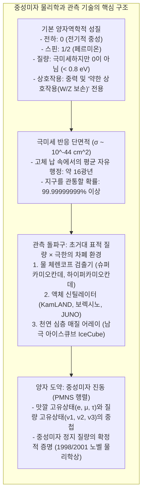
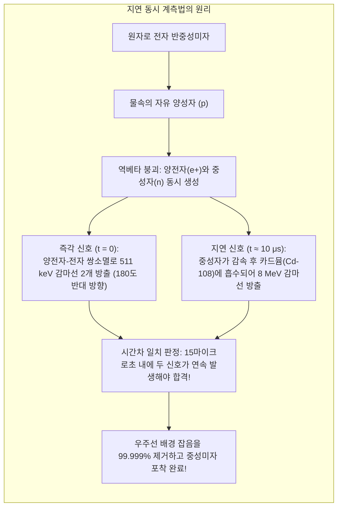
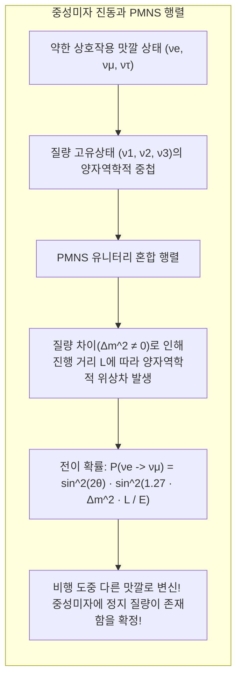

지금 이 순간에도 당신의 손톱 크기(약 1제곱센티미터) 면적을, 매초 약 650억 개에 달하는 극미세 입자들이 빛에 가까운 속도로 통과해 지나가고 있습니다. 이들은 태양 중심핵의 격렬한 핵융합 반응에서 태어나, 수십만 킬로미터에 이르는 태양의 초고온 플라스마층을 마치 완전한 진공처럼 통과하고, 1억 5천만 킬로미터의 우주 공간을 건너 지구의 지각과 맨틀, 심지어 액체 철로 이루어진 핵을 아무런 저항 없이 뚫고 지나가 반대편 우주 공간으로 날아갑니다.

이 입자의 이름은 <strong>'중성미자(뉴트리노, Neutrino)'</strong>입니다.

전하가 없고, 질량은 전자의 수백만 분의 일 이하로 극도로 가벼우며, 전자기력도 원자핵을 묶는 강한 상호작용도 전혀 느끼지 않는 이 입자는 물리학자들 사이에서 <strong>'유령 입자(Ghost Particle)'</strong>라는 별명으로 불립니다. 에너지가 수 메가전자볼트(MeV)인 일반적인 중성미자 하나를 50%의 확률로 멈춰 세우기 위해서는 <strong>'두께 약 1광년(약 9조 4600억 킬로미터) 이상의 순수한 납(Pb) 벽'</strong>이 필요할 정도입니다.

그렇다면 현대 물리학자들은 물질과 거의 상호작용하지 않는 이 보이지 않는 유령 입자를 대체 어떻게 발견하고, 그 개수를 세고, 날아온 방향을 추적하며, 나아가 '질량이 존재한다'는 사실까지 밝혀낼 수 있었을까요?

---

## 1. 절망에서 태어난 구원책: 파울리의 가설과 페르미의 이론

중성미자의 탄생은 20세기 초 물리학계를 뒤흔든 심각한 위기, 즉 <strong>'에너지 보존 법칙이 깨질지도 모른다'는 악몽</strong>에서 출발했습니다.

### 베타 붕괴의 연속 스펙트럼 수수께끼
1920년대, 원자핵이 전자를 방출하며 다른 원자핵으로 변환되는 '베타 붕괴($\beta$ 붕괴)' 실험이 활발히 진행되었습니다. 만약 모핵 $A$가 자핵 $B$와 전자 $e^-$라는 두 입자로만 쪼개진다면, 2체 붕괴의 에너지-운동량 보존 법칙에 따라 방출되는 전자의 에너지는 엄격히 정해진 단 하나의 분립된 값(선 스펙트럼)을 가져야만 합니다.

$$A \longrightarrow B + e^-$$

그러나 실제 정밀 측정 결과, 방출되는 전자의 에너지는 0에서 최대치 $E_{\max}$까지 매끄러운 곡선을 그리는 <strong>연속 스펙트럼</strong>을 나타냈습니다. 전자가 가져가는 에너지가 이론적 기댓값보다 명백히 적었고, 사라진 에너지는 어디에서도 찾을 수 없었습니다. 당대 최고의 석학 닐스 보어조차 "양자 세계에서는 에너지 보존 법칙이 개별 반응에서 성립하지 않고 통계적으로만 유지될지도 모른다"는 극단적인 가설을 진지하게 고려할 지경이었습니다.

### 볼프강 파울리의 절망적인 편지
이 위기를 타개하기 위해 1930년 12월, 천재 물리학자 <strong>볼프강 파울리(Wolfgang Pauli)</strong>는 튀빙겐에서 열린 방사능 학회에 참석한 동료들에게 한 통의 편지를 보냈습니다:

> "친애하는 방사능 신사 숙녀 여러분…… 저는 에너지 보존 법칙을 지켜내기 위해 절망적인 구원책에 기대기로 결심했습니다."

파울리는 베타 붕괴 시 전자가 튀어나올 때, <strong>질량이 극히 작거나 0이며 전하가 없고 물질과의 상호작용이 극도로 미약한 미지의 중성 입자</strong>가 함께 방출되어 관측망을 빠져나가며 에너지의 일부를 훔쳐 가고 있다고 제안했습니다:

$$A \longrightarrow B + e^- + \text{미지의 중성 입자}$$

이로써 반응은 3체 붕괴가 되어 전자의 에너지가 연속적으로 분포할 수 있게 되었습니다. 파울리는 에너지 보존 법칙을 지켜냈지만, "결코 검출할 수 없는 유령 입자를 예언해 버렸다"며 스스로 자책했습니다.

### 엔리코 페르미의 명명과 약한 상호작용 이론
1932년 채드윅이 무거운 중성자인 '중성자(Neutron)'를 발견하자, 파울리의 가벼운 입자와 구별하기 위해 이탈리아의 거장 <strong>엔리코 페르미(Enrico Fermi)</strong>는 이탈리아어로 '작은 중성자'를 뜻하는 <strong>'뉴트리노(Neutrino)'</strong>라는 이름을 붙였습니다.

1934년, 페르미는 중성자가 양성자로 바뀌며 전자와 반중성미자가 한 점에서 동시에 생성되는 현대적 약한 상호작용 이론을 수립했습니다:

$$n \longrightarrow p + e^- + \bar{\nu}_e$$

페르미 결합 상수($G_F \approx 1.166 \times 10^{-5} \, \text{GeV}^{-2}$)의 도입으로 인류는 중성미자가 물질과 충돌할 단면적을 최초로 계산할 수 있게 되었습니다.

---

## 2. 왜 중성미자는 모든 것을 통과하는가: 반응 단면적과 자유 행정의 한계

물질이 단단한 벽을 형성하는 이유는 원자 외곽의 전자 구름이 <strong>전자기력(쿨롱 반발력)</strong>으로 서로를 밀어내기 때문입니다. 또한 양성자와 중성자는 원자핵 내부에서 <strong>강한 상호작용(핵력)</strong>으로 강력하게 결속되어 있습니다.

그러나 중성미자는:
1. <strong>전하가 0</strong>이므로 쿨롱력을 전혀 느끼지 않아 전자 구름과 핵의 전하를 통과합니다.
2. <strong>강한 상호작용을 느끼지 않으므로</strong> 원자핵 내부를 지날 때도 튕겨 나가지 않습니다.
3. 오직 중력과 매우 무거운 W/Z 게이지 보손이 매개하는 단거리 <strong>약한 상호작용</strong>에만 반응합니다.

수 MeV 수준의 중성미자가 핵자와 충돌할 확률을 나타내는 반응 단면적($\sigma_\nu$)은 다음과 같습니다:

$$\sigma_\nu \sim 10^{-44} \, \text{cm}^2 = 10^{-20} \, \text{barn}$$

이는 일반적인 강한 상호작용 핵반응 단면적($10^{-24} \, \text{cm}^2$, 1 barn)에 비해 무려 <strong>1억 배의 1억 배(1경 배, $10^{-20}$배)</strong> 작습니다.

물질 속에서의 평균 충돌 간격인 평균 자유 행정($\lambda = \frac{1}{n \cdot \sigma}$)을 고체 납(Pb)에 대해 계산해 보면 약 <strong>16광년(약 150조 킬로미터)</strong>에 달합니다. 지름 1만 2,742 킬로미터의 지구 따위는 중성미자에게 사실상 완벽한 진공이나 다름없는 셈입니다.

---

## 3. 라이네스와 코완의 기적: 원자로 역베타 붕괴 검출 (1956)

1956년, 미국의 물리연구팀 <strong>프레더릭 라이네스(Frederick Reines)</strong>와 <strong>클라이드 코완(Clyde Cowan)</strong>은 통계적 돌파구를 찾아냈습니다: <strong>"단일 입자의 반응 확률이 1조 분의 1이라면, 매초 1조 개의 1조 배에 달하는 입자를 쏟아부으면 된다!"</strong>

$$\text{검출률} = \text{중성미자 플럭스} \times \text{표적 핵자 수} \times \text{반응 단면적}$$

그들은 사바나 리버 원자력 발전소의 강력한 원자로 바로 옆 지하에 검출기를 설치했습니다. 핵분열에서 매초 $10^{13} \, \text{개/cm}^2$의 전자 반중성미자가 방출되었고, 물 분자 속의 양성자와 충돌하는 <strong>역베타 붕괴(Inverse Beta Decay)</strong>를 유도했습니다:

$$\bar{\nu}_e + p \longrightarrow n + e^+$$

라이네스와 코완은 주변 자연 방사선 노이즈를 완벽히 거르기 위해 <strong>'지연 동시 계측법(Delayed Coincidence)'</strong>을 고안했습니다:
1. <strong>즉각 신호:</strong> 생성된 양전자가 주변 전자와 즉시 쌍소멸하며 180도 반대 방향으로 두 개의 $511 \, \text{keV}$ 감마선을 방출합니다.
2. <strong>지연 신호:</strong> 동시에 생긴 중성자는 물속에서 속도를 잃고 감속된 후, 약 10마이크로초 뒤 물에 녹여 둔 카드뮴-108 원자핵에 포획되며 총 $8 \, \text{MeV}$의 감마선 다발을 방출합니다.

"511 keV 감마선 쌍이 번쩍인 직후, 정확히 수 마이크로초 뒤에 8 MeV 감마선이 연쇄 발광한다"는 시간차 동시성 판정을 통해 노이즈를 완벽히 배제하고 중성미자를 사상 최초로 검출하는 데 성공했습니다. 라이네스는 1995년 노벨 물리학상을 수상했습니다.

---

## 4. 거대 검출기의 시대: 슈퍼카미오칸데와 아이스큐브

현대 천체물리학에서 중성미자를 관측하기 위한 3대 대표적 검출 시스템은 다음과 같습니다:

### ① 슈퍼카미오칸데(Super-Kamiokande): 물 체렌코프광 검출
일본 기후현 가미오카 광산 지하 1,000미터에 위치한 슈퍼카미오칸데는 <strong>5만 톤의 초순수</strong>를 담은 직경 39.3미터, 높이 41.4미터의 거대 탱크입니다. 벽면에는 세계 최대인 20인치 광전증배관(PMT) 11,129개가 빼곡히 설치되어 있습니다.
- <strong>체렌코프 방사:</strong> 수중에서 하전 입자의 속도가 물속의 빛의 위상속도(약 $0.75c$)를 초과할 때, 초음속 비행기의 소닉붐처럼 푸른빛의 광원뿔(원뿔 반각 약 $41.4^\circ$)이 형성됩니다.
- <strong>입자 식별 능력:</strong> 전자 중성미자 반응으로 튀어나온 전자는 가벼워 다중 산란을 일으키며 <strong>가장자리가 흐릿한 체렌코프 링</strong>을 만들고, 무거운 뮤온은 직진하여 <strong>가장자리가 칼로 자른 듯 선명한 링</strong>을 만들어 99% 이상의 정확도로 입자 종류를 판별합니다.

### ② 남극 아이스큐브(IceCube): 대륙 빙하를 관측기로
극고에너지(TeV~PeV) 우주 중성미자를 잡기 위해 남극점 1.5~2.5킬로미터 깊이의 투명한 빙상 속에 5,160개의 광학 센서를 얼려 고정한 아이스큐브는 <strong>1세제곱킬로미터(10억 톤)의 얼음</strong>을 관측 표적으로 삼아 고에너지 블레이저와 천체 중성미자를 직접 포착하고 있습니다.

---

## 5. 태양 중성미자 문제와 중성미자 진동의 세기적 발견

1960년대 존 바콜(John Bahcall)의 표준 태양 모델 계산과 레이 데이비스(Ray Davis Jr.)의 홈스테이크 금광 염소-37 실험 사이에서 불거진 <strong>'태양 중성미자가 이론치의 3분의 1밖에 도달하지 않는다'는 태양 중성미자 결손 미스터리</strong>는 30년 넘게 과학계를 뒤흔들었습니다.

이 수수께끼는 <strong>'중성미자 진동(Neutrino Oscillation)'</strong>을 통해 완전히 해결되었습니다.
약한 상호작용을 하는 맛깔 상태($\nu_e, \nu_\mu, \nu_\tau$)는 질량을 가진 질량 고유상태($\nu_1, \nu_2, \nu_3$)의 선형 결합 중첩 상태입니다(PMNS 행렬). 각 질량 상태의 질량이 서로 다르면($\Delta m^2 \neq 0$), 우주를 날아가는 동안 양자역학적 위상차가 누적되어 다른 맛깔의 중성미자로 주기적으로 변신합니다.

- <strong>1998년 슈퍼카미오칸데:</strong> 가지타 다카아키 교수팀이 대기를 뚫고 올라오는 뮤온 중성미자의 감소를 측정하여 진동을 확증.
- <strong>2001년 캐나다 SNO 중수 실험:</strong> 중성류(NC) 반응을 통해 전 맛깔 중성미자의 총합이 바콜의 태양 모델 이론치와 100% 일치함을 증명.

이 발견으로 2015년 가지타 다카아키와 아서 맥도널드가 노벨 물리학상을 수상했습니다.

---

## 6. 표준모형 너머: 마요라나 입자와 우주 물질의 기원

중성미자 진동은 표준모형에서 질량이 0으로 정의되었던 중성미자에게 질량이 존재함을 밝혀냄으로써 표준모형의 한계를 입증했습니다.

현재 물리학계의 최대 화두는 다음과 같습니다:
1. <strong>마요라나 페르미온:</strong> 중성미자가 자기 자신이 곧 반입자인 '마요라나 입자'인가? 전 세계 연구진은 <strong>무중성미자 이중 베타 붕괴($0\nu\beta\beta$)</strong>를 탐색 중이며, 이것이 발견되면 렙톤 수 보존 법칙이 깨집니다.
2. <strong>시소 메커니즘(Seesaw Mechanism):</strong> 초대질량 오른손잡이 중성미자를 가정하여 왜 통상 중성미자의 질량이 전자보다 수백만 배 가벼운지를 설명합니다.
3. <strong>레프토제네시스(Leptogenesis):</strong> 대폭발 초기 중성미자 붕괴에서의 CP 대칭성 깨짐이 왜 우주에 반물질이 사라지고 오직 물질만이 남아 행성과 인류를 형성했는지를 밝혀줄 핵심 열쇠로 꼽힙니다.

아무것도 멈출 수 없는 유령 입자 중성미자를 쫓는 여정은, 우주의 가장 거대한 비밀과 가장 미세한 기본 법칙을 잇는 장대한 지적 탐험입니다.
