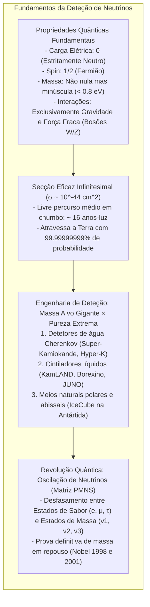

Neste exato milissegundo, cerca de 65 mil milhões de partículas subatómicas atravessam cada centímetro quadrado da sua unha à velocidade da luz. Foram forjadas no coração termonuclear do Sol, atravessaram centenas de milhares de quilómetros de plasma solar denso como se fosse vácuo, cruzaram 150 milhões de quilómetros no espaço, perfuraram a crosta, o manto e o núcleo de ferro líquido da Terra e saíram do outro lado rumo ao infinito.

Estas partículas chamam-se <strong>neutrinos</strong>.

Sem carga elétrica, com uma massa milhões de vezes inferior à do eletrão e imunes ao eletromagnetismo e à força nuclear forte, os neutrinos interagem com a matéria quase exclusivamente através da <strong>força nuclear fraca</strong>. Para travar com 50% de probabilidade um neutrino solar com energia de alguns megaeletrão-volts (MeV), seria necessária uma <strong>parede de chumbo maciço com mais de um ano-luz de espessura</strong> (cerca de 10 biliões de quilómetros).

Como conseguiu a física moderna capturar estas entidades invisíveis e provar que possuem massa?



---

## 1. O recurso desesperado de Pauli e a teoria de Fermi

A história do neutrino começou na década de 1920 com uma crise profunda: a aparente violação da <strong>lei da conservação da energia</strong> no decaimento beta ($\beta$). O eletrão emitido apresentava um <strong>espetro de energia contínuo</strong>, como se parte da energia desaparecesse misteriosamente.

Em dezembro de 1930, <strong>Wolfgang Pauli</strong> escreveu uma carta aos colegas em Tübingen propondo a existência de uma partícula neutra e penetrante de spin 1/2 que escapava com a energia em falta:

$$n \longrightarrow p + e^- + \bar{\nu}_e$$

Em 1934, <strong>Enrico Fermi</strong> formulou a teoria matemática da força fraca e batizou a partícula de <strong>neutrino</strong> («pequeno neutro»).

---

## 2. Por que razão o neutrino atravessa tudo?

A matéria quotidiana é impenetrável devido à repulsão eletromagnética entre as nuvens de eletrões dos átomos. O neutrino:
1. Não tem carga elétrica (ignora as forças de Coulomb);
2. Não interage pela força nuclear forte;
3. Só interage através dos pesados bosões $W^\pm$ e $Z^0$ da força fraca ($M_W \approx 80{,}4 \, \text{GeV}/c^2$).

A secção eficaz de choque típica de um neutrino solar é:

$$\sigma_\nu \sim 10^{-44} \, \text{cm}^2 = 10^{-20} \, \text{barn}$$

O seu livre percurso médio em chumbo sólido atinge <strong>16 anos-luz</strong>. Para um neutrino, a Terra é praticamente transparente.

---

## 3. O marco de Reines e Cowan (1956)

Em 1956, os físicos norte-americanos <strong>Frederick Reines</strong> e <strong>Clyde Cowan</strong> instalaram um detetor junto ao reator nuclear de Savannah River, aproveitando o fluxo descomunal de $10^{13} \, \bar{\nu}_e / \text{cm}^2 / \text{s}$ para induzir o decaimento beta inverso:

$$\bar{\nu}_e + p \longrightarrow n + e^+$$

```mermaid
flowchart LR
    subgraph DELAYED_PT ["Método de Coincidência Retardada de Reines e Cowan"]
        direction TB
        NU_PT["Antineutrino do reator"] --> P_PT["Protão na água"]
        P_PT --> IBD_PT["Decaimento beta inverso: Positrão (e+) e Neutrão (n)"]
        
        IBD_PT --> PROMPT_PT["SINAL IMEDIATO (t = 0):\nAniquilação do positrão -> 2 raios gama de 511 keV (a 180° opostos)"]
        IBD_PT --> DELAYED_PT["SINAL RETARDADO (t ≈ 10 μs):\nCaptura do neutrão em cádmio-108 -> Cascata gama de 8 MeV"]
        
        PROMPT_PT --> GATE_PT["Janela de coincidência temporal: Elimina 99,999% do ruído de fundo!"]
        DELAYED_PT --> GATE_PT
        GATE_PT --> OK_PT["Deteção inequívoca confirmada! (Prémio Nobel 1995)"]
    end
```

Utilizando a <strong>técnica de coincidência retardada</strong>, isolaram o sinal com precisão absoluta, conquistando o Prémio Nobel da Física de 1995.

---

## 4. Os grandes detetores contemporâneos

### ① Super-Kamiokande: A catedral da luz Cherenkov
A 1.000 metros de profundidade no Japão, o <strong>Super-Kamiokande</strong> abriga <strong>50.000 toneladas de água ultrapura</strong> e <strong>11.129 fotomultiplicadores (PMTs)</strong>.
- <strong>Efeito Cherenkov:</strong> Quando uma partícula carregada ultrapassa a velocidade da luz na água ($0{,}75c$), gera um cone de luz azul com abertura $\theta_C \approx 41{,}4^\circ$.
- <strong>Identificação:</strong> Eletrões produzem <strong>anéis Cherenkov difusos e borrados</strong>, enquanto muões produzem <strong>anéis perfeitamente nítidos</strong>.

### ② IceCube no Polo Sul
Para neutrinos cósmicos de energias colossais (TeV a PeV), o observatório <strong>IceCube</strong> converteu <strong>um quilómetro cúbico de gelo antártico</strong> num detetor gigante com 5.160 módulos óticos sepultados até 2.450 metros de profundidade.

---

## 5. O problema solar e a oscilação de neutrinos

Durante trinta anos, as medições de Ray Davis revelaram apenas <strong>um terço dos neutrinos solares</strong> esperados pelo modelo de John Bahcall.

A solução residia na mecânica quântica: <strong>a oscilação de neutrinos</strong>.
Os estados de sabor ($\nu_e, \nu_\mu, \nu_\tau$) são combinações lineares de estados de massa ($\nu_1, \nu_2, \nu_3$), governados pela <strong>matriz PMNS</strong>:

$$P(\nu_e \to \nu_\mu) = \sin^2(2\theta) \sin^2\left( 1{,}27 \cdot \frac{\Delta m^2 \, [\text{eV}^2] \cdot L \, [\text{km}]}{E \, [\text{GeV}]} \right)$$

Durante a viagem entre o Sol e a Terra, os neutrinos transformam-se espontaneamente noutros sabores. Em 1998, Takaaki Kajita demonstrou as oscilações com neutrinos atmosféricos no Super-Kamiokande; em 2001, Arthur McDonald comprovou a conservação total do fluxo solar com água pesada no SNO. Ambos foram laureados com o Prémio Nobel em 2015.

---

## 6. Fronteiras da cosmologia moderna

A massa dos neutrinos abre portas para uma nova física:
1. <strong>Fermióes de Majorana:</strong> Serão os neutrinos as suas próprias antipartículas? A busca pelo <strong>decaimento beta duplo sem neutrinos ($0\nu\beta\beta$)</strong> pretende responder a esta questão.
2. <strong>Mecanismo de Balanço (Seesaw):</strong> Neutrinos dextrógiros supermassivos explicam a extrema leveza dos neutrinos normais.
3. <strong>Leptogénese:</strong> A violação de CP nos neutrinos pode explicar por que razão a matéria sobreviveu no Universo primitivo em vez de se aniquilar em pura radiação.

Do cálculo teórico à exploração do cosmos, o neutrino continua a ser a mais fascinante janela para as leis fundamentais do Universo.
