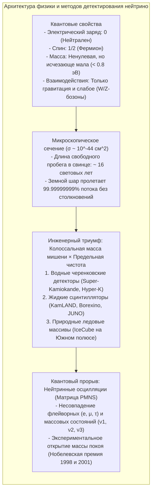

Прямо сейчас, пока вы читаете эти строки, сквозь каждый квадратный сантиметр площади вашего ногтя ежесекундно пролетает около 65 миллиардов микроскопических частиц со скоростью, неотличимой от скорости света. Они рождены в бушующем термоядерном горниле солнечного ядра, беспрепятственно пронзили сотни тысяч километров плотной солнечной плазмы, преодолели 150 миллионов километров космического вакуума, прошли сквозь земную кору, мантию и расплавленное железное ядро Земли и улетели в глубины Вселенной.

Имя этих неуловимых странников — <strong>нейтрино</strong>.

Не имея электрического заряда, обладая ничтожно малой массой и не участвуя в сильном ядерном взаимодействии, нейтрино общается с обычным веществом практически исключительно через <strong>слабое взаимодействие</strong>. Согласно расчетам, чтобы с вероятностью 50% поглотить типичное солнечное нейтрино с энергией в несколько мегаэлектронвольт (МэВ), потребовалась бы сплошная стена из твердого свинца <strong>толщиной более одного светового года</strong> (около 10 триллионов километров).

Как же ученым удалось обнаружить эту частицу-призрак, измерить ее характеристики и даже доказать наличие у нее массы?



---

## 1. Спасение физики: отчаянный шаг Паули и теория Ферми

История нейтрино началась в 1920-х годах с острейшего кризиса: под угрозой оказался <strong>закон сохранения энергии</strong>.

При бета-распаде ядер, когда нейтрон испускает электрон, законы двухчастичного распада требовали, чтобы электрон обладал строго определенной кинетической энергией. Однако опыты Джеймса Чедвика показали <strong>непрерывный энергетический спектр</strong>: электроны уносили произвольную долю энергии, а остаток бесследно исчезал. Нильс Бор даже высказал гипотезу, что закон сохранения энергии в микромире может нарушаться.

В декабре 1930 года австрийский теоретик <strong>Вольфганг Паули</strong> направил участникам физической конференции в Тюбингене историческое письмо:
> «Дорогие радиоактивные дамы и господа... Я предпринял отчаянный шаг, чтобы спасти закон сохранения энергии.»

Паули предположил, что при бета-распаде вместе с электроном вылетает нейтральная частица со спином 1/2, не взаимодействующая с детектором:

$$n \longrightarrow p + e^- + \bar{\nu}_e$$

В 1934 году итальянский гений <strong>Энрико Ферми</strong> назвал эту гипотетическую частицу <strong>нейтрино</strong> («нейтрончик») и создал фундаментальную теорию бета-распада. Рассчитав сечение слабого взаимодействия, физики ужаснулись: вероятность столкновения была настолько ничтожной, что Паули с горечью признался: *«Я предсказал частицу, которую невозможно зарегистрировать»*.

---

## 2. Почему нейтрино пронизывает материю?

Обычные тела кажутся нам твердыми из-за электромагнитного отталкивания электронных оболочек атомов. Нейтрино же:
1. <strong>Лишено электрического заряда</strong> (не чувствует кулоновского поля);
2. <strong>Не подвержено сильному ядерному взаимодействию</strong>;
3. Взаимодействует только через обмен сверхтяжелыми $W^\pm$ и $Z^0$ бозонами ($M_W \approx 80{,}4 \, \text{ГэВ}/c^2$).

Сечение реакции нейтрино с энергией несколько МэВ составляет:

$$\sigma_\nu \sim 10^{-44} \, \text{см}^2 = 10^{-20} \, \text{барн}$$

Это в <strong>сто триллионов раз меньше</strong> геометрического размера атомного ядра! Средняя длина свободного пробега нейтрино в сплошном свинце равна <strong>16 световым годам</strong>. Вся наша планета для нейтрино — абсолютная пустота.

---

## 3. Исторический триумф Райнеса и Коуэна (1956)

В 1956 году американские физики <strong>Фредерик Райнес</strong> и <strong>Клайд Коуэн</strong> преодолели ничтожную вероятность столкновения колоссальным потоком частиц ($10^{13} \, \bar{\nu}_e / \text{см}^2 / \text{с}$) от ядерного реактора в Саванна-Ривер.

Они использовали реакцию обратного бета-распада на протонах воды:

$$\bar{\nu}_e + p \longrightarrow n + e^+$$

```mermaid
flowchart LR
    subgraph DELAYED_RU ["Метод задержанных совпадений Райнеса и Коуэна"]
        direction TB
        NU_RU["Антинейтрино от реактора"] --> P_RU["Свободный протон в воде"]
        P_RU --> IBD_RU["Обратный бета-распад: позитрон (e+) и нейтрон (n)"]
        
        IBD_RU --> PROMPT_RU["МГНОВЕННЫЙ СИГНАЛ (t = 0):\nАннигиляция e+ и e- -> 2 гамма-кванта по 511 кэВ (разлет под 180°)"]
        IBD_RU --> DELAYED_RU["ЗАДЕРЖАННЫЙ СИГНАЛ (t ≈ 10 мкс):\nЗахват замедленного нейтрона ядрами кадмия-108 -> Вспышка гамма 8 МэВ"]
        
        PROMPT_RU --> GATE_RU["Временное окно совпадений: отсечение 99,999% фонового шума!"]
        DELAYED_RU --> GATE_RU
        GATE_RU --> DETECT_RU["Первая достоверная регистрация нейтрино в истории!"]
    end
```

Их метод <strong>задержанных совпадений</strong> (сначала гамма-кванты аннигиляции позитрона, а спустя 10 микросекунд — каскад гамма-лучей от захвата нейтрона кадмием) позволил надежно выделить событие из космического фона. В 1995 году Райнес был удостоен Нобелевской премии по физике.

---

## 4. Великаны нейтринной астрономии

### ① Super-Kamiokande: Подземный храм черенковского света
В Японии на глубине 1 000 метров расположен <strong>Super-Kamiokande</strong> — резервуар с <strong>50 000 тонн сверхчистой воды</strong> и <strong>11 129 фотоумножителями</strong> диаметром 50 см.
- <strong>Черенковский эффект:</strong> Когда заряженная частица движется в воде быстрее света в этой среде ($0{,}75c$), возникает конус голубого излучения с углом $\theta_C \approx 41{,}4^\circ$.
- <strong>Разделение типов частиц:</strong> Электроны дают <strong>размытые кольца с неровными краями</strong>, а тяжелые мюоны оставляют <strong>идеально резкие окружности</strong>.

### ② IceCube: Кубический километр антарктического льда
На Южном полюсе <strong>IceCube</strong> использует <strong>один кубический километр кристально прозрачного глубинного льда</strong> с 5 160 фотодетекторами на глубине до 2 450 метров для охоты за космическими нейтрино сверхвысоких энергий (ТэВ–ПэВ).

---

## 5. Проблема солнечных нейтрино и осцилляции

Более тридцати лет хлорный эксперимент Рэя Дэвиса регистрировал <strong>лишь треть солнечных нейтрино</strong>, предсказанных моделью Джона Бакала.

Загадку разрешила квантовая механика: <strong>нейтринные осцилляции</strong>.
Флейворные состояния ($\nu_e, \nu_\mu, \nu_\tau$) не совпадают с массовыми ($\nu_1, \nu_2, \nu_3$), а связаны через <strong>матрицу PMNS</strong>:

$$P(\nu_e \to \nu_\mu) = \sin^2(2\theta) \sin^2\left( 1{,}27 \cdot \frac{\Delta m^2 \, [\text{эВ}^2] \cdot L \, [\text{км}]}{E \, [\text{ГэВ}]} \right)$$

В полете электронные нейтрино превращаются в мюонные и тау-нейтрино. В 1998 году Такааки Кадзита (Super-Kamiokande) и в 2001 году Артур Макдональд (SNO, Канада) доказали существование осцилляций, за что получили Нобелевскую премию 2015 года.

---

## 6. За пределами Стандартной модели

Открытие ненулевой массы нейтрино открыло путь к новой физике:
1. <strong>Майорановские фермионы:</strong> Является ли нейтрино собственной античастицей? Поиск <strong>безнейтринного двойного бета-распада ($0\nu\beta\beta$)</strong> призван дать ответ на этот вопрос.
2. <strong>Механизм качелей (Seesaw):</strong> Объясняет, почему нейтрино в миллионы раз легче электрона.
3. <strong>Лептогенезис:</strong> Нарушение CP-симметрии у тяжелых первичных нейтрино могло создать наблюдаемое преобладание материи над антиматерией во Вселенной.

Изучение этой призрачной частицы стало триумфом человеческой мысли, объединившим микромир элементарных частиц с масштабами всей Вселенной.
