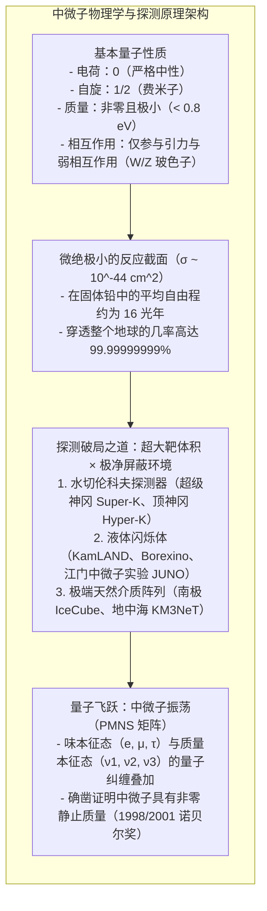
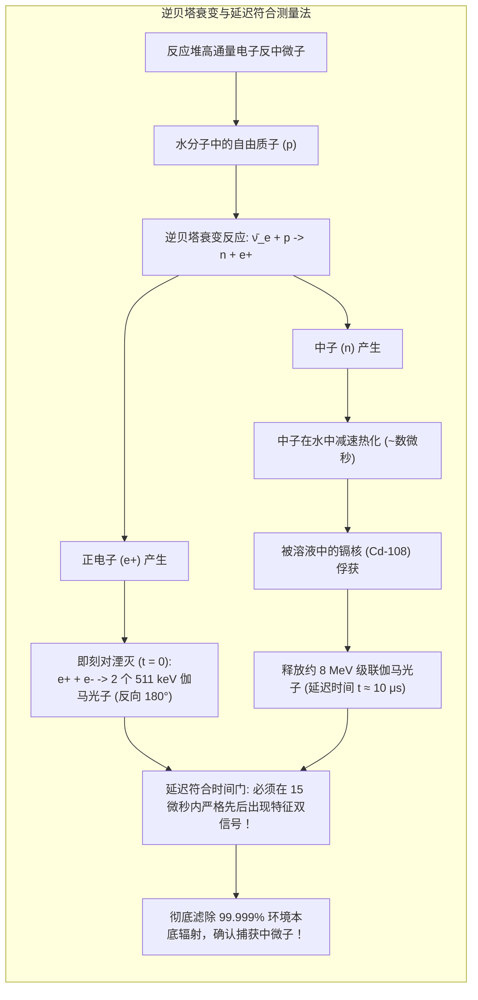
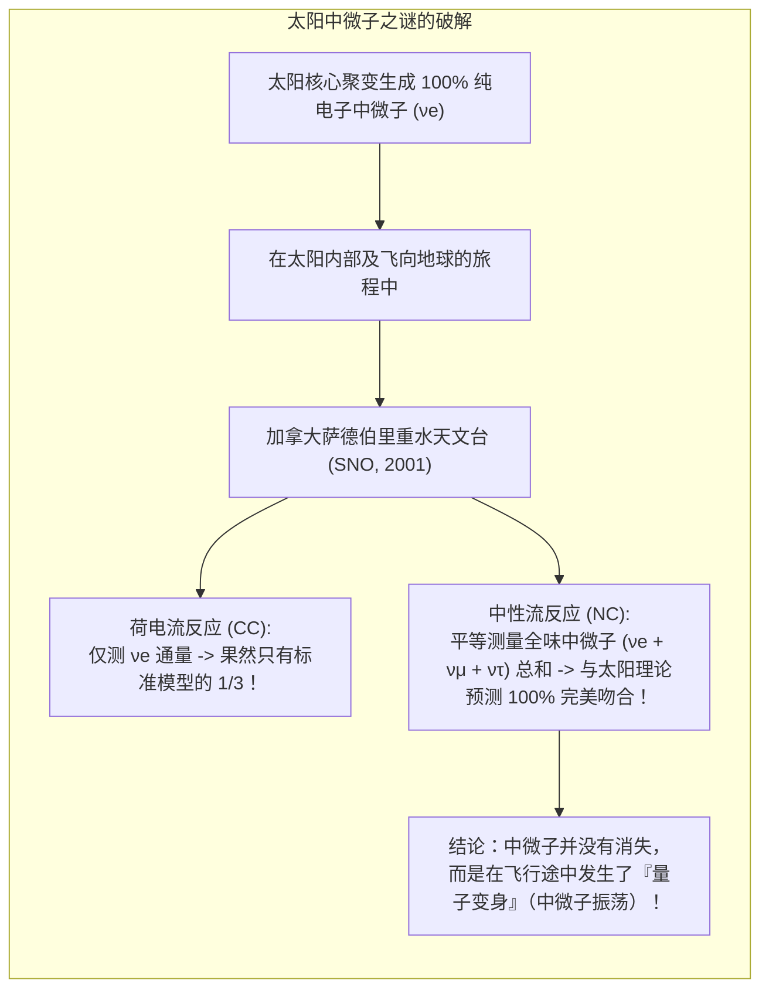

在此时此刻，每秒钟约有 650 亿个微小粒子正以接近光速穿过你的每一平方厘米指甲盖。它们诞生于太阳核心剧烈的氢核聚变反应，轻而易举地穿透数十万公里的高温高密太阳等离子体，横渡 1.5 亿公里的行星际空间，随后穿过地球的地壳、地幔与炽热铁核，毫不受阻地从地球另一端逸出，重新隐没在冰冷的宇宙深空中。

这种粒子被称为<strong>“中微子”（Neutrino）</strong>。

它不带电荷，质量极其微小（不到电子的数百万分之一），对电磁力与把质子中子结合在原子核内的强相互作用力完全“免疫”。中微子在微观世界中几乎只通过全宇宙最微弱的短程力——<strong>弱相互作用</strong>与物质发生碰撞。据理论物理学家精确测算，如果想要以 50% 的概率彻底挡住一个能量为数兆电子伏特（MeV）的太阳中微子，需要一面<strong>厚达十几光年（超过 100 万亿公里）的实心纯铅墙</strong>！

然而，现代物理学家不仅成功捕获了这种“幽灵粒子”，还建造了深埋地下的巨型水池与南极冰盖光电阵列，对其计数、测向，并发现了它违背粒子物理标准模型的“变身”绝技（中微子振荡），最终改写了人类对微观物质世界的认知。

---

## 1. 绝望中的理论救赎：泡利的假说与费米的弱相互作用

中微子的科学史始于 20 世纪初物理学界遭遇的一场空前理论危机——<strong>能量守恒定律的失守风险</strong>。

### 贝塔衰变连续能谱之谜
在 1910 至 1920 年代，物理学家在研究放射性核素的贝塔衰变（$\beta$ 衰变）时发现了一个违背直觉的现象。根据经典力学与狭义相对论，若母核分裂为子核和一个电子：

$$A \longrightarrow B + e^-$$

双体衰变的能量与动量守恒要求释放出的电子必须具有<strong>单一、确定的分立线状能量</strong>。然而实验测定显示，电子的能量呈现从零到某一上限 $E_{\max}$ 的<strong>连续谱</strong>。电子带走的能量总是低于理论预期，一部分能量凭空消失了。这令哥本哈根学派领袖玻尔甚至提出“微观尺度下能量守恒可能仅在统计平均意义上成立”的悲观假设。

### 泡利的绝望之策
为了挽救神圣的能量守恒定律，1930 年 12 月，奥地利天才物理学家<strong>沃尔夫冈·泡利（Wolfgang Pauli）</strong>给正在图宾根参加放射性会议的同行写了一封著名的信件。他提出，原子核在贝塔衰变时不仅放出了电子，还同时释放出一种<strong>质量极小、不带电荷、穿透力极强且尚未被探测到的中性轻粒子</strong>：

$$A \longrightarrow B + e^- + \text{未知中性粒子}$$

这使得反应变为三体衰变，电子与这个未知粒子共同瓜分了能量，从而完美解释了连续能谱。然而泡利对这个大胆猜想深感不安，甚至对天文学家巴德哀叹：“我做了一件可怕的事，我预言了一种永远无法被实验探测到的粒子。”

### 费米的定名与弱相互作用理论
1932 年查德威克发现原子核内的中子后，意大利物理大师<strong>恩里科·费米（Enrico Fermi）</strong>将泡利预言的轻质中性粒子命名为意大利语爱称<strong>“Neutrino”（微小的中性之物）</strong>。

1934 年，费米发表了划时代的弱相互作用贝塔衰变理论，将这一过程描述为四个费米子在同一个时空点的接触相互作用：

$$n \longrightarrow p + e^- + \bar{\nu}_e$$

费米理论确立了费米耦合常数 $G_F \approx 1.166 \times 10^{-5} \, \text{GeV}^{-2}$，让物理学家首次具备了计算中微子与普通物质碰撞反应截面的数学工具。

---

## 2. 为什么中微子能穿透万物：截面与自由程的物理算力

日常物质之所以坚固，是因为原子外层的电子云通过电磁力（库仑斥力）相互排斥；原子核中的质子与中子则由强相互作用力紧紧锚定。

然而中微子：
1. <strong>电荷严格为零</strong>：感受不到库仑力，电子云和原子核电场如同虚设；
2. <strong>不参与强核力</strong>：穿过原子核时不受强力碰撞约束；
3. <strong>仅通过 W/Z 玻色子传递的弱相互作用产生反应</strong>：弱力的作用程仅为 $10^{-18}$ 米（约为质子半径的千分之一）。

对于典型能量约为几兆电子伏（MeV）的太阳中微子，其与核子的反应截面量级约为：

$$\sigma_\nu \sim 10^{-44} \, \text{cm}^2 = 10^{-20} \, \text{靶恩 (barn)}$$

作为对比，强相互作用的典型截面约为 $10^{-24} \, \text{cm}^2$（1 靶恩）。这意味着中微子发生碰撞的有效几何面积比普通原子核小了整整 <strong>1 亿亿倍（$10^{-20}$）</strong>！

物质中的平均自由程由公式 $\lambda = \frac{1}{n \cdot \sigma}$ 决定。代入固体铅的核子数密度（约 $6.8 \times 10^{24} \, \text{个/cm}^3$），可得中微子在实心铅块中的平均自由程约为 <strong>16 光年</strong>（约 150 万亿公里）。对于直径仅 1.27 万公里的地球，中微子穿透它如同光子穿透最透明的虚空。

---

## 3. 莱因斯-考恩实验：在核反应堆旁抓捕幽灵（1956）

面对万亿分之一的碰撞几率，美国物理学家<strong>弗雷德里克·莱因斯（Frederick Reines）</strong>与<strong>克莱德·考恩（Clyde Cowan）</strong>展现了宏大的工程智慧：<strong>以极高通量的粒子流弥补极小的单粒子反应几率</strong>。

$$\text{反应事件数} = \text{中微子通量} \times \text{靶核子总数} \times \text{微观反应截面}$$

1956 年，他们将巨型探测器安置在萨凡纳河核反应堆地下深度屏蔽处。铀核裂变产物不断发生贝塔衰变，向四周喷涌出高达每秒每平方厘米 $10^{13}$ 个电子反中微子（$\bar{\nu}_e$）。

他们利用水中的<strong>逆贝塔衰变（Inverse Beta Decay）</strong>：

$$\bar{\nu}_e + p \longrightarrow n + e^+$$

为了剔除宇宙射线等环境杂音，他们发明了<strong>延迟符合法（Delayed Coincidence）</strong>：
1. <strong>即刻信号（$t = 0$）</strong>：产生的正电子与水中电子湮灭，立刻发射出两个背向而行（$180^\circ$）的 $511 \, \text{keV}$ 伽马光子；
2. <strong>延迟信号（$t \approx 5\text{--}15 \, \mu\text{s}$）</strong>：慢化后的中子被水中溶解的氯化镉俘获，激发出约 $8 \, \text{MeV}$ 的级联伽马暴。

只有当探测器在严苛的微秒时间窗口内连续捕捉到特征能量信号对时，才判定为一次中微子事件。泡利在收到证实电报后欣慰回复：“懂得等待的人终将获得一切。”莱因斯因这一实验获得了 1995 年诺贝尔物理学奖。

---

## 4. 捕捉隐形巨兽：三大现代探测重器

进入当代，为了研究来自太阳、超新星与深空的宇宙中微子，探测器规模经历了惊人的跃升。

### ① 超级神冈（Super-Kamiokande）：水切伦科夫光之眼
超级神冈坐落于日本岐阜县神冈矿山地下 1000 米深处，主体为一个装盛 <strong>5 万吨超纯水</strong>的巨型不锈钢圆柱桶，内壁镶嵌有 <strong>11,129 支 20 英寸光电倍增管（PMT）</strong>。

#### 切伦科夫辐射圆锥
当相对论性荷电粒子（电子或缪子）在介质中的运动速度超过光在介质中的相速度（水中约为 $0.75c$）时，会在前进方向激发出深蓝色的电磁激波——<strong>切伦科夫辐射</strong>。其圆锥半角满足：

$$\cos\theta_C = \frac{1}{n \beta} \approx \frac{1}{1.334} \approx 0.75 \implies \theta_C \approx 41.4^\circ$$

#### 粒子鉴别（PID）：电子环与缪子环
超级神冈的核心优势在于能通过投影在内壁的切伦科夫光环形貌，以高于 99% 的精度分辨入射中微子的“味”：
- <strong>电子中微子事件</strong>：击出的电子由于质量小，频繁发生库仑散射与韧致辐射电磁级联，形成<strong>边缘毛糙模糊的弥散光环</strong>；
- <strong>缪子中微子事件</strong>：击出的缪子质量是电子的 207 倍，如重锤般沿直线前行，在水桶壁留下<strong>轮廓极其锐利清晰的光环</strong>。

### ② 南极冰立方（IceCube）：以大陆冰盖为靶
对于高能天体中微子（$\text{TeV}\text{--}\text{PeV}$），万吨级水池仍然太小。位于南极点冰盖下的 <strong>IceCube</strong> 将深达 1.4 至 2.4 公里的纯净南极冰川直接作为探测介质。86 条观测线悬挂着 5,160 个数字光学模块（DOM），监控着整整 <strong>1 立方公里（10 亿吨）的极地坚冰</strong>，开启了多信使天文学时代。

---

## 5. 太阳中微子失踪案与中微子振荡

20 世纪下半叶，中微子物理学遭遇了最著名的疑案——<strong>太阳中微子问题</strong>。

天体物理学家约翰·巴考尔（John Bahcall）根据标准太阳模型精确计算了太阳核心聚变产生的电子中微子通量。然而，雷·戴维斯（Raymond Davis Jr.）在霍姆斯泰克金矿进行的氯-37放射化学实验测得的数据<strong>只有理论预测值的约三分之一</strong>。这桩公案争论了三十余年，双方反复校核，却发现理论与实验都没有错误。

### 庞蒂科夫-牧-中川-坂田（PMNS）矩阵与量子混合
答案隐藏在量子力学的一大奇观中：<strong>弱作用味本征态（$\nu_e, \nu_\mu, \nu_\tau$）并不是在真空中独立传播的质量本征态（$\nu_1, \nu_2, \nu_3$）</strong>，而是三者的量子叠加态。

在简化的双味混合模型中：

$$|\nu_e\rangle = \cos\theta |\nu_1\rangle + \sin\theta |\nu_2\rangle, \quad |\nu_\mu\rangle = -\sin\theta |\nu_1\rangle + \cos\theta |\nu_2\rangle$$

由于不同质量本征态的能量 $E_i \approx p + \frac{m_i^2}{2p}$ 存在微小差异，它们在飞行距离 $L$ 后会累积量子相位差。电子中微子转变为缪子中微子的概率公式为：

$$P(\nu_e \to \nu_\mu) = \sin^2(2\theta) \sin^2\left( 1.27 \times \frac{\Delta m^2 [\text{eV}^2] \cdot L [\text{km}]}{E [\text{GeV}]} \right)$$

<strong>只要中微子具有微小且不相等的质量（$\Delta m^2 \neq 0$），不同种类的中微子就会在飞行中周期性地相互转化。</strong>

1998 年，梶田隆章带领超级神冈团队通过比对穿透地球上涌与头顶下落的大气缪子中微子，确凿证实了中微子振荡；2001 年，加拿大 SNO 重水探测器通过中性流反应测得全味中微子总数与太阳模型预测完全一致，彻底终结了世纪之谜。梶田隆章与阿瑟·麦克唐纳荣膺 2015 年诺贝尔物理学奖。

---

## 6. 超越标准模型：马约拉纳之谜与宇宙的起源

中微子振荡的证实宣告了粒子物理最小标准模型的破裂——因为标准模型最初将中微子定义为无质量粒子。

今天，物理学家聚焦于以下终极问题：
1. <strong>马约拉纳费米子（自身即是反粒子）</strong>：中微子是否如埃托雷·马约拉纳在 1937 年预言的那样，本身就是其反粒子？全球科学家正通过寻找<strong>无中微子双贝塔衰变（$0\nu\beta\beta$）</strong>（如 KamLAND-Zen 实验）来检验这一假说。若被证实，将打破轻子数守恒定律；
2. <strong>跷跷板机制（Seesaw Mechanism）</strong>：通过假定存在极重的大统一能标右手中微子，解释为什么常规中微子质量比电子轻数百万倍；
3. <strong>轻子生成（Leptogenesis）与宇宙物质起源</strong>：大爆炸初期重马约拉纳中微子衰变中的 CP 对称性破缺，可能是导致全宇宙只剩下正物质而无反物质的关键推手。

从一个为了拯救物理定律而凭空想象的“算账补丁”，到照亮微观世界与浩瀚星空的终极信使，中微子探测史彰显了人类理性的至高力量。
