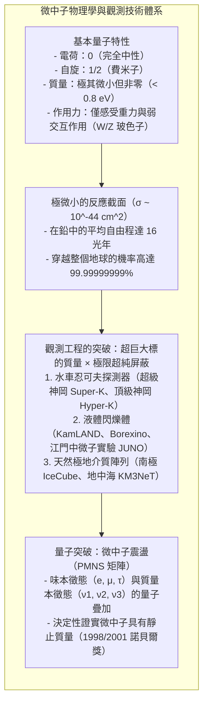
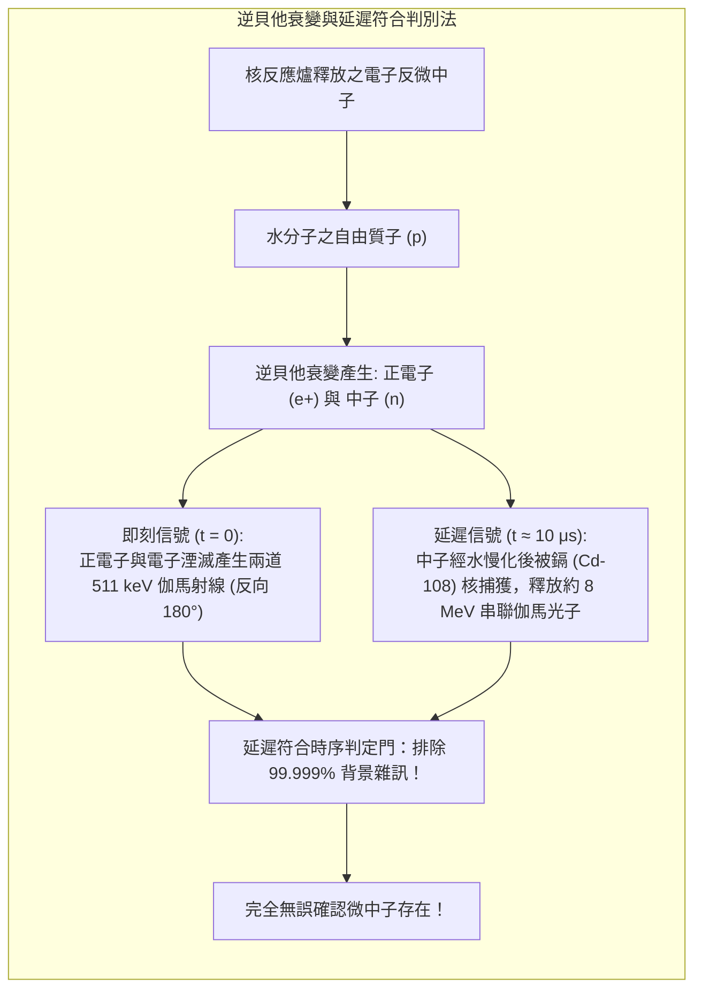
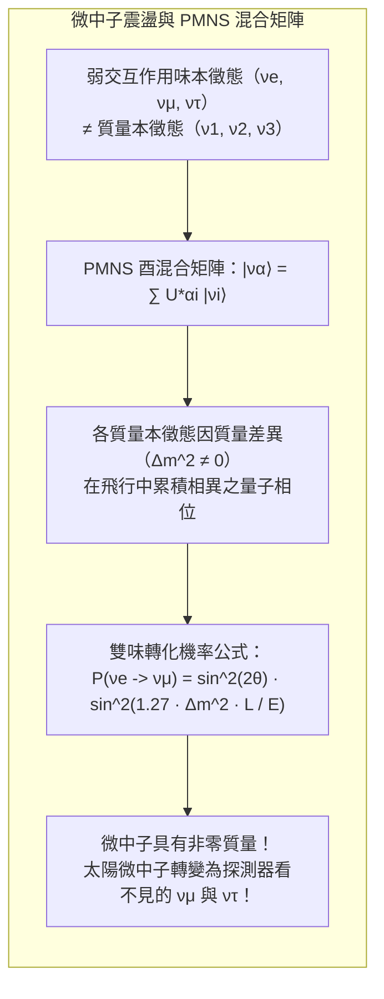

此時此刻，每秒鐘約有 650 億個極微小粒子正以接近光速穿過你指甲蓋的每一平方公分。它們誕生於太陽核心高溫高壓的核融合反應中，毫無阻礙地穿越數十萬公里的熾熱太陽電漿，橫跨 1.5 億公里的行星際太空，穿透地殼、地函與地核，從地球的另一端悄然逸出，繼續奔向宇宙深處。

這些粒子被稱為<strong>「微中子」（Neutrino）</strong>。

微中子不帶電荷，質量微乎其微（不到電子質量的百萬分之一），不受電磁力亦不受將核子束縛在原子核內的強交互作用影響，在微觀世界中幾乎僅透過<strong>弱交互作用</strong>與普通物質發生接觸。根據理論物理學家的嚴密計算，若要以 50% 的機率徹底攔截一個數兆電子伏特（MeV）的太陽微中子，需要一面<strong>厚達十幾光年（超過一百兆公里）的純鉛牆</strong>！

然而，當代物理學家不僅在實驗室中捕獲了這種幽靈粒子，更在地底深處與極地冰原建造起恢弘的探測神殿，成功測量其通量、定向其源頭，並揭開了震驚學界的微中子震盪之謎。

---

## 1. 誕生於絕望的拯救之策：包立的假說與費米理論

微中子的故事發端於二十世紀初物理學界的一場嚴峻危機——<strong>能量守恆定律看似遭到破壞</strong>。

### 貝他衰變連續能譜的謎團
在 1910 至 1920 年代，研究核貝他衰變（$\beta$ 衰變）的物理學家遭遇了無法解釋的反常。若母核僅衰變為子核與一個電子：

$$A \longrightarrow B + e^-$$

基於雙體衰變的能量動量守恆，射出的電子必須擁有嚴格分立的單色能量。然而實驗結果卻表明，電子的能量分佈呈現由零延伸至上限 $E_{\max}$ 的<strong>平滑連續譜</strong>。消失的能量去向成謎，甚至讓量子力學巨擘波耳提出了「能量守恆定律在微觀世界可能失效」的驚人假設。

### 包立的大膽救急方案
為捍衛神聖的能量守恆定律，1930 年 12 月，奧地利物理學家<strong>沃爾夫岡·包立（Wolfgang Pauli）</strong>寄出了一封歷史性信件。他大膽提出，原子核在貝他衰變時，除了放出電子，還同時釋放出一種<strong>質量極小、不帶電荷且穿透力極強的中性粒子</strong>：

$$A \longrightarrow B + e^- + \text{未知中性粒子}$$

該粒子悄悄帶走了部分動量與能量，使反應成為三體衰變，因而使電子的能譜連續分佈。包立私下向友人哀嘆：「我做了一件可怕的事，我預言了一種永遠無法被探測到的粒子。」

### 費米的弱交互作用理論
1932 年查兌克發現中子後，義大利物理巨匠<strong>恩里科·費米（Enrico Fermi）</strong>將包立所稱的粒子正式定名為義大利文愛稱<strong>「微中子」（Neutrino，意為小中性粒子）</strong>。

1934 年，費米提出了著名的四費米子弱交互作用理論，奠定了費米常數 $G_F \approx 1.166 \times 10^{-5} \, \text{GeV}^{-2}$，讓科學家首次能以精準的數學公式計算微中子與物質的微觀反應截面。

---

## 2. 穿透萬物的物理極限：極小截面與十六光年自由程

微中子之所以能無視一切障礙，在於自然界的基本作用力法則：
1. <strong>完全不帶電荷</strong>：無法與電子雲或原子核產生電磁庫侖力；
2. <strong>不感受強核力</strong>：穿行於原子核內亦不會被強作用散射；
3. <strong>僅由質量巨大的 W/Z 玻色子傳遞弱力</strong>：其微觀作用距離僅約 $10^{-18}$ 公尺。

對於約數個 MeV 的微中子，其與核子的散射截面僅約：

$$\sigma_\nu \sim 10^{-44} \, \text{cm}^2 = 10^{-20} \, \text{靶恩 (barn)}$$

比強交互作用的截面小了整整二十個數量級！根據平均自由程公式 $\lambda = \frac{1}{n \sigma}$ 計算，微中子在固體鉛塊中的平均自由程高達 <strong>16 光年</strong>。直徑僅約 1.27 萬公里的地球，對微中子而言幾乎是完全透明的真空。

---

## 3. 萊因斯-考恩實驗：在核反應爐旁創造奇蹟（1956）

微中子的單一反應機率雖微乎其微，但若將入射的微中子通量放大至極限，衝突便必然發生：

$$\text{偵測事件數} = \text{微中子通量} \times \text{標的核子數} \times \text{微觀截面}$$

1956 年，美國物理學家<strong>弗雷德里克·萊因斯（Frederick Reines）</strong>與<strong>克萊德·考恩（Clyde Cowan）</strong>在南卡羅來納州薩凡納河核電廠進行了劃時代實驗。反應爐運轉時釋放的高達每秒每平方公分 $10^{13}$ 個反微中子流，撞擊水槽中的質子誘發<strong>逆貝他衰變</strong>：

$$\bar{\nu}_e + p \longrightarrow n + e^+$$

萊因斯與考恩首創<strong>延遲符合技術（Delayed Coincidence）</strong>：
1. <strong>即刻信號</strong>：生成的正電子迅速與水中電子湮滅，射出兩枚反向的 $511 \, \text{keV}$ 伽馬光子；
2. <strong>延遲信號</strong>：慢化後的中子在數微秒後被水中溶解的鎘鹽捕獲，釋放約 $8 \, \text{MeV}$ 的級聯伽馬射線。

唯有在嚴格微秒間隔內連續出現此特徵雙重信號，才判定為微中子碰撞。這項里程碑式的發現讓萊因斯榮獲 1995 年諾貝爾物理學獎。

---

## 4. 當代三大微中子觀測重器

隨後數十年間，為了觀測來自太陽、超新星爆發及遙遠宇宙的高能微中子，微中子探測器發展出三大技術支柱：

### ① 水車忍可夫光陣列（超級神岡 Super-K）
位於日本岐阜縣神岡地下 1,000 公尺處的超級神岡，擁有裝載 <strong>5 萬噸超純水</strong>的巨型鋼槽與 <strong>11,129 支 20 吋光電倍增管（PMT）</strong>。
- <strong>車忍可夫效應</strong>：當帶電粒子在水中的速度超過水中光速（約 $0.75c$）時，會如超音速音爆般在前方激發出幽藍色的光錐（開角約 $41.4^\circ$）；
- <strong>粒子辨識（PID）</strong>：電子微中子引發的電子因劇烈多重庫侖散射，產生<strong>邊界模糊的毛糙光環</strong>；而重 207 倍的繆子直衝無礙，在壁面投影出<strong>極其銳利清晰的光環</strong>，辨識正確率超過 99%。

### ② 南極冰立方（IceCube）
在南極點厚達數公里的冰川中，IceCube 透過 86 條纜線將 5,160 顆光電模組深埋在 1,450 至 2,450 公尺深處，監控<strong>一立方公里（十億噸）的深海級清澈冰體</strong>，專門捕捉 TeV 至 PeV 級的超高能天體微中子，成功開拓了多信使天體物理學新時代。

---

## 5. 太陽微中子失蹤案與微中子震盪的世紀突破

1960 年代起，約翰·巴考爾（John Bahcall）以太陽標準模型精確預測了太陽微中子的產率；而雷·戴維斯（Ray Davis Jr.）在霍姆斯泰克金礦的四氯乙烯乾洗液槽中測得的微中子通量，卻<strong>僅有理論預期的三分之一</strong>。這場長達三十餘年的科學爭執最終證明雙方皆完全正確——微中子在飛行過程中「變形」了。

微中子的味本徵態（$\nu_e, \nu_\mu, \nu_\tau$）是質量本徵態（$\nu_1, \nu_2, \nu_3$）的量子疊加（由 PMNS 矩陣描述）。由於各質量態質量不同（$\Delta m^2 \neq 0$），在真空傳播時將產生干涉相位差，使得電子微中子在抵達地球前週期性地轉化為繆子或勞子微中子。

1998 年，梶田隆章率領超級神岡團隊由大氣微中子的上下非對稱性證實了震盪；2001 年，加拿大薩德伯里重水天文台（SNO）藉由中性流反應測得全味微中子總量，與巴考爾的模型 100% 吻合！梶田隆章與阿瑟·麥克唐納榮獲 2015 年諾貝爾物理學獎。

---

## 6. 邁向新物理：馬約拉納粒子與宇宙的創生

微中子具備質量的確切證據，直接突破了標準模型的框架。今日物理學家正全力探索：
1. <strong>馬約拉納粒子與無微中子雙貝他衰變（$0\nu\beta\beta$）</strong>：微中子是否是自身的反粒子？若被證實，輕子數將不再守恆；
2. <strong>蹺蹺板機制（Seesaw Mechanism）</strong>：透過極高能標的大質量右旋微中子，自然解釋微中子超輕質量的成因；
3. <strong>輕子生成（Leptogenesis）與反物質消失之謎</strong>：宇宙早期重微中子衰變中的 CP 對稱性破缺，或許正是解答「為何宇宙只剩下物質而非空無一物」的終極鑰匙。

從一張信紙上的絕望算術，到深邃地底的巨眼，微中子的百年探索印證了人類探索未知世界的無盡好奇與卓越智慧。
