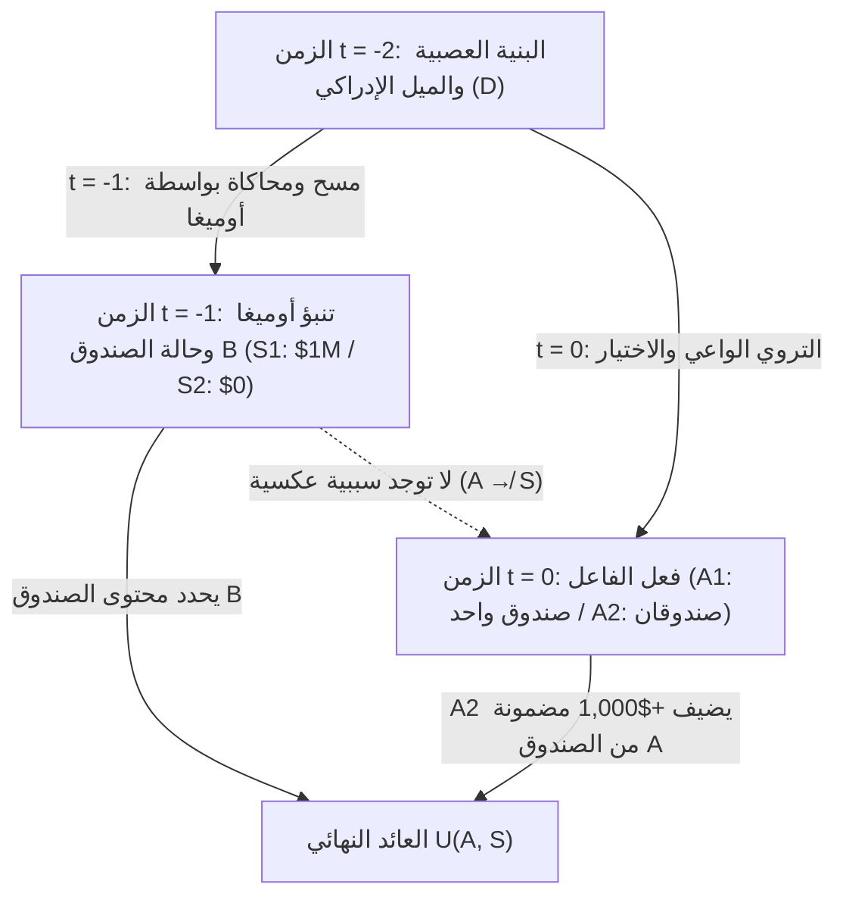
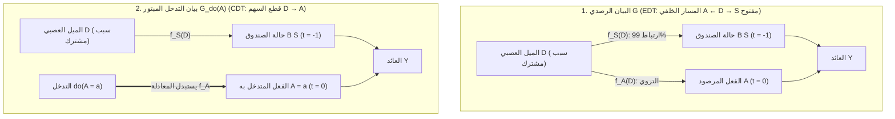

## 1. التجربة الفكرية التي شطرت العقلانية: مفارقة نيوكومب (1960–1969)

في عام 1960، صاغ الفيزيائي النظري <strong>ويليام نيوكومب (William A. Newcomb)</strong> في مختبر لورانس ليفرمور الوطني بجامعة كاليفورنيا معضلة اختيار تبدو بسيطة لكنها هزت أركان نظرية الاختيار العقلاني الحديثة. وبعد أن قدّمها فيلسوف هارفارد <strong>روبرت نوزيك (Robert Nozick)</strong> إلى الأوساط الأكاديمية في ورقته التأسيسية عام 1969 بعنوان <strong>*«مشكلة نيوكومب ومبدآن للاختيار» (Newcomb's Problem and Two Principles of Choice)*</strong>، ونشرها مارتن غاردنر في مجلة *Scientific American* (1973، 1974)، انقسم الاقتصاديون والرياضيون والفيزيائيون والفلاسفة إلى معسكرين متصادمين.

وقد لخّص نوزيك هذا الانقسام في عبارته الشهيرة:

> *«بالنسبة لكل شخص تقريباً، يبدو ما يجب فعله واضحاً وبديهياً تماماً. تكمن الصعوبة في أن الناس ينقسمون بالتساوي تقريباً حول هذه المشكلة، حيث يعتقد قطاع كبير من كل فريق أن النصف الآخر يتصرف بحماقة فحسب.»*
> — <strong>Robert Nozick (1969)</strong>, *"Newcomb's Problem and Two Principles of Choice"*

---

### 1.1 الإعداد القياسي للتجربة: صندوقان والمتنبئ الخارق أوميغا ($\Omega$)

تقف أمام طاولة عليها صندوقان: <strong>الصندوق الشفاف A</strong> و<strong>الصندوق المعتم B</strong>.

1. <strong>الصندوق الشفاف A</strong>: مصنوع من الزجاج الشفاف، ويحتوي بوضوح تام على <strong>$\$1,000$</strong> نقداً.
2. <strong>الصندوق المعتم B</strong>: مصنوع من الفولاذ المغلق، وتعلم يقيناً أنه يحتوي إما على <strong>$\$1,000,000$</strong> (مليون دولار) أو على <strong>$\$0$</strong> (فارغ تماماً).

في اللحظة الحالية $t = 0$، عليك الاختيار بين فعلين فقط:

- <strong>أخذ صندوق واحد (One-Boxing, $A_1$)</strong>: ترك الصندوق الشفاف A و<strong>أخذ الصندوق المعتم B فقط</strong>.
- <strong>أخذ الصندوقين معاً (Two-Boxing, $A_2$)</strong>: <strong>أخذ الصندوق A والصندوق B كليهما</strong>.

الشخصية المحورية في الخلفية هي <strong>المتنبئ الخارق أوميغا ($\Omega$)</strong>، الذي حققت عمليات مسح الدماغ والمحاكاة العصبية الحاسوبية لديه دقة تنبؤ موثقة بنسبة <strong>$99\%$ ($p = 0.99$)</strong> عبر آلاف التجارب السابقة. <strong>بالأمس (عند الزمن $t = -1$)</strong>، تنبأ $\Omega$ باختيارك اليوم وجهّز الصندوق B وفق القاعدة الصارمة التالية:

- <strong>حالة العالم $S_1$ ($\text{Pred}_1$: تنبأ $\Omega$ بأنك ستأخذ الصندوق B فقط، $A_1$)</strong>:
  وضع $\Omega$ بالأمس مبلغ <strong>$\$1,000,000$</strong> داخل الصندوق B.
- <strong>حالة العالم $S_2$ ($\text{Pred}_2$: تنبأ $\Omega$ بأنك ستأخذ الصندوقين معاً، $A_2$)</strong>:
  ترك $\Omega$ بالأمس الصندوق B <strong>فارغاً ($\$0$)</strong>.

يُشترط هنا <strong>الانغلاق السببي للماضي</strong> بصرامة: لقد غادر $\Omega$ بالأمس، ولا توجد سببية رجعية ($A \not\to S$). حركتك اليوم عند $t = 0$ لا يمكنها تغيير محتوى الصندوق B فيزيائياً.

| اختيارك اليوم (عند $t = 0$) | الحالة $S_1$ ($\text{Pred}_1$): تنبأ $\Omega$ بـ $A_1$ (الصندوق B فيه $\$1,000,000$) | الحالة $S_2$ ($\text{Pred}_2$): تنبأ $\Omega$ بـ $A_2$ (الصندوق B فيه $\$0$) |
| :--- | :---: | :---: |
| <strong>$A_1$: أخذ الصندوق B فقط (One-Boxing)</strong> | <strong>$\$1,000,000$</strong> | <strong>$\$0$</strong> |
| <strong>$A_2$: أخذ الصندوقين A و B معاً (Two-Boxing)</strong> | <strong>$\$1,001,000$</strong> | <strong>$\$1,000$</strong> |

---

## 2. الركيزة الأولى: نظرية القرار الدليلي (EDT) وحجة أصحاب الصندوق الواحد

الأساس الصوري لمعسكر الصندوق الواحد هو <strong>نظرية القرار الدليلي (Evidential Decision Theory, EDT)</strong> التي صاغها <strong>ريتشارد جيفري (Richard C. Jeffrey)</strong> في كتابه الكلاسيكي <strong>*منطق القرار (The Logic of Decision, 1965)*</strong>.

### 2.1 المنفعة المتوقعة الشرطية و«القيمة الإخبارية (News Value)»

في جبر بول الموحد عند جيفري، تُقاس جاذبية الفعل $A_i$ بـ<strong>قيمته الإخبارية (News Value)</strong> الموزونة بالاحتمال الشرطي البايزي $\mathbb{P}(S_j \mid A_i)$:

$$\text{EU}_{\text{EDT}}(A_i) = \sum_{j} \mathbb{P}(S_j \mid A_i)\, U(A_i, S_j)$$

بما أن $\mathbb{P}(S_1 \mid A_1) = 0.99$ و$\mathbb{P}(S_2 \mid A_1) = 0.01$، وكذلك $\mathbb{P}(S_1 \mid A_2) = 0.01$ و$\mathbb{P}(S_2 \mid A_2) = 0.99$، نحصل على:

$$\begin{aligned}
\text{EU}_{\text{EDT}}(A_1) &= 0.99 \times \$1,000,000 + 0.01 \times \$0 = \$990,000 \\
\text{EU}_{\text{EDT}}(A_2) &= 0.01 \times \$1,001,000 + 0.99 \times \$1,000 = \$10,010 + \$990 = \$11,000
\end{aligned}$$

وبوجه عام، لجائزة $M$ في الصندوق B ومبلغ $k$ في الصندوق A ودقة تنبؤ $p$:

$$\text{EU}_{\text{EDT}}(A_1) > \text{EU}_{\text{EDT}}(A_2) \iff p M > (1-p)(M+k) + pk \iff p > \frac{1}{2} + \frac{k}{2M} = 0.5005$$

أي بمجرد أن تتجاوز دقة أوميغا $50.05\%$، تأمر EDT بأخذ صندوق واحد ($A_1$)، ومن هنا وُلدت السخرية الشهيرة الموجهة لأصحاب الصندوقين: <strong>*«إذا كنتم أذكياء إلى هذا الحد، فلماذا لستم أثرياء؟» (If you're so smart, why ain't you rich?)*</strong>

---

## 3. الركيزة الثانية: نظرية القرار السببي (CDT)، مبدأ الهيمنة الصارمة، وحساب-$do$ عند بيرل

أثبت مؤسسو <strong>نظرية القرار السببي (Causal Decision Theory, CDT)</strong> — <strong>ألان غيبارد وويليام هاربر (1978)</strong>، و<strong>برايان سكيرمز (1980)</strong>، و<strong>ديفيد لويس (1981)</strong>، و<strong>جيمس جويس (1999)</strong>، والحائز على جائزة تورنغ <strong>جوديا بيرل (2000)</strong> — أن EDT تخلط بين <strong>الارتباط التشخيصي (الدليل الإحصائي)</strong> و<strong>الفعالية السببية</strong>.

### 3.1 مبدأ الهيمنة الصارمة والشرطيات المضادة للواقع

وفق <strong>مبدأ الهيمنة الصارمة</strong> عند ليونارد سافاج (1954)، بما أن حالة الصندوق B ($S_1$ أو $S_2$) محددة سلفاً في الماضي ومستقلة سببياً عن فعلك $A$، فإن أخذ الصندوقين ($A_2$) يمنحك $+\$1,000$ إضافية في *كل* حالة ممكنة للعالم ($1,001,000 > 1,000,000$ و$1,000 > 0$).

استبدل غيبارد وهاربر (1978) الاحتمال الشرطي $\mathbb{P}(S_j \mid A_i)$ باحتمال القضية الشرطية المضادة للواقع عند ستالناكر-لويس $\mathbb{P}(A_i \Box\!\to S_j)$، بينما صاغ <strong>جوديا بيرل (2000)</strong> نظرية CDT عبر <strong>النماذج السببية البنيوية (SCM)</strong> ومؤثر التدخل <strong>$do(A_i)$</strong>:

$$\text{EU}_{\text{CDT}}(A_i) = \sum_{j} \mathbb{P}(S_j \mid do(A_i))\, U(A_i, S_j)$$

### 3.2 شوكة السبب المشترك ($S \leftarrow D \to A$) وجراحة البيان

في البيان الموجه غير الدوري (DAG)، يُعد ميلك العصبي السابق $D$ <strong>سبباً مشتركاً (Common-Cause Fork: $S \leftarrow D \to A$)</strong> لكل من تنبؤ أوميغا بالأمس $S = f_S(D, U_S)$ واختيارك اليوم $A = f_A(D, U_A)$.

بينما يفتح التكييف الرصدي $\mathbb{P}(S \mid A)$ <strong>المسار الخلفي (Back-door Path) $A \leftarrow D \to S$</strong>، تقوم <strong>جراحة البيان ($do(A_i)$)</strong> عند بيرل بقطع السهم $D \to A$، مما يؤدي رياضياً إلى:

$$\mathbb{P}(S_j \mid do(A_i)) = \mathbb{P}(S_j) \implies \text{EU}_{\text{CDT}}(A_2) - \text{EU}_{\text{CDT}}(A_1) = +\$1,000 > 0$$

---

## 4. مشاكل نيوكومب الطبية (آفة المدخن) ومذهب الجبر الكالفيني عند ماكس فيبر

### 4.1 «آفة المدخن (The Smoking Lesion, Skyrms 1980)»

بناءً على الفرضية التكوينية لرونالد فيشر، صاغ برايان سكيرمز (1980) تجربة <strong>آفة المدخن</strong>: لنفترض أن تدخين التبغ غير مسرطن إطلاقاً ($A_{\text{smoke}} \not\to C$)، لكن طفرة جينية خلقية $L$ تسبب باحتمال $99\%$ كلاً من الرغبة في التدخين ($A_{\text{smoke}}$، متعة $+1$) وسرطان الرئة القاتل ($C$، منفعة $-1,000$).
- في الشوكة $C \leftarrow L \to A$، تحسب <strong>EDT</strong> أن $\text{EU}_{\text{EDT}}(A_{\text{abstain}}) = -10$ مقابل $\text{EU}_{\text{EDT}}(A_{\text{smoke}}) = -989$، فتأمرك خرافياً بالامتناع عن التدخين لتقليل الاحتمال الشرطي لكونك قد وُلدت بالجين $L$!
- أما <strong>CDT</strong> فتدرك عبر $\mathbb{P}(C \mid do(A)) = \mathbb{P}(C)$ أن الجينات لا تتغير وتوصي بعقلانية بالتدخين ($+1$).

### 4.2 التماثل البنيوي مع القضاء والقدر الكالفيني عند ماكس فيبر (1905)

كما أشار نوزيك (1969)، فإن عقيدة <strong>التقدير المزدوج (Predestination)</strong> لجان كالفن التي حللها <strong>ماكس فيبر</strong> في كتابه *«الأخلاق البروتستانتية وروح الرأسمالية»* (1904–1905) تمثل مشكلة نيوكومب لاهوتية: فقد قضى الله منذ الأزل من هم <strong>المختارون للخلاص ($S_1$)</strong> ومن هم <strong>الهالكون ($S_2$)</strong>، ولا يمكن لأي عمل بشري ($A_1$) أن يغير هذا القضاء سببياً ($A \not\to S$). ومع ذلك، مارس البيوريتانيون <strong>الزهد الدنيوي الصارم ($A_1$)</strong> ليس بوصفه *سبباً للخلاص (causa salutis)*، بل بوصفه <strong>علامة تشخيصية ودليلاً معرفياً على الاصطفاء (*cognoscendi ratio*)</strong> ضمن الشوكة $\text{الخلاص } S_1 \leftarrow \text{النعمة الإلهية } D \to \text{العمل الزهدي } A_1$، معظّمين بذلك $\mathbb{P}(S_1 \mid A_1)$ تماماً كفاعلين يتبعون EDT!

---

## 5. «دفاع الدغدغة» لإيلري إيلز وتماثل معضلة السجينين التوأمين لديفيد لويس

### 5.1 «دفاع الدغدغة (Tickle Defense, 1982)» وقابلية المصادقة (Ratifiability)

لإنقاذ EDT من آفة المدخن، جادل <strong>إيلري إيلز (Ellery Eells, 1982)</strong> بأن الجين $L$ لا يسبب الفعل $A$ إلا عبر رغبة واعية أو «دغدغة» $T = (\mathcal{B}, \mathcal{D})$ ($C \leftarrow L \to T \to A$). فإذا علم الفاعل حالته الداخلية $T$ بالاستبطان قبل الفعل، فإن التكييف على $T$ <strong>يحجب (Screening-Off)</strong> الارتباط بين $A$ و$L$: $\mathbb{P}(C \mid A, T) = \mathbb{P}(C \mid T)$، فتتطابق EDT مع CDT. غير أن هذا يفشل في مفارقة نيوكومب لأن $\Omega$ يتنبأ بالقرار النهائي ذاته، كما يبيّن معيار <strong>قابلية المصادقة (Ratifiability, Jeffrey 1983)</strong> أن قرار أخذ صندوق واحد ($\text{Decide}(A_1)$) غير قابل للمصادقة، إذ بمجرد ثبوت $\text{Decide}(A_1)$ يصبح التحول إلى $A_2$ أفضل بمقدار $+\$1,000$.

### 5.2 مبرهنة التماثل لديفيد لويس: *«Prisoners' Dilemma Is a Newcomb Problem»* (1979)

في عام 1979، برهن <strong>ديفيد لويس</strong> على أن معضلة السجينين لمرة واحدة ضد توأم نفسي (أو نسخة تشغل نفس الشيفرة المصدرية) متماثلة بنسبة $100\%$ مع مفارقة نيوكومب:
- <strong>التعاون ($C_{\text{PD}}$: التنازل عن $\$1,000$ لمنح توأمك $\$1,000,000$)</strong> $\Longleftrightarrow$ <strong>أخذ صندوق واحد ($A_1$)</strong>.
- <strong>الخيانة ($D_{\text{PD}}$: أخذ $+\$1,000$ لنفسك)</strong> $\Longleftrightarrow$ <strong>أخذ الصندوقين ($A_2$)</strong>.
بما أن أوميغا يتنبأ بك عبر تشغيل محاكاة (توأم) لعقلك بالأمس، فإن اللعبتين متطابقتان تماماً. استنتج لويس وجوب الخيانة وأخذ الصندوقين، بينما صاغ <strong>دوغلاس هوفشتاتر (1983)</strong> مفهوم <strong>العقلانية الفائقة (Superrationality)</strong> لتبرير التعاون المتبادل $(C_{\text{PD}}, C_{\text{PD}})$ وأخذ صندوق واحد ($A_1$).

---

## 6. آفاق محاذاة الذكاء الاصطناعي: نظرية القرار الوظيفي (FDT)

بالنسبة لوكلاء البرمجيات (الذكاء الاصطناعي) الذين يمكن قراءة شيفرتهم المصدرية أو محاكاتها بدقة $100\%$ داخل بيئة معزولة (*sandbox*)، يُعد المتنبئ $\Omega$ واقعاً هندسياً يومياً. وفي عام 2017، صاغ <strong>إليعازر يودكوفسكي ونيت سواريس</strong> (بدمج <strong>TDT</strong> و<strong>UDT</strong> لوِي داي) <strong>نظرية القرار الوظيفي (Functional Decision Theory, FDT)</strong>.

### 6.1 الشرطيات المضادة للواقع المنطقية: التدخل في الدالة الرياضية $\mathsf{F}$

تعامل CDT القرار كحدث فيزيائي موضعي $A$ عند $(x_0, t_0)$ وتفترض عند حساب $do(A = A_2)$ عالماً مستحيلاً منطقياً تُخرج فيه نفس الخوارزمية الحتمية $\mathsf{F}(\mathcal{I})$ القيمة $A_1$ بالأمس في محاكي أوميغا والقيمة $A_2$ اليوم. أما FDT فتتدخل مباشرة في <strong>مخرجات دالة القرار الرياضية $\mathsf{F}(\mathcal{I})$ ذاتها</strong>:

$$\text{EU}_{\text{FDT}}(a) = \sum_{j} \mathbb{P}\!\left(S_j \;\middle|\; do(\mathsf{F}(\mathcal{I}) = a)\right) U(a, S_j)$$

1. <strong>مفارقة نيوكومب</strong>: بما أن تنبؤ أوميغا $S = f_S(\mathsf{F}(\mathcal{I}), U_S)$ يعتمد وظيفياً على $\mathsf{F}(\mathcal{I})$، فإن التدخل $do(\mathsf{F}(\mathcal{I}) = A_1)$ يضبط المحاكاة والفعل الحالي معاً على $A_1$ $\implies$ <strong>تختار FDT صندوقاً واحداً ($A_1$) وتربح $\$1,000,000$!</strong>
2. <strong>آفة المدخن</strong>: بما أن الجين الخلقي $L$ ليس محاكاة للدالة $\mathsf{F}(\mathcal{I})$ ($C \leftarrow L \to \mathcal{I} \to \mathsf{F}(\mathcal{I}) \to A$)، فإن $do(\mathsf{F}(\mathcal{I}) = a)$ لا يغير احتمال السرطان $\implies$ <strong>تختار FDT التدخين ($A_{\text{smoke}}$) بلا خرافات!</strong>
3. <strong>نيوكومب الشفاف (مسافر بارفيت) وتوازن البرامج (مبرهنة لوب)</strong>: حتى لو كان الصندوق B شفافاً ورأيت المليون دولار بداخله، تحسّن FDT/UDT السياسة الكلية $\mathsf{F}$ مسبقاً وتأخذ الصندوق B فقط؛ وفي معضلة السجينين مفتوحة المصدر، يستخدم `FairBot` <strong>مبرهنة لوب ($\square(\square P \to P) \to \square P$)</strong> لتحقيق تعاون متبادل قابل للإثبات رسمياً.

### 6.2 جدول مقارن شامل: EDT مقابل CDT مقابل FDT/UDT

| البُعد / المعضلة | النظرية الدليلية (EDT — Jeffrey 1965) | النظرية السببية (CDT — Lewis, Pearl) | النظرية الوظيفية (FDT / UDT — Yudkowsky & Soares 2017) |
| :--- | :--- | :--- | :--- |
| <strong>صيغة المنفعة المتوقعة</strong> | $\sum_j \mathbb{P}(S_j \mid A_i)\, U(A_i, S_j)$ | $\sum_j \mathbb{P}(S_j \mid do(A_i))\, U(A_i, S_j)$ | $\sum_j \mathbb{P}(S_j \mid do(\mathsf{F}(\mathcal{I}) = a))\, U(a, S_j)$ |
| <strong>1. مفارقة نيوكومب القياسية</strong> | <strong>صندوق واحد ($A_1$)</strong> ($\$1,000,000$) | <strong>صندوقان ($A_2$)</strong> ($\$1,000$) | <strong>صندوق واحد ($A_1$)</strong> ($\$1,000,000$) |
| <strong>2. آفة المدخن (طبية)</strong> | <strong>الامتناع ($A_{\text{abstain}}$)</strong> (خرافة) | <strong>التدخين ($A_{\text{smoke}}$)</strong> (صحيح، $+1$) | <strong>التدخين ($A_{\text{smoke}}$)</strong> (صحيح، $+1$) |
| <strong>3. معضلة السجينين التوأمين</strong> | <strong>التعاون ($C_{\text{PD}}$)</strong> ($\$1,000,000$) | <strong>الخيانة ($D_{\text{PD}}$)</strong> ($\$1,000$) | <strong>التعاون ($C_{\text{PD}}$)</strong> ($\$1,000,000$) |
| <strong>4. نيوكومب الشفاف</strong> | <strong>صندوقان</strong> (الرصد يحجب الدليل $\implies \$0$) | <strong>صندوقان</strong> (الهيمنة $\implies \$0$) | <strong>صندوق واحد</strong> (تحسين السياسة $\implies \$1,000,000$) |

---

## المراجع (References)

- <strong>Nozick, R. (1969)</strong>. "Newcomb's Problem and Two Principles of Choice." In *Essays in Honor of Carl G. Hempel* (pp. 114–146).
- <strong>Jeffrey, R. C. (1965 / 1983)</strong>. *The Logic of Decision*. University of Chicago Press.
- <strong>Lewis, D. (1979)</strong>. "Prisoners' Dilemma Is a Newcomb Problem." *Philosophy & Public Affairs*, 8(3), 235–240.
- <strong>Pearl, J. (2000 / 2009)</strong>. *Causality: Models, Reasoning, and Inference*. Cambridge University Press.
- <strong>Yudkowsky, E., & Soares, N. (2017)</strong>. "Functional Decision Theory: A New Theory of Instrumental Rationality." *arXiv:1710.05060*.
