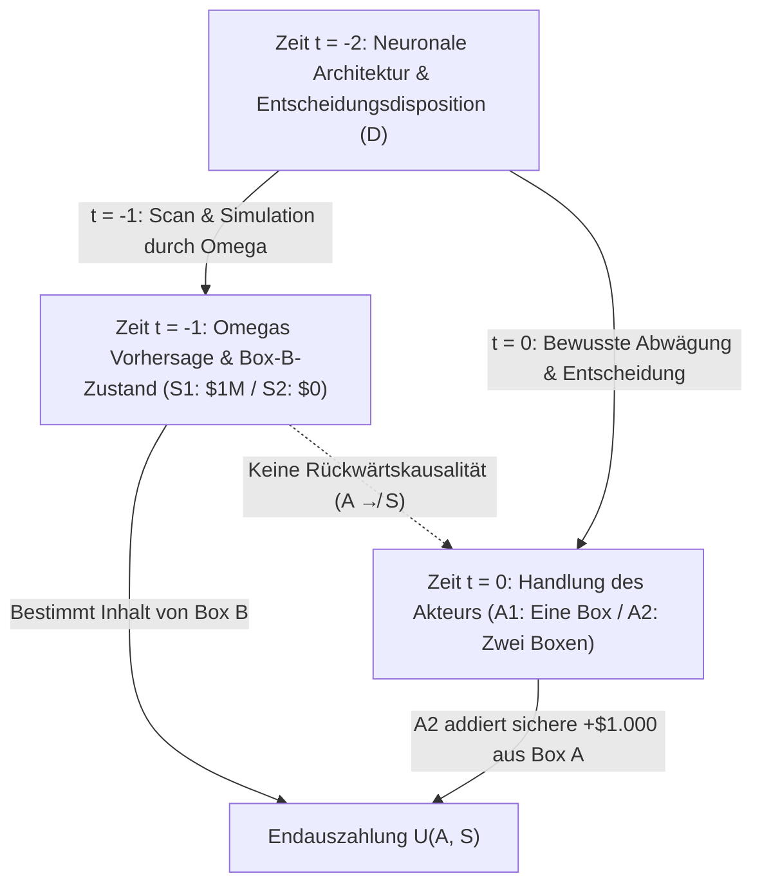
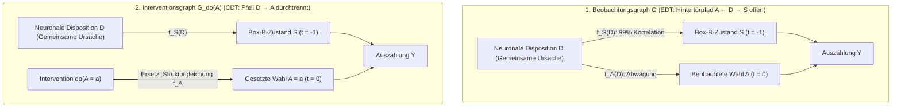

## 1. Das Gedankenexperiment, das die Rationalität spaltete: Newcombs Paradoxon (1960–1969)

Im Jahr 1960 entwarf der theoretische Physiker <strong>William A. Newcomb</strong> am Lawrence Livermore National Laboratory der University of California ein scheinbar schlichtes Entscheidungsproblem, das die Grundfesten der modernen Rationalitätstheorie erschüttern sollte. Nachdem der Harvard-Philosoph <strong>Robert Nozick</strong> das Problem 1969 in seinem wegweisenden Aufsatz <strong>*„Newcomb's Problem and Two Principles of Choice“*</strong> (in der Festschrift für Carl G. Hempel) veröffentlichte und Martin Gardner es 1973/1974 in seinen *Scientific American*-Kolumnen weltweit bekannt machte, spaltete es Ökonomen, Mathematiker, Physiker und Philosophen in zwei unversöhnliche Lager.

Nozick beschrieb diese Spaltung mit den berühmten Worten:

> *„Für fast jeden ist es vollkommen klar und offensichtlich, was zu tun ist. Die Schwierigkeit besteht darin, dass sich die Menschen bei diesem Problem fast genau in zwei Hälften teilen, wobei große Teile jeweils glauben, die andere Hälfte verhalte sich schlicht albern.“*
> — <strong>Robert Nozick (1969)</strong>, *"Newcomb's Problem and Two Principles of Choice"*

---

### 1.1 Der kanonische Versuchsaufbau: Zwei Boxen und der Prädiktor Omega ($\Omega$)

Vor Ihnen auf einem Tisch stehen zwei Behälter: die <strong>transparente Box A</strong> und die <strong>undurchsichtige Box B</strong>.

1. <strong>Transparente Box A</strong>: Aus klarem Glas gefertigt; sie enthält sichtbar <strong>$\$1.000$</strong> in bar.
2. <strong>Undurchsichtige Box B</strong>: Aus verschlossenem Stahl; sie enthält entweder <strong>$\$1.000.000$</strong> (eine Million Dollar) oder <strong>$\$0$</strong> (nichts).

Zum gegenwärtigen Zeitpunkt $t = 0$ haben Sie genau zwei Handlungsoptionen:

- <strong>Ein-Box-Wahl (One-Boxing, $A_1$)</strong>: Sie lassen die transparente Box A stehen und nehmen <strong>nur die undurchsichtige Box B</strong>.
- <strong>Zwei-Box-Wahl (Two-Boxing, $A_2$)</strong>: Sie nehmen <strong>sowohl Box A als auch Box B</strong>.

Der zentrale Akteur im Hintergrund ist ein übermenschlicher <strong>Prädiktor Omega ($\Omega$)</strong>, dessen hochauflösende Gehirnscans und Verhaltenssimulationen in Tausenden früheren Durchläufen eine empirisch belegte Vorhersagegenauigkeit von <strong>$99\%$ ($p = 0,99$)</strong> erreicht haben. <strong>Gestern (zum Zeitpunkt $t = -1$)</strong> hat $\Omega$ Ihre Entscheidung für heute prognostiziert und Box B nach folgender Regel befüllt:

- <strong>Weltzustand $S_1$ ($\text{Pred}_1$: $\Omega$ sagte voraus, dass Sie nur Box B nehmen, $A_1$)</strong>:
  $\Omega$ legte gestern <strong>$\$1.000.000$</strong> in Box B.
- <strong>Weltzustand $S_2$ ($\text{Pred}_2$: $\Omega$ sagte voraus, dass Sie beide Boxen nehmen, $A_2$)</strong>:
  $\Omega$ ließ Box B gestern <strong>leer ($\$0$)</strong>.

Es gilt die strikte <strong>kausale Abgeschlossenheit der Vergangenheit</strong>: $\Omega$ ist bereits gestern abgereist; es gibt keine Rückwärtskausalität (Retrokausalität, $A \not\to S$). Ihre heutige Handbewegung bei $t = 0$ kann den physischen Inhalt von Box B nicht mehr verändern.

| Ihre heutige Wahl (bei $t = 0$) | Zustand $S_1$ ($\text{Pred}_1$): $\Omega$ sagte $A_1$ voraus (Box B enthält $\$1.000.000$) | Zustand $S_2$ ($\text{Pred}_2$): $\Omega$ sagte $A_2$ voraus (Box B enthält $\$0$) |
| :--- | :---: | :---: |
| <strong>$A_1$: Nur Box B nehmen (One-Boxing)</strong> | <strong>$\$1.000.000$</strong> | <strong>$\$0$</strong> |
| <strong>$A_2$: Box A und Box B nehmen (Two-Boxing)</strong> | <strong>$\$1.001.000$</strong> | <strong>$\$1.000$</strong> |

---

## 2. Pfeiler I: Evidenzbasierte Entscheidungstheorie (EDT) und das Argument für One-Boxing

Das formale Fundament der One-Boxer bildet die <strong>Evidenzbasierte Entscheidungstheorie (Evidential Decision Theory, EDT)</strong>, entwickelt von <strong>Richard C. Jeffrey</strong> in seinem Klassiker <strong>*The Logic of Decision* (1965; 2. Aufl. 1983)</strong>.

### 2.1 Bedingter Erwartungsnutzen und „Nachrichtenwert (News Value)“

In Jeffreys einheitlicher Boolescher Propositionenalgebra $\mathcal{F}$ bemisst sich der Wert einer Handlung $A_i$ nach ihrem <strong>evidenziellen Nachrichtenwert (Desirability)</strong>, gewichtet mit der klassischen Bayesschen bedingten Wahrscheinlichkeit $\mathbb{P}(S_j \mid A_i)$:

$$\text{EU}_{\text{EDT}}(A_i) = \sum_{j} \mathbb{P}(S_j \mid A_i)\, U(A_i, S_j)$$

Mit $\mathbb{P}(S_1 \mid A_1) = 0,99$, $\mathbb{P}(S_2 \mid A_1) = 0,01$ sowie $\mathbb{P}(S_1 \mid A_2) = 0,01$ und $\mathbb{P}(S_2 \mid A_2) = 0,99$ ergibt sich:

$$\begin{aligned}
\text{EU}_{\text{EDT}}(A_1) &= 0,99 \times \$1.000.000 + 0,01 \times \$0 = \$990.000 \\
\text{EU}_{\text{EDT}}(A_2) &= 0,01 \times \$1.001.000 + 0,99 \times \$1.000 = \$10.010 + \$990 = \$11.000
\end{aligned}$$

Allgemein gilt für eine Prämie $M$ in Box B, einen Betrag $k$ in Box A und eine Prognosegüte $p$:

$$\text{EU}_{\text{EDT}}(A_1) > \text{EU}_{\text{EDT}}(A_2) \iff p M > (1-p)(M+k) + pk \iff p > \frac{1}{2} + \frac{k}{2M} = 0,5005$$

Schon ab einer Vorhersagegenauigkeit von $50,05\%$ fordert die EDT zwingend <strong>One-Boxing ($A_1$)</strong> – untermauert durch den berühmten Spottvers gegen alle Two-Boxer: <strong>*„If you're so smart, why ain't you rich?“* (Wenn ihr so klug seid, warum seid ihr dann nicht reich?)</strong>

---

## 3. Pfeiler II: Kausale Entscheidungstheorie (CDT), Dominanzprinzip und Judea Pearls $do$-Kalkül

Vertreter der <strong>Kausalen Entscheidungstheorie (Causal Decision Theory, CDT)</strong> – darunter <strong>Allan Gibbard und William Harper (1978)</strong>, <strong>Brian Skyrms (1980)</strong>, <strong>David Lewis (1981)</strong>, <strong>James Joyce (1999)</strong> und <strong>Judea Pearl (2000)</strong> – entgegnen: Die EDT verwechselt <strong>diagnostische Evidenz (statistische Korrelation)</strong> mit <strong>kausaler Wirksamkeit (Kausalität)</strong>.

### 3.1 Striktes Dominanzprinzip und kontrafaktische Konditionale

Nach Leonard Savages (1954) <strong>Prinzip der strikten Dominanz</strong> gilt: Da der Zustand von Box B ($S_1$ oder $S_2$) bereits in der Vergangenheit fixiert wurde und kausal unabhängig von Ihrer heutigen Handlung $A$ ist, dominiert $A_2$ die Option $A_1$ in jedem möglichen Weltzustand um exakt $+\$1.000$:
- Falls $S_1$ vorliegt ($\$1\text{M}$ in Box B): $U(A_2, S_1) = \$1.001.000 > U(A_1, S_1) = \$1.000.000$.
- Falls $S_2$ vorliegt ($\$0$ in Box B): $U(A_2, S_2) = \$1.000 > U(A_1, S_2) = \$0$.

Gibbard und Harper (1978) ersetzten daher $\mathbb{P}(S_j \mid A_i)$ durch die Wahrscheinlichkeit des nicht-rückwirkenden Stalnaker-Lewis-Kontrafaktuals $\mathbb{P}(A_i \Box\!\to S_j)$, während <strong>Judea Pearl (2000)</strong> im Rahmen <strong>Struktureller Kausalmodelle (SCM)</strong> den <strong>Interventionsoperator $do(A_i)$</strong> einführte:

$$\text{EU}_{\text{CDT}}(A_i) = \sum_{j} \mathbb{P}(S_j \mid do(A_i))\, U(A_i, S_j)$$

### 3.2 Die gemeinsame Ursache ($S \leftarrow D \to A$) und Graphen-Chirurgie

Im kausalen gerichteten azyklischen Graphen (DAG) bildet Ihre frühere neuronale Disposition $D$ eine <strong>gemeinsame Ursache (Common-Cause Fork: $S \leftarrow D \to A$)</strong> sowohl für Omegas gestrige Vorhersage $S = f_S(D, U_S)$ als auch für Ihre heutige Wahl $A = f_A(D, U_A)$.

Während die Beobachtungsbedingung $\mathbb{P}(S \mid A)$ den nicht-kausalen <strong>Hintertürpfad (Back-door Path) $A \leftarrow D \to S$</strong> öffnet, kappt Pearls <strong>Graphen-Chirurgie ($do(A_i)$)</strong> den Pfeil $D \to A$. Damit folgt zwingend:

$$\mathbb{P}(S_j \mid do(A_i)) = \mathbb{P}(S_j) \implies \text{EU}_{\text{CDT}}(A_2) - \text{EU}_{\text{CDT}}(A_1) = +\$1.000 > 0$$

---

## 4. Medizinische Newcomb-Probleme (Die Raucherläsion) und Max Webers calvinistische Prädestination

### 4.1 Skyrms' „Raucherläsion (The Smoking Lesion, 1980)“

Aufbauend auf Ronald Fishers Konstitutionshypothese formulierte Brian Skyrms (1980) das Experiment der <strong>Raucherläsion</strong>: Angenommen, Rauchen selbst ist völlig unschädlich ($A_{\text{smoke}} \not\to C$), doch ein angeborener Gendefekt $L$ verursacht mit $99\%$ Wahrscheinlichkeit sowohl das Verlangen zu rauchen ($A_{\text{smoke}}$, Genussnutzen $+1$) als auch späteren tödlichen Lungenkrebs ($C$, Nutzen $-1.000$).
- In dieser Gabelung $C \leftarrow L \to A$ berechnet die <strong>EDT</strong> $\text{EU}_{\text{EDT}}(A_{\text{abstain}}) = -10$ gegenüber $\text{EU}_{\text{EDT}}(A_{\text{smoke}}) = -989$ und rät abergläubisch zum Rauchverzicht, nur um sich selbst einzureden, man sei ohne das Krebsgen $L$ geboren worden!
- Die <strong>CDT</strong> erkennt mittels $\mathbb{P}(C \mid do(A)) = \mathbb{P}(C)$, dass das eigene Genom unveränderlich feststeht, und empfiehlt rational den Genuss der Zigarette ($+1$).

### 4.2 Strukturelle Isomorphie mit Max Webers calvinistischer Prädestinationslehre (1905)

Wie Robert Nozick (1969) bemerkte, ist die von <strong>Max Weber</strong> in *Die protestantische Ethik und der Geist des Kapitalismus* (1904/1905) untersuchte <strong>calvinistische Prädestinationslehre</strong> ein reales historisches Newcomb-Problem: Gott hat vor Anbeginn der Zeit festgelegt, wer zu den <strong>Auserwählten (Elect, $S_1$)</strong> und wer zu den <strong>Verworfenen (Reprobate, $S_2$)</strong> gehört. Obwohl weltliche Askese und rastlose Berufsarbeit ($A_1$) Gottes Dekret kausal niemals ändern können ($A \not\to S$), nutzten die Puritaner ihre asketische Lebensführung nicht als *Realstrecke zur Erlangung des Heils (causa salutis)*, sondern als <strong>diagnostischen Erkenntnisgrund (*cognoscendi ratio*)</strong> innerhalb der Gabelung $\text{Erwählung } S_1 \leftarrow \text{Göttliche Gnade } D \to \text{Asketische Werke } A_1$, um ihre subjektive Heilsgewissheit (*certitudo salutis*, $\mathbb{P}(S_1 \mid A_1) \approx 1$) gemäß der EDT zu maximieren!

---

## 5. Ellery Eells' „Tickle Defense“ und David Lewis' Gefangenendilemma-Isomorphie

### 5.1 Eells' „Kitzel-Verteidigung (Tickle Defense, 1982)“ und Ratifizierbarkeit

Um die EDT vor der Raucherläsion zu retten, argumentierte <strong>Ellery Eells (1982)</strong>, dass die genetische Disposition $L$ das Handeln $A$ nur über bewusste Wünsche und Überzeugungen – ein inneres „Kitzeln“ $T = (\mathcal{B}, \mathcal{D})$ – verursacht ($C \leftarrow L \to T \to A$). Kennt der Akteur seinen mentalen Zustand $T$ vor der Tat durch Introspektion, so schirmt $T$ nach der Markov-Bedingung (<strong>Screening-Off</strong>) die Korrelation ab: $\mathbb{P}(C \mid A, T) = \mathbb{P}(C \mid T)$, womit EDT und CDT zusammenfallen. In Newcombs Problem scheitert dies jedoch, sobald $\Omega$ den finalen Willensakt selbst vorhersagt; zudem zeigt Richard Jeffreys Kriterium der <strong>Ratifizierbarkeit (Ratifiability, 1983)</strong>, dass die Entscheidung für eine Box ($\text{Decide}(A_1)$) unratifizierbar ist, da unter der Bedingung $\text{Decide}(A_1)$ der Wechsel zu $A_2$ sofort $+\$1.000$ mehr verspricht.

### 5.2 David Lewis' Theorem: *„Prisoners' Dilemma Is a Newcomb Problem“* (1979)

1979 bewies <strong>David Lewis</strong>, dass ein einmaliges Gefangenendilemma gegen einen psychologischen Zwilling (oder einen identischen Software-Klon) exakt isomorph zu Newcombs Paradoxon ist:
- <strong>Kooperation ($C_{\text{PD}}$: Verzicht auf $\$1.000$, um dem Zwilling $\$1.000.000$ zu geben)</strong> $\Longleftrightarrow$ <strong>One-Boxing ($A_1$)</strong>.
- <strong>Defektion ($D_{\text{PD}}$: Einbehalten der eigenen $+\$1.000$)</strong> $\Longleftrightarrow$ <strong>Two-Boxing ($A_2$)</strong>.
Da $\Omega$ gestern nichts anderes tat, als eine Simulation (einen Zwilling) Ihres Geistes laufen zu lassen, sind beide Probleme identisch. Während Lewis daraus folgerte, man müsse in beiden Spielen defektieren bzw. zwei Boxen nehmen, begründete <strong>Douglas Hofstadter (1983)</strong> mit dem Konzept der <strong>Superrationalität (Superrationality)</strong> die symmetrische Wahl von $(C_{\text{PD}}, C_{\text{PD}})$ und One-Boxing ($A_1$).

---

## 6. Moderne KI-Alignment-Forschung: Funktionale Entscheidungstheorie (FDT)

Für moderne KI-Agenten, deren Quellcode von anderen Agenten eingesehen oder in einer Sandbox zu $100\%$ simuliert werden kann, ist Prädiktor $\Omega$ technische Realität. 2017 entwickelten <strong>Eliezer Yudkowsky und Nate Soares</strong> (aufbauend auf <strong>TDT</strong> und Wei Dais <strong>UDT</strong>) die <strong>Funktionale Entscheidungstheorie (Functional Decision Theory, FDT)</strong>.

### 6.1 Logische Kontrafaktuale: Intervention auf die mathematische Funktion $\mathsf{F}$

CDT betrachtet die Handlung als isoliertes physisches Ereignis $A$ am Raumzeitpunkt $(x_0, t_0)$ und unterstellt bei $do(A = A_2)$ das logisch unmögliche Szenario, dass derselbe deterministische Algorithmus $\mathsf{F}(\mathcal{I})$ gestern im Simulator $A_1$ und heute im Raum $A_2$ ausgibt. FDT interveniert stattdessen auf den <strong>Output der mathematischen Entscheidungsfunktion $\mathsf{F}(\mathcal{I})$ selbst</strong>:

$$\text{EU}_{\text{FDT}}(a) = \sum_{j} \mathbb{P}\!\left(S_j \;\middle|\; do(\mathsf{F}(\mathcal{I}) = a)\right) U(a, S_j)$$

1. <strong>Newcombs Paradoxon</strong>: Da Omegas Vorhersage $S = f_S(\mathsf{F}(\mathcal{I}), U_S)$ funktional vom Output von $\mathsf{F}(\mathcal{I})$ abhängt, setzt $do(\mathsf{F}(\mathcal{I}) = A_1)$ sowohl die Simulation als auch die heutige Tat auf $A_1$ $\implies$ <strong>FDT wählt One-Boxing ($A_1$) und gewinnt $\$1.000.000$!</strong>
2. <strong>Raucherläsion</strong>: Da das angeborene Gen $L$ keine Simulation von $\mathsf{F}(\mathcal{I})$ ist ($C \leftarrow L \to \mathcal{I} \to \mathsf{F}(\mathcal{I}) \to A$), lässt $do(\mathsf{F}(\mathcal{I}) = a)$ die Krebswahrscheinlichkeit unberührt $\implies$ <strong>FDT raucht ($A_{\text{smoke}}$) ohne Aberglauben!</strong>
3. <strong>Transparentes Newcomb-Problem (Parfits Anhalter) & Programm-Gleichgewicht (Löbs Theorem)</strong>: Selbst wenn Box B aus Klarglas besteht und die $\$1.000.000$ sichtbar sind, optimiert FDT/UDT die globale Policy-Funktion $\mathsf{F}$ *ex ante* und nimmt nur Box B; im Quellcode-Gefangenendilemma erreicht `FairBot` mittels <strong>Löbs Theorem ($\square(\square P \to P) \to \square P$)</strong> beweisbare wechselseitige Kooperation.

### 6.2 Vergleichstabelle: EDT vs. CDT vs. FDT/UDT

| Dimension / Dilemma | Evidenzbasierte Theorie (EDT — Jeffrey 1965) | Kausale Theorie (CDT — Lewis, Pearl) | Funktionale Theorie (FDT / UDT — Yudkowsky & Soares 2017) |
| :--- | :--- | :--- | :--- |
| <strong>Erwartungsnutzen-Formel</strong> | $\sum_j \mathbb{P}(S_j \mid A_i)\, U(A_i, S_j)$ | $\sum_j \mathbb{P}(S_j \mid do(A_i))\, U(A_i, S_j)$ | $\sum_j \mathbb{P}(S_j \mid do(\mathsf{F}(\mathcal{I}) = a))\, U(a, S_j)$ |
| <strong>1. Standard-Newcomb-Problem</strong> | <strong>One-Box ($A_1$)</strong> ($\$1.000.000$) | <strong>Two-Box ($A_2$)</strong> ($\$1.000$) | <strong>One-Box ($A_1$)</strong> ($\$1.000.000$) |
| <strong>2. Raucherläsion (Medizinisch)</strong> | <strong>Nichtrauchen ($A_{\text{abstain}}$)</strong> (Irrtum) | <strong>Rauchen ($A_{\text{smoke}}$)</strong> (Korrekt, $+1$) | <strong>Rauchen ($A_{\text{smoke}}$)</strong> (Korrekt, $+1$) |
| <strong>3. Zwillings-Gefangenendilemma</strong> | <strong>Kooperation ($C_{\text{PD}}$)</strong> ($\$1.000.000$) | <strong>Defektion ($D_{\text{PD}}$)</strong> ($\$1.000$) | <strong>Kooperation ($C_{\text{PD}}$)</strong> ($\$1.000.000$) |
| <strong>4. Transparentes Newcomb</strong> | <strong>Two-Box</strong> (Beobachtung schirmt ab $\implies \$0$) | <strong>Two-Box</strong> (Dominanz $\implies \$0$) | <strong>One-Box</strong> (Policy-Optimierung $\implies \$1.000.000$) |

---

## Literaturverzeichnis (References)

- <strong>Nozick, R. (1969)</strong>. "Newcomb's Problem and Two Principles of Choice." In *Essays in Honor of Carl G. Hempel* (pp. 114–146).
- <strong>Jeffrey, R. C. (1965 / 1983)</strong>. *The Logic of Decision*. University of Chicago Press.
- <strong>Lewis, D. (1979)</strong>. "Prisoners' Dilemma Is a Newcomb Problem." *Philosophy & Public Affairs*, 8(3), 235–240.
- <strong>Pearl, J. (2000 / 2009)</strong>. *Causality: Models, Reasoning, and Inference*. Cambridge University Press.
- <strong>Yudkowsky, E., & Soares, N. (2017)</strong>. "Functional Decision Theory: A New Theory of Instrumental Rationality." *arXiv:1710.05060*.
