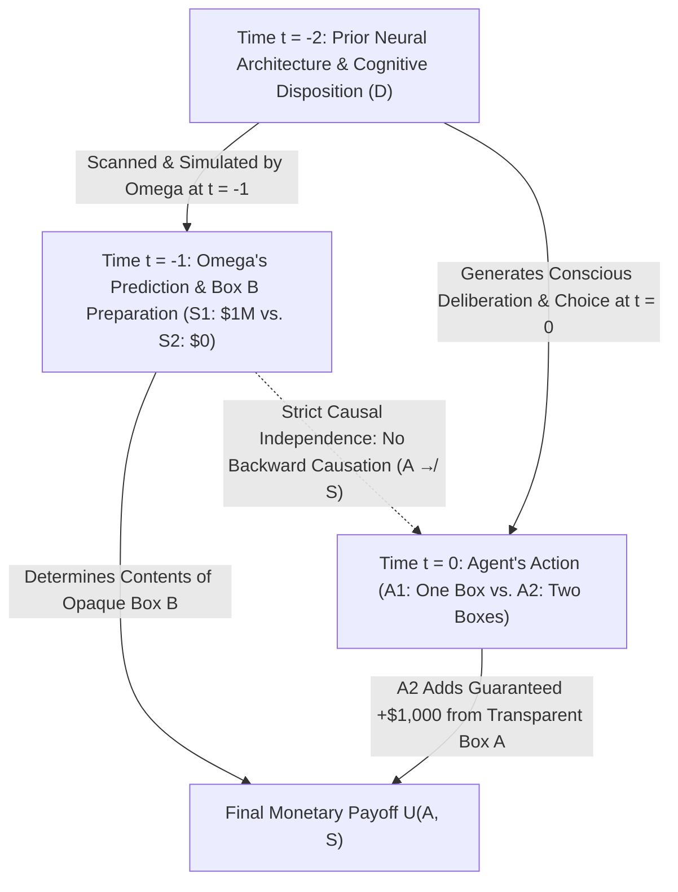
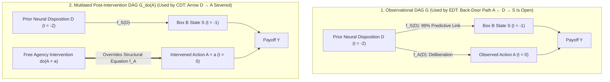

## 1. The Thought Experiment That Fractured Rationality: Newcomb's Paradox (1960–1969)

In 1960, while pondering the foundations of game theory and the Prisoner's Dilemma at the University of California's Lawrence Livermore National Laboratory, theoretical physicist <strong>William A. Newcomb</strong> formulated a deceptively simple decision puzzle. Communicated through colleagues to Harvard philosopher <strong>Robert Nozick</strong>, the puzzle was introduced to the academic world in Nozick's landmark 1969 paper, <strong>*"Newcomb's Problem and Two Principles of Choice"*</strong> (published in *Essays in Honor of Carl G. Hempel*), and subsequently popularized to a global audience by Martin Gardner in his *Scientific American* "Mathematical Games" columns of July 1973 and March 1974.

Within a decade, Newcomb's Paradox had shattered the mid-twentieth-century consensus on rational choice theory, splitting Nobel laureates in economics, mathematical statisticians, theoretical physicists, and analytic philosophers into two irreconcilable camps. Nozick captured the uncanny sociology of the problem in one of the most famous opening passages in twentieth-century philosophy:

> *"To almost everyone, it is perfectly clear and obvious what should be done. The difficulty is that these people seem to divide almost evenly on the problem, with large fractions thinking that the opposing half is just being silly."*
> — <strong>Robert Nozick (1969)</strong>, *"Newcomb's Problem and Two Principles of Choice"*

Why does an elementary one-shot decision problem—involving two boxes, two possible actions, and two possible states of the world—provoke top decision theorists to accuse one another of elementary irrationality? Let us begin by specifying the exact mathematical and physical architecture of the game.

---

### 1.1 The Canonical Setup: Two Boxes and the Superhuman Predictor Omega ($\Omega$)

You stand before a table holding two boxes: <strong>Transparent Box A</strong> and <strong>Opaque Box B</strong>.

1. <strong>Transparent Box A</strong>: Constructed of clear glass, it visibly and unmistakably contains <strong>$\$1,000$</strong> in cash.
2. <strong>Opaque Box B</strong>: Constructed of sealed steel, its interior cannot be observed. You know with certainty that it contains either <strong>$\$1,000,000$</strong> (one million dollars) or <strong>$\$0$</strong> (nothing at all).

You must choose between exactly two available actions at the present time $t = 0$:

- <strong>One-Boxing ($A_1$)</strong>: Refuse Transparent Box A and take <strong>only Opaque Box B</strong>.
- <strong>Two-Boxing ($A_2$)</strong>: Take <strong>both Transparent Box A and Opaque Box B</strong>.

Enter the central figure of the dilemma: a superhuman <strong>Predictor, Omega ($\Omega$)</strong>. Omega may be conceptualized as an extraterrestrial superintelligence, an ultra-high-resolution neuro-computational brain scanner that maps every synaptic weight and neurotransmitter gradient in your neocortex, or a deterministic software sandbox running a high-fidelity simulation of your cognitive architecture. Across thousands of previously documented trials involving both hardened One-Boxers and hardened Two-Boxers, Omega's predictions of human choices have achieved an empirically verified accuracy rate of <strong>$99\%$ ($p = 0.99$)</strong>—independent of whether the subject ultimately chose one box or two boxes.

<strong>Yesterday (at time $t = -1$)</strong>, Omega scanned your brain and cognitive dispositions, formulated a definite prediction about what you would choose today (at time $t = 0$), and prepared Opaque Box B according to the following strict protocol:

- <strong>World State $S_1$ ($\text{Pred}_1$: Omega predicted you would One-Box, $A_1$)</strong>:
  Yesterday at $t = -1$, Omega placed <strong>$\$1,000,000$</strong> inside Opaque Box B.
- <strong>World State $S_2$ ($\text{Pred}_2$: Omega predicted you would Two-Box, $A_2$)</strong>:
  Yesterday at $t = -1$, Omega left Opaque Box B <strong>completely empty ($\$0$)</strong>.

To eliminate trivial evasions or ambiguities, the following physical and epistemic boundary conditions—collectively known as the <strong>Causal Closure of the Past</strong>—are strictly stipulated:

1. <strong>Absence of Retrocausality (No Backward Causation)</strong>: Omega completed its prediction, loaded or left empty Box B, sealed the vault, and departed the solar system yesterday. There is no hidden mechanical wire, no quantum eraser, no time machine, and no confederate watching your hands today. Reaching for Box A at $t = 0$ cannot cause a million-dollar bank note inside Box B to vanish or disintegrate.
2. <strong> Ontological Determinacy of the State</strong>: At the moment of your deliberation ($t = 0$), the physical state of Box B is already fixed in the past: either the $\$1,000,000$ is sitting inside Box B right now ($S_1$), or Box B is sitting empty right now ($S_2$).
3. <strong>Linear Monetary Utility</strong>: Your utility function over wealth is strictly increasing and linear in dollar payoffs over the relevant range, $U(\$x) = x$, with no social utility for spiting or pleasing Omega (note that even under strictly concave logarithmic utility $U(w) = \ln(w + w_0)$, the paradox persists unchanged for any reasonable baseline wealth $w_0$).

The resulting $2 \times 2$ payoff matrix is given below:

| Your Choice Today (at $t = 0$) | State $S_1$ ($\text{Pred}_1$): $\Omega$ Predicted $A_1$ (Box B contains $\$1,000,000$) | State $S_2$ ($\text{Pred}_2$): $\Omega$ Predicted $A_2$ (Box B contains $\$0$) |
| :--- | :---: | :---: |
| <strong>$A_1$: Take Only Box B (One-Boxing)</strong> | <strong>$\$1,000,000$</strong> | <strong>$\$0$</strong> |
| <strong>$A_2$: Take Both Box A and Box B (Two-Boxing)</strong> | <strong>$\$1,001,000$</strong> | <strong>$\$1,000$</strong> |

You now stand in front of the table. Do you take <strong>One Box ($A_1$)</strong> or <strong>Two Boxes ($A_2$)</strong>?



---

### 1.2 Why Newcomb's Problem Is a True Antinomy: The Collision of Two Golden Rules

In virtually every classical decision problem under uncertainty—from portfolio optimization and clinical trials to poker and insurance—two foundational principles of rational choice agree completely:

1. <strong>The Principle of Expected Utility Maximization (The One-Boxer's Pillar)</strong>:
   When evaluating candidate actions, a rational agent weighs the utility of each possible outcome by the conditional probability of that outcome given the chosen action. Because Omega is $99\%$ accurate, conditioning on taking only Box B ($A_1$) implies a $99\%$ probability that Box B contains $\$1,000,000$, yielding an expected payoff of $\$990,000$. Conditioning on taking both boxes ($A_2$) implies a $99\%$ probability that Box B is empty, yielding an expected payoff of only $\$11,000$. Because $\$990,000 \gg \$11,000$, rationality overwhelmingly commands <strong>One-Boxing ($A_1$)</strong>.
2. <strong>The Principle of Strict State-by-State Dominance (The Two-Boxer's Pillar)</strong>:
   When the physical states of the world $\{S_1, S_2\}$ are already fixed and causally unaffected by the agent's action, and Action $A_2$ yields a strictly higher payoff than Action $A_1$ in *every single state of the world*, rationality commands choosing the dominant action $A_2$. Here, whether Box B currently holds $\$1,000,000$ ($S_1$) or $\$0$ ($S_2$), taking both boxes ($A_2$) yields <strong>strictly $+\$1,000$ more</strong> than taking only Box B ($A_1$) ($1,001,000 > 1,000,000$ and $1,000 > 0$). Therefore, rationality unassailably commands <strong>Two-Boxing ($A_2$)</strong>.

Newcomb's Paradox is the exact point of singularity where <strong>Expected Utility Maximization</strong> (interpreted evidentially) and <strong>Strict Dominance</strong> (interpreted causally) tear apart. To understand why, we must formalize the two competing schools of decision theory that emerged from the rubble of Nozick's paper.

---

## 2. Pillar I: Evidential Decision Theory (EDT) and the Mathematical Case for One-Boxing

The formal foundation of the One-Boxer position is <strong>Evidential Decision Theory (EDT)</strong>, articulated in its definitive form by logician and philosopher <strong>Richard C. Jeffrey</strong> in his classic monograph <strong>*The Logic of Decision* (1965; 2nd ed. 1983)</strong>.

### 2.1 Richard Jeffrey's Unified Boolean Framework and "News Value"

In Leonard Savage's earlier decision theory (*The Foundations of Statistics*, 1954), states of nature, acts, and consequences were modeled as three ontologically distinct sets. Jeffrey revolutionized this architecture by embedding states $S_j$, acts $A_i$, and outcomes $O_{ij}$ within a <strong>single unified Boolean algebra of propositions $\mathcal{F}$</strong>. Over this algebra $\mathcal{F}$ (excluding the contradiction $\bot$), a rational agent possesses two subjective measures:

1. A coherent <strong>subjective probability (credence) measure</strong> $\mathbb{P}: \mathcal{F} \to [0, 1]$, and
2. A <strong>desirability (or "news-value") measure</strong> $V: \mathcal{F} \setminus \{\bot\} \to \mathbb{R}$, governed by Jeffrey's Desirability Axiom: for any two mutually incompatible propositions $X, Y \in \mathcal{F}$ ($X \wedge Y = \bot$) with $\mathbb{P}(X \vee Y) > 0$,
   $$V(X \vee Y) = \frac{\mathbb{P}(X)\,V(X) + \mathbb{P}(Y)\,V(Y)}{\mathbb{P}(X) + \mathbb{P}(Y)}$$

Given a finite partition of the state space $\{S_1, S_2, \dots, S_n\}$ (satisfying $S_j \wedge S_k = \bot$ for $j \neq k$ and $\bigvee_{j=1}^n S_j = \top$), the <strong>Evidential Expected Utility ($\text{EU}_{\text{EDT}}$)</strong>—or desirability—of performing act $A_i$ is given by weighting the utility $U(A_i, S_j) = V(A_i \wedge S_j)$ of each act-state conjunction by the standard <strong>Bayesian conditional probability $\mathbb{P}(S_j \mid A_i)$</strong>:

$$\text{EU}_{\text{EDT}}(A_i) = \sum_{j=1}^{n} \mathbb{P}(S_j \mid A_i)\, U(A_i, S_j)$$

where $\mathbb{P}(S_j \mid A_i)$ is the standard Kolmogorov conditional probability:

$$\mathbb{P}(S_j \mid A_i) = \frac{\mathbb{P}(A_i \wedge S_j)}{\mathbb{P}(A_i)} = \frac{\mathbb{P}(A_i \mid S_j)\,\mathbb{P}(S_j)}{\sum_{k=1}^{n} \mathbb{P}(A_i \mid S_k)\,\mathbb{P}(S_k)}$$

Philosophically, Jeffrey's formula asks: <strong>"How good is the news that proposition $A_i$ is true?"</strong> When you learn (or decide) that $A_i$ holds, you update your beliefs over the states of the world from the prior $\mathbb{P}(S_j)$ to the posterior $\mathbb{P}(S_j \mid A_i)$ and compute the expected value of the resulting world.

---

### 2.2 Step-by-Step Derivation in Newcomb's Problem

In Newcomb's Problem, the state partition consists of $S_1 = \text{Pred}_1$ (Omega predicted One-Boxing and placed $\$1,000,000$ in Box B) and $S_2 = \text{Pred}_2$ (Omega predicted Two-Boxing and placed $\$0$ in Box B). Given Omega's $99\%$ conditional reliability:

$$\mathbb{P}(S_1 \mid A_1) = 0.99, \qquad \mathbb{P}(S_2 \mid A_1) = 0.01$$

$$\mathbb{P}(S_1 \mid A_2) = 0.01, \qquad \mathbb{P}(S_2 \mid A_2) = 0.99$$

Substituting these conditional probabilities and the payoff matrix values into Jeffrey's Evidential Expected Utility functional yields:

$$\begin{aligned}
\text{EU}_{\text{EDT}}(A_1) &= \mathbb{P}(S_1 \mid A_1)\, U(A_1, S_1) + \mathbb{P}(S_2 \mid A_1)\, U(A_1, S_2) \\
&= 0.99 \times \$1,000,000 + 0.01 \times \$0 \\
&= \$990,000
\end{aligned}$$

$$\begin{aligned}
\text{EU}_{\text{EDT}}(A_2) &= \mathbb{P}(S_1 \mid A_2)\, U(A_2, S_1) + \mathbb{P}(S_2 \mid A_2)\, U(A_2, S_2) \\
&= 0.01 \times \$1,001,000 + 0.99 \times \$1,000 \\
&= \$10,010 + \$990 \\
&= \$11,000
\end{aligned}$$

The net evidential advantage of One-Boxing over Two-Boxing is:

$$\Delta \text{EU}_{\text{EDT}} = \text{EU}_{\text{EDT}}(A_1) - \text{EU}_{\text{EDT}}(A_2) = \$990,000 - \$11,000 = +\$979,000$$

Under Evidential Decision Theory, <strong>One-Boxing ($A_1$) crushes Two-Boxing ($A_2$) by $\$979,000$ in expected value</strong>.

---

### 2.3 General Threshold Analysis and Bayesian Sensitivity to Priors

To see just how robust the EDT preference for One-Boxing is, let us generalize the parameters: let $M > 0$ denote the prize inside Opaque Box B under $S_1$, let $k > 0$ denote the guaranteed cash inside Transparent Box A ($M > k$), and let $p \in [0.5, 1]$ denote Omega's predictive accuracy $\mathbb{P}(S_1 \mid A_1) = \mathbb{P}(S_2 \mid A_2) = p$.

Then One-Boxing is strictly preferred by Evidential Decision Theory if and only if:

$$\text{EU}_{\text{EDT}}(A_1) > \text{EU}_{\text{EDT}}(A_2) \iff p M + (1 - p)\cdot 0 > (1 - p)(M + k) + p k$$

Expanding the right-hand side and collecting terms in $M$ and $k$:

$$p M > (1 - p)M + (1 - p)k + p k = (1 - p)M + k$$

$$(2p - 1)M > k \iff p > p^* \equiv \frac{1}{2} + \frac{k}{2M}$$

For the canonical Newcomb payoffs $M = \$1,000,000$ and $k = \$1,000$, the critical accuracy threshold $p^*$ is:

$$p^* = \frac{1}{2} + \frac{\$1,000}{2 \times \$1,000,000} = 0.5005 \quad (50.05\%)$$

That is, Omega does not even need to be a godlike $99\%$ predictor! As long as your current choice correlates with Omega's prediction at a rate exceeding a fair coin toss by <strong>more than five hundredths of one percent ($50.05\%$)</strong>, Evidential Decision Theory commands One-Boxing.

What if we invert the conditioning via Bayes' theorem, parameterized by the agent's prior credence $\pi = \mathbb{P}(S_1) \in (0, 1)$ that Omega predicted One-Boxing, and let $q = \mathbb{P}(A_1 \mid S_1) = \mathbb{P}(A_2 \mid S_2) = 0.99$ represent the accuracy with which the agent's behavioral disposition matches the state? By Bayes' rule:

$$\mathbb{P}(S_1 \mid A_1) = \frac{q\pi}{q\pi + (1-q)(1-\pi)}, \qquad \mathbb{P}(S_1 \mid A_2) = \frac{(1-q)\pi}{(1-q)\pi + q(1-\pi)}$$

Then the evidential shift in probability of the million-dollar prize between choosing $A_1$ and choosing $A_2$ is:

$$\Delta \mathbb{P}(S_1) = \mathbb{P}(S_1 \mid A_1) - \mathbb{P}(S_1 \mid A_2) = \frac{(2q - 1)\,\pi(1 - \pi)}{\left[q\pi + (1-q)(1-\pi)\right]\left[(1-q)\pi + q(1-\pi)\right]}$$

Setting $\Delta \mathbb{P}(S_1) \cdot M > k$ reveals that for $q = 0.99$ and $M/k = 1000$, One-Boxing remains EDT-optimal across virtually the entire open interval of prior beliefs $\pi \in (0.0000102, 0.9999898)$! Only if an agent already holds a dogmatic prior belief exceeding $99.999\%$ certainty that Omega's decision is fixed independently of their choice can EDT ever endorse Two-Boxing.

This mathematical result fuels the One-Boxers' most devastating pragmatic taunt against Two-Boxers:

> <strong>"If you're so smart, why ain't you rich?"</strong>

Imagine an auditorium where $1,000$ Evidential Decision Theorists (One-Boxers) and $1,000$ Causal Decision Theorists (Two-Boxers) sequentially play Newcomb's game against Omega. At the end of the afternoon, $990$ out of $1,000$ One-Boxers walk out of the auditorium as <strong>millionaires</strong> (average wealth: $\$990,000$), while $990$ out of $1,000$ Two-Boxers walk out clutching a measly <strong>$\$1,000$ bill</strong> (average wealth: $\$11,000$), congratulating one another on their impeccable adherence to dominance reasoning. If the entire purpose of instrumental rationality is to systematically achieve higher utility in the real world, how can a decision theory that predictably condemns its adherents to poverty claim to be the gold standard of rationality?

---

## 3. Pillar II: Causal Decision Theory (CDT), Strict Dominance, and Judea Pearl's $do$-Calculus

Why, then, do the majority of contemporary analytic philosophers and game theorists reject Evidential Decision Theory and advocate <strong>Two-Boxing ($A_2$)</strong>?
Because between 1978 and 2000, a remarkable lineage of thinkers—<strong>Allan Gibbard and William Harper (1978)</strong>, <strong>Brian Skyrms (1980)</strong>, <strong>David Lewis (1981)</strong>, <strong>James M. Joyce (1999)</strong>, and Turing Award laureate <strong>Judea Pearl (2000)</strong>—demonstrated that Jeffrey's Evidential Decision Theory suffers from a fatal structural flaw: <strong>it conflates diagnostic correlation (evidential news value) with causal efficacy (teleological control)</strong>.

### 3.1 The Unassailability of the Strict Dominance Principle

In Leonard Savage's *The Foundations of Statistics* (1954), the <strong>Sure-Thing Principle</strong> (and its immediate corollary, the <strong>Strict Dominance Principle</strong>) is the bedrock of rational choice under uncertainty:

- <strong>Strict Dominance Principle</strong>: Let $\{S_1, S_2, \dots, S_n\}$ be a partition of states of the world whose truth values are <strong>causally independent</strong> of the agent's present choice among acts $\{A_1, A_2\}$. If for every state $S_j \in \{S_1, \dots, S_n\}$,
  $$U(A_2, S_j) > U(A_1, S_j)$$
  then $A_2$ strictly dominates $A_1$, and any rational agent must choose $A_2$.

In Newcomb's Problem, the state of Box B ($S_1$ or $S_2$) was physically locked in at $t = -1$. At $t = 0$, the universe is either in state $S_1$ or in state $S_2$:

$$\begin{aligned}
\text{In state } S_1 \text{ ($\$1,000,000$ in Box B):} \quad U(A_2, S_1) - U(A_1, S_1) &= \$1,001,000 - \$1,000,000 = +\$1,000 > 0 \\
\text{In state } S_2 \text{ ($\$0$ in Box B):} \quad U(A_2, S_2) - U(A_1, S_2) &= \$1,000 - \$0 = +\$1,000 > 0
\end{aligned}$$

In every physically possible state of the world at $t = 0$, Two-Boxing ($A_2$) leaves you strictly richer by exactly $+\$1,000$.
Why did Evidential Decision Theory violate this ironclad dominance relation? Because in computing $\text{EU}_{\text{EDT}}(A_1) - \text{EU}_{\text{EDT}}(A_2)$, EDT evaluated $\mathbb{P}(S_1 \mid A_1)$ against $\mathbb{P}(S_1 \mid A_2)$—treating the shift in conditional probability $(0.99 - 0.01 = 0.98)$ as if choosing $A_1$ at $t = 0$ had a $98\%$ power to *bring about* $S_1$ at $t = -1$!

As Gibbard and Harper (1978) pointed out, taking only Box B does not *cause* a million dollars to be in Box B; it merely gives you comforting <strong>evidential news</strong> that a million dollars was already placed there yesterday. Managing your own actions in order to manipulate the diagnostic symptoms of an unchangeable past is the very definition of superstition and magical thinking.

---

### 3.2 Three Formalizations of Causal Decision Theory (CDT)

To purge decision theory of purely diagnostic correlations while retaining expected utility maximization for genuinely caused outcomes, Causal Decision Theorists replaced the Bayesian conditional probability $\mathbb{P}(S_j \mid A_i)$ with three mathematically equivalent causal probability weights:

#### (1) Gibbard & Harper (1978): Stalnaker-Lewis Counterfactual Conditionals ($A_i \Box\!\to S_j$)
In their foundational paper *"Counterfactuals and Two Kinds of Expected Utility"* (1978), Allan Gibbard and William Harper drew upon the possible-worlds semantics of <strong>subjunctive counterfactual conditionals</strong> developed by Robert Stalnaker (1968) and David Lewis (*Counterfactuals*, 1973). They defined Causal Expected Utility ($\text{EU}_{\text{CDT}}$, which they termed $U$-utility as opposed to Jeffrey's $V$-utility) using the probability of the counterfactual conditional $A_i \Box\!\to S_j$ ("If I were to perform act $A_i$, state $S_j$ would hold"):

$$\text{EU}_{\text{CDT}}^{\text{GH}}(A_i) = \sum_{j=1}^{n} \mathbb{P}(A_i \Box\!\to S_j)\, U(A_i, S_j)$$

Under David Lewis's similarity metric over possible worlds, evaluating $A_i \Box\!\to S_j$ at time $t = 0$ requires holding the entire causal history of the world up to $t = 0$ (including Omega's yesterday prediction $S_j$ at $t = -1$) strictly fixed, inserting a minimal local "miracle" (intervention) just prior to $t = 0$ to set the agent's action to $A_i$, and evolving the physical laws forward in time (<strong>non-backtracking counterfactuals</strong>). Because the past state $S_j$ does not backtrack when $A_i$ is varied at $t = 0$, the counterfactual probability reduces identically to the unconditional prior probability:

$$\mathbb{P}(A_1 \Box\!\to S_j) = \mathbb{P}(A_2 \Box\!\to S_j) = \mathbb{P}(S_j)$$

#### (2) Skyrms (1980) & Lewis (1981): Causal Dependency Hypotheses ($K_m$)
Brian Skyrms (*Causal Necessity*, 1980) and David Lewis (*"Causal Decision Theory"*, 1981) generalized this formulation to accommodate probabilistic causation by partitioning the state space into maximal <strong>dependency hypotheses</strong> $\{K_1, K_2, \dots, K_M\}$. Each dependency hypothesis $K_m$ is a maximally specific proposition specifying exactly how all outcomes in the world depend causally (deterministically or chansily) on the agent's available actions, while remaining outside the agent's causal influence:

$$\text{EU}_{\text{CDT}}^{\text{Lewis}}(A_i) = \sum_{m=1}^{M} \mathbb{P}(K_m)\, U(A_i \wedge K_m)$$

#### (3) Joyce (1999) & Pearl (2000): Structural Causal Models (SCMs) and the $do$-Operator
The modern mathematical synthesis of Causal Decision Theory was completed by James M. Joyce (*The Foundations of Causal Decision Theory*, 1999) and computer scientist <strong>Judea Pearl</strong> (*Causality: Models, Reasoning, and Inference*, 2000) via <strong>Structural Causal Models (SCMs)</strong> and Pearl's <strong>intervention calculus ($do$-calculus)</strong>:

$$\text{EU}_{\text{CDT}}(A_i) = \sum_{j=1}^{n} \mathbb{P}(S_j \mid do(A_i))\, U(A_i, S_j)$$

---

### 3.3 Dissecting the Common-Cause Fork ($S \leftarrow D \to A$) via Pearl's Graph Surgery

Let us construct the exact Structural Causal Model $\mathcal{M} = \langle \mathbf{U}, \mathbf{V}, \mathbf{F}, \mathbb{P}(\mathbf{U}) \rangle$ of Newcomb's Paradox on a Directed Acyclic Graph (DAG) $\mathcal{G}$.

The endogenous variables $\mathbf{V} = \{D, S, A, Y\}$ are governed by the following structural equations:

1. <strong>Prior Neural Disposition ($D$ at $t = -2$)</strong>: The agent's deep neurobiological, psychological, and decision-theoretic character, determined by exogenous background factors $U_D$:
   $$D = f_D(U_D)$$
2. <strong>Omega's Prediction and Box State ($S$ at $t = -1$)</strong>: Determined by Omega's scan of $D$ plus Omega's $1\%$ measurement noise $U_S$:
   $$S = f_S(D, U_S) \in \{S_1, S_2\}$$
3. <strong>Agent's Present Choice ($A$ at $t = 0$)</strong>: Generated in the observational regime by the agent's neural disposition $D$ and local deliberation noise $U_A$:
   $$A = f_A(D, U_A) \in \{A_1, A_2\}$$
4. <strong>Final Monetary Payoff ($Y$ at $t = +1$)</strong>: Determined jointly by the box state $S$ and the action $A$:
   $$Y = f_Y(A, S) = \$1,000 \cdot \mathbb{I}(A = A_2) + \$1,000,000 \cdot \mathbb{I}(S = S_1)$$

Look closely at the topology of the causal graph $\mathcal{G}$:
The neural disposition $D$ is a <strong>latent common cause (confounder)</strong> that sits at the apex of a <strong>Causal Fork ($S \leftarrow D \to A$)</strong>. Crucially, there is <strong>no directed causal path</strong> from $A$ to $S$ ($A \not\to S$).



Pearl's framework makes the exact divergence between $\mathbb{P}(S_j \mid A_i)$ and $\mathbb{P}(S_j \mid do(A_i))$ transparent:

- <strong>Why $\mathbb{P}(S_j \mid A_i)$ depends on $A_i$ (Observational Conditioning)</strong>:
  In the observational graph $\mathcal{G}$, the path $A \leftarrow D \to S$ is an <strong>unblocked back-door path</strong>. When an external observer (or an EDT agent viewing their own act as a statistical datum) conditions on $A = A_1$, Bayesian inference flows *backward* against the arrow $D \to A$ to infer that $D$ is likely a One-Boxing disposition, and then flows *forward* along $D \to S$ to infer that Omega likely placed $\$1,000,000$ in Box B.
- <strong>Why $\mathbb{P}(S_j \mid do(A_i)) = \mathbb{P}(S_j)$ (Interventional Surgery)</strong>:
  When an autonomous agent exercises free choice at $t = 0$, the agent does not passively observe $A = f_A(D, U_A)$; the agent <strong>intervenes</strong> to set $A := a$, replacing the structural equation $A = f_A(D, U_A)$ with the constant assignment $A = a$. Graphically, this operation $do(A = a)$ induces the <strong>mutilated graph $\mathcal{G}_{\overline{A}}$</strong> by <strong>deleting all incoming arrows into node $A$</strong>—specifically severing the arrow $D \to A$!
  In the mutilated graph $\mathcal{G}_{\overline{A}}$, the back-door path $A \leftarrow D \to S$ no longer exists, and because $S$ is a non-descendant of $A$ ($S \notin \text{Desc}(A)$), Rule 3 of Pearl's $do$-calculus immediately yields:

  $$\mathbb{P}(S_j \mid do(A_i)) = \mathbb{P}(S_j) \qquad \forall i \in \{1, 2\},\; j \in \{1, 2\}$$

Substituting this interventional identity into Causal Expected Utility, for any prior credence $\pi = \mathbb{P}(S_1) \in [0, 1]$:

$$\begin{aligned}
\text{EU}_{\text{CDT}}(A_1) &= \mathbb{P}(S_1 \mid do(A_1))\,(\$1,000,000) + \mathbb{P}(S_2 \mid do(A_1))\,(\$0) = \$1,000,000\,\pi \\
\text{EU}_{\text{CDT}}(A_2) &= \mathbb{P}(S_1 \mid do(A_2))\,(\$1,001,000) + \mathbb{P}(S_2 \mid do(A_2))\,(\$1,000) = \$1,000,000\,\pi + \$1,000
\end{aligned}$$

Subtracting the two causal expectations eliminates the unknown prior $\pi$ completely:

$$\text{EU}_{\text{CDT}}(A_2) - \text{EU}_{\text{CDT}}(A_1) = +\$1,000 > 0 \qquad \forall \pi \in [0, 1]$$

Thus, Causal Decision Theory vindicates Strict Dominance unconditionally: <strong>Two-Boxing ($A_2$) is strictly optimal by $+\$1,000$ regardless of your prior belief $\pi$ about what Omega predicted.</strong>

And how does the Causal Decision Theorist answer the One-Boxer's taunt, *"If you're so smart, why ain't you rich?"*
David Lewis and Robert Nozick gave a devastatingly sharp reply: <strong>"We are not poor because we made an irrational choice today at $t = 0$; we are poor because yesterday at $t = -1$, Omega discriminated against rational agents and only put the million dollars in the boxes of people whom Omega knew to be irrational One-Boxers!"</strong> In a world where a whimsical billionaire rewards irrationality prior to the game, it is profitable to *have been* irrational yesterday, yet at the moment of choice $t = 0$ when the money is already locked in the box, the only rational action remains taking both boxes.

---

## 4. Medical Newcomb Problems (The Smoking Lesion) and Max Weber's Calvinist Predestination

If Newcomb's Problem involving a cosmic Predictor Omega were the only case where EDT and CDT diverged, many philosophers might have simply accepted One-Boxing and kept Jeffrey's Evidential Decision Theory. What drove the philosophical community to invent Causal Decision Theory was the discovery of <strong>Medical Newcomb Problems</strong>—everyday epidemiological scenarios that possess the <strong>exact same mathematical and causal structure ($S \leftarrow D \to A$)</strong> as Newcomb's Paradox, but in which Evidential Decision Theory delivers manifestly absurd, superstitious prescriptions.

### 4.1 Fisher's Constitutional Hypothesis and Skyrms's "Smoking Lesion" (1980)

In the 1950s, the great statistician Sir Ronald A. Fisher famously (though empirically incorrectly) suggested that the strong statistical correlation between tobacco smoking and lung cancer might not be due to smoking causing cancer, but rather due to a <strong>common genetic constitution</strong> that simultaneously predisposes individuals both to crave nicotine and to develop lung carcinoma.

Building on Fisher's hypothesis, Brian Skyrms (1980) constructed the canonical thought experiment known as <strong>The Smoking Lesion</strong>:

1. Suppose medical science has established with $100\%$ certainty that tobacco smoke contains zero chemical carcinogens: <strong>smoking has zero direct causal effect on lung cancer ($A_{\text{smoke}} \not\to C$)</strong>.
2. However, there exists a congenital genetic lesion $L$ (present from conception at $t = -1$). Individuals born with lesion $L$ have a $99\%$ probability of experiencing a strong craving to smoke ($A_{\text{smoke}}$) and an independent $99\%$ probability of developing fatal lung cancer ($C$) later in life.
3. Individuals born without lesion $L$ ($\neg L$) have a $99\%$ probability of abstaining from smoking ($A_{\text{abstain}}$) and only a $1\%$ probability of developing lung cancer ($C$).
4. Smoking provides a genuine, mild hedonic pleasure worth $u_{\text{pleasure}} = +1$ (comparable to $+\$1,000$ in Box A), whereas developing fatal lung cancer inflicts a massive disutility of $u_{\text{cancer}} = -1,000$ (comparable to losing $-\$1,000,000$ in Box B).

Compare the causal graph and payoff matrix of the Smoking Lesion with Newcomb's Problem:

- <strong>Smoking Lesion Fork</strong>: $\text{Lung Cancer } C \longleftarrow \text{Congenital Lesion } L \longrightarrow \text{Smoking } A_{\text{smoke}}$
- <strong>Newcomb Paradox Fork</strong>: $\text{Empty Box B } S_2 \longleftarrow \text{Neural Disposition } D \longrightarrow \text{Two-Boxing } A_2$

The two problems are <strong>mathematically and structurally $100\%$ isomorphic</strong>:

| Your Choice Today (at $t = 0$) | State $S_1$ ($\neg C$): Born Without Lesion (No Cancer: $0$) | State $S_2$ ($C$): Born With Lesion (Fatal Cancer: $-1,000$) |
| :--- | :---: | :---: |
| <strong>$A_1$: Abstain from Smoking ($A_{\text{abstain}}$ / Analogous to One-Boxing)</strong> | <strong>$0$</strong> | <strong>$-1,000$</strong> |
| <strong>$A_2$: Enjoy Smoking ($A_{\text{smoke}}$ / Analogous to Two-Boxing)</strong> | <strong>$+1$</strong> | <strong>$-999$</strong> |

Now apply <strong>Evidential Decision Theory (EDT)</strong> to the Smoking Lesion:

$$\begin{aligned}
\text{EU}_{\text{EDT}}(A_{\text{abstain}}) &= \mathbb{P}(\neg C \mid A_{\text{abstain}})\cdot 0 + \mathbb{P}(C \mid A_{\text{abstain}})\cdot (-1,000) \\
&= 0.99 \times 0 + 0.01 \times (-1,000) = -10
\end{aligned}$$

$$\begin{aligned}
\text{EU}_{\text{EDT}}(A_{\text{smoke}}) &= \mathbb{P}(\neg C \mid A_{\text{smoke}})\cdot (+1) + \mathbb{P}(C \mid A_{\text{smoke}})\cdot (-999) \\
&= 0.01 \times (+1) + 0.99 \times (-999) = +0.01 - 989.01 = -989
\end{aligned}$$

Because $-10 \gg -989$, Evidential Decision Theory commands you to <strong>abstain from smoking ($A_{\text{abstain}}$) in order to lower the conditional probability that you were born with a congenital genetic mutation decades ago!</strong>

Here, the pathology of EDT is laid bare. Whether you carry the congenital lesion $L$ in your DNA was fixed at the moment of your conception. Depriving yourself of the harmless pleasure of a cigar today cannot reach backward in time to rewrite your genome; it merely lets you manufacture false statistical comfort ("Since I didn't smoke today, I probably don't have the gene!"). Causal Decision Theory ($do$-calculus), by contrast, sees immediately that $\mathbb{P}(C \mid do(A_{\text{smoke}})) = \mathbb{P}(C \mid do(A_{\text{abstain}})) = \mathbb{P}(C)$, and therefore rightly recommends enjoying the smoke ($A_{\text{smoke}}$) for its $+1$ dominant payoff.

---

### 4.2 Structural Isomorphism with Max Weber's Calvinist Predestination (1905)

Long before William Newcomb or Brian Skyrms, an entire civilization lived inside a real-world theological Newcomb Problem. As Robert Nozick noted in his 1969 paper and as sociologist <strong>Max Weber</strong> famously analyzed in <strong>*The Protestant Ethic and the Spirit of Capitalism* (*Die protestantische Ethik und der Geist des Kapitalismus*, 1904–1905)</strong>, the doctrine of <strong>Double Predestination</strong> formulated by the sixteenth-century reformer <strong>John Calvin</strong> exhibits the exact causal-evidential fork of Newcomb's Paradox.

In orthodox Calvinist theology (codified in the Westminster Confession of 1646):

1. <strong>Eternal Fixity of the State ($S_1$ vs. $S_2$)</strong>: Before the foundation of the universe ($t = -\infty$), an omniscient and sovereign God issued an immutable decree (*decretum horribile*) dividing humanity into the <strong>Elect ($S_1$: predestined for eternal salvation, $+M$)</strong> and the <strong>Reprobate ($S_2$: predestined for eternal damnation, $-M$)</strong>.
2. <strong>Strict Causal Impotence of Human Works ($A \not\to S$)</strong>: No human action, moral virtue, charity, or worldly asceticism ($A_1$) at $t = 0$ can ever causally influence, earn, or alter God's prior decree $S$. To believe that one's good works *cause* salvation is the heresy of Pelagianism / Arminianism.

From the perspective of <strong>Causal Decision Theory (CDT / Two-Boxing)</strong>, Calvinist predestination should immediately trigger fatalistic hedonism ($A_2$):
*"Whether my name is written in the Book of Life ($S_1$) or condemned to Hell ($S_2$) was fixed before time began and cannot be altered by my deeds ($do(A)$ leaves $\mathbb{P}(S_1)$ invariant). In either state, indulging in earthly pleasures ($A_2$, payoff $+k$) strictly dominates enduring a life of grueling Puritan asceticism ($A_1$, payoff $0$) by $+k$!"*

Yet historically, Calvinism produced the exact opposite behavior: a relentless, systematic, self-denying <strong>worldly asceticism (*innerweltliche Askese*, $A_1$)</strong> that forged the psychological engine of modern industrial capitalism! How?
As Max Weber demonstrated, tortured by unbearable <strong>salvation anxiety (*certitudo salutis*)</strong>—the burning question *"Am I among the Elect?"*—Calvinist pastoral theology taught believers to view tireless moral discipline and calling (*Beruf*) not as the <strong>causal means of purchasing salvation (*causa salutis*)<strong>, but as the </strong>indispensable diagnostic sign and epistemic evidence of having been chosen (*cognoscendi ratio*)</strong>!

- Because God's electing grace ($D$) implanted in the soul of the Electboth guarantees eternal salvation ($S_1$) and causally empowers the believer to lead a disciplined, godly life ($A_1$), the theological structure is an exact <strong>Common-Cause Fork ($\text{Salvation } S_1 \leftarrow \text{Electing Grace } D \to \text{Ascetic Works } A_1$)</strong>.
- Operating as intuitive <strong>Evidential Decision Theorists</strong>, Puritans maximized $\mathbb{P}(\text{Elect } S_1 \mid A_1)$ by relentlessly performing $A_1$—working to convince themselves (by generating diagnostic evidence) that God had already placed the infinite treasure in their box before the creation of the world!

---

## 5. Ellery Eells's "Tickle Defense" and the Epistemology of Self-Knowledge (1982)

Confronted with the Smoking Lesion, defenders of Evidential Decision Theory faced an existential crisis: could Jeffrey's formula $\text{EU}_{\text{EDT}}(A_i) = \sum_j \mathbb{P}(S_j \mid A_i)\, U(A_i, S_j)$ be rescued from recommending superstitious abstention in medical common-cause problems without introducing primitive causal arrows or counterfactuals?

In 1982, philosopher <strong>Ellery Eells</strong> (in *Rational Decision and Causality*, building on suggestions by Richard Jeffrey, Bas van Fraassen, and Huw Price) proposed an ingenious epistemological rescue operation known as <strong>The Tickle Defense (Metacognitive Screening-Off)</strong>.

### 5.1 Deliberative Mediation and Reichenbach's Screening-Off Criterion

Eells observed that in the Smoking Lesion ($C \leftarrow L \to A$), the congenital genetic lesion $L$ does not bypass the agent's mind to move their arm muscles like an involuntary epileptic seizure. If $L$ forced the bodily movement directly regardless of the agent's desires, then $A$ would not be a *rational choice* at all.

In any genuine decision problem, the common cause $L$ (or $D$) influences the chosen act $A$ <strong>only by first causing a conscious psychological state—a "tickle" or urge $T$</strong>, formally consisting of the agent's complete set of conscious <strong>beliefs ($\mathcal{B}$) and desires ($\mathcal{D}$)</strong> at the moment of deliberation ($T = (\mathcal{B}, \mathcal{D})$)—which in turn causes the rational agent to select act $A$:

$$C \longleftarrow L \longrightarrow T = (\mathcal{B}, \mathcal{D}) \longrightarrow A$$

Now invoke two epistemological assumptions:

1. <strong>Causal Mediation via $T$</strong>: The causal path from the latent disposition $L$ to the overt act $A$ passes entirely through the conscious propositional attitudes $T = (\mathcal{B}, \mathcal{D})$.
2. <strong>Introspective Self-Knowledge (Metacognitive Transparency)</strong>: Prior to executing the act $A$, a fully rational, self-aware agent already knows via introspection what their own beliefs, desires, and cravings $T$ are—that is, the agent has already conditioned their credence function on $T$.

By Hans Reichenbach's Common Cause Principle (and the <strong>Markov $d$-separation property</strong> of Bayesian networks), conditioning on the intermediate node $T$ along the chain $L \to T \to A$ <strong>screens off (blocks)</strong> the distal common cause $L$ (and hence the state $C$) from the final action $A$:

$$\mathbb{P}(C \mid A_{\text{smoke}}, T) = \mathbb{P}(C \mid A_{\text{abstain}}, T) = \mathbb{P}(C \mid T)$$

Look at what happens to Evidential Decision Theory once the agent conditions on their existing self-knowledge $T$:

$$\begin{aligned}
\text{EU}_{\text{EDT}}(A_{\text{smoke}} \mid T) &= \mathbb{P}(\neg C \mid T)\,(+1) + \mathbb{P}(C \mid T)\,(-999) = -1000\,\mathbb{P}(C \mid T) + 1 \\
\text{EU}_{\text{EDT}}(A_{\text{abstain}} \mid T) &= \mathbb{P}(\neg C \mid T)\,(0) + \mathbb{P}(C \mid T)\,(-1000) = -1000\,\mathbb{P}(C \mid T)
\end{aligned}$$

Because the agent *already feels the craving (tickle) $T$* before acting, the bad news that they likely possess the cancer gene $L$ ($\mathbb{P}(C \mid T) \approx 0.99$) has <strong>already been fully absorbed into their credences</strong>! Refusing to light the cigarette at the last millisecond ($A_{\text{abstain}}$) cannot erase the introspective knowledge that the craving $T$ is already present. Consequently, the act $A$ carries <strong>zero additional evidential news value</strong> above and beyond $T$, and EDT's prescription collapses identically into CDT's prescription: <strong>smoke ($A_{\text{smoke}}$) in the Smoking Lesion, AND Two-Box ($A_2$) in Newcomb's Problem!</strong>

---

### 5.2 Why the Tickle Defense Fails to Resolve Newcomb's Paradox

While the Tickle Defense brilliantly illuminated the role of self-knowledge in decision theory, subsequent analysis revealed two critical reasons why it fails to dissolve Newcomb's Paradox:

1. <strong>Evidential Opacity of the Final Volition</strong>:
   In Newcomb's Problem, what makes you a One-Boxer or a Two-Boxer is not a passive bodily craving ("a tickle for Box B"), but the <strong>very outcome of your rational decision-making algorithm itself</strong>! Prior to finishing your calculation and making up your mind, you cannot introspectively know what your final decision will be. If Omega predicts your final volition—including any subconscious neural tie-breaking or the output of your deliberation procedure itself—then no pre-decisional state $T$ accessible prior to the choice can screen off the correlation between your final act $A$ and Omega's prediction $S$: $\mathbb{P}(S_1 \mid A_1, T) > \mathbb{P}(S_1 \mid A_2, T)$ persists right up to the instant of action.
2. <strong>Decision Instability and Richard Jeffrey's *Ratifiability* (1983)</strong>:
   Suppose an agent *can* observe their own settled intention $\text{Decide}(A_i)$ immediately before their hand moves. In the second edition of *The Logic of Decision* (1983), Richard Jeffrey acknowledged that such self-observation creates vicious feedback loops (as exemplified in Allan Gibbard and William Harper's famous <strong>"Death in Damascus"</strong> paradox) and proposed the criterion of <strong>Ratifiability</strong>:
   > <strong>Definition (Ratifiability)</strong>: An action $A^*$ is *ratifiable* if and only if, conditional on the agent having settled upon the decision to perform $A^*$ ($\text{Decide}(A^*)$), no alternative action $A_i$ has a strictly greater expected utility:
   > $$\sum_{j} \mathbb{P}(S_j \mid \text{Decide}(A^*))\, U(A^*, S_j) \ge \sum_{j} \mathbb{P}(S_j \mid \text{Decide}(A^*))\, U(A_i, S_j) \qquad \forall A_i$$

   Notice the dramatic consequence of applying Ratifiability to Newcomb's Problem:
   - Suppose you form the settled decision to One-Box, $\text{Decide}(A_1)$. Conditional on $\text{Decide}(A_1)$, you are now $99\%$ certain that $\$1,000,000$ is sitting in Box B ($\mathbb{P}(S_1 \mid \text{Decide}(A_1)) = 0.99$). Holding $\text{Decide}(A_1)$ fixed as your evidence, what is the expected payoff of switching your physical hand movement at the last instant to $A_2$? It is $0.99 \times \$1,001,000 + 0.01 \times \$1,000 = \$991,000 > \$990,000$!
   - Thus, <strong>One-Boxing ($A_1$) is unratifiable</strong>, and <strong>Two-Boxing ($A_2$) is the unique ratifiable choice</strong>! Yet if Omega knows you are a ratifier who can only settle on ratifiable choices, Omega foresees that you will settle on $A_2$ and leaves Box B empty ($\$0$).

---

## 6. David Lewis's Isomorphism Theorem: *"Prisoners' Dilemma Is a Newcomb Problem"* (1979)

For a decade after Nozick's 1969 paper, many economists and game theorists dismissed Newcomb's Problem as a bizarre science-fiction pathology that could only arise in the presence of an impossible, psychic Predictor $\Omega$.

In 1979, Princeton philosopher <strong>David Lewis</strong> demolished that complacency in a celebrated six-page paper published in *Philosophy & Public Affairs* titled simply: <strong>*"Prisoners' Dilemma Is a Newcomb Problem."*</strong> Lewis proved with surgical precision that <strong>the one-shot Prisoner's Dilemma played against a psychological twin (or a clone running identical decision software) is 100% mathematically and structurally identical to Newcomb's Paradox!</strong>

### 6.1 Constructing the Twin Prisoner's Dilemma

Suppose you and your <strong>Psychological Twin</strong> (a genetic and cognitive replica who shares your exact reasoning architecture, beliefs, and values—or, in modern terms, a second instantiation of your exact AI source code running on an isolated server) are placed in separate, soundproof rooms to play a single-shot symmetric Prisoner's Dilemma.

Each of you must independently and simultaneously choose between two actions:

- <strong>Cooperate ($C_{\text{PD}}$)</strong>: Forego taking $\$1,000$ for yourself in order to bestow <strong>$\$1,000,000$</strong> upon your Twin in the other room.
- <strong>Defect ($D_{\text{PD}}$)</strong>: Refuse to bestow $\$1,000,000$ upon your Twin and instead pocket a guaranteed <strong>$+\$1,000$</strong> for yourself.

Your personal monetary payoff depends on your own choice ($C_{\text{PD}}$ or $D_{\text{PD}}$) and your Twin's choice ($\text{Twin } C_{\text{PD}}$ or $\text{Twin } D_{\text{PD}}$) according to the following matrix:

| Your Choice in Room 1 | State $S_1$: Twin Cooperates ($\text{Twin } C_{\text{PD}}$: Bestows $\$1,000,000$ on You) | State $S_2$: Twin Defects ($\text{Twin } D_{\text{PD}}$: Bestows $\$0$ on You) |
| :--- | :---: | :---: |
| <strong>$C_{\text{PD}}$: Cooperate (Forego your $\$1,000$)</strong> | <strong>$\$1,000,000$</strong> | <strong>$\$0$</strong> |
| <strong>$D_{\text{PD}}$: Defect (Take your $+\$1,000$)</strong> | <strong>$\$1,001,000$</strong> | <strong>$\$1,000$</strong> |

### 6.2 The Exact Structural Bijection Between Twin PD and Newcomb's Paradox

Compare the Twin Prisoner's Dilemma payoff table above with the Newcomb's Paradox payoff table in Section 1.1. <strong>They are identical down to the last dollar!</strong> Lewis established the exact four-point structural isomorphism:

1. <strong>Action Isomorphism</strong>:
   - <strong>Cooperating ($C_{\text{PD}}$)</strong> $\Longleftrightarrow$ <strong>One-Boxing ($A_1$)</strong> (sacrificing the guaranteed $\$1,000$ within your causal reach).
   - <strong>Defecting ($D_{\text{PD}}$)</strong> $\Longleftrightarrow$ <strong>Two-Boxing ($A_2$)</strong> (taking the guaranteed $+\$1,000$ within your causal reach).
2. <strong>State Isomorphism</strong>:
   - <strong>Twin Cooperating ($\text{Twin } C_{\text{PD}}$)</strong> $\Longleftrightarrow$ <strong>Omega Predicting One-Boxing ($S_1$)</strong> (which places $\$1,000,000$ in your possession).
   - <strong>Twin Defecting ($\text{Twin } D_{\text{PD}}$)</strong> $\Longleftrightarrow$ <strong>Omega Predicting Two-Boxing ($S_2$)</strong> (which leaves you with $\$0$ from the external source).
3. <strong>Causal Independence ($A \not\to S$)</strong>:
   - Because the two rooms are causally isolated (spacelike separated in relativistic terms), your choice in Room 1 has <strong>zero causal influence</strong> on your Twin's choice in Room 2, just as your choice today at $t = 0$ has zero backward causal influence on Omega's choice yesterday at $t = -1$.
4. <strong>Diagnostic Correlation via a Common Cause ($S \leftarrow D \to A$)</strong>:
   - Because you and your Twin share the exact same cognitive architecture $D$, there is a $99\%$ (or $100\%$) diagnostic correlation between what you choose and what your Twin chooses: $\mathbb{P}(\text{Twin } C_{\text{PD}} \mid C_{\text{PD}}) = 0.99$ and $\mathbb{P}(\text{Twin } D_{\text{PD}} \mid D_{\text{PD}}) = 0.99$.

Why is this isomorphism so profound? Because as Lewis pointed out, <strong>how does Predictor Omega actually predict your choice in Newcomb's Problem?</strong> Omega does so by running a <strong>simulation (a cognitive twin/replica)</strong> of you yesterday at $t = -1$, observing whether your simulated twin chooses $A_1$ or $A_2$, and rewarding you with $\$1,000,000$ if and only if your simulated twin chose $A_1$!

Whether your cognitive replica runs <strong>yesterday inside Omega's computer (Newcomb's Problem)</strong> or sits <strong>today in an adjacent room (Twin Prisoner's Dilemma)</strong> is a mere change of spacetime coordinates with zero decision-theoretic significance. Newcomb's Problem is not an exotic parable about precognition; <strong>every Prisoner's Dilemma between symmetric rational agents is already a Newcomb Problem!</strong>

### 6.3 Lewis's *Modus Ponens* vs. Hofstadter's *Superrationality*

True to Nozick's law that one philosopher's *modus ponens* is another's *modus tollens*, Lewis's isomorphism theorem split the philosophical and scientific communities in two directions:

- <strong>David Lewis's Two-Boxer Conclusion (CDT)</strong>:
  Since it is elementary game theory that Defecting ($D_{\text{PD}}$) strictly dominates Cooperating ($C_{\text{PD}}$) in a one-shot Prisoner's Dilemma with no causal link between the players, and since Newcomb's Problem is the exact same game, rationality requires <strong>Defecting ($D_{\text{PD}}$) in the Twin Prisoner's Dilemma and Two-Boxing ($A_2$) in Newcomb's Problem</strong>. Lewis unflinchingly accepted the tragic consequence: two perfectly rational CDT twins lock themselves into the Pareto-inferior Nash equilibrium of mutual defection $(\$1,000, \$1,000)$, while two "irrational" EDT twins walk away with $(\$1,000,000, \$1,000,000)$.
- <strong>Anatol Rapoport & Douglas Hofstadter's One-Boxer Conclusion (*Superrationality*, 1983)</strong>:
  Cognitive scientist and Pulitzer Prize winner <strong>Douglas Hofstadter</strong> (in his 1983 *Scientific American* columns, reprinted in *Metamagical Themas*, 1985) argued the exact reverse: if two agents know that they instantiate the *exact same rational decision function*, then they know from the outset that the diagonal outcomes $(C, C) = \$1,000,000$ and $(D, D) = \$1,000$ are the only logically coherent outputs of their shared symmetry. Hofstadter coined the term <strong>Superrationality</strong> for agents who recognize that a rational algorithm must map symmetric games onto the Pareto-optimal diagonal $(C, C)$—thereby cooperating in the Twin Prisoner's Dilemma and One-Boxing in Newcomb's Problem.

---

## 7. The Modern Frontier in AI Alignment: Functional Decision Theory (FDT) and Logical Counterfactuals

Throughout the late twentieth century, Causal Decision Theory (CDT) reigned as the orthodox standard in academic philosophy, largely because EDT's failure in the Smoking Lesion seemed intolerable, while $99\%$-accurate brain predictors ($\Omega$) seemed confined to science fiction.

Then came the twenty-first-century revolution in <strong>Artificial Intelligence, Algorithmic Game Theory, and AI Alignment</strong>.
Computer scientists and decision theorists suddenly realized a startling truth: while a $99\%$-accurate brain scanner is science fiction for biological humans, <strong>for software agents (AI programs), having one's exact source code inspected or simulated in a sandbox by another agent or environment is a literal, everyday engineering reality!</strong>

If humanity constructs advanced autonomous AI systems using standard <strong>Causal Decision Theory (CDT)</strong>, those AI agents will systematically defect against exact copies of themselves in Prisoner's Dilemmas, fail to cooperate in transparent multi-agent environments, and consistently walk away with $\$1,000$ instead of $\$1,000,000$ whenever interacting with predictive simulators. Conversely, if we build AI systems using classical <strong>Evidential Decision Theory (EDT)</strong>, they will fall prey to medical Newcomb problems (Smoking Lesions), manipulating diagnostic symptoms in futile attempts to alter past physical states.

Can we construct a <strong>third foundational pillar of decision theory</strong> that simultaneously:
1. <strong>One-Boxes ($A_1$) in Newcomb's Problem</strong> (winning $\$1,000,000$) and <strong>Cooperates ($C_{\text{PD}}$) in the Twin Prisoner's Dilemma</strong>, AND
2. <strong>Smokes ($A_{\text{smoke}}$) in the Smoking Lesion</strong> (refusing to engage in superstitious symptom-management)?

Between 2009 and 2018, AI alignment researchers <strong>Eliezer Yudkowsky</strong>, <strong>Nate Soares</strong>, <strong>Wei Dai</strong>, and <strong>Vladimir Nesov</strong> at the Machine Intelligence Research Institute (MIRI)—synthesizing <strong>Timeless Decision Theory (TDT, Yudkowsky 2010)</strong> and <strong>Updateless Decision Theory (UDT, Wei Dai 2009)</strong>—achieved this breakthrough in their landmark treatise, <strong>*"Functional Decision Theory: A New Theory of Instrumental Rationality"* (Yudkowsky & Soares, 2017/2018)</strong>.

---

### 7.1 Why CDT Fails for Algorithms: Agents Are Mathematical Functions, Not Isolated Spacetime Points

Yudkowsky and Soares identified the exact ontological mistake embedded inside Causal Decision Theory and Pearl's physical intervention operator $do(A = a)$:

CDT models an agent's decision as a <strong>localized physical event $A$ confined to a single spacetime coordinate $(x_0, t_0)$</strong>. When CDT evaluates the counterfactual intervention $do(A = A_2)$ at $t = 0$, it holds fixed the output of Omega's simulation at $t = -1$ (say, $\text{Sim}(\mathsf{F}) = A_1$) while setting the physical action at $t = 0$ to $A = A_2$.

From the standpoint of theoretical computer science, <strong>this counterfactual world is logically impossible!</strong>
Why? Because you (the decision-making agent) are not an arbitrary physical coin flip at $(x_0, t_0)$; you are the physical instantiation of a <strong>deterministic mathematical decision function (algorithm) $\mathsf{F}: \mathcal{I} \to \mathcal{A}$</strong> that maps your epistemic input state $\mathcal{I}$ to an action $a \in \{A_1, A_2\}$. Yesterday at $t = -1$, Omega ran that *exact same mathematical function* $\mathsf{F}(\mathcal{I})$ inside its sandbox simulator; today at $t = 0$, your brain (or CPU) runs that *exact same mathematical function* $\mathsf{F}(\mathcal{I})$ in the decision room.

Asking *"What would happen if $\mathsf{F}(\mathcal{I})$ returned $A_1$ at $t = -1$ inside Omega's simulator, but the exact same deterministic function $\mathsf{F}(\mathcal{I})$ on the exact same input $\mathcal{I}$ returned $A_2$ at $t = 0$?"* is like asking *"What would happen if $2 + 2$ equaled $4$ yesterday when the engineer designed the bridge, but $2 + 2$ equaled $5$ today when I drive across it?"*

### 7.2 Formalizing Functional Decision Theory (FDT) and Logical Intervention $do(\mathsf{F}(\mathcal{I}) = a)$

<strong>Functional Decision Theory (FDT)</strong> corrects CDT's error by shifting the locus of intervention from the downstream physical action node $A$ to the <strong>mathematical output of the decision function $\mathsf{F}(\mathcal{I})$ itself</strong>.

In FDT's structural graph, the abstract mathematical node $\mathsf{F}(\mathcal{I})$ (the output of the decision algorithm $\mathsf{F}$ on input $\mathcal{I}$) is a <strong>common logical parent</strong> that causally/logically determines *every* physical instantiation or simulation of $\mathsf{F}(\mathcal{I})$ across all of spacetime:

$$\text{Omega's Box State } S = f_S(\mathsf{F}(\mathcal{I}), U_S) \longleftarrow \boxed{\text{Decision Function Output } \mathsf{F}(\mathcal{I})} \longrightarrow \text{Physical Action } A = \mathsf{F}(\mathcal{I})$$

When an FDT agent deliberates over candidate actions $a \in \{A_1, A_2\}$, it evaluates the <strong>Logical / Functional Intervention $do(\mathsf{F}(\mathcal{I}) = a)$</strong> (or the logical subjunctive counterfactual $\left(\mathsf{F}(\mathcal{I}) = a\right) \Box\!\Rightarrow_{\text{logical}} S_j$):

$$\text{EU}_{\text{FDT}}(a) = \sum_{j=1}^{n} \mathbb{P}\!\left(S_j \;\middle|\; do(\mathsf{F}(\mathcal{I}) = a)\right) U(a, S_j)$$

Let us verify how this single formula resolves both Newcomb's Paradox and the Smoking Lesion with complete mathematical rigor:

1. <strong>How FDT Solves Newcomb's Paradox ($\implies$ One-Boxing $A_1$!)</strong>:
   Because Omega's prediction at $t = -1$ was generated by simulating your decision function $\mathsf{F}(\mathcal{I})$ (with $99\%$ fidelity), the structural equation for Box B's state is $S = f_S(\mathsf{F}(\mathcal{I}), U_S)$.
   When FDT intervenes on the mathematical function node via $do(\mathsf{F}(\mathcal{I}) = A_1)$, <strong>both</strong> your physical action today ($A$) <strong>and</strong> Omega's simulation of $\mathsf{F}(\mathcal{I})$ yesterday ($S$) simultaneously receive the intervened value $A_1$! Consequently:
   $$\mathbb{P}(S_1 \mid do(\mathsf{F}(\mathcal{I}) = A_1)) = 0.99, \qquad \mathbb{P}(S_1 \mid do(\mathsf{F}(\mathcal{I}) = A_2)) = 0.01$$
   yielding $\text{EU}_{\text{FDT}}(A_1) = \$990,000 > \text{EU}_{\text{FDT}}(A_2) = \$11,000$. <strong>FDT cleanly One-Boxes ($A_1$) and walks away with $\$1,000,000$!</strong>
2. <strong>How FDT Solves the Smoking Lesion ($\implies$ Smoking $A_{\text{smoke}}$!)</strong>:
   In the Smoking Lesion, the congenital genetic mutation $L$ is a biological fact determined at conception—it is <strong>not</strong> a simulation of how your decision function $\mathsf{F}(\mathcal{I})$ processes cravings! Rather, the gene $L$ sits *upstream* of your decision function, generating the craving input $\mathcal{I}$ that feeds into $\mathsf{F}(\mathcal{I})$:
   $$C \longleftarrow L \longrightarrow \mathcal{I} \longrightarrow \boxed{\mathsf{F}(\mathcal{I})} \longrightarrow A$$
   When FDT performs graph surgery at the function node via $do(\mathsf{F}(\mathcal{I}) = a)$, it severs the incoming arrow $\mathcal{I} \to \mathsf{F}(\mathcal{I})$. Because neither the genetic lesion $L$ nor lung cancer $C$ is a downstream descendant of the decision function $\mathsf{F}(\mathcal{I})$, intervening on $\mathsf{F}(\mathcal{I})$ leaves the probability of cancer completely unchanged:
   $$\mathbb{P}(C \mid do(\mathsf{F}(\mathcal{I}) = A_{\text{smoke}})) = \mathbb{P}(C \mid do(\mathsf{F}(\mathcal{I}) = A_{\text{abstain}})) = \mathbb{P}(C)$$
   Consequently, <strong>FDT smokes ($A_{\text{smoke}}$) in the Smoking Lesion for its dominant $+1$ pleasure payoff</strong>, completely immune to EDT's superstitious symptom-management!

---

### 7.3 Transparent Newcomb's Problem, Parfit's Hitchhiker, and Program Equilibrium via Löb's Theorem

The power of Functional Decision Theory (incorporating Wei Dai's <strong>Updateless Decision Theory, UDT</strong>) shines even more brightly in two advanced variants where <strong>both</strong> classical EDT and classical CDT fail catastrophically:

#### (1) Transparent Newcomb's Problem and Derek Parfit's Hitchhiker (1984)
Suppose <strong>both Box A and Box B are made of transparent glass</strong>. When you walk into the room at $t = 0$, you can already see with your own eyes whether $\$1,000,000$ is sitting inside Box B!
Omega's rule, delivered yesterday, was: *"I will place $\$1,000,000$ inside Transparent Box B if and only if I predict that, upon seeing the $\$1,000,000$ inside Box B, you will still take ONLY Box B ($A_1$) and leave the $\$1,000$ in Box A untouched."* (This is structurally identical to philosopher Derek Parfit's famous **Hitchhiker Problem** in *Reasons and Persons*, 1984: a stranded traveler in the desert promises to pay a driver $\$1,000$ at the ATM *after* being rescued and driven to town, where the driver can read the traveler's trustworthiness from their facial micro-expressions.)

- <strong>Why BOTH CDT and Classical EDT Fail Here</strong>:
  Once you walk into the room and visually observe $O = \text{"\$1,000,000 is visible in Box B"}$, a Bayesian updater (including a classical EDT agent!) updates their probability of $S_1$ to certainty: $\mathbb{P}(S_1 \mid A_1, O) = \mathbb{P}(S_1 \mid A_2, O) = 1.0$. Because the observation $O$ completely screens off any further news value from your action $A$, **even classical EDT joins CDT in telling you to take both boxes ($A_2$) once you see the million dollars!** And because Omega foresees that both EDT and CDT agents will defect upon seeing the money, Omega leaves Transparent Box B empty ($\$0$) for both of them!
- <strong>How UDT / FDT Triumphs via Policy-Level Optimization</strong>:
  An Updateless / Functional Decision Theorist does not myopically re-optimize after conditioning on the observation $O$; instead, it evaluates the entire global policy function $\mathsf{F}: \{O_{\text{full}}, O_{\text{empty}}\} \to \{A_1, A_2\}$ from an *ex ante* (updateless) perspective. Because the policy $\mathsf{F}^*(O_{\text{full}}) = A_1$ causes Omega's simulation to place the $\$1,000,000$ in the transparent box, the FDT/UDT agent **walks into the room, sees the $\$1,000,000$ sitting in Transparent Box B, leaves the $\$1,000$ in Box A untouched, and walks home with $\$1,000,000$!

#### (2) Program Equilibrium and Provable Cooperation via Löb's Theorem
In algorithmic game theory, Moshe Tennenholtz (2004) introduced <strong>Program Equilibrium</strong>, where two software agents play a one-shot Prisoner's Dilemma while given read-access to each other's source code $\ulcorner M_1 \urcorner, \ulcorner M_2 \urcorner$. In a groundbreaking 2014 paper (*"Robust Cooperation in the Prisoner's Dilemma: Program Equilibrium via Provability Logic"*), Barasz, Christiano, Fallenstein, Herreshoff, Mihalyi, and Yudkowsky proved that agents using <strong>Gödelian self-reference</strong> and <strong>Martin Löb's Theorem</strong> from modal provability logic ($\square(\square P \to P) \to \square P$, where $\square P$ denotes *"P is formally provable in Peano Arithmetic"*) can achieve robust, unexploitable mutual cooperation via a ten-line program called `FairBot`:

```python
def FairBot(opponent_source_code):
    # Search for a formal proof in Peano Arithmetic (PA) that the opponent
    # cooperates when playing against FairBot's own source code:
    if provable_in_PA(f"{opponent_source_code}(FairBot) == 'Cooperate'"):
        return "Cooperate"
    else:
        return "Defect"
```

When two `FairBot` agents face each other, does an infinite regress of *"I will cooperate if I prove you prove I prove..."* occur? <strong>No!</strong> By Gödel's diagonal lemma and <strong>Löb's Theorem</strong>, because the conditional statement *"If it is provable in PA that `FairBot(FairBot) == 'Cooperate'`, then `FairBot(FairBot)` immediately returns `'Cooperate'`"* is itself trivially provable in PA ($\vdash_{\text{PA}} \square C \to C$), Löb's theorem guarantees that $\vdash_{\text{PA}} C$ is provable in PA! Both `FairBot` programs prove their mutual cooperation, execute `Cooperate`, and win $(\$1,000,000, \$1,000,000)$—while simultaneously defecting against `DefectBot` so they can never be exploited!

---

### 7.4 Comprehensive Synthesis Table: EDT vs. CDT vs. FDT/UDT

The table below synthesizes the mathematical architecture and behavioral predictions of the three grand paradigms of rational choice theory across all benchmark dilemmas:

| Dimension / Benchmark Dilemma | Evidential Decision Theory (EDT — Jeffrey 1965) | Causal Decision Theory (CDT — Gibbard-Harper, Lewis, Pearl) | Functional Decision Theory (FDT / UDT — Yudkowsky & Soares 2017) |
| :--- | :--- | :--- | :--- |
| <strong>Core Expected Utility Formula</strong> | $\sum_j \mathbb{P}(S_j \mid A_i)\, U(A_i, S_j)$ | $\sum_j \mathbb{P}(S_j \mid do(A_i))\, U(A_i, S_j)$ | $\sum_j \mathbb{P}(S_j \mid do(\mathsf{F}(\mathcal{I}) = a))\, U(a, S_j)$ |
| <strong>Fundamental Principle of Choice</strong> | Maximize <strong>evidential news value</strong> (diagnostic Bayesian posterior $\mathbb{P}(S \mid A)$) | Maximize <strong>physical causal efficacy</strong> (local spacetime intervention $do(A)$) | Maximize <strong>functional/logical counterfactual efficacy</strong> of decision algorithm $\mathsf{F}$ |
| <strong>1. Standard Newcomb's Paradox</strong> | <strong>One-Box ($A_1$)</strong><br>(Wins $\$1,000,000$) | <strong>Two-Box ($A_2$)</strong><br>(Walks away with $\$1,000$) | <strong>One-Box ($A_1$)</strong><br>(Wins $\$1,000,000$) |
| <strong>2. Medical Newcomb (The Smoking Lesion)</strong> | <strong>Abstain ($A_{\text{abstain}}$)</strong><br>(Superstitiously sacrifices pleasure to "evidentially" alter DNA) | <strong>Smoke ($A_{\text{smoke}}$)</strong><br>(Correctly recognizes DNA is causally invariant; gains $+1$) | <strong>Smoke ($A_{\text{smoke}}$)</strong><br>(Recognizes DNA is not a simulation of $\mathsf{F}$; gains $+1$) |
| <strong>3. Twin Prisoner's Dilemma (Lewis 1979)</strong> | <strong>Cooperate ($C_{\text{PD}}$)</strong><br>(Achieves $\$1,000,000$ mutual cooperation) | <strong>Defect ($D_{\text{PD}}$)</strong><br>(Trapped in $\$1,000$ mutual defection Nash equilibrium) | <strong>Cooperate ($C_{\text{PD}}$)</strong><br>(Achieves $\$1,000,000$ via shared functional output $\mathsf{F}$) |
| <strong>4. Transparent Newcomb / Parfit's Hitchhiker</strong> | <strong>Two-Box / Refuse to Pay</strong><br>(Visual observation screens off news value $\implies$ gets $\$0$) | <strong>Two-Box / Refuse to Pay</strong><br>(Dominance after rescue/observation $\implies$ gets $\$0$) | <strong>One-Box / Pay the Driver</strong><br>(Updateless policy optimization $\implies$ wins $\$1,000,000$ / rescued) |

---

## 8. Conclusion: Standing Before the Predictor

Over the sixty-five years since William Newcomb first posed his puzzle at Lawrence Livermore National Laboratory and Robert Nozick brought it to the philosophical stage, Newcomb's Paradox has served as the ultimate crucible for testing what it means to be a rational agent embedded in a causal universe.

Tracing its trajectory reveals three enduring lessons:

1. <strong>Why Classical Intuition Fractured</strong>:
   The clash between One-Boxers and Two-Boxers was never a dispute over arithmetic; it was a collision between two legitimate demands of rationality that come apart only in the presence of accurate predictors of agency. Evidential Decision Theory (EDT) tracked *which type of agent prospers in the world*, whereas Causal Decision Theory (CDT) tracked *which local physical perturbation improves the world holding the past fixed*.
2. <strong>The Triumph of Pearl's $do$-Calculus in Physical Epidemiology</strong>:
   Whenever a common-cause fork ($S \leftarrow D \to A$) connects a past physical state $S$ (such as a congenital genetic lesion or a Calvinist decree) to our present action $A$ without $S$ depending on a simulation of our rational deliberation, Judea Pearl's distinction between observational conditioning $\mathbb{P}(S \mid A)$ and interventional graph surgery $\mathbb{P}(S \mid do(A))$ is indispensable. Managing symptoms to deceive oneself about a fixed physical cause is irrational.
3. <strong>The Shift from Physical Events to Mathematical Functions (FDT)</strong>:
   Yet when the environment contains other minds, game-theoretic twins, or predictive simulators ($\Omega$) whose actions depend on simulating or reading our decision algorithm $\mathsf{F}$, we are no longer isolated physical atoms acting at a single point in time. Our decision today is the output of an abstract mathematical function $\mathsf{F}(\mathcal{I})$ that is instantiated across multiple places and times. By intervening at the functional level $do(\mathsf{F}(\mathcal{I}) = a)$, Functional Decision Theory unifies the best insights of both traditions—smoking without superstition in the Smoking Lesion, while calmly leaving the transparent $\$1,000$ box on the table and walking out of Omega's vault with $\$1,000,000$.

---

## References

- <strong>Nozick, R. (1969)</strong>. "Newcomb's Problem and Two Principles of Choice." In N. Rescher (Ed.), *Essays in Honor of Carl G. Hempel* (pp. 114–146). Dordrecht: D. Reidel.
- <strong>Jeffrey, R. C. (1965 / 1983)</strong>. *The Logic of Decision* (1st ed. 1965; 2nd ed. 1983). University of Chicago Press.
- <strong>Savage, L. J. (1954)</strong>. *The Foundations of Statistics*. New York: John Wiley & Sons.
- <strong>Gibbard, A., & Harper, W. L. (1978)</strong>. "Counterfactuals and Two Kinds of Expected Utility." In C. A. Hooker, J. J. Leach, & E. F. McClennen (Eds.), *Foundations and Applications of Decision Theory* (Vol. 1, pp. 125–162). Dordrecht: D. Reidel.
- <strong>Lewis, D. (1979)</strong>. "Prisoners' Dilemma Is a Newcomb Problem." *Philosophy & Public Affairs*, 8(3), 235–240.
- <strong>Lewis, D. (1981)</strong>. "Causal Decision Theory." *Australasian Journal of Philosophy*, 59(1), 5–30.
- <strong>Skyrms, B. (1980)</strong>. *Causal Necessity: A Pragmatic Investigation of the Necessity of Laws*. Yale University Press.
- <strong>Eells, E. (1982)</strong>. *Rational Decision and Causality*. Cambridge University Press.
- <strong>Weber, M. (1904–1905)</strong>. *Die protestantische Ethik und der Geist des Kapitalismus* (*The Protestant Ethic and the Spirit of Capitalism*).
- <strong>Parfit, D. (1984)</strong>. *Reasons and Persons*. Oxford University Press.
- <strong>Pearl, J. (2000 / 2009)</strong>. *Causality: Models, Reasoning, and Inference* (2nd ed.). Cambridge University Press.
- <strong>Joyce, J. M. (1999)</strong>. *The Foundations of Causal Decision Theory*. Cambridge University Press.
- <strong>Hofstadter, D. R. (1983)</strong>. "Metamagical Themas: Dilemma Reinforced by Computer Tournaments." *Scientific American*, 248(5), 16–26.
- <strong>Tennenholtz, M. (2004)</strong>. "Program Equilibrium." *Games and Economic Behavior*, 49(2), 363–373.
- <strong>Barasz, M., Christiano, P., Fallenstein, B., Herreshoff, M., Mihalyi, P., & Yudkowsky, E. (2014)</strong>. "Robust Cooperation in the Prisoner's Dilemma: Program Equilibrium via Provability Logic." *arXiv preprint arXiv:1401.5577*.
- <strong>Yudkowsky, E., & Soares, N. (2017)</strong>. "Functional Decision Theory: A New Theory of Instrumental Rationality." *arXiv preprint arXiv:1710.05060*.
