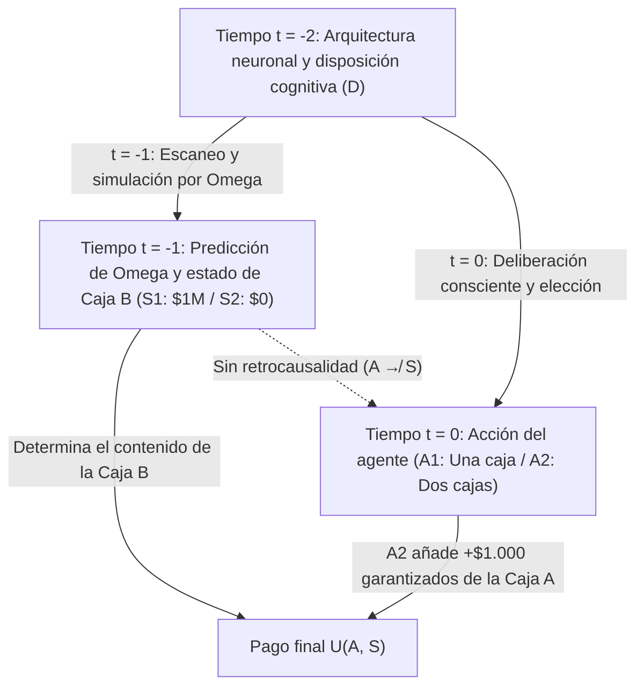
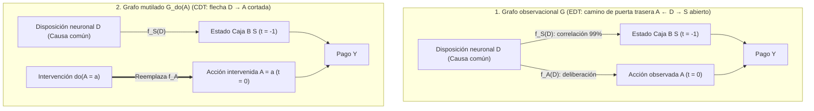

## 1. El experimento mental que fracturó la racionalidad: la paradoja de Newcomb (1960–1969)

En 1960, el físico teórico <strong>William A. Newcomb</strong>, en el Laboratorio Nacional Lawrence Livermore de la Universidad de California, concibió un problema de elección engañosamente simple que sacudiría los cimientos de la teoría de la decisión racional. Presentado al mundo académico por el filósofo de Harvard <strong>Robert Nozick</strong> en su célebre artículo de 1969, <strong>*«Newcomb's Problem and Two Principles of Choice»*</strong> (publicado en *Essays in Honor of Carl G. Hempel*), y popularizado por Martin Gardner en *Scientific American* (1973, 1974), el problema dividió a economistas, matemáticos, físicos y filósofos en dos bandos irreconciliables.

Nozick inmortalizó esta fractura en su párrafo inicial:

> *«Para casi todo el mundo, está perfectamente claro y es obvio lo que se debe hacer. La dificultad es que estas personas parecen dividirse casi en partes iguales respecto al problema, y grandes fracciones piensan que la otra mitad simplemente está siendo tonta.»*
> — <strong>Robert Nozick (1969)</strong>, *"Newcomb's Problem and Two Principles of Choice"*

---

### 1.1 El planteamiento canónico: dos cajas y el Predictor Omega ($\Omega$)

Frente a ti, sobre una mesa, hay dos cajas: la <strong>Caja Transparente A</strong> y la <strong>Caja Opaca B</strong>.

1. <strong>Caja Transparente A</strong>: De cristal transparente; contiene visiblemente <strong>$\$1.000$</strong> en efectivo.
2. <strong>Caja Opaca B</strong>: De acero sellado; sabes con certeza que contiene o bien <strong>$\$1.000.000$</strong> (un millón de dólares) o bien <strong>$\$0$</strong> (nada).

En el instante actual $t = 0$, debes elegir entre dos acciones posibles:

- <strong>Tomar una sola caja (One-Boxing, $A_1$)</strong>: Renunciar a la Caja A y <strong>tomar únicamente la Caja Opaca B</strong>.
- <strong>Tomar ambas cajas (Two-Boxing, $A_2$)</strong>: <strong>Tomar tanto la Caja A como la Caja B</strong>.

El protagonista detrás del escenario es un <strong>Predictor sobrehumano, Omega ($\Omega$)</strong>, cuyos escáneres cerebrales y modelos neurocomputacionales han predicho decisiones humanas con una precisión verificada del <strong>$99\%$ ($p = 0,99$)</strong> a lo largo de miles de ensayos previos. <strong>Ayer (en $t = -1$)</strong>, $\Omega$ predijo tu elección de hoy y preparó la Caja B siguiendo estrictamente esta regla:

- <strong>Estado del mundo $S_1$ ($\text{Pred}_1$: $\Omega$ predijo que tomarías solo la Caja B, $A_1$)</strong>:
  $\Omega$ depositó ayer <strong>$\$1.000.000$</strong> dentro de la Caja B.
- <strong>Estado del mundo $S_2$ ($\text{Pred}_2$: $\Omega$ predijo que tomarías ambas cajas, $A_2$)</strong>:
  $\Omega$ dejó ayer la Caja B <strong>completamente vacía ($\$0$)</strong>.

Se garantiza estrictamente la <strong>clausura causal del pasado</strong>: $\Omega$ ya se marchó ayer; no existe retrocausalidad ($A \not\to S$). Tu movimiento de mano hoy en $t = 0$ no puede alterar físicamente el contenido de la Caja B.

| Tu elección hoy (en $t = 0$) | Estado $S_1$ ($\text{Pred}_1$): $\Omega$ predijo $A_1$ (Caja B contiene $\$1.000.000$) | Estado $S_2$ ($\text{Pred}_2$): $\Omega$ predijo $A_2$ (Caja B contiene $\$0$) |
| :--- | :---: | :---: |
| <strong>$A_1$: Tomar solo la Caja B (One-Boxing)</strong> | <strong>$\$1.000.000$</strong> | <strong>$\$0$</strong> |
| <strong>$A_2$: Tomar las Cajas A y B (Two-Boxing)</strong> | <strong>$\$1.001.000$</strong> | <strong>$\$1.000$</strong> |

---

## 2. Pilar I: Teoría de la Decisión Evidencial (EDT) y el argumento a favor de una caja

El fundamento formal de quienes eligen una sola caja es la <strong>Teoría de la Decisión Evidencial (Evidential Decision Theory, EDT)</strong>, desarrollada por <strong>Richard C. Jeffrey</strong> en su obra clásica <strong>*The Logic of Decision* (1965; 2.ª ed. 1983)</strong>.

### 2.1 Utilidad esperada condicional y «valor de noticia (News Value)»

En el álgebra booleana unificada de Jeffrey, cada acción $A_i$ se evalúa mediante su <strong>valor de noticia (News Value)</strong>, ponderando cada resultado por la probabilidad condicional bayesiana $\mathbb{P}(S_j \mid A_i)$:

$$\text{EU}_{\text{EDT}}(A_i) = \sum_{j} \mathbb{P}(S_j \mid A_i)\, U(A_i, S_j)$$

Con $\mathbb{P}(S_1 \mid A_1) = 0,99$, $\mathbb{P}(S_2 \mid A_1) = 0,01$ y $\mathbb{P}(S_1 \mid A_2) = 0,01$, $\mathbb{P}(S_2 \mid A_2) = 0,99$, obtenemos:

$$\begin{aligned}
\text{EU}_{\text{EDT}}(A_1) &= 0,99 \times \$1.000.000 + 0,01 \times \$0 = \$990.000 \\
\text{EU}_{\text{EDT}}(A_2) &= 0,01 \times \$1.001.000 + 0,99 \times \$1.000 = \$10.010 + \$990 = \$11.000
\end{aligned}$$

En general, para un premio $M$ en B, una suma $k$ en A y una precisión $p$:

$$\text{EU}_{\text{EDT}}(A_1) > \text{EU}_{\text{EDT}}(A_2) \iff p M > (1-p)(M+k) + pk \iff p > \frac{1}{2} + \frac{k}{2M} = 0,5005$$

Basta con que la precisión de Omega supere el $50,05\%$ para que la EDT ordene tomar una sola caja ($A_1$), dando origen a la célebre burla empírica contra los partidarios de dos cajas: <strong>*«Si eres tan listo, ¿por qué no eres rico?» (If you're so smart, why ain't you rich?)*</strong>

---

## 3. Pilar II: Teoría de la Decisión Causal (CDT), dominancia estricta y el cálculo-$do$ de Pearl

Los fundadores de la <strong>Teoría de la Decisión Causal (Causal Decision Theory, CDT)</strong> —<strong>Allan Gibbard y William Harper (1978)</strong>, <strong>Brian Skyrms (1980)</strong>, <strong>David Lewis (1981)</strong>, <strong>James Joyce (1999)</strong> y <strong>Judea Pearl (2000)</strong>— demostraron que la EDT confunde la <strong>correlación diagnóstica (evidencia estadística)</strong> con la <strong>eficacia causal</strong>.

### 3.1 Principio de dominancia estricta y condicionales contrafácticos

Según el <strong>principio de dominancia estricta</strong> de Leonard Savage (1954), dado que el estado de la Caja B ($S_1$ o $S_2$) ya está fijado en el pasado y es causalmente independiente de tu acción $A$, tomar ambas cajas ($A_2$) rinde estrictamente $+\$1.000$ más en *cualquier* estado del mundo ($1.001.000 > 1.000.000$ y $1.000 > 0$).

Gibbard y Harper (1978) reemplazaron $\mathbb{P}(S_j \mid A_i)$ por la probabilidad del condicional contrafáctico de Stalnaker-Lewis $\mathbb{P}(A_i \Box\!\to S_j)$, mientras que <strong>Judea Pearl (2000)</strong> formalizó la CDT mediante <strong>Modelos Causales Estructurales (SCM)</strong> y el operador de intervención <strong>$do(A_i)$</strong>:

$$\text{EU}_{\text{CDT}}(A_i) = \sum_{j} \mathbb{P}(S_j \mid do(A_i))\, U(A_i, S_j)$$

### 3.2 La horquilla de causa común ($S \leftarrow D \to A$) y la cirugía gráfica

En el grafo acíclico dirigido (DAG), tu disposición neuronal previa $D$ actúa como una <strong>causa común (Common-Cause Fork: $S \leftarrow D \to A$)</strong> tanto de la predicción de Omega ayer $S = f_S(D, U_S)$ como de tu elección hoy $A = f_A(D, U_A)$.

Mientras que el condicionamiento observacional $\mathbb{P}(S \mid A)$ abre el <strong>camino de puerta trasera (back-door path) $A \leftarrow D \to S$</strong>, la <strong>cirugía gráfica ($do(A_i)$)</strong> de Pearl corta la flecha entrante $D \to A$, de modo que:

$$\mathbb{P}(S_j \mid do(A_i)) = \mathbb{P}(S_j) \implies \text{EU}_{\text{CDT}}(A_2) - \text{EU}_{\text{CDT}}(A_1) = +\$1.000 > 0$$

---

## 4. Problemas de Newcomb médicos (la lesión del fumador) y la predestinación calvinista en Max Weber

### 4.1 La «lesión del fumador (The Smoking Lesion, Skyrms 1980)»

Basándose en la hipótesis constitucional de Ronald Fisher, Brian Skyrms (1980) propuso el caso de la <strong>lesión del fumador</strong>: supongamos que fumar tabaco es químicamente inofensivo ($A_{\text{smoke}} \not\to C$), pero una lesión genética congénita $L$ provoca con un $99\%$ de probabilidad tanto el deseo de fumar ($A_{\text{smoke}}$, placer $+1$) como cáncer de pulmón letal ($C$, utilidad $-1.000$).
- En la horquilla $C \leftarrow L \to A$, la <strong>EDT</strong> calcula $\text{EU}_{\text{EDT}}(A_{\text{abstain}}) = -10$ frente a $\text{EU}_{\text{EDT}}(A_{\text{smoke}}) = -989$, ordenándote supersticiosamente abstenerte de fumar ¡para reducir la probabilidad condicional de haber nacido con el gen $L$!
- La <strong>CDT</strong> reconoce mediante $\mathbb{P}(C \mid do(A)) = \mathbb{P}(C)$ que tu ADN es inmutable y recomienda racionalmente disfrutar del cigarrillo ($+1$).

### 4.2 Isomorfismo estructural con la predestinación calvinista de Max Weber (1905)

Como señaló Nozick (1969), la doctrina de la <strong>doble predestinación</strong> de Juan Calvino analizada por <strong>Max Weber</strong> en *La ética protestante y el espíritu del capitalismo* (1904–1905) constituye un problema de Newcomb teológico: Dios decretó antes de la creación quién pertenece a los <strong>Elegidos ($S_1$)</strong> y quién a los <strong>Réprobos ($S_2$)</strong>, sin que ninguna obra humana ($A_1$) pueda alterar causalmente ese decreto ($A \not\to S$). Sin embargo, los puritanos practicaron un riguroso <strong>ascetismo intramundano ($A_1$)</strong> no como *causa de salvación (causa salutis)*, sino como <strong>signo diagnóstico de elección (*cognoscendi ratio*)</strong> dentro de la horquilla $\text{Salvación } S_1 \leftarrow \text{Gracia divina } D \to \text{Obras ascéticas } A_1$, maximizando $\mathbb{P}(S_1 \mid A_1)$ exactamente como agentes de la EDT.

---

## 5. La «Tickle Defense» de Ellery Eells y el Dilema del Prisionero Gemelo de David Lewis

### 5.1 La «defensa del cosquilleo (Tickle Defense, 1982)» y la ratificabilidad

Para rescatar a la EDT de la lesión del fumador, <strong>Ellery Eells (1982)</strong> argumentó que la lesión $L$ solo causa el acto $A$ a través de un deseo consciente o «cosquilleo» $T = (\mathcal{B}, \mathcal{D})$ ($C \leftarrow L \to T \to A$). Si el agente conoce $T$ por introspección antes de actuar, condicionar sobre $T$ <strong>apantalla (Screening-Off)</strong> la correlación entre $A$ y $L$: $\mathbb{P}(C \mid A, T) = \mathbb{P}(C \mid T)$, haciendo coincidir a la EDT con la CDT. No obstante, en el problema de Newcomb, $\Omega$ predice la decisión final misma, y el criterio de <strong>ratificabilidad (Ratifiability, Jeffrey 1983)</strong> demuestra que decidir tomar una caja ($\text{Decide}(A_1)$) no es ratificable, pues dado $\text{Decide}(A_1)$, cambiar a $A_2$ reporta $+\$1.000$ adicionales.

### 5.2 El teorema de isomorfismo de David Lewis: *«Prisoners' Dilemma Is a Newcomb Problem»* (1979)

En 1979, <strong>David Lewis</strong> demostró que el Dilema del Prisionero de una sola jugada contra un gemelo psicológico (o un clon que ejecuta el mismo código fuente) es $100\%$ isomorfo a la paradoja de Newcomb:
- <strong>Cooperar ($C_{\text{PD}}$: renunciar a $\$1.000$ propios para otorgar $\$1.000.000$ a tu gemelo)</strong> $\Longleftrightarrow$ <strong>One-Boxing ($A_1$)</strong>.
- <strong>Traicionar ($D_{\text{PD}}$: embolsarse los $+\$1.000$ propios)</strong> $\Longleftrightarrow$ <strong>Two-Boxing ($A_2$)</strong>.
Como Omega te predice ejecutando ayer una simulación (un gemelo) de tu mente, ambos problemas son idénticos. Lewis concluyó que la racionalidad exige traicionar y tomar dos cajas, mientras que <strong>Douglas Hofstadter (1983)</strong> formuló la <strong>superracionalidad (Superrationality)</strong> para respaldar la cooperación mutua $(C_{\text{PD}}, C_{\text{PD}})$ y el One-Boxing ($A_1$).

---

## 6. Frontera en alineación de IA: Teoría de la Decisión Funcional (FDT)

Para agentes de software (IA) cuyo código fuente puede ser leído o simulado al $100\%$ en un entorno *sandbox*, el predictor $\Omega$ es una realidad cotidiana. En 2017, <strong>Eliezer Yudkowsky y Nate Soares</strong> (integrando la <strong>TDT</strong> y la <strong>UDT</strong> de Wei Dai) formularon la <strong>Teoría de la Decisión Funcional (Functional Decision Theory, FDT)</strong>.

### 6.1 Contrafácticos lógicos: intervención sobre la función matemática $\mathsf{F}$

La CDT modela la elección como un evento físico local $A$ en $(x_0, t_0)$ y evalúa $do(A = A_2)$ imaginando el mundo lógicamente imposible donde el mismo algoritmo determinista $\mathsf{F}(\mathcal{I})$ arroja $A_1$ ayer en el simulador de Omega y $A_2$ hoy. La FDT interviene directamente sobre la <strong>salida de la función matemática de decisión $\mathsf{F}(\mathcal{I})$</strong>:

$$\text{EU}_{\text{FDT}}(a) = \sum_{j} \mathbb{P}\!\left(S_j \;\middle|\; do(\mathsf{F}(\mathcal{I}) = a)\right) U(a, S_j)$$

1. <strong>Paradoja de Newcomb</strong>: Como la predicción de Omega $S = f_S(\mathsf{F}(\mathcal{I}), U_S)$ depende funcionalmente de $\mathsf{F}(\mathcal{I})$, la intervención $do(\mathsf{F}(\mathcal{I}) = A_1)$ fija tanto la simulación como la acción actual en $A_1$ $\implies$ <strong>¡la FDT toma una sola caja ($A_1$) y gana $\$1.000.000$!</strong>
2. <strong>Lesión del fumador</strong>: Como el gen congénito $L$ no es una simulación de $\mathsf{F}(\mathcal{I})$ ($C \leftarrow L \to \mathcal{I} \to \mathsf{F}(\mathcal{I}) \to A$), $do(\mathsf{F}(\mathcal{I}) = a)$ no altera la probabilidad de cáncer $\implies$ <strong>¡la FDT fuma ($A_{\text{smoke}}$) sin caer en supersticiones!</strong>
3. <strong>Newcomb transparente (autoestopista de Parfit) y equilibrio de programas (teorema de Löb)</strong>: Incluso si la Caja B es transparente y ves el millón de dólares dentro, la FDT/UDT optimiza la política global $\mathsf{F}$ *ex ante* y toma solo la Caja B; en el dilema del prisionero con acceso al código fuente, `FairBot` emplea el <strong>teorema de Löb ($\square(\square P \to P) \to \square P$)</strong> para lograr cooperación mutua formalmente demostrable.

### 6.2 Tabla comparativa: EDT vs. CDT vs. FDT/UDT

| Dimensión / Dilema | Teoría Evidencial (EDT — Jeffrey 1965) | Teoría Causal (CDT — Lewis, Pearl) | Teoría Funcional (FDT / UDT — Yudkowsky & Soares 2017) |
| :--- | :--- | :--- | :--- |
| <strong>Fórmula de utilidad esperada</strong> | $\sum_j \mathbb{P}(S_j \mid A_i)\, U(A_i, S_j)$ | $\sum_j \mathbb{P}(S_j \mid do(A_i))\, U(A_i, S_j)$ | $\sum_j \mathbb{P}(S_j \mid do(\mathsf{F}(\mathcal{I}) = a))\, U(a, S_j)$ |
| <strong>1. Paradoja de Newcomb estándar</strong> | <strong>Una caja ($A_1$)</strong> ($\$1.000.000$) | <strong>Dos cajas ($A_2$)</strong> ($\$1.000$) | <strong>Una caja ($A_1$)</strong> ($\$1.000.000$) |
| <strong>2. Lesión del fumador (médico)</strong> | <strong>Abstenerse ($A_{\text{abstain}}$)</strong> (Superstición) | <strong>Fumar ($A_{\text{smoke}}$)</strong> (Correcto, $+1$) | <strong>Fumar ($A_{\text{smoke}}$)</strong> (Correcto, $+1$) |
| <strong>3. Dilema del prisionero gemelo</strong> | <strong>Cooperar ($C_{\text{PD}}$)</strong> ($\$1.000.000$) | <strong>Traicionar ($D_{\text{PD}}$)</strong> ($\$1.000$) | <strong>Cooperar ($C_{\text{PD}}$)</strong> ($\$1.000.000$) |
| <strong>4. Newcomb transparente</strong> | <strong>Dos cajas</strong> (Observación apantalla $\implies \$0$) | <strong>Dos cajas</strong> (Dominancia $\implies \$0$) | <strong>Una caja</strong> (Optimización de política $\implies \$1.000.000$) |

---

## Referencias

- <strong>Nozick, R. (1969)</strong>. "Newcomb's Problem and Two Principles of Choice." En *Essays in Honor of Carl G. Hempel* (pp. 114–146).
- <strong>Jeffrey, R. C. (1965 / 1983)</strong>. *The Logic of Decision*. University of Chicago Press.
- <strong>Lewis, D. (1979)</strong>. "Prisoners' Dilemma Is a Newcomb Problem." *Philosophy & Public Affairs*, 8(3), 235–240.
- <strong>Pearl, J. (2000 / 2009)</strong>. *Causality: Models, Reasoning, and Inference*. Cambridge University Press.
- <strong>Yudkowsky, E., & Soares, N. (2017)</strong>. "Functional Decision Theory: A New Theory of Instrumental Rationality." *arXiv:1710.05060*.
