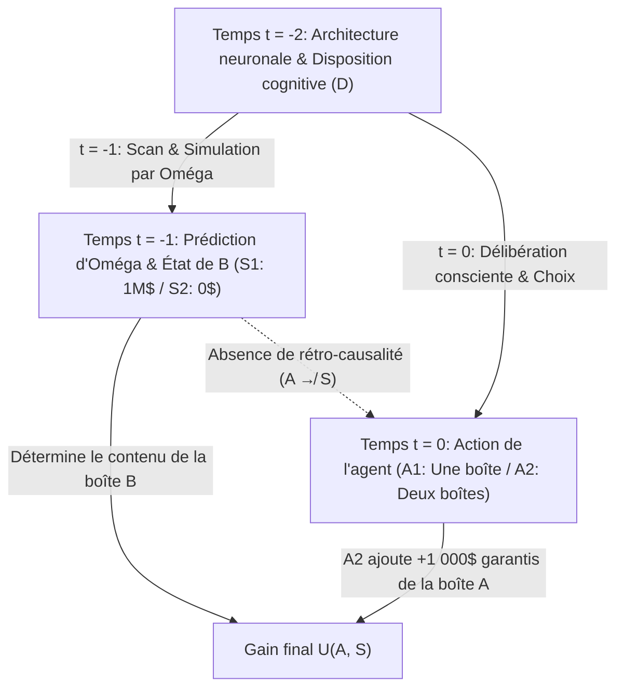
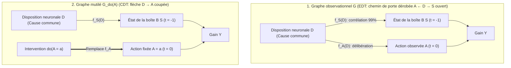

## 1. L'expérience de pensée qui a fracturé la rationalité : le paradoxe de Newcomb (1960–1969)

En 1960, le physicien théoricien <strong>William A. Newcomb</strong>, du Lawrence Livermore National Laboratory de l'Université de Californie, imagina un problème de décision d'une simplicité trompeuse qui allait ébranler les fondements mêmes de la théorie du choix rationnel. Introduit dans le monde académique par le philosophe de Harvard <strong>Robert Nozick</strong> dans son article fondateur de 1969, <strong>*« Newcomb's Problem and Two Principles of Choice »*</strong> (publié dans les *Essays in Honor of Carl G. Hempel*), puis popularisé par Martin Gardner dans *Scientific American* en 1973 et 1974, ce paradoxe a divisé économistes, mathématiciens, physiciens et philosophes en deux camps irréconciliables.

Nozick résuma cette fracture intellectuelle par une formule restée célèbre :

> *« Pour presque tout le monde, ce qu'il faut faire est parfaitement clair et évident. La difficulté est que les gens semblent se diviser presque à parts égales sur le problème, une grande fraction de chaque camp pensant que l'autre moitié est tout simplement stupide. »*
> — <strong>Robert Nozick (1969)</strong>, *"Newcomb's Problem and Two Principles of Choice"*

---

### 1.1 Le dispositif canonique : deux boîtes et le Prédicteur Oméga ($\Omega$)

Vous vous tenez devant une table sur laquelle reposent deux boîtes : la <strong>boîte transparente A</strong> et la <strong>boîte opaque B</strong>.

1. <strong>Boîte transparente A</strong> : En verre clair, elle contient visiblement et avec certitude <strong>$\$1\,000$</strong> en espèces.
2. <strong>Boîte opaque B</strong> : En acier scellé, son contenu est invisible. Vous savez qu'elle contient soit <strong>$\$1\,000\,000$</strong> (un million de dollars), soit <strong>$\$0$</strong> (rien du tout).

À l'instant présent $t = 0$, vous devez choisir entre deux actions :

- <strong>Prendre une seule boîte (One-Boxing, $A_1$)</strong> : Renoncer à la boîte A et <strong>prendre uniquement la boîte opaque B</strong>.
- <strong>Prendre les deux boîtes (Two-Boxing, $A_2$)</strong> : <strong>Prendre à la fois la boîte A et la boîte B</strong>.

Le personnage central est un <strong>Prédicteur surhumain, Oméga ($\Omega$)</strong>, dont les scanners cérébraux et les modèles de simulation neuro-computationnels ont prédit les choix humains avec une précision empiriquement vérifiée de <strong>$99\%$ ($p = 0,99$)</strong> sur des milliers d'essais antérieurs. <strong>Hier (à $t = -1$)</strong>, $\Omega$ a prédit votre choix d'aujourd'hui et a préparé la boîte B selon la règle suivante :

- <strong>État du monde $S_1$ ($\text{Pred}_1$ : $\Omega$ a prédit que vous ne prendriez que la boîte B, $A_1$)</strong> :
  $\Omega$ a placé hier <strong>$\$1\,000\,000$</strong> dans la boîte B.
- <strong>État du monde $S_2$ ($\text{Pred}_2$ : $\Omega$ a prédit que vous prendriez les deux boîtes, $A_2$)</strong> :
  $\Omega$ a laissé hier la boîte B <strong>vide ($\$0$)</strong>.

La <strong>clôture causale du passé</strong> est strictement garantie : $\Omega$ est déjà reparti hier ; il n'existe aucune rétro-causalité ($A \not\to S$). Votre geste aujourd'hui à $t = 0$ ne peut modifier physiquement le contenu de la boîte B.

| Votre choix aujourd'hui (à $t = 0$) | État $S_1$ ($\text{Pred}_1$) : $\Omega$ a prédit $A_1$ (Boîte B = $\$1\,000\,000$) | État $S_2$ ($\text{Pred}_2$) : $\Omega$ a prédit $A_2$ (Boîte B = $\$0$) |
| :--- | :---: | :---: |
| <strong>$A_1$ : Prendre uniquement la boîte B (One-Boxing)</strong> | <strong>$\$1\,000\,000$</strong> | <strong>$\$0$</strong> |
| <strong>$A_2$ : Prendre les boîtes A et B (Two-Boxing)</strong> | <strong>$\$1\,001\,000$</strong> | <strong>$\$1\,000$</strong> |

---

## 2. Pilier I : La théorie de la décision évidentielle (EDT) et l'argument du One-Boxing

Le fondement formel des partisans d'une seule boîte est la <strong>théorie de la décision évidentielle (Evidential Decision Theory, EDT)</strong>, formulée par <strong>Richard C. Jeffrey</strong> dans <strong>*The Logic of Decision* (1965 ; 2e éd. 1983)</strong>.

### 2.1 Utilité espérée conditionnelle et « valeur de nouvelle (News Value) »

Dans l'algèbre booléenne unifiée de Jeffrey, la désirabilité d'une action $A_i$ est mesurée par sa <strong>valeur de nouvelle (News Value)</strong>, pondérée par la probabilité conditionnelle bayésienne $\mathbb{P}(S_j \mid A_i)$ :

$$\text{EU}_{\text{EDT}}(A_i) = \sum_{j} \mathbb{P}(S_j \mid A_i)\, U(A_i, S_j)$$

Avec $\mathbb{P}(S_1 \mid A_1) = 0,99$, $\mathbb{P}(S_2 \mid A_1) = 0,01$ et $\mathbb{P}(S_1 \mid A_2) = 0,01$, $\mathbb{P}(S_2 \mid A_2) = 0,99$, on obtient :

$$\begin{aligned}
\text{EU}_{\text{EDT}}(A_1) &= 0,99 \times \$1\,000\,000 + 0,01 \times \$0 = \$990\,000 \\
\text{EU}_{\text{EDT}}(A_2) &= 0,01 \times \$1\,001\,000 + 0,99 \times \$1\,000 = \$10\,010 + \$990 = \$11\,000
\end{aligned}$$

De façon générale, pour une récompense $M$ dans B, une somme $k$ dans A et une fiabilité $p$ :

$$\text{EU}_{\text{EDT}}(A_1) > \text{EU}_{\text{EDT}}(A_2) \iff p M > (1-p)(M+k) + pk \iff p > \frac{1}{2} + \frac{k}{2M} = 0,5005$$

Dès que la fiabilité d'Oméga dépasse $50,05\%$, l'EDT prescrit de ne prendre qu'une seule boîte ($A_1$), d'où la célèbre réplique adressée aux partisans des deux boîtes : <strong>*« Si vous êtes si intelligents, pourquoi n'êtes-vous pas riches ? » (If you're so smart, why ain't you rich?)*</strong>

---

## 3. Pilier II : La théorie de la décision causale (CDT), la dominance stricte et le $do$-calcul de Pearl

Les fondateurs de la <strong>théorie de la décision causale (Causal Decision Theory, CDT)</strong> — <strong>Allan Gibbard et William Harper (1978)</strong>, <strong>Brian Skyrms (1980)</strong>, <strong>David Lewis (1981)</strong>, <strong>James Joyce (1999)</strong> et <strong>Judea Pearl (2000)</strong> — démontrent que l'EDT confond <strong>corrélation diagnostique (valeur d'indice)</strong> et <strong>efficacité causale</strong>.

### 3.1 Principe de dominance stricte et conditionnels contrefactuels

Selon le <strong>principe de dominance stricte</strong> de Leonard Savage (1954), puisque l'état de la boîte B ($S_1$ ou $S_2$) est déjà fixé dans le passé et causalement indépendant de $A$, prendre les deux boîtes ($A_2$) rapporte strictement $+\$1\,000$ de plus dans *chaque* état du monde ($1\,001\,000 > 1\,000\,000$ et $1\,000 > 0$).

Gibbard et Harper (1978) ont remplacé $\mathbb{P}(S_j \mid A_i)$ par la probabilité du contrefactuel de Stalnaker-Lewis $\mathbb{P}(A_i \Box\!\to S_j)$, tandis que <strong>Judea Pearl (2000)</strong> a formalisé la CDT au moyen des <strong>modèles causaux structurels (SCM)</strong> et de l'opérateur d'intervention <strong>$do(A_i)$</strong> :

$$\text{EU}_{\text{CDT}}(A_i) = \sum_{j} \mathbb{P}(S_j \mid do(A_i))\, U(A_i, S_j)$$

### 3.2 La fourche à cause commune ($S \leftarrow D \to A$) et la chirurgie de graphe

Dans le graphe acyclique dirigé (DAG), votre disposition neuronale antérieure $D$ est une <strong>cause commune (Common-Cause Fork : $S \leftarrow D \to A$)</strong> de la prédiction d'Oméga hier $S = f_S(D, U_S)$ et de votre choix aujourd'hui $A = f_A(D, U_A)$.

Alors que le conditionnement observationnel $\mathbb{P}(S \mid A)$ ouvre le <strong>chemin de porte dérobée (back-door path) $A \leftarrow D \to S$</strong>, la <strong>chirurgie de graphe ($do(A_i)$)</strong> de Pearl coupe la flèche $D \to A$, ce qui entraîne :

$$\mathbb{P}(S_j \mid do(A_i)) = \mathbb{P}(S_j) \implies \text{EU}_{\text{CDT}}(A_2) - \text{EU}_{\text{CDT}}(A_1) = +\$1\,000 > 0$$

---

## 4. Problèmes de Newcomb médicaux (la lésion du fumeur) et prédestination calviniste chez Max Weber

### 4.1 La « lésion du fumeur (The Smoking Lesion, Skyrms 1980) »

Inspiré par l'hypothèse constitutionnelle de Ronald Fisher, Brian Skyrms (1980) imagine qu'une lésion génétique congénitale $L$ provoque avec une probabilité de $99\%$ à la fois l'envie de fumer ($A_{\text{smoke}}$, plaisir $+1$) et un cancer du poumon mortel ($C$, utilité $-1\,000$), alors que le tabac lui-même est totalement inoffensif ($A_{\text{smoke}} \not\to C$).
- Dans cette fourche $C \leftarrow L \to A$, l'<strong>EDT</strong> calcule $\text{EU}_{\text{EDT}}(A_{\text{abstain}}) = -10$ contre $\text{EU}_{\text{EDT}}(A_{\text{smoke}}) = -989$ et vous ordonne superstitieusement de ne pas fumer afin de réduire la probabilité conditionnelle d'être né avec le gène $L$ !
- La <strong>CDT</strong> reconnaît via $\mathbb{P}(C \mid do(A)) = \mathbb{P}(C)$ que votre ADN est immuable et recommande rationnellement de fumer ($+1$).

### 4.2 Isomorphisme avec la prédestination calviniste analysée par Max Weber (1905)

Comme l'a souligné Nozick (1969), la doctrine de la <strong>double prédestination</strong> de Jean Calvin, analysée par <strong>Max Weber</strong> dans *L'Éthique protestante et l'esprit du capitalisme* (1904–1905), possède exactement la structure du paradoxe de Newcomb : Dieu a décrété de toute éternité qui fait partie des <strong>Élus ($S_1$)</strong> et des <strong>Réprouvés ($S_2$)</strong>, sans qu'aucune œuvre humaine ($A_1$) puisse modifier ce décret ($A \not\to S$). Pourtant, les puritains ont pratiqué un <strong>ascétisme intramondain ($A_1$)</strong> acharné non comme *cause du salut (causa salutis)*, mais comme <strong>signe diagnostique d'élection (*cognoscendi ratio*)</strong> au sein de la fourche $\text{Salut } S_1 \leftarrow \text{Grâce divine } D \to \text{Œuvres ascétiques } A_1$, maximisant ainsi $\mathbb{P}(S_1 \mid A_1)$ selon la logique exacte de l'EDT !

---

## 5. La « Tickle Defense » d'Ellery Eells et le dilemme du prisonnier jumeau de David Lewis

### 5.1 La « défense du chatouillement (Tickle Defense, 1982) » et la ratifiabilité

Pour sauver l'EDT de la lésion du fumeur, <strong>Ellery Eells (1982)</strong> soutint que la disposition $L$ ne cause l'acte $A$ qu'à travers une envie ou attitude propositionnelle consciente $T = (\mathcal{B}, \mathcal{D})$ ($C \leftarrow L \to T \to A$). Si l'agent connaît $T$ par introspection avant d'agir, le conditionnement sur $T$ <strong>fait écran (Screening-Off)</strong> entre $A$ et $L$ : $\mathbb{P}(C \mid A, T) = \mathbb{P}(C \mid T)$, réconciliant EDT et CDT. Toutefois, dans le problème de Newcomb, $\Omega$ prédit la résolution finale elle-même, et le critère de <strong>ratifiabilité (Ratifiability, Jeffrey 1983)</strong> montre que la décision $\text{Decide}(A_1)$ est non ratifiable, car une fois $\text{Decide}(A_1)$ fixé, basculer vers $A_2$ rapporte $+\$1\,000$ de plus.

### 5.2 Le théorème d'isomorphisme de David Lewis : *« Prisoners' Dilemma Is a Newcomb Problem »* (1979)

En 1979, <strong>David Lewis</strong> démontra que le dilemme du prisonnier à un coup joué contre un jumeau psychologique (ou un clone exécutant le même code source) est $100\%$ isomorphe au paradoxe de Newcomb :
- <strong>Coopérer ($C_{\text{PD}}$ : renoncer à $\$1\,000$ pour offrir $\$1\,000\,000$ à son jumeau)</strong> $\Longleftrightarrow$ <strong>One-Boxing ($A_1$)</strong>.
- <strong>Trahir ($D_{\text{PD}}$ : empocher ses $+\$1\,000$)</strong> $\Longleftrightarrow$ <strong>Two-Boxing ($A_2$)</strong>.
Puisqu'Oméga prédit votre choix en exécutant hier une simulation (un jumeau) de votre esprit, les deux jeux sont identiques. Lewis en conclut qu'il faut trahir / prendre les deux boîtes, tandis que <strong>Douglas Hofstadter (1983)</strong> introduisit la <strong>superrationalité (Superrationality)</strong> pour justifier la coopération mutuelle $(C_{\text{PD}}, C_{\text{PD}})$ et le One-Boxing ($A_1$).

---

## 6. Frontière de l'alignement de l'IA : la théorie de la décision fonctionnelle (FDT)

Pour des agents logiciels (IA) dont le code source peut être lu ou simulé à $100\%$ dans un bac à sable (sandbox), le prédicteur $\Omega$ est une réalité informatique quotidienne. En 2017, <strong>Eliezer Yudkowsky et Nate Soares</strong> (synthétisant la <strong>TDT</strong> et l'<strong>UDT</strong> de Wei Dai) ont formulé la <strong>théorie de la décision fonctionnelle (Functional Decision Theory, FDT)</strong>.

### 6.1 Contrefactuels logiques : intervenir sur la fonction mathématique $\mathsf{F}$

La CDT traite l'action comme un événement physique local $A$ en $(x_0, t_0)$ et imagine le monde logiquement impossible où le même algorithme déterministe $\mathsf{F}(\mathcal{I})$ renvoie $A_1$ hier dans le simulateur d'Oméga et $A_2$ aujourd'hui. La FDT intervient directement sur la <strong>sortie de la fonction mathématique de décision $\mathsf{F}(\mathcal{I})$</strong> :

$$\text{EU}_{\text{FDT}}(a) = \sum_{j} \mathbb{P}\!\left(S_j \;\middle|\; do(\mathsf{F}(\mathcal{I}) = a)\right) U(a, S_j)$$

1. <strong>Paradoxe de Newcomb</strong> : La prédiction d'Oméga $S = f_S(\mathsf{F}(\mathcal{I}), U_S)$ dépend fonctionnellement de $\mathsf{F}(\mathcal{I})$ ; l'intervention $do(\mathsf{F}(\mathcal{I}) = A_1)$ fixe simultanément la simulation et l'action présente sur $A_1$ $\implies$ <strong>la FDT prend une seule boîte ($A_1$) et gagne $\$1\,000\,000$ !</strong>
2. <strong>Lésion du fumeur</strong> : Le gène $L$ n'étant pas une simulation de $\mathsf{F}(\mathcal{I})$ ($C \leftarrow L \to \mathcal{I} \to \mathsf{F}(\mathcal{I}) \to A$), $do(\mathsf{F}(\mathcal{I}) = a)$ ne modifie pas la probabilité de cancer $\implies$ <strong>la FDT choisit de fumer ($A_{\text{smoke}}$) sans superstition !</strong>
3. <strong>Newcomb transparent (auto-stoppeur de Parfit) & équilibre de programme (théorème de Löb)</strong> : Même lorsque la boîte B est transparente et que le million de dollars est visible, la FDT/UDT optimise la politique globale $\mathsf{F}$ sans mise à jour myope et ne prend que la boîte B ; dans le dilemme du prisonnier à code source ouvert, `FairBot` utilise le <strong>théorème de Löb ($\square(\square P \to P) \to \square P$)</strong> pour accomplir une coopération mutuelle formellement prouvable.

### 6.2 Tableau comparatif : EDT vs CDT vs FDT/UDT

| Dimension / Dilemme | Théorie Évidentielle (EDT — Jeffrey 1965) | Théorie Causale (CDT — Lewis, Pearl) | Théorie Fonctionnelle (FDT / UDT — Yudkowsky & Soares 2017) |
| :--- | :--- | :--- | :--- |
| <strong>Formule d'utilité espérée</strong> | $\sum_j \mathbb{P}(S_j \mid A_i)\, U(A_i, S_j)$ | $\sum_j \mathbb{P}(S_j \mid do(A_i))\, U(A_i, S_j)$ | $\sum_j \mathbb{P}(S_j \mid do(\mathsf{F}(\mathcal{I}) = a))\, U(a, S_j)$ |
| <strong>1. Paradoxe de Newcomb standard</strong> | <strong>Une boîte ($A_1$)</strong> ($\$1\,000\,000$) | <strong>Deux boîtes ($A_2$)</strong> ($\$1\,000$) | <strong>Une boîte ($A_1$)</strong> ($\$1\,000\,000$) |
| <strong>2. Lésion du fumeur (médical)</strong> | <strong>S'abstenir ($A_{\text{abstain}}$)</strong> (Superstition) | <strong>Fumer ($A_{\text{smoke}}$)</strong> (Correct, $+1$) | <strong>Fumer ($A_{\text{smoke}}$)</strong> (Correct, $+1$) |
| <strong>3. Dilemme du prisonnier jumeau</strong> | <strong>Coopérer ($C_{\text{PD}}$)</strong> ($\$1\,000\,000$) | <strong>Trahir ($D_{\text{PD}}$)</strong> ($\$1\,000$) | <strong>Coopérer ($C_{\text{PD}}$)</strong> ($\$1\,000\,000$) |
| <strong>4. Newcomb transparent</strong> | <strong>Deux boîtes</strong> (Écran visuel $\implies \$0$) | <strong>Deux boîtes</strong> (Dominance $\implies \$0$) | <strong>Une boîte</strong> (Politique globale $\implies \$1\,000\,000$) |

---

## Références

- <strong>Nozick, R. (1969)</strong>. "Newcomb's Problem and Two Principles of Choice." In *Essays in Honor of Carl G. Hempel* (pp. 114–146).
- <strong>Jeffrey, R. C. (1965 / 1983)</strong>. *The Logic of Decision*. University of Chicago Press.
- <strong>Lewis, D. (1979)</strong>. "Prisoners' Dilemma Is a Newcomb Problem." *Philosophy & Public Affairs*, 8(3), 235–240.
- <strong>Pearl, J. (2000 / 2009)</strong>. *Causality: Models, Reasoning, and Inference*. Cambridge University Press.
- <strong>Yudkowsky, E., & Soares, N. (2017)</strong>. "Functional Decision Theory: A New Theory of Instrumental Rationality." *arXiv:1710.05060*.
