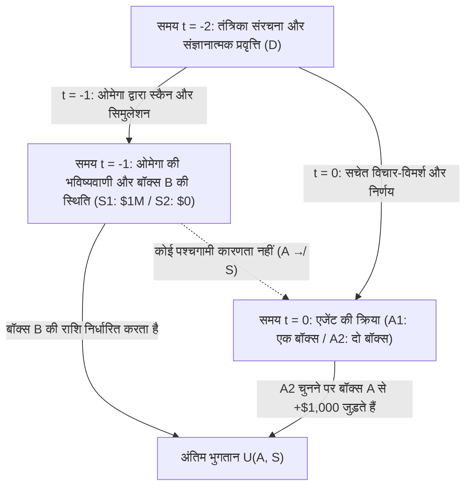
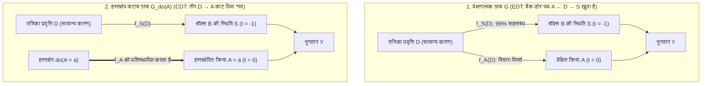

## 1. वह विचार प्रयोग जिसने तर्कसंगतता को दो भागों में बाँट दिया: न्यूकॉम्ब का विरोधाभास (1960–1969)

1960 में, कैलिफोर्निया विश्वविद्यालय की लॉरेंस लिवरमोर नेशनल लेबोरेटरी के सैद्धांतिक भौतिक विज्ञानी <strong>विलियम ए. न्यूकॉम्ब (William A. Newcomb)</strong> ने खेल सिद्धांत (Game Theory) और कैदी की दुविधा (Prisoner's Dilemma) पर विचार करते हुए एक ऐसी पहेली की कल्पना की जिसने आधुनिक तर्कसंगत विकल्प सिद्धांत (Rational Choice Theory) की नींव हिला दी। हार्वर्ड के दार्शनिक <strong>रॉबर्ट नोज़िक (Robert Nozick)</strong> ने 1969 के अपने ऐतिहासिक शोधपत्र <strong>*«Newcomb's Problem and Two Principles of Choice»*</strong> में इसे अकादमिक जगत के सामने प्रस्तुत किया और मार्टिन गार्डनर ने 1973–1974 में *Scientific American* के अपने स्तंभों में इसे विश्वभर में प्रसिद्ध कर दिया।

नोज़िक ने इस वैचारिक विभाजन को इन प्रसिद्ध शब्दों में व्यक्त किया:

> *«लगभग हर किसी के लिए यह पूरी तरह से स्पष्ट और स्वयंसिद्ध है कि क्या किया जाना चाहिए। कठिनाई यह है कि लोग इस समस्या पर लगभग बराबर दो हिस्सों में बँट जाते हैं, और प्रत्येक पक्ष का एक बड़ा हिस्सा यह मानता है कि दूसरा आधा हिस्सा बस मूर्खता कर रहा है।»*
> — <strong>Robert Nozick (1969)</strong>, *"Newcomb's Problem and Two Principles of Choice"*

---

### 1.1 मानक प्रयोग संरचना: दो बॉक्स और अतिमानवीय भविष्यवक्ता ओमेगा ($\Omega$)

आपके सामने मेज पर दो बॉक्स रखे हैं: <strong>पारदर्शी बॉक्स A (Transparent Box A)</strong> और <strong>अपारदर्शी बॉक्स B (Opaque Box B)</strong>।

1. <strong>पारदर्शी बॉक्स A</strong>: साफ कांच से बना है और इसमें स्पष्ट रूप से <strong>$\$1,000$</strong> नकद दिखाई दे रहे हैं।
2. <strong>अपारदर्शी बॉक्स B</strong>: बंद स्टील से बना है; आप निश्चित रूप से जानते हैं कि इसमें या तो <strong>$\$1,000,000$</strong> (दस लाख डॉलर) हैं या <strong>$\$0$</strong> (कुछ भी नहीं)।

वर्तमान समय $t = 0$ पर, आपको दो कार्यों में से एक को चुनना है:

- <strong>एक-बॉक्स चयन (One-Boxing, $A_1$)</strong>: पारदर्शी बॉक्स A को छोड़ दें और <strong>केवल अपारदर्शी बॉक्स B</strong> लें।
- <strong>दो-बॉक्स चयन (Two-Boxing, $A_2$)</strong>: <strong>पारदर्शी बॉक्स A और अपारदर्शी बॉक्स B दोनों</strong> को ले लें।

इस खेल का केंद्रीय पात्र एक अतिमानवीय <strong>भविष्यवक्ता ओमेगा (Predictor Omega, $\Omega$)</strong> है, जिसके उच्च-रिज़ॉल्यूशन मस्तिष्क स्कैन और न्यूरो-कम्प्यूटेशनल सिमुलेशन ने हजारों पिछले परीक्षणों में मानवीय विकल्पों की <strong>$99\%$ सटीकता ($p = 0.99$)</strong> के साथ भविष्यवाणी की है। <strong>कल (समय $t = -1$ पर)</strong>, $\Omega$ ने आपके आज के चुनाव की भविष्यवाणी की और निम्नलिखित कठोर नियम के अनुसार बॉक्स B को तैयार किया:

- <strong>विश्व अवस्था $S_1$ ($\text{Pred}_1$: $\Omega$ ने भविष्यवाणी की कि आप केवल बॉक्स B लेंगे, $A_1$)</strong>:
  $\Omega$ ने कल अपारदर्शी बॉक्स B में <strong>$\$1,000,000$</strong> रख दिए।
- <strong>विश्व अवस्था $S_2$ ($\text{Pred}_2$: $\Omega$ ने भविष्यवाणी की कि आप दोनों बॉक्स लेंगे, $A_2$)</strong>:
  $\Omega$ ने कल अपारदर्शी बॉक्स B को <strong>खाली ($\$0$)</strong> छोड़ दिया।

यहाँ <strong>अतीत की कारणात्मक पूर्णता (Causal Closure of the Past)</strong> पूरी तरह सुनिश्चित है: $\Omega$ कल ही जा चुका है; कोई पश्चगामी कारणता (Retrocausality, $A \not\to S$) मौजूद नहीं है। आज $t = 0$ पर आपका हाथ बढ़ाना बॉक्स B की भौतिक सामग्री को नहीं बदल सकता।

| आज आपका चुनाव ($t = 0$ पर) | अवस्था $S_1$ ($\text{Pred}_1$): $\Omega$ ने $A_1$ की भविष्यवाणी की (बॉक्स B में $\$1,000,000$) | अवस्था $S_2$ ($\text{Pred}_2$): $\Omega$ ने $A_2$ की भविष्यवाणी की (बॉक्स B में $\$0$) |
| :--- | :---: | :---: |
| <strong>$A_1$: केवल बॉक्स B लें (One-Boxing)</strong> | <strong>$\$1,000,000$</strong> | <strong>$\$0$</strong> |
| <strong>$A_2$: बॉक्स A और B दोनों लें (Two-Boxing)</strong> | <strong>$\$1,001,000$</strong> | <strong>$\$1,000$</strong> |

---

## 2. स्तंभ I: साक्ष्य निर्णय सिद्धांत (EDT) और 'एक-बॉक्स' का गणितीय तर्क

एक-बॉक्स समर्थकों (One-Boxers) का औपचारिक आधार <strong>साक्ष्य निर्णय सिद्धांत (Evidential Decision Theory, EDT)</strong> है, जिसे <strong>रिचर्ड सी. जेफ्री (Richard C. Jeffrey)</strong> ने अपनी प्रसिद्ध पुस्तक <strong>*The Logic of Decision* (1965; द्वितीय संस्करण 1983)</strong> में प्रतिपादित किया था।

### 2.1 सप्रतिबंध अपेक्षित उपयोगिता और «समाचार मूल्य (News Value)»

जेफ्री के एकीकृत बूलियन बीजगणित में किसी क्रिया $A_i$ का मूल्यांकन उसके <strong>समाचार मूल्य (News Value)</strong> द्वारा किया जाता है, जिसे मानक बेजियन सप्रतिबंध प्रायिकता (Conditional Probability) $\mathbb{P}(S_j \mid A_i)$ से भारित किया जाता है:

$$\text{EU}_{\text{EDT}}(A_i) = \sum_{j} \mathbb{P}(S_j \mid A_i)\, U(A_i, S_j)$$

$\mathbb{P}(S_1 \mid A_1) = 0.99$, $\mathbb{P}(S_2 \mid A_1) = 0.01$ तथा $\mathbb{P}(S_1 \mid A_2) = 0.01$, $\mathbb{P}(S_2 \mid A_2) = 0.99$ रखने पर:

$$\begin{aligned}
\text{EU}_{\text{EDT}}(A_1) &= 0.99 \times \$1,000,000 + 0.01 \times \$0 = \$990,000 \\
\text{EU}_{\text{EDT}}(A_2) &= 0.01 \times \$1,001,000 + 0.99 \times \$1,000 = \$10,010 + \$990 = \$11,000
\end{aligned}$$

सामान्यतः, बॉक्स B के पुरस्कार $M$, बॉक्स A की राशि $k$ और सटीकता $p$ के लिए:

$$\text{EU}_{\text{EDT}}(A_1) > \text{EU}_{\text{EDT}}(A_2) \iff p M > (1-p)(M+k) + pk \iff p > \frac{1}{2} + \frac{k}{2M} = 0.5005$$

जैसे ही ओमेगा की सटीकता $50.05\%$ से अधिक होती है, EDT केवल एक बॉक्स ($A_1$) लेने का आदेश देता है—जिससे दो-बॉक्स समर्थकों पर प्रसिद्ध व्यंग्य जन्म लेता है: <strong>*«यदि तुम इतने ही बुद्धिमान हो, तो अमीर क्यों नहीं हो?» (If you're so smart, why ain't you rich?)*</strong>

---

## 3. स्तंभ II: कारणात्मक निर्णय सिद्धांत (CDT), कठोर प्रभुत्व सिद्धांत और पर्ल का $do$-कैलकुलस

<strong>कारणात्मक निर्णय सिद्धांत (Causal Decision Theory, CDT)</strong> के संस्थापकों — <strong>एलन गिबार्ड और विलियम हार्पर (1978)</strong>, <strong>ब्रायन स्काइर्म्स (1980)</strong>, <strong>डेविड लुईस (1981)</strong>, <strong>जेम्स जॉयस (1999)</strong> और ट्यूरिंग पुरस्कार विजेता <strong>जूडिया पर्ल (2000)</strong> — ने सिद्ध किया कि EDT <strong>निदानात्मक सहसंबंध (Diagnostic Correlation)</strong> को <strong>कारणात्मक प्रभावकारिता (Causal Efficacy)</strong> समझने की भूल करता है।

### 3.1 कठोर प्रभुत्व सिद्धांत (Strict Dominance) और प्रतिकारणात्मक शर्तें

लियोनार्ड सैवेज (1954) के <strong>कठोर प्रभुत्व सिद्धांत</strong> के अनुसार, चूँकि बॉक्स B की अवस्था ($S_1$ या $S_2$) पहले से ही अतीत में तय हो चुकी है और आपकी क्रिया $A$ से कारणात्मक रूप से स्वतंत्र है, इसलिए दोनों बॉक्स लेना ($A_2$) दुनिया की *प्रत्येक* अवस्था में ठीक $+\$1,000$ अधिक देता है ($1,001,000 > 1,000,000$ और $1,000 > 0$)।

गिबार्ड और हार्पर (1978) ने $\mathbb{P}(S_j \mid A_i)$ को स्टालनेकर-लुईस की प्रतिकारणात्मक प्रायिकता $\mathbb{P}(A_i \Box\!\to S_j)$ से प्रतिस्थापित किया, जबकि <strong>जूडिया पर्ल (2000)</strong> ने <strong>संरचनात्मक कारण मॉडल (SCM)</strong> और हस्तक्षेप ऑपरेटर <strong>$do(A_i)$</strong> के माध्यम से CDT को औपचारिक रूप दिया:

$$\text{EU}_{\text{CDT}}(A_i) = \sum_{j} \mathbb{P}(S_j \mid do(A_i))\, U(A_i, S_j)$$

### 3.2 सामान्य-कारण फोर्क ($S \leftarrow D \to A$) और ग्राफ सर्जरी

निर्देशित अचक्रीय ग्राफ (DAG) में, आपकी पूर्व तंत्रिका प्रवृत्ति $D$ कल की ओमेगा की भविष्यवाणी $S = f_S(D, U_S)$ और आज के आपके चुनाव $A = f_A(D, U_A)$ दोनों का एक <strong>सामान्य कारण (Common-Cause Fork: $S \leftarrow D \to A$)</strong> है।

जहाँ प्रेक्षणात्मक अनुकूलन $\mathbb{P}(S \mid A)$ <strong>बैक-डोर पथ (Back-door Path) $A \leftarrow D \to S$</strong> को खोलता है, वहीं पर्ल की <strong>ग्राफ सर्जरी ($do(A_i)$)</strong> तीर $D \to A$ को काट देती है, जिससे स्पष्ट रूप से प्राप्त होता है:

$$\mathbb{P}(S_j \mid do(A_i)) = \mathbb{P}(S_j) \implies \text{EU}_{\text{CDT}}(A_2) - \text{EU}_{\text{CDT}}(A_1) = +\$1,000 > 0$$

---

## 4. चिकित्सीय न्यूकॉम्ब समस्याएं (स्मोकिंग लीजन) और मैक्स वेबर का केल्विनवादी पूर्वनिधारणवाद

### 4.1 «स्मोकिंग लीजन (The Smoking Lesion, Skyrms 1980)»

रोनाल्ड फिशर की संवैधानिक परिकल्पना के आधार पर ब्रायन स्काइर्म्स (1980) ने <strong>स्मोकिंग लीजन (धूम्रपान घाव)</strong> का उदाहरण प्रस्तुत किया: मान लीजिए कि तंबाकू का धुआँ स्वयं कैंसर पैदा नहीं करता ($A_{\text{smoke}} \not\to C$), परंतु एक जन्मजात आनुवंशिक घाव $L$ $99\%$ प्रायिकता के साथ धूम्रपान की इच्छा ($A_{\text{smoke}}$, आनंद $+1$) और घातक फेफड़ों के कैंसर ($C$, उपयोगिता $-1,000$) दोनों को जन्म देता है।
- फोर्क $C \leftarrow L \to A$ में, <strong>EDT</strong> $\text{EU}_{\text{EDT}}(A_{\text{abstain}}) = -10$ बनाम $\text{EU}_{\text{EDT}}(A_{\text{smoke}}) = -989$ की गणना करता है और अंधविश्वासपूर्वक आपको धूम्रपान छोड़ने का आदेश देता है ताकि इस सप्रतिबंध प्रायिकता को कम किया जा सके कि आप जन्मजात जीन $L$ के साथ पैदा हुए थे!
- <strong>CDT</strong> $\mathbb{P}(C \mid do(A)) = \mathbb{P}(C)$ के माध्यम से पहचानता है कि आपका डीएनए अपरिवर्तनीय है और तर्कसंगत रूप से धूम्रपान ($+1$) की सिफारिश करता है।

### 4.2 मैक्स वेबर के केल्विनवादी पूर्वनिधारणवाद (1905) के साथ संरचनात्मक समरूपता

जैसा कि नोज़िक (1969) ने उल्लेख किया, जॉन केल्विन का <strong>दोहरा पूर्वनिधारणवाद (Double Predestination)</strong>, जिसका विश्लेषण <strong>मैक्स वेबर</strong> ने *प्रोटेस्टेंट एथिक एंड द स्पिरिट ऑफ कैपिटलिज्म* (1904–1905) में किया, एक वास्तविक धर्मशास्त्रीय न्यूकॉम्ब समस्या है: ईश्वर ने सृष्टि से पूर्व ही तय कर दिया है कि कौन <strong>निर्वाचित (Elect, $S_1$)</strong> है और कौन <strong>अभिशप्त (Reprobate, $S_2$)</strong>, और कोई भी मानवीय कर्म ($A_1$) उस आदेश को कारणात्मक रूप से नहीं बदल सकता ($A \not\to S$)। फिर भी प्यूरिटनों ने कठोर <strong>सांसारिक तपस्या ($A_1$)</strong> का पालन किया—मोक्ष के *कारण (causa salutis)* के रूप में नहीं, बल्कि फोर्क $\text{मोक्ष } S_1 \leftarrow \text{ईश्वरीय अनुग्रह } D \to \text{तपस्वी कर्म } A_1$ के भीतर <strong>निर्वाचन के निदानात्मक प्रमाण (*cognoscendi ratio*)</strong> के रूप में, ठीक EDT एजेंटों की तरह $\mathbb{P}(S_1 \mid A_1)$ को अधिकतम करते हुए!

---

## 5. एलरी ईल्स का «टिकल डिफेंस» और डेविड लुईस की जुड़वां कैदी की दुविधा समरूपता

### 5.1 «टिकल डिफेंस (Tickle Defense, 1982)» और अनुसमर्थनीयता (Ratifiability)

स्मोकिंग लीजन से EDT को बचाने के लिए, <strong>एलरी ईल्स (1982)</strong> ने तर्क दिया कि जीन $L$ केवल एक सचेत इच्छा या «गुदगुदी (Tickle)» $T = (\mathcal{B}, \mathcal{D})$ के माध्यम से क्रिया $A$ को उत्पन्न करता है ($C \leftarrow L \to T \to A$)। यदि एजेंट कार्य करने से पहले अंतर्दर्शन (Introspection) द्वारा अपनी आंतरिक स्थिति $T$ को जानता है, तो $T$ पर अनुकूलन करने से $A$ और $L$ के बीच का सहसंबंध <strong>अवरुद्ध (Screening-Off)</strong> हो जाता है: $\mathbb{P}(C \mid A, T) = \mathbb{P}(C \mid T)$, जिससे EDT और CDT एक हो जाते हैं। किंतु न्यूकॉम्ब की समस्या में $\Omega$ अंतिम संकल्प की ही भविष्यवाणी करता है, और रिचर्ड जेफ्री (1983) की <strong>अनुसमर्थनीयता (Ratifiability)</strong> की कसौटी दिखाती है कि एक बॉक्स लेने का निर्णय ($\text{Decide}(A_1)$) अनुसमर्थनीय नहीं है, क्योंकि $\text{Decide}(A_1)$ तय होते ही $A_2$ पर स्विच करना $+\$1,000$ अधिक देता है।

### 5.2 डेविड लुईस का समरूपता प्रमेय: *«Prisoners' Dilemma Is a Newcomb Problem»* (1979)

1979 में, <strong>डेविड लुईस</strong> ने सिद्ध किया कि मनोवैज्ञानिक जुड़वां (या समान सोर्स कोड चलाने वाले क्लोन) के विरुद्ध खेली गई एक-बारगी कैदी की दुविधा न्यूकॉम्ब के विरोधाभास के $100\%$ समरूप (Isomorphic) है:
- <strong>सहयोग करना ($C_{\text{PD}}$: अपने $\$1,000$ छोड़कर जुड़वां को $\$1,000,000$ दिलाना)</strong> $\Longleftrightarrow$ <strong>One-Boxing ($A_1$)</strong>।
- <strong>धोखा देना ($D_{\text{PD}}$: अपने $+\$1,000$ रख लेना)</strong> $\Longleftrightarrow$ <strong>Two-Boxing ($A_2$)</strong>।
चूँकि ओमेगा ने कल आपके मस्तिष्क का सिमुलेशन (जुड़वां) चलाकर आपकी भविष्यवाणी की थी, इसलिए दोनों खेल अभिन्न हैं। लुईस ने निष्कर्ष निकाला कि तर्कसंगतता धोखा देने और दोनों बॉक्स लेने की मांग करती है, जबकि <strong>डगलस हॉफस्टैड्टर (1983)</strong> ने पारस्परिक सहयोग $(C_{\text{PD}}, C_{\text{PD}})$ और One-Boxing ($A_1$) के समर्थन में <strong>सुपररैशनैलिटी (Superrationality)</strong> का सिद्धांत दिया।

---

## 6. आधुनिक AI एलाइनमेंट का अग्रिम मोर्चा: कार्यात्मक निर्णय सिद्धांत (FDT)

सॉफ्टवेयर एजेंटों (AI) के लिए, जिनका सोर्स कोड पढ़ा जा सकता है या *सैंडबॉक्स* में $100\%$ सटीकता के साथ सिमुलेट किया जा सकता है, भविष्यवक्ता $\Omega$ एक दैनिक इंजीनियरिंग वास्तविकता है। 2017 में, <strong>एलिएज़र युदकोव्स्की और नेट सोअर्स</strong> ने (<strong>TDT</strong> और वेई दाई के <strong>UDT</strong> को मिलाकर) <strong>कार्यात्मक निर्णय सिद्धांत (Functional Decision Theory, FDT)</strong> का प्रतिपादन किया।

### 6.1 तार्किक प्रतिकारणात्मकता: गणितीय फलन $\mathsf{F}$ पर हस्तक्षेप

CDT निर्णय को $(x_0, t_0)$ पर एक स्थानीय भौतिक घटना $A$ मानता है और $do(A = A_2)$ का मूल्यांकन करते समय उस तार्किक रूप से असंभव दुनिया की कल्पना करता है जहाँ वही नियतात्मक एल्गोरिदम $\mathsf{F}(\mathcal{I})$ कल ओमेगा के सिमुलेटर में $A_1$ और आज कमरे में $A_2$ देता है। इसके विपरीत, FDT सीधे <strong>गणितीय निर्णय फलन $\mathsf{F}(\mathcal{I})$ के आउटपुट</strong> पर हस्तक्षेप करता है:

$$\text{EU}_{\text{FDT}}(a) = \sum_{j} \mathbb{P}\!\left(S_j \;\middle|\; do(\mathsf{F}(\mathcal{I}) = a)\right) U(a, S_j)$$

1. <strong>न्यूकॉम्ब का विरोधाभास</strong>: चूँकि ओमेगा की भविष्यवाणी $S = f_S(\mathsf{F}(\mathcal{I}), U_S)$ कार्यात्मक रूप से $\mathsf{F}(\mathcal{I})$ पर निर्भर करती है, इसलिए हस्तक्षेप $do(\mathsf{F}(\mathcal{I}) = A_1)$ सिमुलेशन और आज की क्रिया दोनों को $A_1$ पर सेट करता है $\implies$ <strong>FDT केवल एक बॉक्स ($A_1$) चुनता है और $\$1,000,000$ जीतता है!</strong>
2. <strong>स्मोकिंग लीजन</strong>: चूँकि जन्मजात जीन $L$ फलन $\mathsf{F}(\mathcal{I})$ का सिमुलेशन नहीं है ($C \leftarrow L \to \mathcal{I} \to \mathsf{F}(\mathcal{I}) \to A$), $do(\mathsf{F}(\mathcal{I}) = a)$ कैंसर की प्रायिकता को नहीं बदलता $\implies$ <strong>FDT बिना किसी अंधविश्वास के धूम्रपान ($A_{\text{smoke}}$) चुनता है!</strong>
3. <strong>पारदर्शी न्यूकॉम्ब (पारफिट का हिचहाइकर) और प्रोग्राम संतुलन (लोब का प्रमेय)</strong>: भले ही बॉक्स B पारदर्शी हो और उसके अंदर दस लाख डॉलर दिख रहे हों, FDT/UDT वैश्विक नीति $\mathsf{F}$ का पूर्व-अनुकूलन करता है और केवल बॉक्स B लेता है; तथा ओपन-सोर्स कैदी की दुविधा में `FairBot` औपचारिक रूप से सिद्ध पारस्परिक सहयोग प्राप्त करने के लिए <strong>लोब के प्रमेय (Löb's Theorem: $\square(\square P \to P) \to \square P$)</strong> का उपयोग करता है।

### 6.2 तुलनात्मक तालिका: EDT बनाम CDT बनाम FDT/UDT

| आयाम / दुविधा | साक्ष्य सिद्धांत (EDT — Jeffrey 1965) | कारणात्मक सिद्धांत (CDT — Lewis, Pearl) | कार्यात्मक सिद्धांत (FDT / UDT — Yudkowsky & Soares 2017) |
| :--- | :--- | :--- | :--- |
| <strong>अपेक्षित उपयोगिता सूत्र</strong> | $\sum_j \mathbb{P}(S_j \mid A_i)\, U(A_i, S_j)$ | $\sum_j \mathbb{P}(S_j \mid do(A_i))\, U(A_i, S_j)$ | $\sum_j \mathbb{P}(S_j \mid do(\mathsf{F}(\mathcal{I}) = a))\, U(a, S_j)$ |
| <strong>1. मानक न्यूकॉम्ब विरोधाभास</strong> | <strong>एक बॉक्स ($A_1$)</strong> ($\$1,000,000$) | <strong>दो बॉक्स ($A_2$)</strong> ($\$1,000$) | <strong>एक बॉक्स ($A_1$)</strong> ($\$1,000,000$) |
| <strong>2. स्मोकिंग लीजन (चिकित्सीय)</strong> | <strong>परहेज ($A_{\text{abstain}}$)</strong> (अंधविश्वास) | <strong>धूम्रपान ($A_{\text{smoke}}$)</strong> (सही, $+1$) | <strong>धूम्रपान ($A_{\text{smoke}}$)</strong> (सही, $+1$) |
| <strong>3. जुड़वां कैदी की दुविधा</strong> | <strong>सहयोग ($C_{\text{PD}}$)</strong> ($\$1,000,000$) | <strong>धोखा ($D_{\text{PD}}$)</strong> ($\$1,000$) | <strong>सहयोग ($C_{\text{PD}}$)</strong> ($\$1,000,000$) |
| <strong>4. पारदर्शी न्यूकॉम्ब</strong> | <strong>दो बॉक्स</strong> (प्रेक्षण अवरोध $\implies \$0$) | <strong>दो बॉक्स</strong> (प्रभुत्व $\implies \$0$) | <strong>एक बॉक्स</strong> (वैश्विक नीति $\implies \$1,000,000$) |

---

## संदर्भ (References)

- <strong>Nozick, R. (1969)</strong>. "Newcomb's Problem and Two Principles of Choice." In *Essays in Honor of Carl G. Hempel* (pp. 114–146).
- <strong>Jeffrey, R. C. (1965 / 1983)</strong>. *The Logic of Decision*. University of Chicago Press.
- <strong>Lewis, D. (1979)</strong>. "Prisoners' Dilemma Is a Newcomb Problem." *Philosophy & Public Affairs*, 8(3), 235–240.
- <strong>Pearl, J. (2000 / 2009)</strong>. *Causality: Models, Reasoning, and Inference*. Cambridge University Press.
- <strong>Yudkowsky, E., & Soares, N. (2017)</strong>. "Functional Decision Theory: A New Theory of Instrumental Rationality." *arXiv:1710.05060*.
