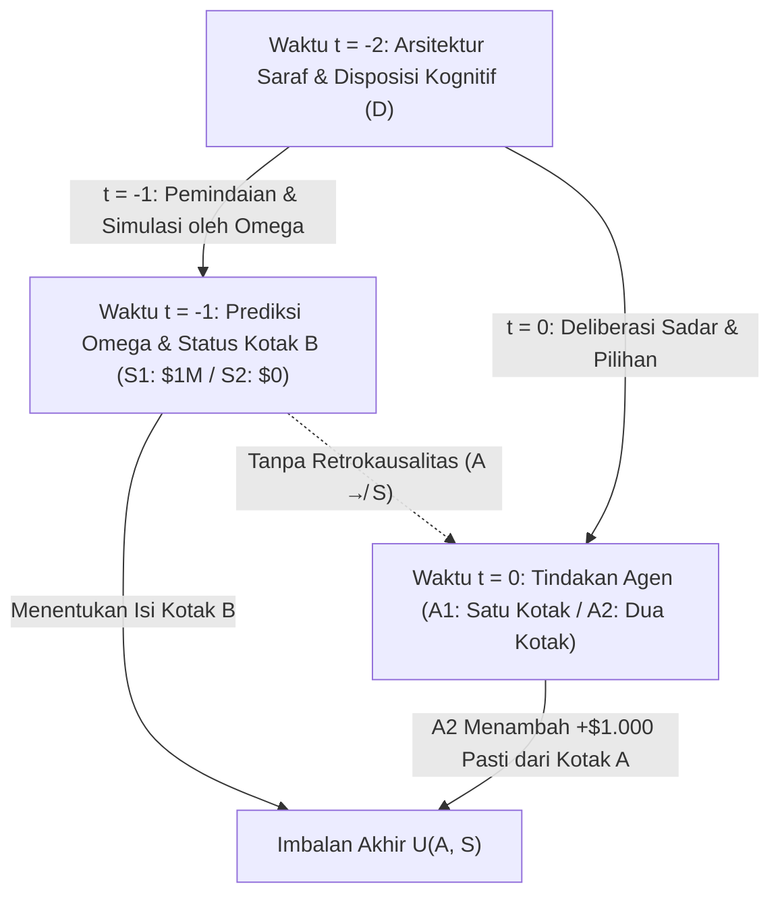
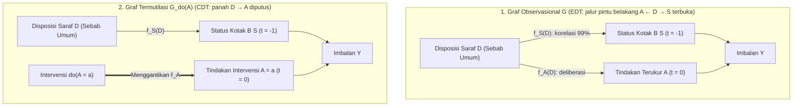

## 1. Eksperimen Pikiran yang Membelah Rasionalitas: Paradoks Newcomb (1960–1969)

Pada tahun 1960, fisikawan teoretis <strong>William A. Newcomb</strong> di Lawrence Livermore National Laboratory, Universitas California, merumuskan sebuah teka-teki pengambilan keputusan yang tampak sederhana namun mengguncang fondasi teori pilihan rasional modern. Diperkenalkan ke dunia akademik oleh filsuf Harvard <strong>Robert Nozick</strong> melalui makalah monumentalnya tahun 1969, <strong>*«Newcomb's Problem and Two Principles of Choice»*</strong> (dalam *Essays in Honor of Carl G. Hempel*), dan dipopulerkan oleh Martin Gardner di *Scientific American* (1973, 1974), paradoks ini membelah para ekonom, matematikawan, fisikawan, dan filsuf menjadi dua kubu yang tak terdamaikan.

Nozick mengabadikan keterbelahan ini dalam kalimat pembukanya yang terkenal:

> *«Bagi hampir semua orang, sangat jelas dan gamblang apa yang harus dilakukan. Kesulitannya adalah bahwa orang-orang tampaknya terbagi hampir sama rata dalam masalah ini, dengan sebagian besar dari masing-masing kubu menganggap separuh lainnya просто konyol.»*
> — <strong>Robert Nozick (1969)</strong>, *"Newcomb's Problem and Two Principles of Choice"*

---

### 1.1 Pengaturan Kanonik: Dua Kotak dan Peramal Super Omega ($\Omega$)

Anda berdiri di depan meja yang memuat dua kotak: <strong>Kotak Transparan A</strong> dan <strong>Kotak Buram B</strong>.

1. <strong>Kotak Transparan A</strong>: Terbuat dari kaca bening; terlihat jelas berisi uang tunai <strong>$\$1.000$</strong>.
2. <strong>Kotak Buram B</strong>: Terbuat dari baja tertutup; Anda tahu pasti bahwa di dalamnya terdapat <strong>$\$1.000.000$</strong> (satu juta dolar) atau <strong>$\$0$</strong> (kosong).

Pada saat ini $t = 0$, Anda harus memilih salah satu dari dua tindakan:

- <strong>Mengambil Satu Kotak (One-Boxing, $A_1$)</strong>: Menolak Kotak A dan <strong>hanya mengambil Kotak Buram B</strong>.
- <strong>Mengambil Dua Kotak (Two-Boxing, $A_2$)</strong>: <strong>Mengambil Kotak A sekaligus Kotak B</strong>.

Tokoh kunci di balik layar adalah <strong>Peramal super, Omega ($\Omega$)</strong>, yang melalui pemindaian otak resolusi tinggi dan simulasi neuro-komputasional telah memprediksi pilihan ribuan subjek sebelumnya dengan akurasi teruji sebesar <strong>$99\%$ ($p = 0,99$)</strong>. <strong>Kemarin (pada $t = -1$)</strong>, $\Omega$ memprediksi pilihan Anda hari ini dan menyiapkan Kotak B menurut aturan ketat berikut:

- <strong>Keadaan Dunia $S_1$ ($\text{Pred}_1$: $\Omega$ memprediksi Anda hanya mengambil Kotak B, $A_1$)</strong>:
  Kemarin $\Omega$ memasukkan <strong>$\$1.000.000$</strong> ke dalam Kotak B.
- <strong>Keadaan Dunia $S_2$ ($\text{Pred}_2$: $\Omega$ memprediksi Anda mengambil kedua kotak, $A_2$)</strong>:
  Kemarin $\Omega$ membiarkan Kotak B <strong>kosong ($\$0$)</strong>.

<strong>Ketertutupan kausal masa lalu</strong> dijamin sepenuhnya: $\Omega$ telah pergi kemarin; tidak ada kausalitas mundur (retrokausalitas, $A \not\to S$). Gerakan tangan Anda hari ini pada $t = 0$ tidak dapat mengubah isi fisik Kotak B.

| Pilihan Anda Hari Ini (pada $t = 0$) | Keadaan $S_1$ ($\text{Pred}_1$): $\Omega$ Memprediksi $A_1$ (Kotak B berisi $\$1.000.000$) | Keadaan $S_2$ ($\text{Pred}_2$): $\Omega$ Memprediksi $A_2$ (Kotak B berisi $\$0$) |
| :--- | :---: | :---: |
| <strong>$A_1$: Ambil Hanya Kotak B (One-Boxing)</strong> | <strong>$\$1.000.000$</strong> | <strong>$\$0$</strong> |
| <strong>$A_2$: Ambil Kotak A dan Kotak B (Two-Boxing)</strong> | <strong>$\$1.001.000$</strong> | <strong>$\$1.000$</strong> |

---

## 2. Pilar I: Teori Keputusan Evidensial (EDT) dan Argumen Satu Kotak

Landasan formal kubu satu kotak adalah <strong>Teori Keputusan Evidensial (Evidential Decision Theory, EDT)</strong> yang dikembangkan oleh <strong>Richard C. Jeffrey</strong> dalam karya klasiknya <strong>*The Logic of Decision* (1965; ed. ke-2 1983)</strong>.

### 2.1 Utilitas Harapan Kondisional dan «Nilai Berita (News Value)»

Dalam aljabar Boolean terpadu Jeffrey, setiap tindakan $A_i$ dievaluasi berdasarkan <strong>nilai beritanya (News Value)</strong> menggunakan probabilitas kondisional Bayes standar $\mathbb{P}(S_j \mid A_i)$:

$$\text{EU}_{\text{EDT}}(A_i) = \sum_{j} \mathbb{P}(S_j \mid A_i)\, U(A_i, S_j)$$

Dengan $\mathbb{P}(S_1 \mid A_1) = 0,99$, $\mathbb{P}(S_2 \mid A_1) = 0,01$ serta $\mathbb{P}(S_1 \mid A_2) = 0,01$, $\mathbb{P}(S_2 \mid A_2) = 0,99$, kita peroleh:

$$\begin{aligned}
\text{EU}_{\text{EDT}}(A_1) &= 0,99 \times \$1.000.000 + 0,01 \times \$0 = \$990.000 \\
\text{EU}_{\text{EDT}}(A_2) &= 0,01 \times \$1.001.000 + 0,99 \times \$1.000 = \$10.010 + \$990 = \$11.000
\end{aligned}$$

Secara umum, untuk hadiah $M$ di B, uang $k$ di A, dan akurasi $p$:

$$\text{EU}_{\text{EDT}}(A_1) > \text{EU}_{\text{EDT}}(A_2) \iff p M > (1-p)(M+k) + pk \iff p > \frac{1}{2} + \frac{k}{2M} = 0,5005$$

Selama akurasi Omega melampaui $50,05\%$, EDT memerintahkan One-Boxing ($A_1$), melahirkan sindiran terkenal terhadap kubu dua kotak: <strong>*«Jika Anda begitu pintar, mengapa Anda tidak kaya?» (If you're so smart, why ain't you rich?)*</strong>

---

## 3. Pilar II: Teori Keputusan Kausal (CDT), Dominansi Ketat, dan Kalkulus-$do$ Pearl

Para pelopor <strong>Teori Keputusan Kausal (Causal Decision Theory, CDT)</strong> — <strong>Allan Gibbard dan William Harper (1978)</strong>, <strong>Brian Skyrms (1980)</strong>, <strong>David Lewis (1981)</strong>, <strong>James Joyce (1999)</strong>, dan <strong>Judea Pearl (2000)</strong> — membuktikan bahwa EDT mencampuradukkan <strong>korelasi diagnostik (bukti statistik)</strong> dengan <strong>efikasi kausal</strong>.

### 3.1 Prinsip Dominansi Ketat dan Kondisional Kontrafaktual

Menurut <strong>prinsip dominansi ketat</strong> Leonard Savage (1954), karena keadaan Kotak B ($S_1$ atau $S_2$) sudah terkunci di masa lalu dan independen secara kausal dari tindakan $A$, mengambil kedua kotak ($A_2$) memberikan $+\$1.000$ lebih banyak di *setiap* keadaan dunia ($1.001.000 > 1.000.000$ dan $1.000 > 0$).

Gibbard dan Harper (1978) mengganti $\mathbb{P}(S_j \mid A_i)$ dengan probabilitas kontrafaktual Stalnaker-Lewis $\mathbb{P}(A_i \Box\!\to S_j)$, sementara <strong>Judea Pearl (2000)</strong> memformalkan CDT melalui <strong>Model Kausal Struktural (SCM)</strong> dan operator intervensi <strong>$do(A_i)$</strong>:

$$\text{EU}_{\text{CDT}}(A_i) = \sum_{j} \mathbb{P}(S_j \mid do(A_i))\, U(A_i, S_j)$$

### 3.2 Garpu Sebab-Umum ($S \leftarrow D \to A$) dan Bedah Graf

Dalam graf asiklik berarah (DAG), disposisi saraf masa lalu Anda $D$ adalah <strong>sebab umum (Common-Cause Fork: $S \leftarrow D \to A$)</strong> bagi prediksi Omega kemarin $S = f_S(D, U_S)$ dan pilihan Anda hari ini $A = f_A(D, U_A)$.

Sementara pengkondisian observasional $\mathbb{P}(S \mid A)$ membuka <strong>jalur pintu belakang (back-door path) $A \leftarrow D \to S$</strong>, <strong>bedah graf ($do(A_i)$)</strong> Pearl memutus panah $D \to A$, sehingga:

$$\mathbb{P}(S_j \mid do(A_i)) = \mathbb{P}(S_j) \implies \text{EU}_{\text{CDT}}(A_2) - \text{EU}_{\text{CDT}}(A_1) = +\$1.000 > 0$$

---

## 4. Masalah Newcomb Medis (Lesi Perokok) dan Predestinasi Calvinis Max Weber

### 4.1 «Lesi Perokok (The Smoking Lesion, Skyrms 1980)»

Berdasarkan hipotesis konstitusional Ronald Fisher, Brian Skyrms (1980) merumuskan kasus <strong>lesi perokok</strong>: andaikan merokok sama sekali tidak menyebabkan kanker ($A_{\text{smoke}} \not\to C$), tetapi lesi genetik bawaan $L$ dengan probabilitas $99\%$ menyebabkan baik hasrat merokok ($A_{\text{smoke}}$, kenikmatan $+1$) maupun kanker paru-paru mematikan ($C$, utilitas $-1.000$).
- Dalam garpu $C \leftarrow L \to A$, <strong>EDT</strong> menghitung $\text{EU}_{\text{EDT}}(A_{\text{abstain}}) = -10$ vs $\text{EU}_{\text{EDT}}(A_{\text{smoke}}) = -989$, memerintahkan Anda secara takhayul untuk berhenti merokok demi menurunkan probabilitas kondisional bahwa Anda terlahir dengan gen $L$!
- <strong>CDT</strong> melalui $\mathbb{P}(C \mid do(A)) = \mathbb{P}(C)$ menyadari bahwa DNA tidak berubah dan secara rasional merekomendasikan merokok ($+1$).

### 4.2 Isomorfisme Struktural dengan Predestinasi Calvinis Max Weber (1905)

Sebagaimana dicatat Nozick (1969), doktrin <strong>predestinasi ganda</strong> Yohanes Calvin yang dianalisis <strong>Max Weber</strong> dalam *Etika Protestan dan Semangat Kapitalisme* (1904–1905) adalah masalah Newcomb teologis: Tuhan telah menetapkan sejak kekekalan siapa yang termasuk <strong>Kaum Terpilih ($S_1$)</strong> dan <strong>Kaum Terkutuk ($S_2$)</strong>, tanpa ada amal manusia ($A_1$) yang dapat mengubah ketetapan itu ($A \not\to S$). Namun kaum Puritan menjalankan <strong>asketisme duniawi ($A_1$)</strong> yang ketat bukan sebagai *penyebab keselamatan (causa salutis)*, melainkan sebagai <strong>tanda diagnostik keterpilihan (*cognoscendi ratio*)</strong> dalam garpu $\text{Keselamatan } S_1 \leftarrow \text{Anugerah Ilahi } D \to \text{Karya Asketis } A_1$, memaksimalkan $\mathbb{P}(S_1 \mid A_1)$ persis seperti agen EDT.

---

## 5. «Tickle Defense» Ellery Eells dan Dilema Tahanan Kembar David Lewis

### 5.1 «Pertahanan Gelitik (Tickle Defense, 1982)» dan Ratifiabilitas

Untuk menyelamatkan EDT dari lesi perokok, <strong>Ellery Eells (1982)</strong> berargumen bahwa lesi $L$ hanya menyebabkan tindakan $A$ melalui hasrat sadar atau «gelitik» $T = (\mathcal{B}, \mathcal{D})$ ($C \leftarrow L \to T \to A$). Jika agen mengetahui $T$ lewat introspeksi sebelum bertindak, pengkondisian pada $T$ <strong>menyekat (Screening-Off)</strong> korelasi antara $A$ dan $L$: $\mathbb{P}(C \mid A, T) = \mathbb{P}(C \mid T)$, menyatukan EDT dan CDT. Namun dalam masalah Newcomb, $\Omega$ memprediksi keputusan akhir itu sendiri, dan kriteria <strong>ratifiabilitas (Ratifiability, Jeffrey 1983)</strong> menunjukkan bahwa keputusan $\text{Decide}(A_1)$ tidak dapat diratifikasi karena begitu $\text{Decide}(A_1)$ ditetapkan, beralih ke $A_2$ memberikan tambahan $+\$1.000$.

### 5.2 Teorema Isomorfisme David Lewis: *«Prisoners' Dilemma Is a Newcomb Problem»* (1979)

Pada tahun 1979, <strong>David Lewis</strong> membuktikan bahwa Dilema Tahanan sekali jalan melawan kembaran psikologis (atau klon dengan kode sumber identik) $100\%$ isomorfik dengan paradoks Newcomb:
- <strong>Bekerja sama ($C_{\text{PD}}$: merelakan $\$1.000$ sendiri demi memberi $\$1.000.000$ kepada kembaran)</strong> $\Longleftrightarrow$ <strong>One-Boxing ($A_1$)</strong>.
- <strong>Membelot ($D_{\text{PD}}$: mengambil $+\$1.000$ sendiri)</strong> $\Longleftrightarrow$ <strong>Two-Boxing ($A_2$)</strong>.
Karena Omega memprediksi Anda dengan menjalankan simulasi (kembaran) pikiran Anda kemarin, kedua masalah tersebut identik. Lewis menyimpulkan bahwa rasionalitas menuntut membelot dan mengambil dua kotak, sedangkan <strong>Douglas Hofstadter (1983)</strong> merumuskan <strong>superrasionalitas (Superrationality)</strong> untuk mendukung kerja sama timbal balik $(C_{\text{PD}}, C_{\text{PD}})$ dan One-Boxing ($A_1$).

---

## 6. Garda Depan Penyelarasan AI: Teori Keputusan Fungsional (FDT)

Bagi agen perangkat lunak (AI) yang kode sumbernya dapat dibaca atau disimulasikan $100\%$ di dalam *sandbox*, peramal $\Omega$ adalah realitas rekayasa sehari-hari. Pada tahun 2017, <strong>Eliezer Yudkowsky dan Nate Soares</strong> (memadukan <strong>TDT</strong> dan <strong>UDT</strong> Wei Dai) merumuskan <strong>Teori Keputusan Fungsional (Functional Decision Theory, FDT)</strong>.

### 6.1 Kontrafaktual Logis: Intervensi pada Fungsi Matematika $\mathsf{F}$

CDT memodelkan pilihan sebagai peristiwa fisik lokal $A$ di $(x_0, t_0)$ dan mengevaluasi $do(A = A_2)$ dengan membayangkan dunia yang mustahil secara logis di mana algoritma deterministik yang sama $\mathsf{F}(\mathcal{I})$ menghasilkan $A_1$ kemarin di simulator Omega dan $A_2$ hari ini. FDT mengintervensi langsung pada <strong>keluaran fungsi keputusan matematika $\mathsf{F}(\mathcal{I})$</strong>:

$$\text{EU}_{\text{FDT}}(a) = \sum_{j} \mathbb{P}\!\left(S_j \;\middle|\; do(\mathsf{F}(\mathcal{I}) = a)\right) U(a, S_j)$$

1. <strong>Paradoks Newcomb</strong>: Karena prediksi Omega $S = f_S(\mathsf{F}(\mathcal{I}), U_S)$ bergantung secara fungsional pada $\mathsf{F}(\mathcal{I})$, intervensi $do(\mathsf{F}(\mathcal{I}) = A_1)$ menetapkan baik simulasi maupun tindakan saat ini ke $A_1$ $\implies$ <strong>FDT mengambil satu kotak ($A_1$) dan memenangkan $\$1.000.000$!</strong>
2. <strong>Lesi Perokok</strong>: Karena gen bawaan $L$ bukan simulasi dari $\mathsf{F}(\mathcal{I})$ ($C \leftarrow L \to \mathcal{I} \to \mathsf{F}(\mathcal{I}) \to A$), $do(\mathsf{F}(\mathcal{I}) = a)$ tidak mengubah probabilitas kanker $\implies$ <strong>FDT merokok ($A_{\text{smoke}}$) tanpa takhayul!</strong>
3. <strong>Newcomb Transparan (Penumpang Tumpangan Parfit) & Ekuilibrium Program (Teorema Löb)</strong>: Bahkan jika Kotak B transparan dan uang satu juta dolar terlihat jelas, FDT/UDT mengoptimalkan kebijakan global $\mathsf{F}$ *ex ante* dan hanya mengambil Kotak B; dalam dilema tahanan kode terbuka, `FairBot` menggunakan <strong>teorema Löb ($\square(\square P \to P) \to \square P$)</strong> untuk mencapai kerja sama timbal balik yang dapat dibuktikan secara formal.

### 6.2 Tabel Perbandingan: EDT vs. CDT vs. FDT/UDT

| Dimensi / Dilema | Teori Evidensial (EDT — Jeffrey 1965) | Teori Kausal (CDT — Lewis, Pearl) | Teori Fungsional (FDT / UDT — Yudkowsky & Soares 2017) |
| :--- | :--- | :--- | :--- |
| <strong>Rumus Utilitas Harapan</strong> | $\sum_j \mathbb{P}(S_j \mid A_i)\, U(A_i, S_j)$ | $\sum_j \mathbb{P}(S_j \mid do(A_i))\, U(A_i, S_j)$ | $\sum_j \mathbb{P}(S_j \mid do(\mathsf{F}(\mathcal{I}) = a))\, U(a, S_j)$ |
| <strong>1. Paradoks Newcomb Standar</strong> | <strong>Satu kotak ($A_1$)</strong> ($\$1.000.000$) | <strong>Dua kotak ($A_2$)</strong> ($\$1.000$) | <strong>Satu kotak ($A_1$)</strong> ($\$1.000.000$) |
| <strong>2. Lesi Perokok (Medis)</strong> | <strong>Berhenti ($A_{\text{abstain}}$)</strong> (Takhayul) | <strong>Merokok ($A_{\text{smoke}}$)</strong> (Benar, $+1$) | <strong>Merokok ($A_{\text{smoke}}$)</strong> (Benar, $+1$) |
| <strong>3. Dilema Tahanan Kembar</strong> | <strong>Kerja sama ($C_{\text{PD}}$)</strong> ($\$1.000.000$) | <strong>Membelot ($D_{\text{PD}}$)</strong> ($\$1.000$) | <strong>Kerja sama ($C_{\text{PD}}$)</strong> ($\$1.000.000$) |
| <strong>4. Newcomb Transparan</strong> | <strong>Dua kotak</strong> (Observasi menyekat $\implies \$0$) | <strong>Dua kotak</strong> (Dominansi $\implies \$0$) | <strong>Satu kotak</strong> (Kebijakan global $\implies \$1.000.000$) |

---

## Referensi

- <strong>Nozick, R. (1969)</strong>. "Newcomb's Problem and Two Principles of Choice." Dalam *Essays in Honor of Carl G. Hempel* (pp. 114–146).
- <strong>Jeffrey, R. C. (1965 / 1983)</strong>. *The Logic of Decision*. University of Chicago Press.
- <strong>Lewis, D. (1979)</strong>. "Prisoners' Dilemma Is a Newcomb Problem." *Philosophy & Public Affairs*, 8(3), 235–240.
- <strong>Pearl, J. (2000 / 2009)</strong>. *Causality: Models, Reasoning, and Inference*. Cambridge University Press.
- <strong>Yudkowsky, E., & Soares, N. (2017)</strong>. "Functional Decision Theory: A New Theory of Instrumental Rationality." *arXiv:1710.05060*.
