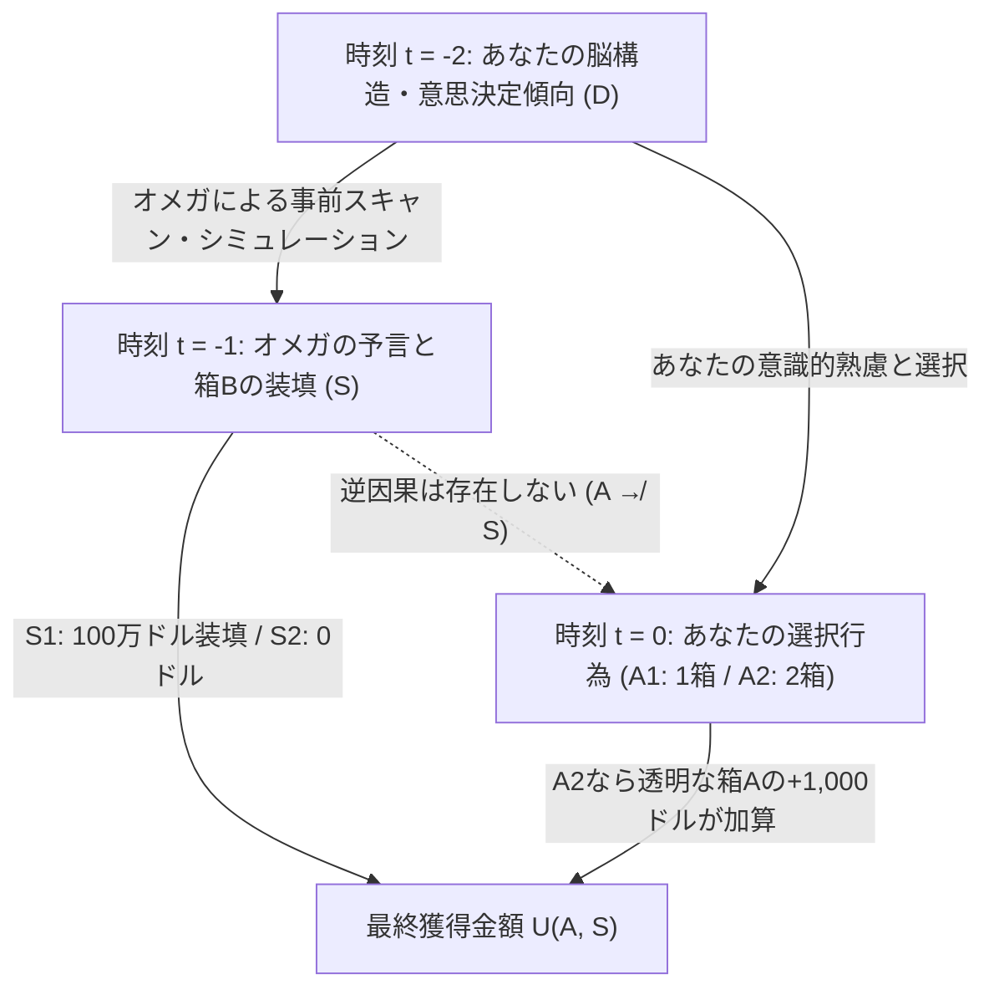
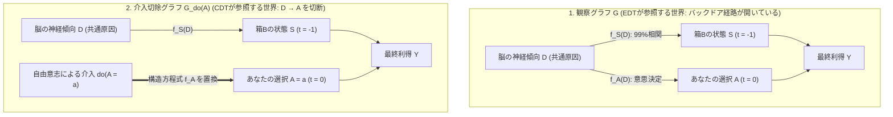

## 1. 合理性を真っ二つに引き裂いた思考実験：ニューカムのパラドックス（1960–1969）

1960年、カリフォルニア大学ローレンス・リバモア国立研究所の理論物理学者<strong>ウィリアム・ニューカム（William A. Newcomb）</strong>は、ゲーム理論と囚人のジレンマの構造を思索するなかで、現代の意思決定理論（Decision Theory）・認識論・因果推論の根幹を揺るがすことになるひとつの思考実験を着想した。この問題はその後、友人を通じてハーバード大学の哲学者<strong>ロバート・ノージック（Robert Nozick）</strong>へと伝わり、1969年にノージックが発表した記念碑的論文<strong>『Newcomb's Problem and Two Principles of Choice（ニューカムの問題と選択の二原理）』</strong>（カール・ヘンペル記念論文集所収）によって哲学界および数理経済学界に衝撃をもたらした。さらに1973年および1974年、マーティン・ガードナー（Martin Gardner）が『Scientific American』誌の「数学ゲーム」連載コラムでこの問題を取り上げたことで、世界中の数学者・物理学者・経済学者・哲学者を巻き込む大論争へと発展した。

ノージックは1969年の論文の冒頭で、この思考実験が持つ異様な魔力を次のように描写している。

> 「ほぼすべての人にとって、何をすべきかは完全に明白であり自明であるように見える。厄介なのは、この問題を前にした人々がほぼ真っ二つに割れ、しかもそれぞれの陣営の大多数が『反対側の半分は単に愚かなだけだ』と確信していることである。」
> — <strong>Robert Nozick (1969)</strong>, *"Newcomb's Problem and Two Principles of Choice"*

なぜ、ノーベル賞級の経済学者や一流の理論物理学者、分析哲学者たちが、極めて単純なルールからなる1回の選択ゲームをめぐって「お前は合理性の基本がわかっていない」と互いに罵り合う事態に陥ったのか。まずはその厳密な実験設定を確認しよう。

---

### 1.1 実験設定：2つの箱と超人的予言者オメガ（$\Omega$）

あなたの目の前のテーブルに、2つの箱——<strong>箱A（透明な箱）</strong>と<strong>箱B（不透明な箱）</strong>——が置かれている。

1. <strong>透明な箱A（Transparent Box A）</strong>：外から中身がはっきりと見えるガラス製の箱であり、その中には確実に<strong>$\$1,000$（約15万円）</strong>の現金が入っている。
2. <strong>不透明な箱B（Opaque Box B）</strong>：中身が外からは一切見えない鋼鉄製の箱であり、その中には<strong>$\$1,000,000$（100万ドル、約1億5,000万円）</strong>が入っているか、あるいは<strong>$\$0$（空っぽ）</strong>であるかのいずれかである。

あなたに与えられた選択肢（行為 $A$）は、次の2つだけである。

- <strong>1箱取り（One-Boxing, $A_1$）</strong>：透明な箱Aを諦め、<strong>不透明な箱Bだけ</strong>を受け取る。
- <strong>2箱取り（Two-Boxing, $A_2$）</strong>：<strong>透明な箱Aと不透明な箱Bの両方</strong>を受け取る。

ここで、このゲームの核心となる存在——<strong>超人的予言者「オメガ（$\Omega$）」</strong>——が登場する。オメガは、超高解像度の全脳神経スキャン、過去の行動履歴、微小な視線や自律神経の反応、あるいはあなたの脳のシナプス結合重みを完全に模倣する計算論的シミュレータを備えた超知能である。過去数千人の被験者（1箱だけを取った人々も、2箱とも取った人々も両方含む）に対する実験において、オメガは被験者が最終的にどちらの選択を下すかを<strong>$99\%$の精度（的中確率 $p = 0.99$）</strong>で事前に言い当ててきたという、検証済みの圧倒的な実績を持っている。

そして<strong>昨日（時刻 $t = -1$）</strong>、オメガはあなたの脳状態と意思決定傾向をスキャンし、<strong>今日（時刻 $t = 0$）</strong>あなたが $A_1$（1箱取り）と $A_2$（2箱取り）のどちらを選ぶかを予測したうえで、次の厳格なルールに従って箱Bの中身をセットした。

- <strong>状態 $S_1$（$\text{Pred}_1$：オメガが「あなたは箱Bだけを取る（$A_1$）」と予言した）</strong>：
  オメガは昨日、不透明な箱Bの中に<strong>$\$1,000,000$</strong>を入れた。
- <strong>状態 $S_2$（$\text{Pred}_2$：オメガが「あなたは両方の箱を取る（$A_2$）」と予言した）</strong>：
  オメガは昨日、不透明な箱Bの中を<strong>空っぽ（$\$0$）</strong>のままにした。

極めて重要な前提条件として、以下の<strong>過去の因果的閉包（Causal Closure of the Past）</strong>が厳密に保証されている。

1. <strong>逆因果（Retrocausality）の不在</strong>：オメガはすでに昨日、箱Bに100万ドルを入れるか空にするかを終えて部屋を立ち去っており、現在は地球の裏側（あるいはアンドロメダ銀河）にいる。今日あなたが手を伸ばして箱Aに触れたからといって、超常的なタイムマシンや遠隔装置が作動して箱Bの中の100万ドルが消滅したり蒸発したりすることは<strong>物理的に絶対にない</strong>。
2. <strong>状態の確定性</strong>：いまこの瞬間（$t = 0$）、箱Bの中にはすでに$\$1,000,000$が物理的に存在しているか（$S_1$）、あるいは$\$0$であるか（$S_2$）のどちらか一方に確定している。
3. <strong>効用の線形性</strong>：あなたは純粋に獲得する金額を最大化したいと考えており、金銭に対する効用関数は線形（$U(\$x) = x$）であると仮定する（なお、対数効用などのリスク回避性を導入しても、箱Bの金額を十分大きくすればパラドックスは全く同じように成立する）。

このゲームの利得行列（Payoff Matrix）を整理すると、以下の表のようになる。

| あなたの今日の選択（時刻 $t = 0$） | 状態 $S_1$：オメガが「1箱取り（$A_1$）」と予言（箱Bに$\$1,000,000$あり） | 状態 $S_2$：オメガが「2箱取り（$A_2$）」と予言（箱Bは$\$0$） |
| :--- | :---: | :---: |
| <strong>$A_1$：箱Bだけを取る（1箱取り / One-Boxing）</strong> | <strong>$\$1,000,000$</strong> | <strong>$\$0$</strong> |
| <strong>$A_2$：箱Aと箱Bの両方を取る（2箱取り / Two-Boxing）</strong> | <strong>$\$1,001,000$</strong> | <strong>$\$1,000$</strong> |

さあ、あなたはテーブルの前に立っている。箱Bだけを取るべきか（$A_1$）、それとも箱Aと箱Bの両方を取るべきか（$A_2$）？



---

### 1.2 なぜこれが「パラドックス」なのか：2つの黄金律の正面衝突

ノージックが指摘した通り、この問題が恐ろしいのは、私たちが日常および科学的意思決定において「合理性の絶対的な公理」として疑わずに使っている<strong>2つの基本原理</strong>が、この問題においては<strong>正反対の結論（$A_1$ と $A_2$）を100%の確信をもって命じる</strong>からである。

1. <strong>期待効用最大化原理（Expected Utility Maximization / 1箱派の論理）</strong>：
   オメガの予言精度は$99\%$である。もしあなたが1箱だけ（$A_1$）を選べば、$99\%$の確率でオメガはそれを予見して箱Bに$\$1,000,000$を入れてくれているため、期待獲得額は $0.99 \times \$1,000,000 = \$990,000$ である。逆に、もしあなたが欲を出して2箱とも（$A_2$）を選べば、$99\%$の確率でオメガはそれを見抜いて箱Bを空っぽにしているため、期待獲得額は $0.01 \times \$1,001,000 + 0.99 \times \$1,000 = \$11,000$ に激減する。$\$990,000$ と $\$11,000$ のどちらが大きいかは小学生でもわかる。したがって、合理的な人間は<strong>絶対に1箱だけ（$A_1$）を取るべきである</strong>。
2. <strong>厳密支配原理（Strict Dominance Principle / 2箱派の論理）</strong>：
   オメガはすでに昨日帰ってしまった。箱Bの中身はすでに物理的に確定しており、あなたの今日の行動によって箱Bの中身が変化することは万に一つもない。ここで場合分けをしよう。
   - <strong>ケース1</strong>：もし昨日オメガが箱Bに$\$1,000,000$を入れていたなら（$S_1$）、1箱だけ取れば$\$1,000,000$、2箱とも取れば$\$1,001,000$になる。<strong>2箱取る方が$\$1,000$得である。</strong>
   - <strong>ケース2</strong>：もし昨日オメガが箱Bを空っぽにしていたなら（$S_2$）、1箱だけ取れば$\$0$、2箱とも取れば$\$1,000$になる。<strong>やはり2箱取る方が$\$1,000$得である。</strong>
   世界がどちらの状態（$S_1$ または $S_2$）であったとしても、2箱とも取る（$A_2$）ことは1箱だけ取る（$A_1$）ことよりも<strong>常に確実に$\$1,000$多くをもたらす</strong>。したがって、合理的な人間は<strong>絶対に2箱とも（$A_2$）取るべきである</strong>。

通常の意思決定問題では、「条件付き期待効用の最大化」と「支配原理」は完全に一致する。なぜニューカムのパラドックスにおいてのみ、この2つの原理は激しい正面衝突を起こすのか。その数学的・哲学的構造を解き明かすことから始めよう。

---

## 2. 第1の柱：証拠的決定理論（Evidential Decision Theory, EDT）と「1箱派」の数理

まず、1箱派（One-Boxers）の理論的支柱である<strong>証拠的決定理論（Evidential Decision Theory: EDT）</strong>を厳密に定式化しよう。

### 2.1 リチャード・ジェフリーの『決定の論理（The Logic of Decision）』

古典的なサヴィッジ（Leonard J. Savage, 1954）の意思決定理論では、「世界の状態（States）」と「行為（Acts）」と「結果（Consequences）」は互いに別個の集合として定義されていた。これに対し、1965年に哲学者・論理学者<strong>リチャード・ジェフリー（Richard C. Jeffrey）</strong>は名著『*The Logic of Decision*』において、状態 $S_j$ も行為 $A_i$ も結果もすべて<strong>単一のブール代数（命題空間）$\mathcal{F}$ の要素（命題）</strong>として統一的に扱う美しい公理系を構築した。

ジェフリーの体系（すなわち<strong>証拠的決定理論 EDT</strong>）において、ある命題（行為）$A_i$ の価値は、その命題が真となったという「ニュース（証拠）」を受け取ったときに期待される世界の望ましさ——すなわち<strong>ニュース価値（News Value / Desirability）</strong>——によって測られる。

世界の状態の分割（互いに排反かつ網羅的な命題の集合）を $\{S_1, S_2, \dots, S_n\}$ とするとき、行為 $A_i$ の<strong>証拠的期待効用（Evidential Expected Utility, $\text{EU}_{\text{EDT}}$）</strong>は、行為 $A_i$ を条件とする各状態 $S_j$ の<strong>条件付き確率（Conditional Probability）$\mathbb{P}(S_j \mid A_i)$</strong> を重みとして次のように定義される。

$$\text{EU}_{\text{EDT}}(A_i) = \sum_{j=1}^{n} \mathbb{P}(S_j \mid A_i)\, U(A_i, S_j)$$

ここで条件付き確率 $\mathbb{P}(S_j \mid A_i)$ は、標準的なコルモゴロフの確率公理およびベイズの定理（Bayes' Rule）によって定義される通常の条件付き確率である。

$$\mathbb{P}(S_j \mid A_i) = \frac{\mathbb{P}(A_i \wedge S_j)}{\mathbb{P}(A_i)} = \frac{\mathbb{P}(A_i \mid S_j)\,\mathbb{P}(S_j)}{\sum_{k=1}^{n} \mathbb{P}(A_i \mid S_k)\,\mathbb{P}(S_k)}$$

### 2.2 ニューカム問題におけるEDTの厳密計算

ニューカムの問題において、世界の状態は $S_1$（オメガが1箱取りを予言し、箱Bに$\$1,000,000$を入れた）と $S_2$（オメガが2箱取りを予言し、箱Bを$\$0$にした）の2つである。
オメガの予測精度が $99\%$ であることから、あなたが $A_1$（1箱取り）を選択したという条件のもとでオメガがそれを正しく予言していた条件付き確率は $\mathbb{P}(S_1 \mid A_1) = 0.99$ であり、予測を外していた確率は $\mathbb{P}(S_2 \mid A_1) = 0.01$ である。同様に、あなたが $A_2$（2箱取り）を選択したという条件のもとでは $\mathbb{P}(S_2 \mid A_2) = 0.99$、$\mathbb{P}(S_1 \mid A_2) = 0.01$ となる。

これらを証拠的期待効用 $\text{EU}_{\text{EDT}}(A_i)$ の定義式に代入すると、次のようになる。

$$\begin{aligned}
\text{EU}_{\text{EDT}}(A_1) &= \mathbb{P}(S_1 \mid A_1)\, U(A_1, S_1) + \mathbb{P}(S_2 \mid A_1)\, U(A_1, S_2) \\
&= 0.99 \times \$1,000,000 + 0.01 \times \$0 \\
&= \$990,000
\end{aligned}$$

$$\begin{aligned}
\text{EU}_{\text{EDT}}(A_2) &= \mathbb{P}(S_1 \mid A_2)\, U(A_2, S_1) + \mathbb{P}(S_2 \mid A_2)\, U(A_2, S_2) \\
&= 0.01 \times \$1,001,000 + 0.99 \times \$1,000 \\
&= \$10,010 + \$990 \\
&= \$11,000
\end{aligned}$$

両者の差は圧倒的である。

$$\text{EU}_{\text{EDT}}(A_1) - \text{EU}_{\text{EDT}}(A_2) = \$990,000 - \$11,000 = +\$979,000 > 0$$

したがって、EDTの下では1箱取り（$A_1$）が2箱取り（$A_2$）を<strong>$\$979,000$という圧倒的な期待効用差で粉砕する</strong>。

---

### 2.3 一般化された損益分岐点（Threshold Analysis）とベイズ的事前確率の感度分析

さらに一般化して、箱Bの賞金を $M > 0$、箱Aの賞金を $k > 0$（ただし $M > k$）、オメガの予言的中率を $p \in [0.5, 1]$ と置こう。このとき、EDTが1箱取り（$A_1$）を推奨するための必要十分条件は次のように導出される。

$$\text{EU}_{\text{EDT}}(A_1) > \text{EU}_{\text{EDT}}(A_2) \iff p M + (1 - p)\cdot 0 > (1 - p)(M + k) + p k$$

右辺を展開して整理すると、

$$p M > (1 - p)M + (1 - p)k + p k = (1 - p)M + k$$

$$(2p - 1)M > k \iff p > \frac{1}{2} + \frac{k}{2M}$$

標準的な設定である $M = \$1,000,000$、$k = \$1,000$ を代入してみよう。

$$p > \frac{1}{2} + \frac{1,000}{2,000,000} = 0.5 + 0.0005 = 0.5005 \quad (50.05\%)$$

驚くべきことに、オメガが超人的な$99\%$の予言者である必要すらない。オメガの予測能力がコイン投げ（$50\%$）よりも<strong>わずか$0.05\%$高い$50.05\%$を超えるだけ</strong>で、EDTは1箱取り（$A_1$）が合理的であると判定するのである！

ここで、ベイズ統計学に精通した読者からは次のような鋭い疑問が呈されるかもしれない。「$\mathbb{P}(S_1 \mid A_1) = 0.99$ というのは事後確率（Posterior Probability）である。もし意思決定者が『自分はほぼ確実に2箱取る人間だから、オメガはすでに箱Bを空にしたはずだ（事前確率 $\pi = \mathbb{P}(S_1)$ が極めて小さい）』と信じていたらどうなるのか？」

この点をベイズの定理で厳密に確認しておこう。オメガの予測アルゴリズムの感度・特異度（被験者の実際の選択が $A_i$ であるときにオメガが $\text{Pred}_i$ を出力した尤度）を $\mathbb{P}(\text{Pred}_1 \mid A_1) = \mathbb{P}(\text{Pred}_2 \mid A_2) = q = 0.99$ とする（厳密には時間順の因果モデルでは共通原因 $D$ から計算されるが、対称な混同行列として扱う）。もしあなたの行動に対する事前確率分布が $\mathbb{P}(A_1) = \alpha \in (0, 1)$、$\mathbb{P}(A_2) = 1 - \alpha$ であれば、周辺確率や条件付き確率は $\alpha$ に依存する。しかし、「私が $A_1$ を選んだとき、どれだけの割合で箱Bに100万ドルが入っているか」という条件付き確率 $\mathbb{P}(S_1 \mid A_1)$ が実験の過去実績として $A_1$ 選択者集団の $99\%$、$A_2$ 選択者集団の $1\%$ であることが頻度論的・経験的に保証されているならば（ノージックの元論文の定式化）、あなたの事前確率 $\alpha$ にかかわらず $\mathbb{P}(S_1 \mid A_1) = 0.99$ および $\mathbb{P}(S_2 \mid A_2) = 0.99$ が成立する。

そして1箱派は、2箱派に対して意思決定理論史上もっとも有名な挑発の言葉を投げかける。

> <strong>"If you're so smart, why ain't you rich?"（もしお前がそんなに賢い［合理的だ］と言うのなら、なぜお前はお金持ちじゃないんだ？）</strong>

実際、このゲームを1,000人の「1箱派（EDT主義者）」と1,000人の「2箱派（CDT主義者）」にプレイさせれば、1箱派の990人は<strong>100万ドルの大富豪</strong>となって会場を去り、2箱派の990人は「俺たちは支配原理に従った最も論理的な人間だ」と胸を張りながら<strong>たった1,000ドル</strong>を握りしめて会場を去るのである。意思決定理論とは「それに従うことで人生において望ましい結果（高い効用）を達成するための規範理論」ではないのか？ 常に貧乏くじを引き続ける理論を「合理的」と呼ぶのは倒錯ではないか——これが1箱派の強力な直観である。

---

## 3. 第2の柱：因果的決定理論（Causal Decision Theory, CDT）とパールの $do$ 演算子

それでは、2箱派（Two-Boxers）は単なる強欲な愚か者なのだろうか？ 決してそうではない。1970年代後半から1980年代にかけて、アラン・ギバード（Allan Gibbard）、ウィリアム・ハーパー（William Harper）、ブライアン・スカームズ（Brian Skyrms）、デイヴィッド・ルイス（David Lewis）、そして統計的因果推論の巨人<strong>ジューディア・パール（Judea Pearl）</strong>やジェームズ・ジョイス（James M. Joyce）らが築き上げた<strong>因果的決定理論（Causal Decision Theory: CDT）</strong>は、ジェフリーの証拠的決定理論（EDT）には<strong>致命的な概念的バグ</strong>が潜んでいることを暴き出した。

そのバグとは、<strong>「証拠的相関（Diagnostic Evidence / News Value）」と「因果的効力（Causal Efficacy）」の混同</strong>である。

### 3.1 厳密支配原理（Strict Dominance Principle）の不可侵性

レナード・サヴィッジ（1954）が『統計学の基礎（*The Foundations of Statistics*）』で定式化した<strong>確実な事柄の原理（Sure-Thing Principle）</strong>および<strong>厳密支配原理（Strict Dominance Principle）</strong>は、合理的意思決定の最も基本的な公理である。

- <strong>厳密支配原理の定義</strong>：
  世界の状態空間の分割 $\{S_1, S_2, \dots, S_n\}$ が、行為者の選択 $A_i$ から<strong>因果的に独立（Causally Independent）</strong>であるとする。このとき、すべての状態 $S_j \in \{S_1, \dots, S_n\}$ において
  $$U(A_2, S_j) > U(A_1, S_j)$$
  が成り立つならば、行為 $A_2$ は行為 $A_1$ を<strong>厳密に支配（Strictly Dominate）</strong>しており、合理的な行為者は必ず $A_2$ を選択しなければならない。

ニューカムの問題において、状態 $S_1$（昨日オメガが箱Bに100万ドルを入れた）と $S_2$（昨日オメガが箱Bを空にした）は、すでに過去に完了した物理的出来事である。あなたの今日の行為 $A$ が過去の状態 $S$ を物理的に変えることはできない。そして、

$$\begin{aligned}
U(A_2, S_1) - U(A_1, S_1) &= \$1,001,000 - \$1,000,000 = +\$1,000 > 0 \\
U(A_2, S_2) - U(A_1, S_2) &= \$1,000 - \$0 = +\$1,000 > 0
\end{aligned}$$

であるから、箱Bの中身が何であれ、2箱取る（$A_2$）方が確実に$\$1,000$多く手に入る。
なぜEDTはこの自明な支配原理を破ってしまうのか？ それは、EDTの期待効用式に登場する条件付き確率 $\mathbb{P}(S_j \mid A_i)$ が、「行為 $A_i$ が状態 $S_j$ を<strong>引き起こす確率</strong>」ではなく、「行為 $A_i$ を観察したときに状態 $S_j$ であったと推論される<strong>診断的・統計的確率</strong>」だからである。

1箱だけを取ること（$A_1$）は、箱Bの中に100万ドルを生み出す<strong>原因（Cause）</strong>にはならない。それは単に「昨日オメガが箱Bに100万ドルを入れてくれた可能性が高い」という<strong>気休めの朗報（Good News / 診断的証拠）</strong>を自分に与えるだけなのである。

---

### 3.2 CDTの3つの歴史的定式化：反事実条件文・依存仮説・$do$ 演算子

「統計的な条件付き確率 $\mathbb{P}(S_j \mid A_i)$ の代わりに、行為 $A_i$ が状態 $S_j$ に及ぼす真の因果的影響だけを取り出すにはどうすればよいか？」——この問いに対して、CDTの創始者たちは3つの数学的に同値なアプローチを発展させた。

#### (1) ギバード＆ハーパーの反事実条件文（Counterfactuals, 1978）
アラン・ギバードとウィリアム・ハーパーは1978年の歴史的論文 *"Counterfactuals and Two Kinds of Expected Utility"* において、ロバート・スタルネイカー（Robert Stalnaker）とデイヴィッド・ルイス（David Lewis）の<strong>反事実条件論理（Counterfactual Logic）</strong>を導入した。彼らは条件付き確率 $\mathbb{P}(S_j \mid A_i)$ を、「もし私が行為 $A_i$ を行ったならば、状態 $S_j$ が成立するであろう（$A_i \Box\!\to S_j$）」という<strong>反事実条件文の確率 $\mathbb{P}(A_i \Box\!\to S_j)$</strong> に置き換えた。

$$\text{EU}_{\text{CDT}}^{\text{GH}}(A_i) = \sum_{j=1}^{n} \mathbb{P}(A_i \Box\!\to S_j)\, U(A_i, S_j)$$

ルイスの可能世界意味論では、反事実条件文 $A_i \Box\!\to S_j$ を評価する際、現在の時刻 $t = 0$ の直前までは現実世界と<strong>完全に同一の過去の歴史（つまりオメガの昨日の予言 $S_j$ も同一）</strong>を保ったまま、時刻 $t = 0$ において局所的な「小さな奇跡（Local Miracle）」によって行為だけを $A_i$ に変えた最も近い可能世界を参照する（<strong>非遡及的・非バックトラッキング反事実：Non-backtracking Counterfactuals</strong>）。過去の状態 $S_j$ は時刻 $t = 0$ の介入によって変わらないため、

$$\mathbb{P}(A_i \Box\!\to S_j) = \mathbb{P}(S_j)$$

が厳密に成立する。

#### (2) スカームズとルイスの依存仮説（Dependency Hypotheses, 1980–1981）
ブライアン・スカームズ（1980）およびデイヴィッド・ルイス（1981, *"Causal Decision Theory"*）は、世界に存在する因果的メカニズムの完全な記述である<strong>因果的依存仮説（Dependency Hypotheses）$K_m$</strong> の分割 $\{K_1, K_2, \dots, K_M\}$ を用いてCDTを定式化した。各 $K_m$ は「どの行為を選べばどの結果が因果的に生じるか」を完全に指定する命題（ニューカム問題では $S_1$ と $S_2$ そのもの）であり、行為者の選択からは因果的に独立している。

$$\text{EU}_{\text{CDT}}^{\text{Lewis}}(A_i) = \sum_{m=1}^{M} \mathbb{P}(K_m)\, U(A_i \wedge K_m)$$

#### (3) ジューディア・パールの構造的因果モデル（SCM）と $do$ 演算子（2000）
そして現代の人工知能・統計学・計量経済学において最も標準的かつ明快な定式化が、<strong>ジューディア・パール（Judea Pearl）</strong>が『*Causality: Models, Reasoning, and Inference*』（2000）で完成させた<strong>構造的因果モデル（Structural Causal Model: SCM）</strong>と<strong>介入演算子 $do(A_i)$</strong> による定義である。

$$\text{EU}_{\text{CDT}}(A_i) = \sum_{j=1}^{n} \mathbb{P}(S_j \mid do(A_i))\, U(A_i, S_j)$$

---

### 3.3 構造的因果モデル（SCM）による「共通原因フォーク」の解剖とグラフ切除

パールの因果推論フレームワークを用いて、ニューカムのパラドックスの因果有向非巡回グラフ（Causal DAG $\mathcal{G}$）を数学的に書き下してみよう。

ニューカム問題には、以下の4つの確率変数（ノード）が存在する。

1. <strong>$D$（Disposition / 意思決定傾向）</strong>：時刻 $t = -2$ におけるあなたの脳の神経構造・性格・合理性信念。外生ノイズ $U_D$ によって $D = f_D(U_D)$ と決まる。
2. <strong>$S$（State of Box B / オメガの予言と箱Bの状態）</strong>：時刻 $t = -1$ において、オメガが $D$ をスキャンして決定した状態。構造方程式は $S = f_S(D, U_S)$（ここで $U_S$ はオメガの1%の予測誤差ノイズ）。
3. <strong>$A$（Action / あなたの選択行為）</strong>：時刻 $t = 0$ において、あなたの脳状態 $D$ から生み出される選択（$A_1$ または $A_2$）。構造方程式は $A = f_A(D, U_A)$。
4. <strong>$Y$（Payoff / 最終利得）</strong>：時刻 $t = +1$ における獲得金額。構造方程式は
   $$Y = f_Y(A, S) = \$1,000 \cdot \mathbb{I}(A = A_2) + \$1,000,000 \cdot \mathbb{I}(S = S_1)$$

この因果グラフ $\mathcal{G}$ のトポロジーに注目してほしい。
変数 $D$ は、オメガの予言 $S$ とあなたの選択 $A$ の両方に向かって矢印を伸ばす<strong>共通原因（Common Cause / Confounder）</strong>であり、グラフ理論における<strong>フォーク構造（Fork: $S \leftarrow D \to A$）</strong>を形成している！ 一方で、あなたの今日の行為 $A$ から昨日のオメガの予言 $S$ へ向かう有向パス（Directed Path）は<strong>一切存在しない（$A \not\to S$）</strong>。



ここで、<strong>「観察による条件付け $\mathbb{P}(S \mid A = a)$」</strong>と<strong>「介入による条件付け $\mathbb{P}(S \mid do(A = a))$」</strong>の決定的な違いが明らかになる。

1. <strong>観察確率 $\mathbb{P}(S \mid A = a)$（EDTが使用）</strong>：
   単に $A = a$ という事象で条件付けを行うと、<strong>バックドア経路（Back-door Path）$A \leftarrow D \to S$</strong> を通じて情報が逆流する。すなわち、「私が $A_1$ を選んだ」という観察は「私の過去の脳状態 $D$ は1箱派タイプであった」という推論を導き、それがさらに「したがって昨日オメガは $S_1$（100万ドル装填）を行ったはずだ」という信念更新を引き起こす。したがって $\mathbb{P}(S_1 \mid A_1) = 0.99 \neq \mathbb{P}(S_1)$ となる。
2. <strong>介入確率 $\mathbb{P}(S \mid do(A = a))$（CDTが使用）</strong>：
   意思決定者が「いま自分がどの行為 $a$ を選ぶか」を決定することは、外部の観察者が自分の行動を受動的に眺めて過去の性格 $D$ を占い直すことではない。それは構造方程式 $A = f_A(D, U_A)$ を<strong>自由な介入 $A := a$ で上書きすること</strong>——すなわちパールの<strong>グラフ手術（Graph Surgery）</strong>によって $D$ から $A$ へ入る矢印 $D \to A$ を<strong>切断（Mutilate）</strong>した切除グラフ $\mathcal{G}_{\overline{A}}$ 上で確率を評価することである！
   矢印 $D \to A$ が切断されると、バックドア経路 $A \leftarrow D \to S$ は完全に遮断され、$A$ から $S$ への有向経路も存在しないため、$do$-微積分（$do$-Calculus）の第3規則（または単純な変数消去）により、

   $$\mathbb{P}(S_j \mid do(A_i)) = \mathbb{P}(S_j)$$

   が数学的に導かれる。

これをCDTの期待効用式に代入してみよう。事前の状態確率を $\mathbb{P}(S_1) = \pi \in [0, 1]$、$\mathbb{P}(S_2) = 1 - \pi$ とすると、

$$\begin{aligned}
\text{EU}_{\text{CDT}}(A_1) &= \mathbb{P}(S_1 \mid do(A_1))\, U(A_1, S_1) + \mathbb{P}(S_2 \mid do(A_1))\, U(A_1, S_2) \\
&= \pi \times \$1,000,000 + (1 - \pi) \times \$0 \\
&= \$1,000,000\,\pi
\end{aligned}$$

$$\begin{aligned}
\text{EU}_{\text{CDT}}(A_2) &= \mathbb{P}(S_1 \mid do(A_2))\, U(A_2, S_1) + \mathbb{P}(S_2 \mid do(A_2))\, U(A_2, S_2) \\
&= \pi \times \$1,001,000 + (1 - \pi) \times \$1,000 \\
&= \$1,000,000\,\pi + \$1,000\,\pi + \$1,000 - \$1,000\,\pi \\
&= \$1,000,000\,\pi + \$1,000
\end{aligned}$$

したがって、オメガが100万ドルを入れた事前確率 $\pi \in [0, 1]$ の値が何であれ（たとえ $\pi = 0.99$ であっても、$\pi = 0.01$ であっても、$\pi = 0.5$ であっても）、

$$\text{EU}_{\text{CDT}}(A_2) - \text{EU}_{\text{CDT}}(A_1) = +\$1,000 > 0$$

が恒等的に成立する！ CDTは「2箱とも取る（$A_2$）ことこそが唯一の合理的選択である」と断定するのである。

---

## 4. 医学的ニューカム問題（喫煙病変）とカルヴァン主義の予定説

ここまで読むと、「理論的にはCDTのスジが通っているように見えるが、それでも実際に100万ドルを取り逃がすCDTよりも、99万ドルの期待値を得るEDT（1箱派）の方が賢いのではないか？」と感じる読者も多いだろう。
しかし、因果的決定理論（CDT）の創始者たちがEDTを棄却せざるを得なかった最大の理由は、<strong>ニューカム問題と寸分違わぬ確率・因果構造（共通原因フォーク $S \leftarrow D \to A$）を持つ日常の意思決定問題——「医学的ニューカム問題（Medical Newcomb Problems）」——において、EDTが誰の目にも明らかな狂気の結論を下してしまうから</strong>である。

### 4.1 スカームズの「喫煙病変（The Smoking Lesion）」問題

統計学の父ロナルド・フィッシャー（Ronald A. Fisher）がかつて1950年代に提唱した「喫煙と肺がんの遺伝的共通原因仮説（体質仮説）」をベースに、ブライアン・スカームズ（1980）が定式化した<strong>「喫煙病変（Smoking Lesion）」</strong>という思考実験を見てみよう。

ある集団において、先天的な遺伝子変異（あるいは脳の微小な病変）$L$ が存在すると仮定する。

1. この先天的病変 $L$ を持って生まれた人は、$99\%$の確率で<strong>「タバコを吸いたい」という強い欲求を感じて喫煙者になる（$A_{\text{smoke}}$）</strong>とともに、将来$99\%$の確率で<strong>致命的な肺がん（$C$）を発症する</strong>。
2. 逆に、先天的病変 $L$ を持たずに生まれた人は、$99\%$の確率で<strong>非喫煙者となり（$A_{\text{abstain}}$）</strong>、肺がんを発症する確率はわずか$1\%$である。
3. そして決定的な前提として、医学的研究により<strong>「タバコの煙そのものには発がん性物質は一切含まれておらず、喫煙行為 $A_{\text{smoke}}$ が肺がん $C$ を直接引き起こす因果的効力はゼロである（$A_{\text{smoke}} \not\to C$）」</strong>ことが100%証明されているものとする。
4. タバコを吸うことは、リラックス効果や嗜好品としての純粋な快楽（効用 $+\$1,000$ 相当、すなわち $+1$ 単位の効用）をもたらす一方、肺がんを発症することは死の苦しみ（効用 $-\$1,000,000$ 相当、すなわち $-1,000$ 単位の効用）をもたらす。

この「喫煙病変」問題の因果グラフと利得行列をニューカムのパラドックスと比較してみよう。

- <strong>共通原因フォーク</strong>：$\text{肺がん } C \leftarrow \text{先天的遺伝子 } L \to \text{喫煙行為 } A$
- <strong>ニューカムのフォーク</strong>：$\text{箱Bの空状態 } S_2 \leftarrow \text{脳の傾向 } D \to \text{2箱取り } A_2$

両者は<strong>数学的に100%同型（Isomorphic）</strong>である！

| あなたの選択（時刻 $t = 0$） | 状態 $S_1$ ($\neg C$)：先天的病変なし（肺がんにならない：$0$） | 状態 $S_2$ ($C$)：先天的病変あり（肺がんになる：$-1,000$） |
| :--- | :---: | :---: |
| <strong>$A_1$：禁煙する（$A_{\text{abstain}}$ / 1箱取りに相当）</strong> | <strong>$0$</strong> | <strong>$-1,000$</strong> |
| <strong>$A_2$：喫煙を楽しむ（$A_{\text{smoke}}$ / 2箱取りに相当）</strong> | <strong>$+1$</strong> | <strong>$-999$</strong> |

ここで、1箱派の理論である<strong>証拠的決定理論（EDT）</strong>をこの問題に適用するとどうなるか？

$$\begin{aligned}
\text{EU}_{\text{EDT}}(A_{\text{abstain}}) &= \mathbb{P}(\neg C \mid A_{\text{abstain}})\cdot 0 + \mathbb{P}(C \mid A_{\text{abstain}})\cdot (-1,000) \\
&= 0.99 \times 0 + 0.01 \times (-1,000) = -10
\end{aligned}$$

$$\begin{aligned}
\text{EU}_{\text{EDT}}(A_{\text{smoke}}) &= \mathbb{P}(\neg C \mid A_{\text{smoke}})\cdot (+1) + \mathbb{P}(C \mid A_{\text{smoke}})\cdot (-999) \\
&= 0.01 \times 1 + 0.99 \times (-999) = -989
\end{aligned}$$

EDTは、<strong>「絶対にタバコを吸うな（$A_{\text{abstain}}$）！ なぜなら、もしあなたが今日タバコに火をつければ、あなたが生まれつき肺がん遺伝子 $L$ を持っていたという条件付き確率が $1\%$ から $99\%$ に跳ね上がってしまうからだ！」</strong>と命じるのである。

誰もが直ちに気づくように、これは完全な<strong>自己欺瞞（魔術的思考 / Magical Thinking）</strong>である。あなたが生まれつき遺伝子 $L$ を持っているかどうかは受精の瞬間にすでに確定している。タバコそのものに害がないとわかっているのに、「自分が肺がん遺伝子を持っていないという良いニュース（証拠）を自分に信じ込ませるため」に大好きなタバコを我慢しても、肺がんになる確率は物理的には1ミリも下がらない！
CDT（$do$ 演算子）を使えば、$\mathbb{P}(C \mid do(A_{\text{smoke}})) = \mathbb{P}(C \mid do(A_{\text{abstain}})) = \mathbb{P}(C)$ となるため、「どうせ遺伝子は変わらないのだから、好きなタバコを吸って $+1$ の快楽を得るべきだ」というまっとうな結論が得られる。

2箱派（CDT）は1箱派（EDT）にこう突きつける。「もしあなたがニューカム問題で1箱だけ取る（$A_1$）と言うのなら、あなたは喫煙病変問題でも『生まれつきの遺伝子を変えるために禁煙する』と言わなければならない。なぜなら、2つの問題の数式は完全に同一だからだ！」

---

### 4.2 マックス・ヴェーバーとカルヴァン主義の予定説（Predestination）の構造的同型

この「過去の決定（または超越者の決定）を因果的に変えることはできないが、自分の現在の行動がその決定の診断的証拠（徴候）となる」という構造は、実は16世紀〜17世紀の宗教改革期に<strong>ジャン・カルヴァン（Jean Calvin）</strong>が唱えた<strong>二重予定説（Double Predestination）</strong>と、それに対する信徒の心理的反応を分析した社会学者<strong>マックス・ヴェーバー（Max Weber）</strong>の古典『プロテスタンティズムの倫理と資本主義の精神』（1904–1905）において、歴史上もっとも壮大なスケールで実演されていた。

カルヴァン主義の神学体系には、以下の厳格な公理が存在する。

1. <strong>予定の絶対的確定性（状態 $S_1, S_2$ の過去における固定）</strong>：
   全知全能の神は、天地創造の遥か以前に、誰を<strong>「救済される選ばれし者（Elect, $S_1$：永遠の天国 $+M$）」</strong>とし、誰を<strong>「滅びに定められた棄民（Reprobate, $S_2$：永遠の地獄 $-M$）」</strong>とするかを絶対的な主権によって決定済みである。
2. <strong>善行による救済の因果的不可能性（$A \not\to S$）</strong>：
   人間が現世で行ういかなる善行・禁欲的労働・道徳的努力（$A_1$）も、神の永遠の予定 $S$ を<strong>因果的に書き換えたり買収したりすることは絶対にできない</strong>。「私が善行を積んだから神が私を天国に入れてくださる」と考えることは、神の主権に対する冒涜である。

ここで因果的決定理論（CDT / 2箱派）の論理に従えば、カルヴァン派の信徒は当然こう推論するはずである。
「私がすでに救いに予定されている（$S_1$）か、滅びに予定されている（$S_2$）かは、天地創造の前に確定しており、私の今日の行動で変えることはできない。どちらであったとしても、現世で厳しい禁欲的労働（$A_1$）に苦しむより、現世の快楽（$A_2$：効用 $+k$）を謳歌した方が、現世の分だけ確実に $+k$ 得をするではないか（宿命論的快楽主義）！」

ところが歴史的事実として、カルヴァン派のピューリタンたちは快楽主義に走るどころか、人類史上類を見ないほど徹底した<strong>世俗内禁欲（Innerweltliche Askese）と勤勉な労働（$A_1$）</strong>へと邁進し、近代資本主義の原動力を生み出した。なぜか？
マックス・ヴェーバーが見抜いた通り、カルヴァン派の信徒たちは「自分は選ばれているのか、それとも捨てられているのか」という耐え難い<strong>救済への不安（Salvation Anxiety）</strong>に直面したとき、自らの禁欲的労働と信仰の実践（$A_1$）を、救済の<strong>「実在根拠（Causa salutis / 原因）」</strong>としてではなく、救済の<strong>「認識根拠（Cognoscendi ratio / 診断的証拠）」</strong>として位置づけたのである！

- すなわち、「神に選ばれた者（$S_1$）には神の恩寵（共通原因 $D$）が宿り、その恩寵が必然的に現世における禁欲的で規律ある善き生活（$A_1$）となって表出する（$S_1 \leftarrow D \to A_1$）」。
- したがって、信徒が自らを律して禁欲的労働（$A_1$）を貫徹するとき、信徒は自らの条件付き確率 $\mathbb{P}(\text{Elect } S_1 \mid A_1) \approx 1$ を高く保つことができ、<strong>「救いの確証（Certitudo salutis）」</strong>という心の平安（ニュース価値）を獲得できる。逆に怠惰と快楽（$A_2$）に溺れることは、自らが棄民（$S_2$）であることの恐るべき証拠（$\mathbb{P}(S_2 \mid A_2) \approx 1$）を突きつけられることを意味した。

ノージック自身も1969年の論文の脚注で指摘し、後の哲学者たちが詳細に論じた通り、<strong>カルヴァン主義の予定説のもとでのピューリタンの行動原理は、共通原因フォーク（$\text{救済の予定 } S \leftarrow \text{神の恩寵 } D \to \text{禁欲的実践 } A$）の上で証拠的決定理論（EDT）を実践することと構造的に完全な同型（Isomorphic）</strong>なのである。

---

## 5. エラリー・イールズの「くすぐり防衛（Tickle Defense）」と自己知識の認識論

「喫煙病変やカルヴァン主義の予定説ではCDTが正しく、しかしニューカム問題ではEDTに魅力がある」というジレンマに対し、1982年、哲学者<strong>エラリー・イールズ（Ellery Eells）</strong>は著書『*Rational Decision and Causality*』において、ジェフリーの証拠的決定理論（EDT）を喫煙病変の批判から救い出すための極めて精緻な議論——<strong>「くすぐり防衛（The Tickle Defense / メタ認知的遮蔽理論）」</strong>——を提唱した。

### 5.1 熟慮の因果連鎖とライヘンバッハの「遮蔽（Screening Off）」

イールズは、喫煙病変問題における共通原因フォーク $C \leftarrow L \to A$ をよりミクロな認知プロセスに分解した。
先天的な遺伝子病変 $L$ は、まるで膝蓋腱反射のようにあなたの腕の筋肉を直接勝手に動かしてタバコに火をつけさせる（自動機械的強制）わけではない。もしそうなら、そこにはそもそも「意思決定（選択）」が存在しない。合理的な行為者において、遺伝子 $L$ が喫煙行為 $A$ を引き起こすのは、必ず行為者の心の中に<strong>「タバコを吸いたいという意識的な欲求・うずき（Tickle, $T$）」</strong>——より正確には、行為者の<strong>信念（Beliefs, $\mathcal{B}$）と欲求（Desires, $\mathcal{D}$）の命題的態度 $T = (\mathcal{B}, \mathcal{D})$</strong>——を生じさせ、その意識的な熟慮 $T$ を経由して選択 $A$ が決定されるという<strong>因果連鎖 $L \to T \to A$</strong> を辿るはずである。

したがって、真の因果グラフは次のようになる。

$$C \longleftarrow L \longrightarrow T = (\mathcal{B}, \mathcal{D}) \longrightarrow A$$

ここで、ハンス・ライヘンバッハ（Hans Reichenbach）の共通原因原理における<strong>マルコフ遮蔽（Markov Screening-Off）</strong>の性質を適用しよう。
もし意思決定者が、最終的な行為 $A$ を選択する直前に、<strong>自分自身の内面にある信念・欲求・「うずき（Tickle）」$T$ を完全に内観（Introspection）して把握している（完全な自己知識 / Metacognitive Self-Knowledge）</strong>ならば、意思決定者が評価すべき条件付き確率は $\mathbb{P}(C \mid A)$ ではなく、<strong>すでに既知である自己の内面状態 $T$ で条件付けた確率 $\mathbb{P}(C \mid A, T)$</strong> である！

グラフ $C \leftarrow L \to T \to A$ において、中間ノード $T$ が条件付けによって固定されると、パス $C \leftarrow L \to T \to A$ はノード $T$ において<strong>完全に遮断（d-分離 / d-separated）</strong>される。したがって、

$$\mathbb{P}(C \mid A_{\text{smoke}}, T) = \mathbb{P}(C \mid A_{\text{abstain}}, T) = \mathbb{P}(C \mid T)$$

が厳密に成立する！
言葉を変えれば、「私にはいま猛烈にタバコを吸いたいうずき $T$ がある」という内面の事実を自分自身がすでに知ってしまった後では、「やっぱり我慢して吸わないでおこう（$A_{\text{abstain}}$）」と最後の瞬間に踏ん張ったところで、「私にはうずき $T$ があった（＝だから私はすでに99%の確率で遺伝子 $L$ を持っている）」という証拠はもはや消せない。したがって、自己の内面状態 $T$ を完全に知る合理的なEDTエージェントにとって、行為 $A$ は状態 $C$ に関する<strong>追加の証拠（新たなニュース価値）を一切もたらさない</strong>ため、EDTの計算式はCDTと完全に一致し、<strong>喫煙病変問題では「タバコを吸う（$A_{\text{smoke}}$）」を選択できる</strong>のである！

### 5.2 なぜ「くすぐり防衛」はニューカムのパラドックスを解消できないのか？

イールズはさらに、この「くすぐり防衛」をニューカムのパラドックスにもそのまま適用できると主張した。すなわち、あなたの脳状態 $D$ が意識的な信念と欲求 $T = (\mathcal{B}, \mathcal{D})$ を通じて選択 $A$ を決定するならば、自分の内面 $T$ を完全に内観したエージェントにとっては $\mathbb{P}(S_j \mid A_i, T) = \mathbb{P}(S_j \mid T)$ となり、<strong>EDTであってもニューカム問題で「2箱取り（$A_2$）」を選ぶことになる</strong>、と論じたのである。

しかし、このイールズの解決策はその後、1箱派からも2箱派からも激しい反論を受け、以下の2つの理由から限界が露呈した。

1. <strong>内観不可能な決定プロセスとオメガの予測解像度</strong>：
   人間が「1箱にするか、2箱にするか」と最後の瞬間まで迷い、決断を下すプロセスには、本人の意識的な内観 $T$ だけでは決定しきれない無意識の神経発火やタイブレーク機構が含まれている。オメガ $\Omega$ は、あなたの意識的な「うずき $T$」だけでなく、<strong>あなたがそのうずき $T$ を受けた後に最終的にどう決断を下すかという計算プロセスそのもの</strong>を予測している。したがって、行為 $A$ そのものを選んだ瞬間に初めて確定する情報が残り、$\mathbb{P}(S_1 \mid A_1, T) > \mathbb{P}(S_1 \mid A_2, T)$ の相関は消えない。
2. <strong>決定の不安定性（Decision Instability）とジェフリーの「批准可能性（Ratifiability, 1983）」</strong>：
   仮に自分の決断 $\text{Decide}(A_i)$ そのものを実行前に内観して証拠として使えるとしよう。リチャード・ジェフリー自身が『*The Logic of Decision*』第2版（1983）で導入した<strong>批准可能性（Ratifiability）</strong>の概念によれば、ある行為 $A^*$ が「批准可能（Ratifiable）」であるとは、<strong>「自分が $A^*$ を実行すると最終的に決心した（$\text{Decide}(A^*)$）」という条件のもとで、なお $A^*$ の期待効用が他のすべての行為 $A_i$ 以上であること</strong>と定義される。
   $$\sum_{j} \mathbb{P}(S_j \mid \text{Decide}(A^*))\, U(A^*, S_j) \ge \sum_{j} \mathbb{P}(S_j \mid \text{Decide}(A^*))\, U(A_i, S_j) \quad (\forall A_i)$$
   ニューカム問題において、もしあなたが「よし、私は1箱取り（$A_1$）に決めたぞ（$\text{Decide}(A_1)$）」と決心した瞬間、箱Bに100万ドルが入っている確率は $0.99$ に確定する。しかし、<strong>その確率 $0.99$ を前提にしてもう一度計算し直すと、今度は2箱取り（$A_2$）に乗り換えた方が $+\$1,000$ 期待効用が高くなってしまう！</strong> すなわち、ニューカム問題において1箱取り（$A_1$）は<strong>批准不可能（Unratifiable）</strong>であり、唯一の批准可能な選択は2箱取り（$A_2$）なのである。しかし、そうして最初から批准可能な $A_2$ を選ぶと、今度はオメガにそれを見抜かれて確実に$\$1,000$しか手に入らないというジレンマが再燃する。

---

## 6. デイヴィッド・ルイスの同型定理：「囚人のジレンマはニューカム問題である」（1979）

ニューカムのパラドックスが単なる「SF的な超能力者のパズル」ではなく、社会科学・進化生物学・ゲーム理論の核心問題であることを決定的に証明したのが、20世紀最大の形而上学者<strong>デイヴィッド・ルイス（David Lewis）</strong>が1979年に『*Philosophy & Public Affairs*』誌に発表したわずか6ページの短編論文<strong>『Prisoners' Dilemma Is a Newcomb Problem（囚人のジレンマはニューカム問題である）』</strong>であった。

ルイスはこの論文において、<strong>「心理学的双子（または同一のアルゴリズムを持つクローン）を相手に行う1回限りの囚人のジレンマ（Twin Prisoner's Dilemma）は、ニューカムのパラドックスと構造的に100%同一（Isomorphic）のゲームである」</strong>ことを完璧な論理で証明した。

### 6.1 双子の囚人のジレンマ（Twin Prisoner's Dilemma）の構築

次のような1回限りの対称な囚人のジレンマを考えよう。
あなたと、あなたの<strong>心理学的双子（Psychological Twin：あなたと全く同じ脳構造・価値観・意思決定プロセスを持つクローン）</strong>が、完全に隔離された別々の部屋に入れられている。通信は一切不可能であり、互いの選択が相手の部屋に物理的な影響を及ぼすこともない。

あなたと双子のそれぞれに、次の2つの選択肢が与えられている。

- <strong>協力（Cooperate, $C_{\text{PD}}$）</strong>：自分自身が確実に受け取れるはずだった<strong>$\$1,000$を放棄する</strong>代わりに、別室にいる<strong>双子に対して$\$1,000,000$が支給されるボタンを押す</strong>。
- <strong>裏切り（Defect, $D_{\text{PD}}$）</strong>：双子への$\$1,000,000$支給を拒否し、<strong>自分自身のポケットに確実に$\$1,000$を入れる</strong>。

あなたが最終的に受け取る金額は、「あなた自身の選択（$C_{\text{PD}}$ または $D_{\text{PD}}$）」と「別室の双子の選択（$\text{Twin } C_{\text{PD}}$ または $\text{Twin } D_{\text{PD}}$）」の組み合わせによって次のように決まる。

| あなたの選択 | 双子が「協力（$\text{Twin } C_{\text{PD}}$）」を選択（あなたに$\$1,000,000$が贈られる） | 双子が「裏切り（$\text{Twin } D_{\text{PD}}$）」を選択（あなたへの贈与は$\$0$） |
| :--- | :---: | :---: |
| <strong>$C_{\text{PD}}$：協力する（自分の$\$1,000$を諦める）</strong> | <strong>$\$1,000,000$</strong> | <strong>$\$0$</strong> |
| <strong>$D_{\text{PD}}$：裏切る（自分の$\$1,000$を取る）</strong> | <strong>$\$1,001,000$</strong> | <strong>$\$1,000$</strong> |

### 6.2 ニューカム問題との完全な一対一対応（全単射）

この双子の囚人のジレンマの利得表を、第1節で示したニューカムのパラドックスの利得表と見比べてほしい。<strong>数字の1桁に至るまで完全に同一である！</strong>
ルイスは、両者の間に以下の厳密な同型対応（Bijection）が成り立つことを示した。

1. <strong>あなたの行為の対応</strong>：
   - 囚人のジレンマで<strong>協力する（$C_{\text{PD}}$）</strong> $\Longleftrightarrow$ ニューカム問題で<strong>1箱だけ取る（$A_1$）</strong>（目の前の確実な$\$1,000$を自ら放棄する行為）。
   - 囚人のジレンマで<strong>裏切る（$D_{\text{PD}}$）</strong> $\Longleftrightarrow$ ニューカム問題で<strong>2箱とも取る（$A_2$）</strong>（目の前の確実な$\$1,000$を自分のものにする行為）。
2. <strong>世界の状態の対応</strong>：
   - 別室の双子が<strong>協力する（$\text{Twin } C_{\text{PD}}$）</strong> $\Longleftrightarrow$ オメガが<strong>1箱取りと予言して箱Bに$\$1,000,000$を入れた（$S_1$）</strong>。
   - 別室の双子が<strong>裏切る（$\text{Twin } D_{\text{PD}}$）</strong> $\Longleftrightarrow$ オメガが<strong>2箱取りと予言して箱Bを$\$0$にした（$S_2$）</strong>。
3. <strong>因果的独立性と統計的相関の対応</strong>：
   - 別室の双子の選択は、あなたの選択から<strong>因果的に完全に独立している（$A \not\to S$）</strong>。あなたが裏切ったからといって、壁の向こうの双子の手が物理的に動くわけではない。
   - にもかかわらず、双子はあなたと同じ認知構造（共通原因 $D$）を99%共有しているため、あなたが $C_{\text{PD}}$ を選べば99%の確率で双子も $\text{Twin } C_{\text{PD}}$ を選び、あなたが $D_{\text{PD}}$ を選べば99%の確率で双子も $\text{Twin } D_{\text{PD}}$ を選ぶ！

そもそもニューカムのパラドックスにおいて、予言者オメガは一体どうやってあなたの選択を99%の精度で予測していたのか？ それは、<strong>オメガが昨日、コンピュータの中に「あなたの脳の精密なシミュレーション（＝あなたの双子・レプリカ）」を立ち上げ、その双子がどちらの箱を選ぶかを観察し、双子が1箱（協力）を選んだときに限りあなたに100万ドルを与えたから</strong>にほかならない！

その「あなたのレプリカ（双子）」が、<strong>昨日オメガのコンピュータの中で走ったか（ニューカム問題）</strong>、それとも<strong>今日隣の部屋に座っているか（双子の囚人のジレンマ）</strong>は、単なる時空間座標の平行移動にすぎず、意思決定理論としては1ビットの差もない同一の問題なのである。

### 6.3 ルイスのモーダス・トレンス vs. ホフスタッターの「超合理性（Superrationality）」

この同型定理から、2つの陣営はまたしても正反対の結論を引き出した（哲学史上有名な「一人の哲学者にとってのモーダス・ポネンスは、別の哲学者にとってのモーダス・トレンスである」の典型例である）。

- <strong>デイヴィッド・ルイスの結論（CDT / 2箱・裏切り派）</strong>：
  「1回限りの囚人のジレンマにおいて、裏切り（$D_{\text{PD}}$）が協力（$C_{\text{PD}}$）を厳密に支配していることはゲーム理論の基本中の基本である。双子が何をしようと、私が裏切れば私の利得は確実に$+\$1,000$増える。そしてニューカム問題は双子の囚人のジレンマと同一なのだから、ニューカム問題でも2箱とも取る（$A_2$）のが唯一の合理的選択である。」
  （その結果、2人の完璧に合理的なCDT双子は互いに裏切り合って $(\$1,000, \$1,000)$ という悲惨なナッシュ均衡に沈み、2人の「非合理な」EDT双子は互いに協力して $(\$1,000,000, \$1,000,000)$ を手にする！）
- <strong>アナトール・ラポポート＆ダグラス・ホフスタッターの結論（超合理性 / 1箱・協力派）</strong>：
  『ゲーデル、エッシャー、バッハ』の著者<strong>ダグラス・ホフスタッター（Douglas Hofstadter, 1983）</strong>は、全く逆の方向に推論を進めた。「もし私と双子がともに真に合理的な意思決定アルゴリズムを実装しているならば、同じ入力に対してそのアルゴリズムが出力する答えはただひとつしかない。つまり現実世界に実現し得る対称な結末は $(C, C) = \$1,000,000$ か $(D, D) = \$1,000$ のどちらかだけである。この事実（自分と相手が同一の数学的関数のインスタンスであるという事実）を認識できる高次の合理性——<strong>超合理性（Superrationality）</strong>——を持つエージェントは、囚人のジレンマで協力（$C$）を選び、ニューカム問題で1箱（$A_1$）を選ぶ！」

---

## 7. 現代AIアライメントの最前線：機能的決定理論（FDT）と論理的反事実

20世紀の哲学界では、喫煙病変問題での勝利を背景に、長らく<strong>因果的決定理論（CDT / 2箱派）が主流派（オーソドックス）</strong>の座を占めていた。多くの哲学者は「ニューカムのパラドックスのような99%の精度で心を読む予言者オメガなど、現実世界には存在しないSFの産物にすぎない」と考えていたのである。

ところが21世紀に入り、<strong>人工知能（AI）と計算機科学の発展</strong>がこの状況を根底から覆した。
なぜなら、人間の脳を99%の精度でスキャンすることはSFであっても、<strong>コンピュータ上で動くAIエージェント（プログラム）にとっては、「自分のソースコードやニューラルネットワークの重みを相手（またはシミュレータ）に読み取られ、サンドボックス内で100%の精度で事前にシミュレーションされる状況」は日常茶飯事の現実だからである！</strong>

もし私たちが人類を超える汎用人工知能（AGI）を設計するとき、その意思決定エンジンに標準的な<strong>因果的決定理論（CDT）</strong>を実装したらどうなるか？ そのAGIは、自分と同じアルゴリズムを持つ他のAIとの囚人のジレンマで常に裏切り合い、ソースコードを検査する予測者（オメガ）に対して常に2箱取りを選んで破滅的な低利得に陥る「愚かなエージェント」になってしまう。かといって古典的な<strong>証拠的決定理論（EDT）</strong>を実装すれば、今度は医学的ニューカム問題（喫煙病変）で相関と因果を取り違え、過去の事実を書き換えようとして自己欺瞞的な行動をとる危険なエージェントになってしまう。

「<strong>ニューカム問題では1箱（$A_1$）を取って100万ドルを獲得し、かつ喫煙病変問題では迷わずタバコを吸う（$A_{\text{smoke}}$）</strong>ような、EDTとCDTの両方の欠陥を克服した第3の決定理論は構築できないのか？」

この問いに正面から挑み、2010年代にAIアライメント研究者の<strong>エリエザー・ユドカウスキー（Eliezer Yudkowsky）</strong>、<strong>ネイト・ソアーズ（Nate Soares）</strong>、ウェイ・ダイ（Wei Dai）、ウラジミール・ネソフ（Vladimir Nesov）らが構築したのが、<strong>無時間的決定理論（Timeless Decision Theory: TDT, 2010）</strong>、<strong>無更新決定理論（Updateless Decision Theory: UDT, 2009）</strong>、そしてそれらを統合した<strong>機能的決定理論（Functional Decision Theory: FDT, Yudkowsky & Soares 2017/2018）</strong>である。

---

### 7.1 CDTの隠れた欠陥：エージェントは「物理的イベント」ではなく「数学的関数」である

ユドカウスキーとソアーズ（2017, *"Functional Decision Theory: A New Theory of Instrumental Rationality"*）は、なぜパールの $do$ 演算子に基づくCDTがニューカム問題で失敗するのか、その根本原因を鮮やかに特定した。

CDT（およびパールの介入 $do(A = a)$）は、エージェントの選択を<strong>「特定の時空間座標 $(x_0, t_0)$ における1個の局所的な物理ノード $A$」</strong>としてモデル化する。そのため、CDTが反事実的な介入 $do(A = A_2)$ を計算するとき、CDTは<strong>「昨日（$t = -1$）オメガのコンピュータの中で走った私の意思決定アルゴリズム $\mathsf{F}$ は $A_1$ を出力したまま固定し、今日（$t = 0$）私の頭蓋骨の中で走っている全く同じアルゴリズム $\mathsf{F}$ だけが $A_2$ を出力する」</strong>という反事実世界を想定する。

しかし、アルゴリズム（プログラム）の観点から見れば、これは<strong>論理的に不可能な世界（Logically Impossible Counterfactual）</strong>である！
もしあなたというエージェントが、入力情報 $\mathcal{I}$ を受け取って行動 $a \in \{A_1, A_2\}$ を返す決定論的な<strong>数学的関数 $\mathsf{F}(\mathcal{I})$</strong>（例：$\text{5行目のサブルーチン } \mathsf{F}$）であるならば、同じ数学的関数 $\mathsf{F}(\mathcal{I})$ は、オメガのシミュレータの中で評価されようと、現実の部屋で評価されようと、<strong>必ず同じ出力 $a$ を返す</strong>。

それはあたかも、「もし円周率 $\pi$ の小数第3位が $1$ ではなく $9$ だったらどうなるか」と問うときに、CDTが「昨日計算した円の面積の式の中にある $\pi$ は $3.1415\dots$ のまま固定し、今日計算する円周の式の中にある $\pi$ だけを $3.1495\dots$ に変える」と計算するようなものである。

### 7.2 機能的決定理論（FDT）の定式化と論理的反事実（Logical Counterfactuals）

機能的決定理論（FDT）は、介入の対象を「物理ノード $A$」から<strong>「エージェントの意思決定関数 $\mathsf{F}$ の出力そのもの」</strong>へと引き上げる。

FDTにおいて、エージェントは自らの意思決定アルゴリズムを数学的関数 $\mathsf{F}$ として表現し、「もし関数 $\mathsf{F}(\mathcal{I})$ の出力が $a$ であったならば、世界の状態 $S_j$ はどうなるか」という<strong>論理的・機能的反事実条件文（Logical / Functional Counterfactual）$\left(\mathsf{F}(\mathcal{I}) = a\right) \Box\!\Rightarrow_{\text{logical}} S_j$</strong>（あるいは関数ノード $\mathsf{F}$ に対する介入 $do(\mathsf{F}(\mathcal{I}) = a)$）を用いて期待効用を最大化する。

$$\text{EU}_{\text{FDT}}(a) = \sum_{j=1}^{n} \mathbb{P}\!\left(S_j \;\middle|\; do(\mathsf{F}(\mathcal{I}) = a)\right) U(a, S_j)$$

FDTにおける因果グラフ（機能的因果グラフ）には、物理的な時空間ノード $S$（オメガの箱）や $A$（あなたの身体行動）の上位に、<strong>抽象的な数学的ノード「意思決定関数 $\mathsf{F}(\mathcal{I})$ の出力」</strong>が存在し、オメガのシミュレーション $S$ とあなたの行動 $A$ の<strong>両方</strong>がこの関数ノード $\mathsf{F}(\mathcal{I})$ から直接の因果的・論理的矢印を受け取っている（$S \leftarrow \mathsf{F}(\mathcal{I}) \to A$）。

このFDTの式が、<strong>「ニューカム問題」</strong>と<strong>「喫煙病変問題」</strong>の双方を見事に解き明かす様を確認しよう。

1. <strong>ニューカムのパラドックスにおけるFDTの挙動（$\Rightarrow$ 1箱取り $A_1$ を選択！）</strong>：
   オメガは昨日、あなたの意思決定関数 $\mathsf{F}(\mathcal{I})$ をシミュレートして箱Bの中身 $S$ を決定した。すなわち、構造方程式は $S = f_S(\mathsf{F}(\mathcal{I}), U_S)$ である。
   したがって、関数出力に対して介入 $do(\mathsf{F}(\mathcal{I}) = A_1)$ を行うと、あなたの今日の行動 $A$ が $A_1$ になるだけでなく、<strong>昨日オメガのシミュレータが評価した $\mathsf{F}(\mathcal{I})$ の値も論理的必然として $A_1$ になる</strong>！ よって、
   $$\mathbb{P}(S_1 \mid do(\mathsf{F}(\mathcal{I}) = A_1)) = 0.99, \qquad \mathbb{P}(S_1 \mid do(\mathsf{F}(\mathcal{I}) = A_2)) = 0.01$$
   となり、$\text{EU}_{\text{FDT}}(A_1) = \$990,000 > \text{EU}_{\text{FDT}}(A_2) = \$11,000$。<strong>FDTエージェントは堂々と1箱（$A_1$）だけを取り、100万ドルを獲得する！</strong>
2. <strong>喫煙病変問題におけるFDTの挙動（$\Rightarrow$ 喫煙 $A_{\text{smoke}}$ を選択！）</strong>：
   一方、喫煙病変問題において、あなたが生まれつき持っている肺がん遺伝子 $L$ は、受精時の生物学的プロセスによって決まった物理的状態であり、<strong>あなたの意思決定関数 $\mathsf{F}(\mathcal{I})$ をシミュレートした結果ではない</strong>。むしろ逆に、遺伝子 $L$ があなたの意思決定関数への入力（うずき $\mathcal{I}$）を生み出している（$C \leftarrow L \to \mathcal{I} \to \mathsf{F}(\mathcal{I}) \to A$）。
   したがって、関数 $\mathsf{F}(\mathcal{I})$ の出力に対して介入 $do(\mathsf{F}(\mathcal{I}) = A_{\text{abstain}})$ を行っても、上流にある物理的遺伝子 $L$ や肺がん $C$ は1ミリも変化しない！ よって、
   $$\mathbb{P}(C \mid do(\mathsf{F}(\mathcal{I}) = A_{\text{smoke}})) = \mathbb{P}(C \mid do(\mathsf{F}(\mathcal{I}) = A_{\text{abstain}})) = \mathbb{P}(C)$$
   となり、<strong>FDTエージェントは自己欺瞞に陥ることなくタバコを吸う（$A_{\text{smoke}}$）を選択する！</strong>

---

### 7.3 透明なニューカム問題（パーフィットのヒッチハイカー）とプログラム均衡（レーブの定理）

FDTおよびウェイ・ダイの<strong>無更新決定理論（UDT）</strong>の真価がさらに劇的に発揮されるのが、<strong>「透明な箱のニューカム問題（Transparent Newcomb's Problem）」</strong>および哲学者デレク・パーフィット（Derek Parfit, 1984『理由と人格』）が考案した<strong>「パーフィットのヒッチハイカー（Parfit's Hitchhiker）」</strong>である。

#### 透明な箱のニューカム問題
もし箱Aだけでなく<strong>箱Bも完全に透明なガラス製</strong>であり、あなたが部屋に入った瞬間に、箱Bの中に<strong>すでに$\$1,000,000$の札束が入っているのが自分の目ではっきりと見えている</strong>としたらどうだろうか？
ただしオメガは、「箱Bの中に100万ドルが見えている状態でも、なお自制して箱Bだけ（$A_1$）を取る人間」に対してのみ、箱Bに100万ドルを入れている。もしあなたが「箱Bに100万ドルが見えているなら、両方さらって$\$1,001,000$にしてしまおう」と考えるタイプの人間であれば、オメガは最初から箱Bを空っぽ（$\$0$）にしているため、あなたが部屋に入ったときに目にする箱Bは空っぽである。

- <strong>CDTはもちろん、通常のEDTですらここでは崩壊する</strong>：
  なぜなら、部屋に入って「箱Bの中に100万ドルがある（$S_1$）」という事実を<strong>視覚的に観察してベイズ更新を完了してしまった後</strong>では、もはや $\mathbb{P}(S_1 \mid A_1, \text{観察 } S_1) = \mathbb{P}(S_1 \mid A_2, \text{観察 } S_1) = 1.0$ となってしまい、EDTでさえ「もう100万ドルが見えている以上、新しい証拠価値はないから2箱とも取れ（$A_2$）」と命じてしまうからである！ そしてEDTとCDTがそう推論することを事前に知っているオメガは、EDTエージェントにもCDTエージェントにも最初から1ドルも入れない。
- <strong>UDT / FDT（事前コミットメント / 政策最適化）の勝利</strong>：
  これに対し、UDT（無更新決定理論）およびFDTは、「観察 $o \in \{\text{100万ドルが見える}, \text{空が見える}\}$ を受け取った後にその場で局所的に効用を最大化する」のではなく、<strong>「どのような観察 $o$ に対してどのような行動 $\pi(o)$ を返すかという関数（方策 / Policy $\pi$）全体」を、事前の期待効用が最大化されるように固定する</strong>。
  関数 $\pi(\text{100万ドルが見える}) = A_1$ を採用するエージェントだけが、現実世界において「100万ドルが見える」という分岐に到達して$\$1,000,000$を手にすることができるため、FDT/UDTエージェントは<strong>箱Bの中に100万ドルがはっきりと見えている目の前でも、透明な箱Aの1,000ドルに手を触れず、箱Bの100万ドルだけを持ち帰る</strong>のである！

#### プログラム均衡（Program Equilibrium）とレーブの定理（Löb's Theorem）
さらに、互いのソースコード $\ulcorner \text{Agent}_1 \urcorner, \ulcorner \text{Agent}_2 \urcorner$ を読み合う2つのAIエージェントによる双子の囚人のジレンマ（Moshe Tennenholtz 2004の<strong>プログラム均衡</strong>、およびBarasz, Christiano, Fallenstein, Herreshoff, Mihalyi, Yudkowsky 2014の<strong>『Modal Combat』</strong>）では、数理論理学における<strong>ゲーデルの自己言及補題</strong>と<strong>マルティン・レーブの定理（Löb's Theorem：$\square(\square P \to P) \to \square P$）</strong>を用いて、次のようなエージェント `FairBot`（協調ボット）を実際にコードとして記述できることが証明されている。

```python
def FairBot(opponent_source_code):
    # 相手が自分(FairBot)に対して「協力(C)」することを形式論理(PA)で証明できるなら協力(C)する
    if provable_in_PA(f"{opponent_source_code}(FairBot) == 'Cooperate'"):
        return "Cooperate"
    else:
        return "Defect"
```

もし2つの `FairBot` が対戦すると、「もし私たちが互いに協力することが証明可能ならば、私たちは実際に互いに協力する（$\square(\text{Cooperate}) \to \text{Cooperate}$）」という命題がペアノ算術（PA）の内部で直ちに証明されるため、<strong>レーブの定理によって無限後退に陥ることなく $\square(\text{Cooperate})$ が真となり、両者は100%確実に相互協力 $(\$1,000,000, \$1,000,000)$ を達成する</strong>。しかも、相手が常に裏切る `DefectBot` であった場合には、`FairBot` はそれを事前に証明（あるいは協力の不証明を確認）して自らも `Defect` を返すため、一方的に搾取されることもない！

---

### 7.4 三大決定理論（EDT・CDT・FDT）の完全比較一覧表

ここまでの議論を総括し、現代の意思決定理論を構成する3つのパラダイム——<strong>証拠的決定理論（EDT）</strong>、<strong>因果的決定理論（CDT）</strong>、<strong>機能的決定理論（FDT / UDT）</strong>——の数学的定式化と各思考実験における挙動を一覧表にまとめよう。

| 比較項目・思考実験 | 証拠的決定理論（EDT: Jeffrey 1965） | 因果的決定理論（CDT: Gibbard-Harper, Lewis, Pearl） | 機能的決定理論（FDT / UDT: Yudkowsky & Soares 2017） |
| :--- | :--- | :--- | :--- |
| <strong>基本期待効用式</strong> | $\sum_j \mathbb{P}(S_j \mid A_i)\, U(A_i, S_j)$ | $\sum_j \mathbb{P}(S_j \mid do(A_i))\, U(A_i, S_j)$ | $\sum_j \mathbb{P}(S_j \mid do(\mathsf{F}(\mathcal{I}) = a))\, U(a, S_j)$ |
| <strong>評価の核心原理</strong> | 行為がもたらす<strong>ニュース価値（証拠的・診断的条件付き確率）</strong>の最大化 | 行為が世界に及ぼす<strong>物理的因果効力（支配原理・物理的介入）</strong>の最大化 | エージェントの<strong>意思決定関数 $\mathsf{F}$ の出力に対する論理的・機能的介入</strong>の最大化 |
| <strong>1. ニューカムのパラドックス（標準）</strong> | <strong>1箱取り（$A_1$）</strong><br>（$\$1,000,000$ を獲得） | <strong>2箱取り（$A_2$）</strong><br>（$\$1,000$ しか得られない） | <strong>1箱取り（$A_1$）</strong><br>（$\$1,000,000$ を獲得） |
| <strong>2. 医学的ニューカム問題（喫煙病変）</strong> | <strong>禁煙する（$A_{\text{abstain}}$）</strong><br>（遺伝子を変えるため禁煙する自己欺瞞に陥る） | <strong>喫煙する（$A_{\text{smoke}}$）</strong><br>（遺伝子は不変と正しく認識し $+1$ を得る） | <strong>喫煙する（$A_{\text{smoke}}$）</strong><br>（遺伝子は $\mathsf{F}$ のシミュレーションではないため $+1$ を得る） |
| <strong>3. 双子の囚人のジレンマ（Lewis 1979）</strong> | <strong>協力する（$C_{\text{PD}}$）</strong><br>（双子とともに $\$1,000,000$ を獲得） | <strong>裏切る（$D_{\text{PD}}$）</strong><br>（双子とともに $\$1,000$ の相互裏切りに陥る） | <strong>協力する（$C_{\text{PD}}$）</strong><br>（共通関数 $\mathsf{F}$ として $\$1,000,000$ を獲得） |
| <strong>4. 透明なニューカム問題 / ヒッチハイカー</strong> | <strong>2箱取り / 支払い拒否</strong><br>（視覚的観察後にベイズ更新するため事前に見抜かれ $\$0$） | <strong>2箱取り / 支払い拒否</strong><br>（支配原理により裏切るため事前に見抜かれ $\$0$） | <strong>1箱取り / 支払い履行</strong><br>（無更新の関数方策最適化により $\$1,000,000$ を獲得） |

---

## 8. 結論：すべてを見通す予言者を前に、私たちはどう選ぶべきか

ウィリアム・ニューカムが1960年に考案し、ロバート・ノージックが1969年に世に問うた「2つの箱のパズル」は、半世紀以上の歳月を経て、単なる哲学者の頭の体操から、統計的因果推論（Judea Pearlの構造的因果モデル）や次世代人工知能の意思決定アーキテクチャ（AIアライメントとプログラム均衡）の基礎理論へと進化を遂げた。

本稿で解き明かした3つの決定理論の対立と統合から、私たちは次の深い洞察を得ることができる。

1. <strong>なぜ1箱派（EDT）と2箱派（CDT）は和解できなかったのか</strong>：
   両者は「合理性とは何か」という問いの異なる側面を見ていたからである。EDTは「どのような特性（アルゴリズム）を持つエージェントが環境から高い報酬を引き出せるか」という相関的・帰結主義的側面に注目し、CDTは「過去の歴史が固定された後の局所的な物理的介入において、どの操作が世界を改善するか」という因果的・反事実的側面に注目した。
2. <strong>パールの $do$ 演算子が果たした歴史的貢献</strong>：
   ジューディア・パールの構造的因果モデル（SCM）と $do(A)$ 演算子は、共通原因フォーク（$S \leftarrow D \to A$）における「観察によるバックドア経路の逆流（$\mathbb{P}(S \mid A)$）」と「介入によるグラフ切除（$\mathbb{P}(S \mid do(A))$）」を数学的に完全に分離し、なぜ喫煙病変問題やカルヴァン主義の予定説において「症状（証拠）を操作して原因を変えようとする魔術的思考」が誤りであるかを一点の曇りもなく証明した。
3. <strong>「自己がシミュレートされる世界」における合理性の進化（FDT）</strong>：
   しかし、相手（オメガや双子のクローン、あるいはソースコードを読む他のAI）が<strong>あなた自身の意思決定アルゴリズム $\mathsf{F}$ を予測・シミュレートして行動を決める世界</strong>においては、あなたの選択はもはや時空間の一点に閉じ込められた孤立した物理イベントではない。あなたの今日の選択は、「あなたという意思決定関数 $\mathsf{F}$ がどのような論理的出力を返すか」という数学的事実の現れであり、オメガが昨日行ったシミュレーションと<strong>論理的・機能的な共通原因（$\mathsf{F}$）</strong>によって結ばれている。

すべてを見通す予言者オメガを前にしたとき、「すでに箱の中身は決まっているのだから、両方取って1,000ドルでも多くせしめよう」と考える局所的な賢さ（CDT）は、まさにその賢さゆえにオメガに完全に見透かされ、空っぽの箱Bと1,000ドルだけを手にする運命にある。
真に合理的な意思決定者とは、「自分がどのような意思決定原則（関数 $\mathsf{F}$）を体現する存在であるか」が他者や世界の構造そのものに織り込まれていることを理解し、<strong>たとえ1,000ドルが目の前に見えていようとも、迷わず不透明な箱Bひとつだけ（$A_1$）を静かに選び取ることで、確実に100万ドルを手にする存在</strong>なのである。

---

## 参考文献（References）

- <strong>Nozick, R. (1969)</strong>. "Newcomb's Problem and Two Principles of Choice." In N. Rescher (Ed.), *Essays in Honor of Carl G. Hempel* (pp. 114–146). Dordrecht: D. Reidel.
- <strong>Jeffrey, R. C. (1965 / 1983)</strong>. *The Logic of Decision* (1st ed. 1965; 2nd ed. 1983). University of Chicago Press.
- <strong>Savage, L. J. (1954)</strong>. *The Foundations of Statistics*. New York: John Wiley & Sons.
- <strong>Gibbard, A., & Harper, W. L. (1978)</strong>. "Counterfactuals and Two Kinds of Expected Utility." In C. A. Hooker, J. J. Leach, & E. F. McClennen (Eds.), *Foundations and Applications of Decision Theory* (Vol. 1, pp. 125–162). Dordrecht: D. Reidel.
- <strong>Lewis, D. (1979)</strong>. "Prisoners' Dilemma Is a Newcomb Problem." *Philosophy & Public Affairs*, 8(3), 235–240.
- <strong>Lewis, D. (1981)</strong>. "Causal Decision Theory." *Australasian Journal of Philosophy*, 59(1), 5–30.
- <strong>Skyrms, B. (1980)</strong>. *Causal Necessity: A Pragmatic Investigation of the Necessity of Laws*. Yale University Press.
- <strong>Eells, E. (1982)</strong>. *Rational Decision and Causality*. Cambridge University Press.
- <strong>Weber, M. (1904–1905)</strong>. *Die protestantische Ethik und der Geist des Kapitalismus* (『プロテスタンティズムの倫理と資本主義の精神』).
- <strong>Pearl, J. (2000 / 2009)</strong>. *Causality: Models, Reasoning, and Inference* (2nd ed.). Cambridge University Press.
- <strong>Joyce, J. M. (1999)</strong>. *The Foundations of Causal Decision Theory*. Cambridge University Press.
- <strong>Hofstadter, D. R. (1983)</strong>. "Metamagical Themas: Dilemma Reinforced by Computer Tournaments." *Scientific American*, 248(5), 16–26.
- <strong>Yudkowsky, E., & Soares, N. (2017)</strong>. "Functional Decision Theory: A New Theory of Instrumental Rationality." *arXiv preprint arXiv:1710.05060*.
- <strong>Barasz, M., Christiano, P., Fallenstein, B., Herreshoff, M., Mihalyi, P., & Yudkowsky, E. (2014)</strong>. "Robust Cooperation in the Prisoner's Dilemma: Program Equilibrium via Provability Logic." *arXiv preprint arXiv:1401.5577*.
