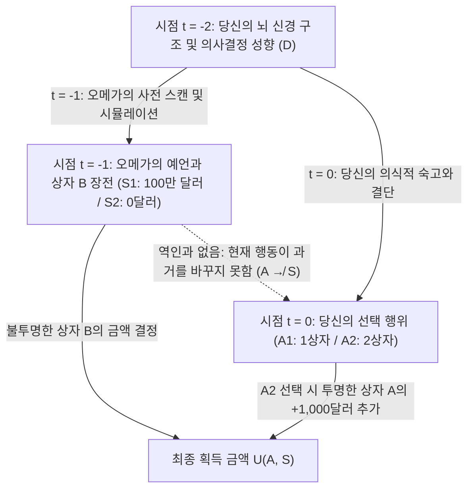
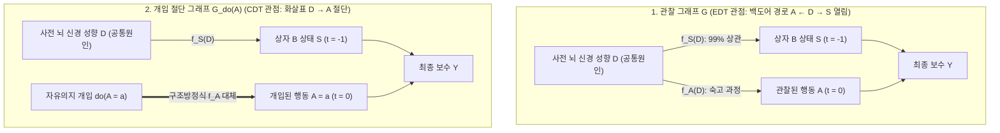

## 1. 합리성의 두 기둥을 분열시킨 사고실험: 뉴컴의 역설 (Newcomb's Paradox, 1960–1969)

1960년, 미국 로렌스 리버모어 국립연구소의 이론물리학자 <strong>윌리엄 뉴컴(William A. Newcomb)</strong>은 게임이론과 죄수의 딜레마를 연구하던 중 현대 의사결정이론(Decision Theory)의 근간을 뒤흔들 사고실험을 고안했다. 이후 하버드 대학교의 철학자 <strong>로버트 노직(Robert Nozick)</strong>이 1969년 기념비적 논문 <strong>《뉴컴의 문제와 두 가지 선택 원리》(*"Newcomb's Problem and Two Principles of Choice"*)</strong>를 통해 이 문제를 학계에 공식 발표했고, 마틴 가드너(Martin Gardner)가 1973년과 1974년 《사이언티픽 아메리칸》(*Scientific American*) 칼럼에 소개하면서 철학자, 수리경제학자, 물리학자, 인공지능 연구자들을 두 진영으로 갈라놓았다.

노직은 1969년 논문의 서두에서 이 역설의 기묘한 위력을 다음과 같이 묘사했다.

> "거의 모든 사람에게 무엇을 해야 하는지는 완전히 명백하고 자명해 보인다. 문제는 이 질문을 마주한 사람들이 거의 정확히 반으로 갈라지며, 각 진영의 대다수가 반대쪽 절반을 그저 어리석다고 생각한다는 점이다."
> — <strong>Robert Nozick (1969)</strong>, *"Newcomb's Problem and Two Principles of Choice"*

---

### 1.1 표준 실험 설정: 두 개의 상자와 초인적 예언자 오메가($\Omega$)

당신 앞의 테이블 위에 두 개의 상자—<strong>투명한 상자 A(Transparent Box A)</strong>와 <strong>불투명한 상자 B(Opaque Box B)</strong>—가 놓여 있다.

1. <strong>투명한 상자 A</strong>: 밖에서 내부가 훤히 보이는 유리 상자로, 그 안에는 확실히 <strong>$\$1,000$</strong>의 현금이 들어 있다.
2. <strong>불투명한 상자 B</strong>: 내부가 보이지 않는 강철 상자로, 그 안에는 <strong>$\$1,000,000$(100만 달러)</strong>가 들어 있거나, 아니면 <strong>$\$0$(비어 있음)</strong>이다.

현재 시점 $t = 0$에서 당신이 내릴 수 있는 선택(행위 $A$)은 다음 두 가지뿐이다.

- <strong>1상자 선택 (One-Boxing, $A_1$)</strong>: 투명한 상자 A를 포기하고 <strong>불투명한 상자 B만</strong> 가져간다.
- <strong>2상자 선택 (Two-Boxing, $A_2$)</strong>: <strong>투명한 상자 A와 불투명한 상자 B를 둘 다</strong> 가져간다.

이 게임의 핵심 인물은 초인적 <strong>예언자 오메가(Predictor Omega, $\Omega$)</strong>이다. $\Omega$는 당신의 전뇌 신경망 스캔과 시냅스 가중치 시뮬레이션을 통해 인간의 선택을 <strong>$99\%$의 정확도($p = 0.99$)</strong>로 사전 예측해 온 검증된 존재다. <strong>어제(시점 $t = -1$)</strong>, $\Omega$는 당신이 오늘($t = 0$) 어떤 선택을 내릴지 예측한 뒤 다음 규칙에 따라 상자 B를 준비하고 떠났다.

- <strong>세계 상태 $S_1$ ($\text{Pred}_1$: $\Omega$가 당신이 '1상자($A_1$)'를 선택할 것이라 예언함)</strong>:
  $\Omega$는 어제 불투명한 상자 B 안에 <strong>$\$1,000,000$</strong>를 넣었다.
- <strong>세계 상태 $S_2$ ($\text{Pred}_2$: $\Omega$가 당신이 '2상자($A_2$)'를 선택할 것이라 예언함)</strong>:
  $\Omega$는 어제 불투명한 상자 B를 <strong>빈 상태($\$0$)</strong>로 두었다.

여기서 <strong>과거의 인과적 폐쇄성(Causal Closure of the Past)</strong>이 엄격히 보장된다. 즉, 역인과(Retrocausality, $A \to S$)는 물리적으로 존재하지 않으며, 지금 당신이 상자 A에 손을 댄다고 해서 이미 어제 확정된 상자 B 속의 100만 달러가 증발하는 일은 절대 없다.

| 오늘 당신의 선택 (시점 $t = 0$) | 상태 $S_1$ ($\text{Pred}_1$): $\Omega$가 1상자($A_1$) 예언 (상자 B에 $\$1,000,000$) | 상태 $S_2$ ($\text{Pred}_2$): $\Omega$가 2상자($A_2$) 예언 (상자 B에 $\$0$) |
| :--- | :---: | :---: |
| <strong>$A_1$: 상자 B만 가져간다 (1상자파 / One-Boxing)</strong> | <strong>$\$1,000,000$</strong> | <strong>$\$0$</strong> |
| <strong>$A_2$: 상자 A와 B 모두 가져간다 (2상자파 / Two-Boxing)</strong> | <strong>$\$1,001,000$</strong> | <strong>$\$1,000$</strong> |

---

## 2. 제1기둥: 증거적 결정이론(EDT)과 '1상자파'의 수리적 논증

1상자파(One-Boxers)의 이론적 토대는 철학자 <strong>리처드 제프리(Richard C. Jeffrey)</strong>가 1965년 명저 <strong>《결정의 논리》(*The Logic of Decision*)</strong>에서 정립한 <strong>증거적 결정이론(Evidential Decision Theory, EDT)</strong>이다.

### 2.1 조건부 기대효용과 '뉴스 가치(News Value)'

제프리의 프레임워크에서 행위 $A_i$의 가치는 그 행위가 참이라는 소식(증거)이 알려졌을 때 기대되는 <strong>조건부 기대효용(Evidential Conditional Expected Utility, 즉 뉴스 가치)</strong>으로 정의된다.

$$\text{EU}_{\text{EDT}}(A_i) = \sum_{j} \mathbb{P}(S_j \mid A_i)\, U(A_i, S_j)$$

$\Omega$의 예측 정확도가 $99\%$이므로 $\mathbb{P}(S_1 \mid A_1) = 0.99$, $\mathbb{P}(S_2 \mid A_1) = 0.01$이고, $\mathbb{P}(S_1 \mid A_2) = 0.01$, $\mathbb{P}(S_2 \mid A_2) = 0.99$이다. 이를 대입하면 다음과 같다.

$$\begin{aligned}
\text{EU}_{\text{EDT}}(A_1) &= 0.99 \times \$1,000,000 + 0.01 \times \$0 = \$990,000 \\
\text{EU}_{\text{EDT}}(A_2) &= 0.01 \times \$1,001,000 + 0.99 \times \$1,000 = \$10,010 + \$990 = \$11,000
\end{aligned}$$

즉, $\text{EU}_{\text{EDT}}(A_1) - \text{EU}_{\text{EDT}}(A_2) = +\$979,000 > 0$으로 1상자 선택($A_1$)이 압도적 우위를 점한다. 일반적으로 상자 B의 상금을 $M$, 상자 A의 상금을 $k$, 예언 정확도를 $p$라 할 때, EDT가 $A_1$을 선택할 필요충분조건은 다음과 같다.

$$p M > (1 - p)(M + k) + p k \iff p > \frac{1}{2} + \frac{k}{2M} = 0.5005 \quad (50.05\%)$$

이에 기반해 1상자파는 2상자파에게 결정이론 역사상 가장 유명한 조롱을 던진다. <strong>"당신들이 그렇게 똑똑하다면(합리적이라면), 왜 부자가 아닌가?(If you're so smart, why ain't you rich?)"</strong>

---

## 3. 제2기둥: 인과적 결정이론(CDT), 엄격 지배 원리, 그리고 펄의 $do$-연산자

반면 <strong>앨런 기버드와 윌리엄 하퍼(Gibbard & Harper, 1978)</strong>, <strong>브라이언 스컴스(Brian Skyrms, 1980)</strong>, <strong>데이비드 루이스(David Lewis, 1981)</strong>, 그리고 튜링상 수상자 <strong>주디어 펄(Judea Pearl, 2000)</strong>이 확립한 <strong>인과적 결정이론(Causal Decision Theory, CDT)</strong>은 EDT가 <strong>'진단적 상관관계(Diagnostic Correlation)'와 '인과적 효력(Causal Efficacy)'을 혼동</strong>하고 있다고 비판한다.

### 3.1 엄격 지배 원리(Strict Dominance)와 반사실적 조건문

레너드 새비지(Savage, 1954)의 <strong>엄격 지배 원리</strong>에 따르면, 세계 상태 $\{S_1, S_2\}$가 행위자의 현재 행동으로부터 인과적으로 독립되어 있을 때 모든 상태 $S_j$에서 $U(A_2, S_j) > U(A_1, S_j)$이면 합리적 행위자는 반드시 $A_2$를 선택해야 한다.
- 상태 $S_1$(상자 B에 100만 달러가 이미 있음): 2상자 선택 시 $\$1,001,000 >$ 1상자 선택 시 $\$1,000,000$ ($+\$1,000$ 이득).
- 상태 $S_2$(상자 B가 이미 비어 있음): 2상자 선택 시 $\$1,000 >$ 1상자 선택 시 $\$0$ ($+\$1,000$ 이득).

기버드와 하퍼(1978)는 조건부 확률 $\mathbb{P}(S_j \mid A_i)$를 루이스의 <strong>반사실적 조건문 확률 $\mathbb{P}(A_i \Box\!\to S_j)$</strong>로 대체했고, 주디어 펄(2000)은 <strong>구조적 인과 모델(SCM)</strong>의 <strong>개입 연산자 $do(A_i)$</strong>로 CDT를 정식화했다.

$$\text{EU}_{\text{CDT}}(A_i) = \sum_{j} \mathbb{P}(S_j \mid do(A_i))\, U(A_i, S_j)$$

### 3.2 공통원인 포크($S \leftarrow D \to A$)와 그래프 절단 수술

뉴컴 문제의 인과 그래프에서 당신의 사전 뇌 성향 $D$는 어제 $\Omega$의 예측 $S = f_S(D, U_S)$와 오늘 당신의 행동 $A = f_A(D, U_A)$를 동시에 야기하는 <strong>공통원인(Common Cause)</strong>으로서 <strong>포크 구조($S \leftarrow D \to A$)</strong>를 형성한다.

EDT가 사용하는 관찰 확률 $\mathbb{P}(S \mid A)$는 <strong>백도어 경로(Back-door Path) $A \leftarrow D \to S$</strong>를 통해 정보가 역류한다. 반면 CDT가 사용하는 개입 확률 $\mathbb{P}(S \mid do(A_i))$는 그래프 수술(Graph Surgery)을 통해 $D \to A$ 화살표를 절단하므로 백도어 경로가 차단되어 다음이 엄밀히 성립한다.

$$\mathbb{P}(S_j \mid do(A_i)) = \mathbb{P}(S_j) \implies \text{EU}_{\text{CDT}}(A_2) - \text{EU}_{\text{CDT}}(A_1) = +\$1,000 > 0$$

---

## 4. 의학적 뉴컴 문제(흡연 병변)와 막스 베버의 칼뱅주의 예정설

### 4.1 스컴스의 '흡연 병변(The Smoking Lesion, 1980)'

로널드 피셔(Ronald Fisher)의 체질 가설을 바탕으로 브라이언 스컴스가 정식화한 <strong>흡연 병변(Smoking Lesion)</strong> 문제를 보자. 담배 연기 자체에는 발암 물질이 전혀 없어 <strong>흡연이 폐암을 직접 유발하지 않지만($A_{\text{smoke}} \not\to C$)</strong>, 선천적 유전자 병변 $L$이 $99\%$ 확률로 흡연 욕구($A_{\text{smoke}}$, 쾌락 효용 $+1$)와 폐암 발병($C$, 고통 효용 $-1,000$)을 동시에 일으킨다고 하자($C \leftarrow L \to A$).
- <strong>EDT의 미신적 처방</strong>: 금연 시 $\text{EU}_{\text{EDT}}(A_{\text{abstain}}) = -10$, 흡연 시 $\text{EU}_{\text{EDT}}(A_{\text{smoke}}) = -989$이므로, EDT는 <strong>"자신이 선천적 폐암 유전자 $L$을 가지고 태어났을 조건부 확률을 낮추기 위해 금연하라!"</strong>는 자기기만적 결론을 내린다.
- <strong>CDT의 합리적 처방</strong>: $\mathbb{P}(C \mid do(A)) = \mathbb{P}(C)$이므로 유전자는 바뀌지 않는다는 사실을 직시하고 흡연의 $+1$ 효용을 선택한다.

### 4.2 막스 베버 《프로테스탄티즘의 윤리와 자본주의 정신》의 칼뱅주의 예정설

노직(1969)이 지적했듯, 장 칼뱅(Jean Calvin)의 <strong>이중 예정설(Predestination)</strong>과 <strong>막스 베버(Max Weber, 1905)</strong>가 분석한 청교도의 행동 원리는 뉴컴의 역설과 완벽한 구조적 동형($\text{구원 예정 } S_1 \leftarrow \text{신의 은총 } D \to \text{세속 내 금욕 } A_1$)을 이룬다. 신의 구원 여부($S_1, S_2$)는 창세 전에 확정되어 인간의 선행($A_1$)으로 바꿀 수 없음에도($A \not\to S$), 청교도들은 구원의 불안(Certitudo salutis)을 해소하기 위해 금욕적 노동을 구원의 <strong>'실재 근거(Causa salutis)'</strong>가 아닌 선택받았음의 <strong>'인식 근거(Cognoscendi ratio, 진단적 증거)'</strong>로 삼아 $\mathbb{P}(S_1 \mid A_1)$을 극대화하는 EDT적 삶을 실천했던 것이다.

---

## 5. 엘스의 '간지럼 방어(Tickle Defense)'와 데이비드 루이스의 '쌍둥이 죄수의 딜레마'

### 5.1 엘스의 '간지럼 방어(The Tickle Defense, 1982)'와 비준 가능성(Ratifiability)

철학자 <strong>엘러리 엘스(Ellery Eells, 1982)</strong>는 흡연 병변에서 유전자 $L$이 행위 $A$를 직접 강제하는 것이 아니라 의식적인 욕구·신념 상태인 '간지럼(Tickle, $T$)'을 거쳐 행위를 유발한다($C \leftarrow L \to T \to A$)고 지적했다. 행위자가 내성(Introspection)을 통해 자신의 내면 상태 $T$를 이미 알고 있다면, 마르코프 <strong>차폐(Screening-Off)</strong>에 의해 $\mathbb{P}(C \mid A, T) = \mathbb{P}(C \mid T)$가 되어 EDT도 흡연을 선택하게 된다. 그러나 뉴컴 문제에서는 $\Omega$가 숙고의 최종 결단 자체를 예측하며, 리처드 제프리(1983)의 <strong>비준 가능성(Ratifiability)</strong> 기준을 적용하면 1상자 선택 결정($\text{Decide}(A_1)$)이 내려진 조건하에서 다시 2상자($A_2$)로 바꾸는 것이 $+\$1,000$ 유리해져 1상자 선택은 비준 불가능(Unratifiable)해진다.

### 5.2 데이비드 루이스의 동형 정리: "죄수의 딜레마는 뉴컴 문제이다" (1979)

1979년 <strong>데이비드 루이스(David Lewis)</strong>는 <strong>《Prisoners' Dilemma Is a Newcomb Problem》</strong>에서 <strong>심리학적 쌍둥이(혹은 동일한 소스 코드를 실행하는 클론)와 벌이는 단판 죄수의 딜레마는 뉴컴의 역설과 100% 구조적으로 동형</strong>임을 증명했다.

| 방 1에서 당신의 선택 | 쌍둥이가 '협력($\text{Twin } C_{\text{PD}}$)' 선택 (당신에게 $\$1,000,000$ 부여) | 쌍둥이가 '배신($\text{Twin } D_{\text{PD}}$)' 선택 (당신에게 $\$0$ 부여) |
| :--- | :---: | :---: |
| <strong>$C_{\text{PD}}$: 협력 (자신의 $\$1,000$ 포기)</strong> | <strong>$\$1,000,000$</strong> | <strong>$\$0$</strong> |
| <strong>$D_{\text{PD}}$: 배신 (자신의 $+\$1,000$ 획득)</strong> | <strong>$\$1,001,000$</strong> | <strong>$\$1,000$</strong> |

$\Omega$가 어제 당신을 예측한 방식은 본질적으로 <strong>컴퓨터 안에서 당신의 복제 클론(쌍둥이)을 시뮬레이션한 것</strong>이므로, 쌍둥이가 어제 시뮬레이터 안에 있었는지 오늘 옆방에 있는지는 시공간 좌표의 차이일 뿐이다. 루이스는 죄수의 딜레마에서 배신($D_{\text{PD}}$)이 엄격 지배 전략이므로 뉴컴 문제에서도 2상자($A_2$)를 택해야 한다고 보았고, 반대로 <strong>더글러스 호프스태터(Douglas Hofstadter, 1983)</strong>는 동일한 합리적 함수를 공유함을 자각하는 <strong>초합리성(Superrationality)</strong>을 통해 협력($C_{\text{PD}}$)과 1상자($A_1$)를 옹호했다.

---

## 6. 현대 AI 얼라인먼트의 최전선: 기능적 결정이론(FDT)과 논리적 반사실

21세기 인공지능 시대에 접어들며, 자신의 소스 코드가 상대방이나 시뮬레이터에 의해 100% 읽히고 모의실험되는 소프트웨어 에이전트에게 뉴컴 문제는 일상의 현실이 되었다. 2017년 <strong>엘리에저 유드코우스키(Eliezer Yudkowsky)</strong>와 <strong>네이트 소어스(Nate Soares)</strong>는 <strong>무시간적 결정이론(TDT)</strong>과 웨이 다이(Wei Dai)의 <strong>무갱신 결정이론(UDT)</strong>을 통합하여 <strong>기능적 결정이론(Functional Decision Theory, FDT)</strong>을 정립했다.

### 6.1 FDT의 핵심: 물리적 노드 $A$가 아닌 '수학적 결정 함수 $\mathsf{F}$'에 대한 개입

CDT는 어제 시뮬레이터 속의 함수 $\mathsf{F}(\mathcal{I})$는 $A_1$을 출력한 채 고정하고 오늘 물리적 행동 $A$만 $A_2$로 바꾸는 <strong>논리적으로 불가능한 반사실</strong>을 가정한다. 반면 FDT는 에이전트를 추상적 <strong>수학적 함수 $\mathsf{F}: \mathcal{I} \to \mathcal{A}$</strong>로 모델링하고 함수 출력 자체에 대한 논리적·기능적 개입 $do(\mathsf{F}(\mathcal{I}) = a)$를 수행한다.

$$\text{EU}_{\text{FDT}}(a) = \sum_{j} \mathbb{P}\!\left(S_j \;\middle|\; do(\mathsf{F}(\mathcal{I}) = a)\right) U(a, S_j)$$

1. <strong>뉴컴의 역설</strong>: $\Omega$의 예측 $S = f_S(\mathsf{F}(\mathcal{I}), U_S)$는 함수 $\mathsf{F}(\mathcal{I})$의 하류 결과이므로 $do(\mathsf{F}(\mathcal{I}) = A_1)$은 시뮬레이션과 현재 행동을 동시에 $A_1$으로 결정하여 <strong>1상자($A_1$)를 선택해 100만 달러를 획득한다!</strong>
2. <strong>흡연 병변 문제</strong>: 유전자 $L$은 함수 $\mathsf{F}(\mathcal{I})$의 시뮬레이션이 아니라 상류의 물리적 상태이므로($C \leftarrow L \to \mathcal{I} \to \mathsf{F}(\mathcal{I}) \to A$), $do(\mathsf{F}(\mathcal{I}) = a)$는 폐암 확률을 바꾸지 않아 <strong>미신 없이 흡연($A_{\text{smoke}}$)을 선택한다!</strong>
3. <strong>투명한 뉴컴 문제(파핏의 히치하이커) 및 프로그램 균형(Program Equilibrium)</strong>: 상자 B가 투명하여 100만 달러가 눈앞에 보이는 상황에서도 FDT/UDT는 사전 정책 최적화를 통해 상자 B만 가져가며, 상호 소스 코드를 읽는 죄수의 딜레마에서는 <strong>뢰브의 정리(Löb's Theorem: $\square(\square P \to P) \to \square P$)</strong>에 기반한 `FairBot`을 통해 증명 가능한 상호 협력을 달성한다.

### 6.2 3대 결정이론(EDT / CDT / FDT) 종합 비교표

| 비교 차원 / 벤치마크 딜레마 | 증거적 결정이론 (EDT — Jeffrey 1965) | 인과적 결정이론 (CDT — Lewis, Pearl) | 기능적 결정이론 (FDT / UDT — Yudkowsky & Soares 2017) |
| :--- | :--- | :--- | :--- |
| <strong>핵심 기대효용 공식</strong> | $\sum_j \mathbb{P}(S_j \mid A_i)\, U(A_i, S_j)$ | $\sum_j \mathbb{P}(S_j \mid do(A_i))\, U(A_i, S_j)$ | $\sum_j \mathbb{P}(S_j \mid do(\mathsf{F}(\mathcal{I}) = a))\, U(a, S_j)$ |
| <strong>선택의 핵심 원리</strong> | 행위의 <strong>진단적 뉴스 가치</strong> 극대화 | 국소적 <strong>물리적 인과 개입 효력</strong> 극대화 | <strong>결정 함수 $\mathsf{F}$ 출력의 논리적·기능적 개입 효력</strong> 극대화 |
| <strong>1. 표준 뉴컴의 역설</strong> | <strong>1상자 선택($A_1$)</strong> ($\$1,000,000$ 획득) | <strong>2상자 선택($A_2$)</strong> ($\$1,000$ 획득) | <strong>1상자 선택($A_1$)</strong> ($\$1,000,000$ 획득) |
| <strong>2. 의학적 뉴컴 (흡연 병변)</strong> | <strong>금연($A_{\text{abstain}}$)</strong> (유전자를 바꾸려는 미신) | <strong>흡연($A_{\text{smoke}}$)</strong> (유전자 불변 인식, $+1$ 획득) | <strong>흡연($A_{\text{smoke}}$)</strong> (유전자는 $\mathsf{F}$의 모의실험 아님, $+1$) |
| <strong>3. 쌍둥이 죄수의 딜레마</strong> | <strong>협력($C_{\text{PD}}$)</strong> (공통 $\$1,000,000$ 획득) | <strong>배신($D_{\text{PD}}$)</strong> ($\$1,000$ 내시 균형 함몰) | <strong>협력($C_{\text{PD}}$)</strong> (공유 함수 $\mathsf{F}$로 $\$1,000,000$ 획득) |
| <strong>4. 투명한 뉴컴 / 히치하이커</strong> | <strong>2상자 / 지불 거부</strong> (관찰 후 갱신으로 $\$0$) | <strong>2상자 / 지불 거부</strong> (지배 원리 배신으로 $\$0$) | <strong>1상자 / 지불 이행</strong> (무갱신 정책 최적화로 $\$1,000,000$) |

---

## 참고문헌 (References)

- <strong>Nozick, R. (1969)</strong>. "Newcomb's Problem and Two Principles of Choice." In *Essays in Honor of Carl G. Hempel* (pp. 114–146).
- <strong>Jeffrey, R. C. (1965 / 1983)</strong>. *The Logic of Decision*. University of Chicago Press.
- <strong>Lewis, D. (1979)</strong>. "Prisoners' Dilemma Is a Newcomb Problem." *Philosophy & Public Affairs*, 8(3), 235–240.
- <strong>Pearl, J. (2000 / 2009)</strong>. *Causality: Models, Reasoning, and Inference*. Cambridge University Press.
- <strong>Yudkowsky, E., & Soares, N. (2017)</strong>. "Functional Decision Theory: A New Theory of Instrumental Rationality." *arXiv:1710.05060*.
