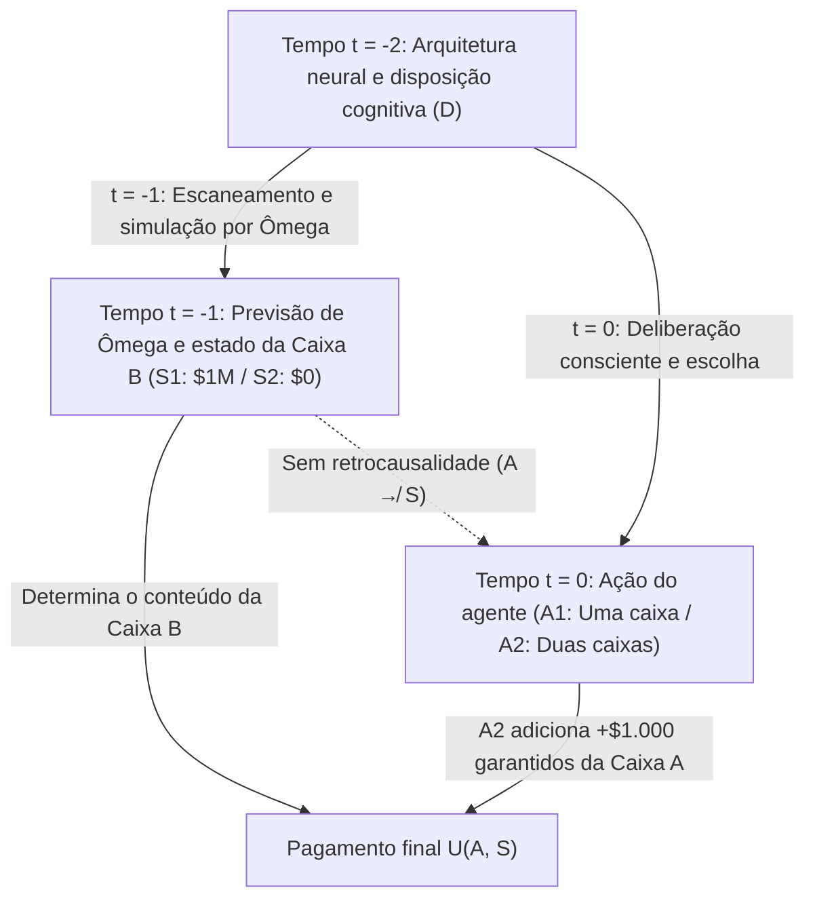
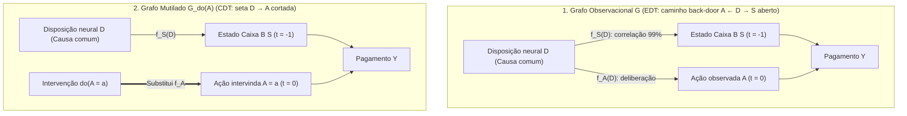

## 1. O Experimento Mental que Fraturou a Racionalidade: O Paradoxo de Newcomb (1960–1969)

Em 1960, o físico teórico <strong>William A. Newcomb</strong>, no Laboratório Nacional Lawrence Livermore da Universidade da Califórnia, formulou um problema de escolha aparentemente simples que abalaria os alicerces da teoria da decisão racional. Apresentado à comunidade acadêmica pelo filósofo de Harvard <strong>Robert Nozick</strong> em seu artigo clássico de 1969, <strong>*«Newcomb's Problem and Two Principles of Choice»*</strong> (publicado em *Essays in Honor of Carl G. Hempel*), e popularizado por Martin Gardner na *Scientific American* (1973, 1974), o paradoxo dividiu economistas, matemáticos, físicos e filósofos em dois campos irreconciliáveis.

Nozick imortalizou esse impasse logo na abertura de seu artigo:

> *«Para quase todo mundo, é perfeitamente claro e óbvio o que deve ser feito. A dificuldade é que essas pessoas parecem se dividir quase igualmente sobre o problema, com grandes frações pensando que a outra metade está apenas sendo tola.»*
> — <strong>Robert Nozick (1969)</strong>, *"Newcomb's Problem and Two Principles of Choice"*

---

### 1.1 O Cenário Canônico: Duas Caixas e o Previsor Ômega ($\Omega$)

Você está diante de uma mesa com duas caixas: a <strong>Caixa Transparente A</strong> e a <strong>Caixa Opaca B</strong>.

1. <strong>Caixa Transparente A</strong>: Feita de vidro transparente; contém visivelmente <strong>$\$1.000$</strong> em dinheiro vivo.
2. <strong>Caixa Opaca B</strong>: Feita de aço lacrado; você sabe com certeza que ela contém ou <strong>$\$1.000.000$</strong> (um milhão de dólares) ou <strong>$\$0$</strong> (nada).

No instante presente $t = 0$, você deve escolher entre duas ações:

- <strong>Pegar uma única caixa (One-Boxing, $A_1$)</strong>: Abrir mão da Caixa A e <strong>levar apenas a Caixa Opaca B</strong>.
- <strong>Pegar ambas as caixas (Two-Boxing, $A_2$)</strong>: <strong>Levar tanto a Caixa A quanto a Caixa B</strong>.

A figura central nos bastidores é um <strong>Previsor sobre-humano, Ômega ($\Omega$)</strong>, cujos escâneres cerebrais e simulações neurocomputacionais previram escolhas humanas com uma precisão empiricamente verificada de <strong>$99\%$ ($p = 0,99$)</strong> em milhares de testes anteriores. <strong>Ontem (em $t = -1$)</strong>, $\Omega$ previu sua escolha de hoje e preparou a Caixa B segundo esta regra estrita:

- <strong>Estado do mundo $S_1$ ($\text{Pred}_1$: $\Omega$ previu que você pegaria apenas a Caixa B, $A_1$)</strong>:
  $\Omega$ colocou ontem <strong>$\$1.000.000$</strong> dentro da Caixa B.
- <strong>Estado do mundo $S_2$ ($\text{Pred}_2$: $\Omega$ previu que você pegaria ambas as caixas, $A_2$)</strong>:
  $\Omega$ deixou ontem a Caixa B <strong>completamente vazia ($\$0$)</strong>.

Garante-se estritamente o <strong>fechamento causal do passado</strong>: $\Omega$ já partiu ontem; não há retrocausalidade ($A \not\to S$). Seu movimento de mão hoje em $t = 0$ não pode alterar fisicamente o conteúdo da Caixa B.

| Sua escolha hoje (em $t = 0$) | Estado $S_1$ ($\text{Pred}_1$): $\Omega$ previu $A_1$ (Caixa B contém $\$1.000.000$) | Estado $S_2$ ($\text{Pred}_2$): $\Omega$ previu $A_2$ (Caixa B contém $\$0$) |
| :--- | :---: | :---: |
| <strong>$A_1$: Pegar apenas a Caixa B (One-Boxing)</strong> | <strong>$\$1.000.000$</strong> | <strong>$\$0$</strong> |
| <strong>$A_2$: Pegar as Caixas A e B (Two-Boxing)</strong> | <strong>$\$1.001.000$</strong> | <strong>$\$1.000$</strong> |

---

## 2. Pilar I: Teoria da Decisão Evidencial (EDT) e o Argumento para Uma Caixa

O fundamento formal dos defensores de uma caixa é a <strong>Teoria da Decisão Evidencial (Evidential Decision Theory, EDT)</strong>, formulada por <strong>Richard C. Jeffrey</strong> em <strong>*The Logic of Decision* (1965; 2.ª ed. 1983)</strong>.

### 2.1 Utilidade Esperada Condicional e «Valor de Notícia (News Value)»

Na álgebra booleana unificada de Jeffrey, cada ação $A_i$ é avaliada por seu <strong>valor de notícia (News Value)</strong>, ponderando cada resultado pela probabilidade condicional bayesiana $\mathbb{P}(S_j \mid A_i)$:

$$\text{EU}_{\text{EDT}}(A_i) = \sum_{j} \mathbb{P}(S_j \mid A_i)\, U(A_i, S_j)$$

Com $\mathbb{P}(S_1 \mid A_1) = 0,99$, $\mathbb{P}(S_2 \mid A_1) = 0,01$ e $\mathbb{P}(S_1 \mid A_2) = 0,01$, $\mathbb{P}(S_2 \mid A_2) = 0,99$, obtemos:

$$\begin{aligned}
\text{EU}_{\text{EDT}}(A_1) &= 0,99 \times \$1.000.000 + 0,01 \times \$0 = \$990.000 \\
\text{EU}_{\text{EDT}}(A_2) &= 0,01 \times \$1.001.000 + 0,99 \times \$1.000 = \$10.010 + \$990 = \$11.000
\end{aligned}$$

Em geral, para um prêmio $M$ em B, uma quantia $k$ em A e uma precisão $p$:

$$\text{EU}_{\text{EDT}}(A_1) > \text{EU}_{\text{EDT}}(A_2) \iff p M > (1-p)(M+k) + pk \iff p > \frac{1}{2} + \frac{k}{2M} = 0,5005$$

Basta que a precisão de Ômega supere $50,05\%$ para que a EDT ordene pegar uma única caixa ($A_1$), originando a célebre provocação empírica contra os defensores de duas caixas: <strong>*«Se você é tão esperto, por que não é rico?» (If you're so smart, why ain't you rich?)*</strong>

---

## 3. Pilar II: Teoria da Decisão Causal (CDT), Dominância Estrita e o Cálculo-$do$ de Pearl

Os fundadores da <strong>Teoria da Decisão Causal (Causal Decision Theory, CDT)</strong> — <strong>Allan Gibbard e William Harper (1978)</strong>, <strong>Brian Skyrms (1980)</strong>, <strong>David Lewis (1981)</strong>, <strong>James Joyce (1999)</strong> e <strong>Judea Pearl (2000)</strong> — demonstraram que a EDT confunde <strong>correlação diagnóstica (evidência estatística)</strong> com <strong>eficácia causal</strong>.

### 3.1 Princípio da Dominância Estrita e Condicionais Contrafactuais

Pelo <strong>princípio da dominância estrita</strong> de Leonard Savage (1954), como o estado da Caixa B ($S_1$ ou $S_2$) já está fixado no passado e é causalmente independente de sua ação $A$, pegar ambas as caixas ($A_2$) rende estritamente $+\$1.000$ a mais em *qualquer* estado do mundo ($1.001.000 > 1.000.000$ e $1.000 > 0$).

Gibbard e Harper (1978) substituíram $\mathbb{P}(S_j \mid A_i)$ pela probabilidade do condicional contrafactual de Stalnaker-Lewis $\mathbb{P}(A_i \Box\!\to S_j)$, enquanto <strong>Judea Pearl (2000)</strong> formalizou a CDT via <strong>Modelos Causais Estruturais (SCM)</strong> e o operador de intervenção <strong>$do(A_i)$</strong>:

$$\text{EU}_{\text{CDT}}(A_i) = \sum_{j} \mathbb{P}(S_j \mid do(A_i))\, U(A_i, S_j)$$

### 3.2 O Garfo de Causa Comum ($S \leftarrow D \to A$) e a Cirurgia de Grafo

No grafo acíclico direcionado (DAG), sua disposição neural prévia $D$ atua como uma <strong>causa comum (Common-Cause Fork: $S \leftarrow D \to A$)</strong> tanto da previsão de Ômega ontem $S = f_S(D, U_S)$ quanto de sua escolha hoje $A = f_A(D, U_A)$.

Enquanto o condicionamento observacional $\mathbb{P}(S \mid A)$ abre o <strong>caminho de porta dos fundos (back-door path) $A \leftarrow D \to S$</strong>, a <strong>cirurgia de grafo ($do(A_i)$)</strong> de Pearl corta a seta $D \to A$, resultando em:

$$\mathbb{P}(S_j \mid do(A_i)) = \mathbb{P}(S_j) \implies \text{EU}_{\text{CDT}}(A_2) - \text{EU}_{\text{CDT}}(A_1) = +\$1.000 > 0$$

---

## 4. Problemas de Newcomb Médicos (A Lesão do Fumante) e a Predestinação Calvinista em Max Weber

### 4.1 A «Lesão do Fumante (The Smoking Lesion, Skyrms 1980)»

Baseado na hipótese constitucional de Ronald Fisher, Brian Skyrms (1980) propôs o caso da <strong>lesão do fumante</strong>: suponha que fumar tabaco seja quimicamente inofensivo ($A_{\text{smoke}} \not\to C$), mas uma lesão genética congênita $L$ provoque com $99\%$ de probabilidade tanto o desejo de fumar ($A_{\text{smoke}}$, prazer $+1$) quanto câncer de pulmão letal ($C$, utilidade $-1.000$).
- No garfo $C \leftarrow L \to A$, a <strong>EDT</strong> calcula $\text{EU}_{\text{EDT}}(A_{\text{abstain}}) = -10$ contra $\text{EU}_{\text{EDT}}(A_{\text{smoke}}) = -989$, ordenando supersticiosamente que você não fume para reduzir a probabilidade condicional de ter nascido com o gene $L$!
- A <strong>CDT</strong> reconhece via $\mathbb{P}(C \mid do(A)) = \mathbb{P}(C)$ que seu DNA é imutável e recomenda racionalmente apreciar o cigarro ($+1$).

### 4.2 Isomorfismo Estrutural com a Predestinação Calvinista de Max Weber (1905)

Como observou Nozick (1969), a doutrina da <strong>dupla predestinação</strong> de João Calvino analisada por <strong>Max Weber</strong> em *A Ética Protestante e o Espírito do Capitalismo* (1904–1905) constitui um problema de Newcomb teológico: Deus decretou antes da criação quem pertence aos <strong>Eleitos ($S_1$)</strong> e quem pertence aos <strong>Réprobos ($S_2$)</strong>, sem que nenhuma obra humana ($A_1$) possa alterar causalmente esse decreto ($A \not\to S$). Contudo, os puritanos praticaram um rigoroso <strong>ascetismo intramundano ($A_1$)</strong> não como *causa da salvação (causa salutis)*, mas como <strong>sinal diagnóstico da eleição (*cognoscendi ratio*)</strong> dentro do garfo $\text{Salvação } S_1 \leftarrow \text{Graça divina } D \to \text{Obras ascéticas } A_1$, maximizando $\mathbb{P}(S_1 \mid A_1)$ exatamente como agentes da EDT.

---

## 5. A «Tickle Defense» de Ellery Eells e o Dilema do Prisioneiro Gêmeo de David Lewis

### 5.1 A «Defesa da Cócega (Tickle Defense, 1982)» e a Ratificabilidade

Para salvar a EDT da lesão do fumante, <strong>Ellery Eells (1982)</strong> argumentou que a lesão $L$ só causa o ato $A$ por meio de um desejo consciente ou «cócega» $T = (\mathcal{B}, \mathcal{D})$ ($C \leftarrow L \to T \to A$). Se o agente conhece $T$ por introspecção antes de agir, condicionar sobre $T$ <strong>blinda (Screening-Off)</strong> a correlação entre $A$ e $L$: $\mathbb{P}(C \mid A, T) = \mathbb{P}(C \mid T)$, fazendo a EDT coincidir com a CDT. Todavia, no problema de Newcomb, $\Omega$ prevê a própria decisão final, e o critério de <strong>ratificabilidade (Ratifiability, Jeffrey 1983)</strong> demonstra que decidir pegar uma caixa ($\text{Decide}(A_1)$) não é ratificável, pois dado $\text{Decide}(A_1)$, mudar para $A_2$ rende $+\$1.000$ adicionais.

### 5.2 O Teorema de Isomorfismo de David Lewis: *«Prisoners' Dilemma Is a Newcomb Problem»* (1979)

Em 1979, <strong>David Lewis</strong> provou que o Dilema do Prisioneiro de jogada única contra um gêmeo psicológico (ou um clone que executa o mesmo código-fonte) é $100\%$ isomorfo ao paradoxo de Newcomb:
- <strong>Cooperar ($C_{\text{PD}}$: abrir mão de $\$1.000$ próprios para conceder $\$1.000.000$ ao gêmeo)</strong> $\Longleftrightarrow$ <strong>One-Boxing ($A_1$)</strong>.
- <strong>Desertar ($D_{\text{PD}}$: embolsar os $+\$1.000$ próprios)</strong> $\Longleftrightarrow$ <strong>Two-Boxing ($A_2$)</strong>.
Como Ômega prevê você executando ontem uma simulação (um gêmeo) de sua mente, ambos os problemas são idênticos. Lewis concluiu que a racionalidade exige desertar e pegar duas caixas, enquanto <strong>Douglas Hofstadter (1983)</strong> formulou a <strong>super-racionalidade (Superrationality)</strong> para sustentar a cooperação mútua $(C_{\text{PD}}, C_{\text{PD}})$ e o One-Boxing ($A_1$).

---

## 6. Fronteira no Alinhamento de IA: Teoria da Decisão Funcional (FDT)

Para agentes de software (IA) cujo código-fonte pode ser lido ou simulado com $100\%$ de fidelidade em uma *sandbox*, o previsor $\Omega$ é uma realidade cotidiana. Em 2017, <strong>Eliezer Yudkowsky e Nate Soares</strong> (integrando a <strong>TDT</strong> e a <strong>UDT</strong> de Wei Dai) formularam a <strong>Teoria da Decisão Funcional (Functional Decision Theory, FDT)</strong>.

### 6.1 Contrafactuais Lógicos: Intervenção sobre a Função Matemática $\mathsf{F}$

A CDT modela a escolha como um evento físico local $A$ em $(x_0, t_0)$ e avalia $do(A = A_2)$ imaginando o mundo logicamente impossível onde o mesmo algoritmo determinista $\mathsf{F}(\mathcal{I})$ produz $A_1$ ontem no simulador de Ômega e $A_2$ hoje. A FDT intervém diretamente sobre a <strong>saída da função matemática de decisão $\mathsf{F}(\mathcal{I})$</strong>:

$$\text{EU}_{\text{FDT}}(a) = \sum_{j} \mathbb{P}\!\left(S_j \;\middle|\; do(\mathsf{F}(\mathcal{I}) = a)\right) U(a, S_j)$$

1. <strong>Paradoxo de Newcomb</strong>: Como a previsão de Ômega $S = f_S(\mathsf{F}(\mathcal{I}), U_S)$ depende funcionalmente de $\mathsf{F}(\mathcal{I})$, a intervenção $do(\mathsf{F}(\mathcal{I}) = A_1)$ fixa tanto a simulação quanto a ação atual em $A_1$ $\implies$ <strong>a FDT pega uma única caixa ($A_1$) e ganha $\$1.000.000$!</strong>
2. <strong>Lesão do Fumante</strong>: Como o gene congênito $L$ não é uma simulação de $\mathsf{F}(\mathcal{I})$ ($C \leftarrow L \to \mathcal{I} \to \mathsf{F}(\mathcal{I}) \to A$), $do(\mathsf{F}(\mathcal{I}) = a)$ não altera a probabilidade de câncer $\implies$ <strong>a FDT fuma ($A_{\text{smoke}}$) sem cair em superstições!</strong>
3. <strong>Newcomb Transparente (Caroneiro de Parfit) e Equilíbrio de Programas (Teorema de Löb)</strong>: Mesmo se a Caixa B for transparente e você vir o milhão de dólares lá dentro, a FDT/UDT otimiza a política global $\mathsf{F}$ *ex ante* e pega apenas a Caixa B; no dilema do prisioneiro com acesso ao código-fonte, `FairBot` emprega o <strong>teorema de Löb ($\square(\square P \to P) \to \square P$)</strong> para alcançar cooperação mútua formalmente demonstrável.

### 6.2 Tabela Comparativa: EDT vs. CDT vs. FDT/UDT

| Dimensão / Dilema | Teoria Evidencial (EDT — Jeffrey 1965) | Teoria Causal (CDT — Lewis, Pearl) | Teoria Funcional (FDT / UDT — Yudkowsky & Soares 2017) |
| :--- | :--- | :--- | :--- |
| <strong>Fórmula de Utilidade Esperada</strong> | $\sum_j \mathbb{P}(S_j \mid A_i)\, U(A_i, S_j)$ | $\sum_j \mathbb{P}(S_j \mid do(A_i))\, U(A_i, S_j)$ | $\sum_j \mathbb{P}(S_j \mid do(\mathsf{F}(\mathcal{I}) = a))\, U(a, S_j)$ |
| <strong>1. Paradoxo de Newcomb Padrão</strong> | <strong>Uma caixa ($A_1$)</strong> ($\$1.000.000$) | <strong>Duas caixas ($A_2$)</strong> ($\$1.000$) | <strong>Uma caixa ($A_1$)</strong> ($\$1.000.000$) |
| <strong>2. Lesão do Fumante (Médico)</strong> | <strong>Abster-se ($A_{\text{abstain}}$)</strong> (Superstição) | <strong>Fumar ($A_{\text{smoke}}$)</strong> (Correto, $+1$) | <strong>Fumar ($A_{\text{smoke}}$)</strong> (Correto, $+1$) |
| <strong>3. Dilema do Prisioneiro Gêmeo</strong> | <strong>Cooperar ($C_{\text{PD}}$)</strong> ($\$1.000.000$) | <strong>Desertar ($D_{\text{PD}}$)</strong> ($\$1.000$) | <strong>Cooperar ($C_{\text{PD}}$)</strong> ($\$1.000.000$) |
| <strong>4. Newcomb Transparente</strong> | <strong>Duas caixas</strong> (Observação blinda $\implies \$0$) | <strong>Duas caixas</strong> (Dominância $\implies \$0$) | <strong>Uma caixa</strong> (Política global $\implies \$1.000.000$) |

---

## Referências

- <strong>Nozick, R. (1969)</strong>. "Newcomb's Problem and Two Principles of Choice." Em *Essays in Honor of Carl G. Hempel* (pp. 114–146).
- <strong>Jeffrey, R. C. (1965 / 1983)</strong>. *The Logic of Decision*. University of Chicago Press.
- <strong>Lewis, D. (1979)</strong>. "Prisoners' Dilemma Is a Newcomb Problem." *Philosophy & Public Affairs*, 8(3), 235–240.
- <strong>Pearl, J. (2000 / 2009)</strong>. *Causality: Models, Reasoning, and Inference*. Cambridge University Press.
- <strong>Yudkowsky, E., & Soares, N. (2017)</strong>. "Functional Decision Theory: A New Theory of Instrumental Rationality." *arXiv:1710.05060*.
