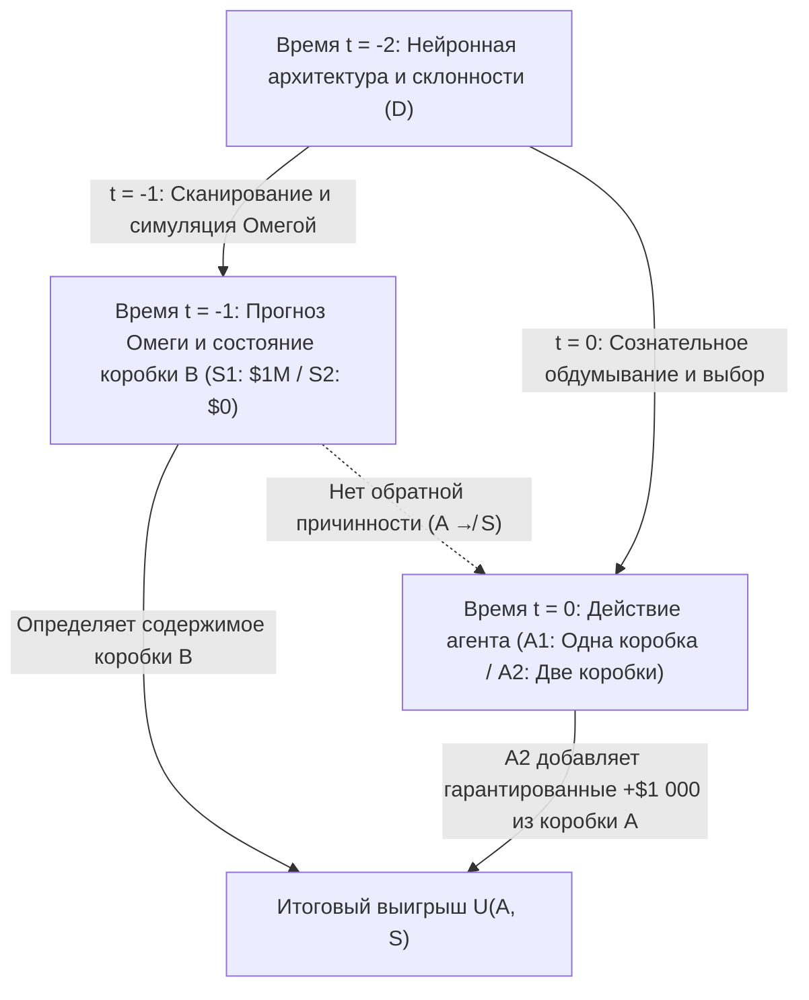
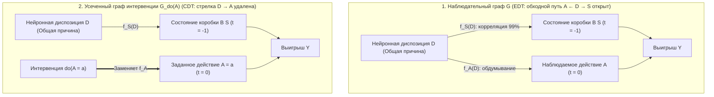

## 1. Мысленный эксперимент, расколовший рациональность: парадокс Ньюкома (1960–1969)

В 1960 году физик-теоретик <strong>Уильям Ньюком (William A. Newcomb)</strong> из Ливерморской национальной лаборатории имени Лоуренса Калифорнийского университета сформулировал обманчиво простую задачу выбора, которой суждено было потрясти основы современной теории рационального выбора. Введенный в научный оборот гарвардским философом <strong>Робертом Нозиком (Robert Nozick)</strong> в его знаменитой статье 1969 года <strong>*«Newcomb's Problem and Two Principles of Choice»*</strong> и популяризированный Мартином Гарднером на страницах *Scientific American* (1973, 1974), этот парадокс расколол экономистов, математиков, физиков и аналитических философов на два непримиримых лагеря.

Нозик описал этот раскол в ставшем классическим вступлении:

> *«Почти для каждого совершенно ясно и очевидно, что следует делать. Трудность заключается в том, что люди делятся по этому вопросу почти поровну, причем значительная часть каждой половины считает противоположную половину просто глупой.»*
> — <strong>Robert Nozick (1969)</strong>, *"Newcomb's Problem and Two Principles of Choice"*

---

### 1.1 Каноническая постановка задачи: две коробки и Предсказатель Омега ($\Omega$)

Перед вами на столе находятся две коробки: <strong>прозрачная коробка A</strong> и <strong>непрозрачная коробка B</strong>.

1. <strong>Прозрачная коробка A</strong>: сделана из прозрачного стекла; в ней отчетливо видны <strong>$\$1\,000$</strong> наличными.
2. <strong>Непрозрачная коробка B</strong>: сделана из запечатанной стали; вы точно знаете, что внутри лежит либо <strong>$\$1\,000\,000$</strong> (один миллион долларов), либо <strong>$\$0$</strong> (пусто).

В настоящий момент времени $t = 0$ вам необходимо выбрать одно из двух действий:

- <strong>Взять одну коробку (One-Boxing, $A_1$)</strong>: отказаться от прозрачной коробки A и <strong>взять только непрозрачную коробку B</strong>.
- <strong>Взять две коробки (Two-Boxing, $A_2$)</strong>: <strong>взять и коробку A, и коробку B</strong>.

Ключевая фигура эксперимента — сверхчеловеческий <strong>Предсказатель Омега ($\Omega$)</strong>, чьи нейросканеры и вычислительные симуляции мозга предсказывали выбор тысяч предыдущих испытуемых с эмпирически подтвержденной точностью <strong>$99\%$ ($p = 0,99$)</strong>. <strong>Вчера (в момент $t = -1$)</strong> $\Omega$ предсказал ваш сегодняшний выбор и подготовил коробку B по строгому правилу:

- <strong>Состояние мира $S_1$ ($\text{Pred}_1$: $\Omega$ предсказал, что вы возьмете только коробку B, $A_1$)</strong>:
  вчера $\Omega$ положил в коробку B <strong>$\$1\,000\,000$</strong>.
- <strong>Состояние мира $S_2$ ($\text{Pred}_2$: $\Omega$ предсказал, что вы возьмете обе коробки, $A_2$)</strong>:
  вчера $\Omega$ оставил коробку B <strong>пустой ($\$0$)</strong>.

Строго гарантируется <strong>каузальная замкнутость прошлого</strong>: $\Omega$ уже покинул планету вчера; обратная причинность (ретрокаузальность, $A \not\to S$) физически невозможна. Ваше движение руки сегодня при $t = 0$ никак не может изменить содержимое коробки B.

| Ваш выбор сегодня (при $t = 0$) | Состояние $S_1$ ($\text{Pred}_1$): $\Omega$ предсказал $A_1$ (в коробке B лежит $\$1\,000\,000$) | Состояние $S_2$ ($\text{Pred}_2$): $\Omega$ предсказал $A_2$ (в коробке B лежит $\$0$) |
| :--- | :---: | :---: |
| <strong>$A_1$: Взять только коробку B (One-Boxing)</strong> | <strong>$\$1\,000\,000$</strong> | <strong>$\$0$</strong> |
| <strong>$A_2$: Взять коробки A и B (Two-Boxing)</strong> | <strong>$\$1\,001\,000$</strong> | <strong>$\$1\,000$</strong> |

---

## 2. Столп I: Эвиденциальная теория принятия решений (EDT) и аргумент «однокоробочников»

Формальным фундаментом сторонников одной коробки является <strong>эвиденциальная теория принятия решений (Evidential Decision Theory, EDT)</strong>, разработанная <strong>Ричардом Джеффри (Richard C. Jeffrey)</strong> в классической монографии <strong>*The Logic of Decision* (1965; 2-е изд. 1983)</strong>.

### 2.1 Условная ожидаемая полезность и «новостная ценность (News Value)»

В единой булевой алгебре высказываний Джеффри ценность действия $A_i$ определяется его <strong>новостной ценностью (News Value)</strong>, взвешенной по стандартной байесовской условной вероятности $\mathbb{P}(S_j \mid A_i)$:

$$\text{EU}_{\text{EDT}}(A_i) = \sum_{j} \mathbb{P}(S_j \mid A_i)\, U(A_i, S_j)$$

Поскольку $\mathbb{P}(S_1 \mid A_1) = 0,99$, $\mathbb{P}(S_2 \mid A_1) = 0,01$, а $\mathbb{P}(S_1 \mid A_2) = 0,01$, $\mathbb{P}(S_2 \mid A_2) = 0,99$, получаем:

$$\begin{aligned}
\text{EU}_{\text{EDT}}(A_1) &= 0,99 \times \$1\,000\,000 + 0,01 \times \$0 = \$990\,000 \\
\text{EU}_{\text{EDT}}(A_2) &= 0,01 \times \$1\,001\,000 + 0,99 \times \$1\,000 = \$10\,010 + \$990 = \$11\,000
\end{aligned}$$

В общем случае при призе $M$ в коробке B, сумме $k$ в коробке A и точности $p$:

$$\text{EU}_{\text{EDT}}(A_1) > \text{EU}_{\text{EDT}}(A_2) \iff p M > (1-p)(M+k) + pk \iff p > \frac{1}{2} + \frac{k}{2M} = 0,5005$$

Как только точность Омеги превышает $50,05\%$, EDT предписывает брать одну коробку ($A_1$), рождая знаменитую насмешку над «двухкоробочниками»: <strong>*«Если вы такие умные, то почему вы не богатые?» (If you're so smart, why ain't you rich?)*</strong>

---

## 3. Столп II: Каузальная теория принятия решений (CDT), строгое доминирование и $do$-исчисление Перла

Создатели <strong>каузальной теории принятия решений (Causal Decision Theory, CDT)</strong> — <strong>Аллан Гиббард и Уильям Харпер (1978)</strong>, <strong>Брайан Скайрмс (1980)</strong>, <strong>Дэвид Льюис (1981)</strong>, <strong>Джеймс Джойс (1999)</strong> и лауреат премии Тьюринга <strong>Джуда Перл (2000)</strong> — показали, что EDT смешивает <strong>диагностическую корреляцию (статистическую улику)</strong> с <strong>причинной эффективностью (каузальным контролем)</strong>.

### 3.1 Принцип строгого доминирования и контрфактические условные предложения

Согласно <strong>принципу строгого доминирования</strong> Леонарда Сэвиджа (1954), поскольку состояние коробки B ($S_1$ или $S_2$) уже зафиксировано в прошлом и причинно не зависит от $A$, выбор обеих коробок ($A_2$) приносит строго на $+\$1\,000$ больше в *любом* состоянии мира ($1\,001\,000 > 1\,000\,000$ и $1\,000 > 0$).

Гиббард и Харпер (1978) заменили $\mathbb{P}(S_j \mid A_i)$ вероятностью контрфактического условия Сталнакера—Льюиса $\mathbb{P}(A_i \Box\!\to S_j)$, а <strong>Джуда Перл (2000)</strong> формализовал CDT через <strong>структурные каузальные модели (SCM)</strong> и оператор вмешательства (интервенции) <strong>$do(A_i)$</strong>:

$$\text{EU}_{\text{CDT}}(A_i) = \sum_{j} \mathbb{P}(S_j \mid do(A_i))\, U(A_i, S_j)$$

### 3.2 Вилка общей причины ($S \leftarrow D \to A$) и хирургия графа

В ориентированном ациклическом графе (DAG) ваша прошлая нейронная диспозиция $D$ является <strong>общей причиной (Common-Cause Fork: $S \leftarrow D \to A$)</strong> как вчерашнего прогноза Омеги $S = f_S(D, U_S)$, так и вашего сегодняшнего выбора $A = f_A(D, U_A)$.

В то время как условная вероятность наблюдения $\mathbb{P}(S \mid A)$ открывает <strong>тыловой путь (back-door path) $A \leftarrow D \to S$</strong>, <strong>хирургия графа ($do(A_i)$)</strong> Перла рассекает стрелку $D \to A$, откуда строго следует:

$$\mathbb{P}(S_j \mid do(A_i)) = \mathbb{P}(S_j) \implies \text{EU}_{\text{CDT}}(A_2) - \text{EU}_{\text{CDT}}(A_1) = +\$1\,000 > 0$$

---

## 4. Медицинские задачи Ньюкома («поражение курильщика») и кальвинистское предопределение у Макса Вебера

### 4.1 «Поражение курильщика (The Smoking Lesion, Skyrms 1980)»

Опираясь на конституциональную гипотезу Рональда Фишера, Брайан Скайрмс (1980) предложил задачу о <strong>поражении курильщика</strong>: пусть курение само по себе абсолютно безвредно ($A_{\text{smoke}} \not\to C$), но врожденная генетическая мутация $L$ с вероятностью $99\%$ вызывает одновременно тягу к курению ($A_{\text{smoke}}$, удовольствие $+1$) и смертельный рак легких ($C$, полезность $-1\,000$).
- В вилке $C \leftarrow L \to A$ теория <strong>EDT</strong> вычисляет $\text{EU}_{\text{EDT}}(A_{\text{abstain}}) = -10$ против $\text{EU}_{\text{EDT}}(A_{\text{smoke}}) = -989$ и суеверно требует отказаться от курения, чтобы снизить условную вероятность того, что вы родились с геном рака $L$!
- Теория <strong>CDT</strong> через $\mathbb{P}(C \mid do(A)) = \mathbb{P}(C)$ понимает, что ДНК неизменна, и рационально рекомендует курить ($+1$).

### 4.2 Структурный изоморфизм с кальвинистским предопределением у Макса Вебера (1905)

Как отметил Нозик (1969), доктрина <strong>двойного предопределения</strong> Жана Кальвина, проанализированная <strong>Максом Вебером</strong> в труде *«Протестантская этика и дух капитализма»* (1904–1905), представляет собой теологическую задачу Ньюкома: Бог предвечно определил, кто принадлежит к <strong>Избранным ($S_1$)</strong>, а кто — к <strong>Осужденным ($S_2$)</strong>, и никакие земные дела ($A_1$) не могут каузально изменить этот вердикт ($A \not\to S$). Тем не менее пуритане практиковали суровую <strong>внутримирскую аскезу ($A_1$)</strong> не как *причину спасения (causa salutis)*, а как <strong>диагностический признак избранности (*cognoscendi ratio*)</strong> внутри вилки $\text{Спасение } S_1 \leftarrow \text{Божья благодать } D \to \text{Аскетический труд } A_1$, максимизируя $\mathbb{P}(S_1 \mid A_1)$ в точном соответствии с EDT!

---

## 5. «Защита щекоткой» Эллери Иллса и изоморфизм дилеммы заключенного Дэвида Льюиса

### 5.1 «Защита щекоткой (Tickle Defense, 1982)» и ратифицируемость

Чтобы спасти EDT от «поражения курильщика», <strong>Эллери Иллс (Ellery Eells, 1982)</strong> указал, что ген $L$ вызывает действие $A$ лишь через посредство сознательного желания или «щекотки» $T = (\mathcal{B}, \mathcal{D})$ ($C \leftarrow L \to T \to A$). Если агент знает $T$ посредством интроспекции до совершения поступка, условие по $T$ <strong>экранирует (Screening-Off)</strong> корреляцию между $A$ и $L$: $\mathbb{P}(C \mid A, T) = \mathbb{P}(C \mid T)$, примиряя EDT с CDT. Однако в задаче Ньюкома $\Omega$ предсказывает сам финальный волевой акт, а критерий <strong>ратифицируемости (Ratifiability, Jeffrey 1983)</strong> показывает, что решение взять одну коробку ($\text{Decide}(A_1)$) нератифицируемо, так как при фиксированном $\text{Decide}(A_1)$ переход к $A_2$ дает $+\$1\,000$ больше.

### 5.2 Теорема об изоморфизме Дэвида Льюиса: *«Prisoners' Dilemma Is a Newcomb Problem»* (1979)

В 1979 году <strong>Дэвид Льюис</strong> доказал, что однократная дилемма заключенного против психологического близнеца (или клона с тем же исходным кодом) на $100\%$ изоморфна парадоксу Ньюкома:
- <strong>Сотрудничать ($C_{\text{PD}}$: отказаться от своих $\$1\,000$, чтобы принести близнецу $\$1\,000\,000$)</strong> $\Longleftrightarrow$ <strong>One-Boxing ($A_1$)</strong>.
- <strong>Предать ($D_{\text{PD}}$: забрать себе $+\$1\,000$)</strong> $\Longleftrightarrow$ <strong>Two-Boxing ($A_2$)</strong>.
Поскольку Омега предсказывает вас, запуская вчера симуляцию (близнеца) вашего разума, обе задачи тождественны. Льюис заключил, что рациональность требует предательства и выбора двух коробок, тогда как <strong>Дуглас Хофштадтер (1983)</strong> выдвинул концепцию <strong>суперрациональности (Superrationality)</strong> в пользу взаимного сотрудничества $(C_{\text{PD}}, C_{\text{PD}})$ и выбора одной коробки ($A_1$).

---

## 6. Передний край ИИ-выравнивания: функциональная теория принятия решений (FDT)

Для программных ИИ-агентов, чей исходный код может быть прочитан или со $100\%$-ной точностью просимулирован в песочнице (*sandbox*), предсказатель $\Omega$ — повседневная инженерная реальность. В 2017 году <strong>Элиезер Юдковски и Нейт Соарес</strong> (объединив <strong>TDT</strong> и <strong>UDT</strong> Вэя Дая) создали <strong>функциональную теорию принятия решений (Functional Decision Theory, FDT)</strong>.

### 6.1 Логические контрфактуалы: интервенция на математическую функцию $\mathsf{F}$

CDT трактует выбор как локальное физическое событие $A$ в точке $(x_0, t_0)$ и при оценке $do(A = A_2)$ постулирует логически невозможный мир, где один и тот же детерминированный алгоритм $\mathsf{F}(\mathcal{I})$ вчера в симуляторе Омеги выдал $A_1$, а сегодня выдал $A_2$. FDT осуществляет интервенцию непосредственно на <strong>выход математической функции принятия решений $\mathsf{F}(\mathcal{I})$</strong>:

$$\text{EU}_{\text{FDT}}(a) = \sum_{j} \mathbb{P}\!\left(S_j \;\middle|\; do(\mathsf{F}(\mathcal{I}) = a)\right) U(a, S_j)$$

1. <strong>Парадокс Ньюкома</strong>: поскольку прогноз Омеги $S = f_S(\mathsf{F}(\mathcal{I}), U_S)$ функционально зависит от $\mathsf{F}(\mathcal{I})$, вмешательство $do(\mathsf{F}(\mathcal{I}) = A_1)$ одновременно задает $A_1$ и в симуляции, и в реальности $\implies$ <strong>FDT выбирает одну коробку ($A_1$) и выигрывает $\$1\,000\,000$!</strong>
2. <strong>Поражение курильщика</strong>: поскольку врожденный ген $L$ не является симуляцией функции $\mathsf{F}(\mathcal{I})$ ($C \leftarrow L \to \mathcal{I} \to \mathsf{F}(\mathcal{I}) \to A$), $do(\mathsf{F}(\mathcal{I}) = a)$ не меняет вероятность рака $\implies$ <strong>FDT выбирает курение ($A_{\text{smoke}}$) без суеверий!</strong>
3. <strong>Прозрачный Ньюком (автостопщик Парфита) и программное равновесие (теорема Лёба)</strong>: даже если коробка B прозрачна и миллион долларов виден глазом, FDT/UDT оптимизирует глобальную политику $\mathsf{F}$ *ex ante* и берет только коробку B; а в дилемме заключенного с открытым кодом агент `FairBot` использует <strong>теорему Лёба ($\square(\square P \to P) \to \square P$)</strong> для достижения формально доказуемого взаимного сотрудничества.

### 6.2 Сравнительная таблица: EDT vs. CDT vs. FDT/UDT

| Измерение / Дилемма | Эвиденциальная теория (EDT — Jeffrey 1965) | Каузальная теория (CDT — Lewis, Pearl) | Функциональная теория (FDT / UDT — Yudkowsky & Soares 2017) |
| :--- | :--- | :--- | :--- |
| <strong>Формула ожидаемой полезности</strong> | $\sum_j \mathbb{P}(S_j \mid A_i)\, U(A_i, S_j)$ | $\sum_j \mathbb{P}(S_j \mid do(A_i))\, U(A_i, S_j)$ | $\sum_j \mathbb{P}(S_j \mid do(\mathsf{F}(\mathcal{I}) = a))\, U(a, S_j)$ |
| <strong>1. Стандартный парадокс Ньюкома</strong> | <strong>Одна коробка ($A_1$)</strong> ($\$1\,000\,000$) | <strong>Две коробки ($A_2$)</strong> ($\$1\,000$) | <strong>Одна коробка ($A_1$)</strong> ($\$1\,000\,000$) |
| <strong>2. Поражение курильщика</strong> | <strong>Не курить ($A_{\text{abstain}}$)</strong> (Суеверие) | <strong>Курить ($A_{\text{smoke}}$)</strong> (Верно, $+1$) | <strong>Курить ($A_{\text{smoke}}$)</strong> (Верно, $+1$) |
| <strong>3. Дилемма заключенного-близнеца</strong> | <strong>Сотрудничать ($C_{\text{PD}}$)</strong> ($\$1\,000\,000$) | <strong>Предать ($D_{\text{PD}}$)</strong> ($\$1\,000$) | <strong>Сотрудничать ($C_{\text{PD}}$)</strong> ($\$1\,000\,000$) |
| <strong>4. Прозрачный Ньюком</strong> | <strong>Две коробки</strong> (Наблюдение экранирует $\implies \$0$) | <strong>Две коробки</strong> (Доминирование $\implies \$0$) | <strong>Одна коробка</strong> (Глобальная политика $\implies \$1\,000\,000$) |

---

## Литература (References)

- <strong>Nozick, R. (1969)</strong>. "Newcomb's Problem and Two Principles of Choice." In *Essays in Honor of Carl G. Hempel* (pp. 114–146).
- <strong>Jeffrey, R. C. (1965 / 1983)</strong>. *The Logic of Decision*. University of Chicago Press.
- <strong>Lewis, D. (1979)</strong>. "Prisoners' Dilemma Is a Newcomb Problem." *Philosophy & Public Affairs*, 8(3), 235–240.
- <strong>Pearl, J. (2000 / 2009)</strong>. *Causality: Models, Reasoning, and Inference*. Cambridge University Press.
- <strong>Yudkowsky, E., & Soares, N. (2017)</strong>. "Functional Decision Theory: A New Theory of Instrumental Rationality." *arXiv:1710.05060*.
