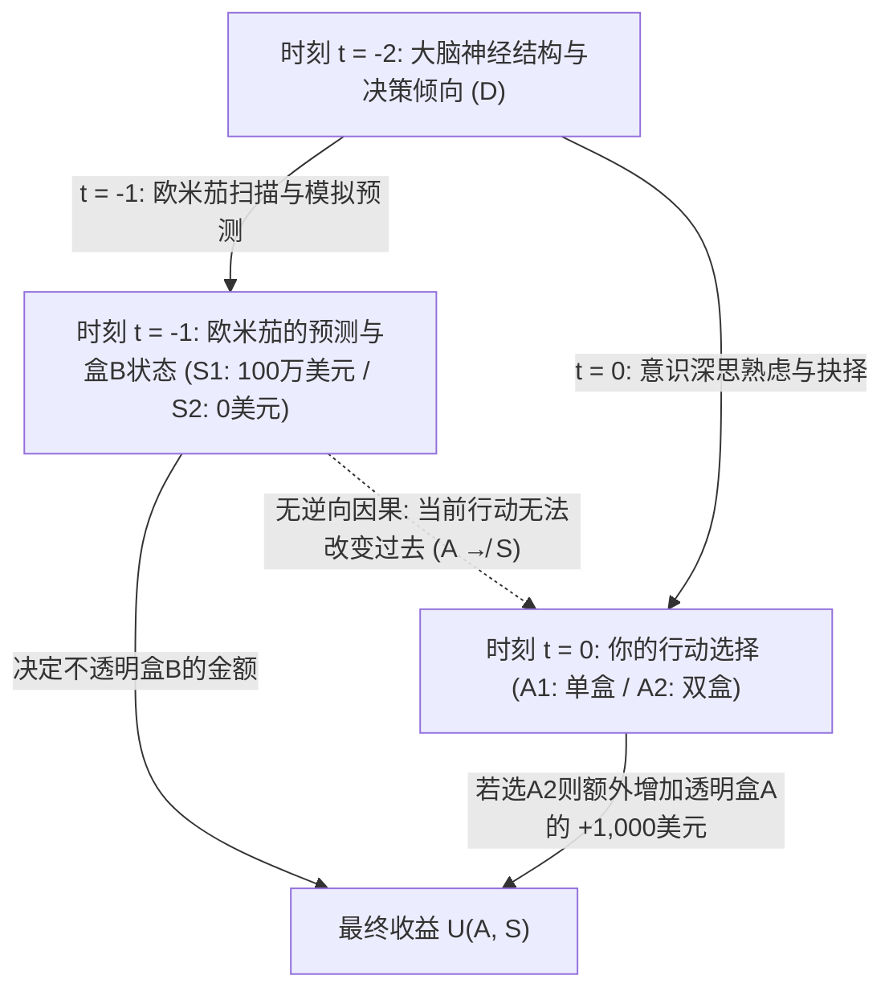
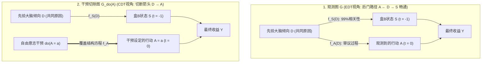

## 1. 撕裂人类理性共识的思想实验：纽科姆悖论（Newcomb's Paradox, 1960–1969）

1960年，美国劳伦斯利弗莫尔国家实验室的理论物理学家<strong>威廉·纽科姆（William A. Newcomb）</strong>在思考博弈论与囚徒困境的深层结构时，构想出了一个看似简单却足以动摇现代理性选择理论根基的思想实验。1969年，哈佛大学哲学家<strong>罗伯特·诺齐克（Robert Nozick）</strong>在其里程碑式的论文<strong>《纽科姆问题与两个选择原则》（"Newcomb's Problem and Two Principles of Choice"）</strong>中首次将该问题正式引入学术界；随后，马丁·加德纳（Martin Gardner）于1973年和1974年在《科学美国人》（*Scientific American*）专栏中对其进行了专题介绍，迅速引发了横跨哲学、数理经济学、统计学、理论物理学与计算机科学的旷世论战。

诺齐克在1969年论文的开篇写下了决策论历史上最著名的一段评述：

> “几乎对每一个人来说，应该怎么做都是完全清楚且显而易见的。困难在于，人们在这个问题上似乎近乎一分为二，而且每个阵营中的大多数人都认为另一半人简直是在犯傻。”
> —— <strong>Robert Nozick (1969)</strong>, *"Newcomb's Problem and Two Principles of Choice"*

为什么一个仅包含两个盒子、两种行动与两种世界状态的单次博弈，会让诺贝尔经济学奖得主、顶级分析哲学家与人工智能科学家分裂成势不两立的两派？让我们首先严格定义这一博弈的数学与物理结构。

---

### 1.1 标准实验设定：两个盒子与超级预言者欧米茄（$\Omega$）

在你的面前放着两个盒子：<strong>透明盒子 A（Transparent Box A）</strong>与<strong>不透明盒子 B（Opaque Box B）</strong>。

1. <strong>透明盒子 A</strong>：由透明玻璃制成，你可以清楚地看到里面确实装着 <strong>$\$1,000$（一千美元）</strong>现金。
2. <strong>不透明盒子 B</strong>：由密封金属制成，外部无法窥视其内部。你确切地知道，里面要么装着 <strong>$\$1,000,000$（一百万美元）</strong>，要么是<strong>空的（$\$0$）</strong>。

在当前时刻 $t = 0$，你必须在以下两种行动（Action $A$）中做出唯一选择：

- <strong>单盒策略（One-Boxing, $A_1$）</strong>：放弃透明盒子 A，<strong>只拿走不透明盒子 B</strong>。
- <strong>双盒策略（Two-Boxing, $A_2$）</strong>：<strong>同时拿走透明盒子 A 和不透明盒子 B</strong>。

博弈的核心角色是超级<strong>预言者欧米茄（Predictor Omega, $\Omega$）</strong>。$\Omega$ 拥有超高精度的全脑神经扫描仪或能够完美模拟你大脑突触权重的计算模拟器。在过去针对数千名受试者（无论其最终选择单盒还是双盒）的试验中，$\Omega$ 的预测准确率经严格统计验证高达 <strong>$99\%$（$p = 0.99$）</strong>。

<strong>昨天（时刻 $t = -1$）</strong>，$\Omega$ 扫描了你的大脑神经结构与决策倾向，对你今天（$t = 0$）的选择做出了预测，并严格按照以下规则布置了盒子 B：

- <strong>世界状态 $S_1$（$\text{Pred}_1$：$\Omega$ 预测你会只拿盒子 B，即 $A_1$）</strong>：
  $\Omega$ 昨天在不透明盒子 B 中放入了 <strong>$\$1,000,000$</strong>。
- <strong>世界状态 $S_2$（$\text{Pred}_2$：$\Omega$ 预测你会两盒全拿，即 $A_2$）</strong>：
  $\Omega$ 昨天让不透明盒子 B 保持<strong>空置（$\$0$）</strong>。

为了排除任何物理机关或诡辩，实验严格满足<strong>过去的因果封闭性（Causal Closure of the Past）</strong>：
1. <strong>不存在逆向因果（No Backward Causation）</strong>：$\Omega$ 昨天完成预测并放置好钞票后便已离开地球。今天你在 $t = 0$ 伸手触碰盒子 A 的动作，绝不可能通过时间倒流或隐蔽机械装置使盒子 B 里的100万美元凭空消失（$A \not\to S$）。
2. <strong>状态的物理确定性</strong>：此时此刻，盒子 B 里的钱要么已经是 $\$1,000,000$（$S_1$），要么已经是 $\$0$（$S_2$）。
3. <strong>效用线性</strong>：你的目标是最大化所获得的货币效用（设 $U(\$x) = x$）。

其 $2 \times 2$ 支付矩阵（Payoff Matrix）如下表所示：

| 你今天的选择（时刻 $t = 0$） | 状态 $S_1$（$\text{Pred}_1$）：$\Omega$ 预测单盒 $A_1$（盒 B 有 $\$1,000,000$） | 状态 $S_2$（$\text{Pred}_2$）：$\Omega$ 预测双盒 $A_2$（盒 B 为 $\$0$） |
| :--- | :---: | :---: |
| <strong>$A_1$：只拿盒子 B（单盒派 / One-Boxing）</strong> | <strong>$\$1,000,000$</strong> | <strong>$\$0$</strong> |
| <strong>$A_2$：同时拿走盒子 A 和 B（双盒派 / Two-Boxing）</strong> | <strong>$\$1,001,000$</strong> | <strong>$\$1,000$</strong> |

---

## 2. 第一大支柱：证据决策论（EDT）与“单盒派”的数学推导

单盒派（One-Boxers）的理论基石是由逻辑学家与哲学家<strong>理查德·杰弗里（Richard C. Jeffrey）</strong>在其1965年经典著作<strong>《决策的逻辑》（*The Logic of Decision*）</strong>中建立的<strong>证据决策论（Evidential Decision Theory, EDT）</strong>。

### 2.1 条件期望效用与“新闻价值（News Value）”

在杰弗里的统一布尔代数框架中，世界状态 $S_j$、行动 $A_i$ 与结果都是命题空间 $\mathcal{F}$ 中的命题。评估行动 $A_i$ 的理性标准是计算该命题为真时所带来的<strong>证据条件期望效用（Evidential Conditional Expected Utility，即“新闻价值”）</strong>：

$$\text{EU}_{\text{EDT}}(A_i) = \sum_{j} \mathbb{P}(S_j \mid A_i)\, U(A_i, S_j)$$

其中 $\mathbb{P}(S_j \mid A_i) = \frac{\mathbb{P}(A_i \wedge S_j)}{\mathbb{P}(A_i)}$ 是标准的贝叶斯条件概率。
在纽科姆问题中，由于 $\Omega$ 的预测准确率为 $99\%$，给定你选择单盒 $A_1$，状态为 $S_1$ 的条件概率为 $\mathbb{P}(S_1 \mid A_1) = 0.99$，$\mathbb{P}(S_2 \mid A_1) = 0.01$；给定你选择双盒 $A_2$，条件概率为 $\mathbb{P}(S_1 \mid A_2) = 0.01$，$\mathbb{P}(S_2 \mid A_2) = 0.99$。代入公式可得：

$$\begin{aligned}
\text{EU}_{\text{EDT}}(A_1) &= 0.99 \times \$1,000,000 + 0.01 \times \$0 = \$990,000 \\
\text{EU}_{\text{EDT}}(A_2) &= 0.01 \times \$1,001,000 + 0.99 \times \$1,000 = \$10,010 + \$990 = \$11,000
\end{aligned}$$

两者的期望收益差距高达 <strong>$\Delta \text{EU}_{\text{EDT}} = \$990,000 - \$11,000 = +\$979,000$</strong>！
更一般地，设盒 B 奖金为 $M$，盒 A 奖金为 $k$，预测准确率为 $p$，则单盒策略占优的充要条件为：

$$p M > (1 - p)(M + k) + p k \iff (2p - 1)M > k \iff p > \frac{1}{2} + \frac{k}{2M}$$

当 $M = \$1,000,000, k = \$1,000$ 时，只要 $\Omega$ 的准确率 $p > 0.5005$（仅比抛硬币高出 $0.05\%$），EDT 就严格指令选择<strong>单盒（$A_1$）</strong>！这也引出了单盒派对双盒派最著名的经验主义嘲讽：<strong>“既然你们这么聪明（理性），为什么你们不富有呢？”（If you're so smart, why ain't you rich?）</strong>

---

## 3. 第二大支柱：因果决策论（CDT）、严格占优原则与珀尔的 $do$-演算

面对单盒派的嘲讽，以<strong>阿兰·吉巴德（Allan Gibbard）与威廉·哈珀（William Harper, 1978）</strong>、<strong>布莱恩·斯凯姆斯（Brian Skyrms, 1980）</strong>、<strong>大卫·刘易斯（David Lewis, 1981）</strong>、<strong>詹姆斯·乔伊斯（James Joyce, 1999）</strong>以及图灵奖得主<strong>朱迪亚·珀尔（Judea Pearl, 2000）</strong>为代表的<strong>因果决策论（Causal Decision Theory, CDT）</strong>指出：EDT 犯下了将<strong>“诊断性统计相关（Diagnostic Correlation）”误认为“因果效力（Causal Efficacy）”</strong>的致命错误。

### 3.1 严格占优原则（Strict Dominance）与反事实条件句

根据萨维奇（Savage, 1954）的<strong>严格占优原则</strong>：当世界状态 $\{S_1, S_2\}$ 已经固定且不受当前行动 $A$ 的因果影响时，如果在每一个状态 $S_j$ 下都有 $U(A_2, S_j) > U(A_1, S_j)$，则理性人必须选择 $A_2$。
- 若盒 B 已有100万美元（$S_1$）：拿两盒得 $\$1,001,000 >$ 拿一盒得 $\$1,000,000$（多得 $+\$1,000$）。
- 若盒 B 是空的（$S_2$）：拿两盒得 $\$1,000 >$ 拿一盒得 $\$0$（同样多得 $+\$1,000$）。

为了在期望效用公式中剥离虚假的回溯性相关，吉巴德与哈珀（1978）用刘易斯的<strong>反事实条件概率 $\mathbb{P}(A_i \Box\!\to S_j)$</strong> 替代了条件概率 $\mathbb{P}(S_j \mid A_i)$；而朱迪亚·珀尔（2000）则在<strong>结构因果模型（Structural Causal Model, SCM）</strong>中使用<strong>干预算子 $do(A_i)$</strong> 给出了最严格的现代定义：

$$\text{EU}_{\text{CDT}}(A_i) = \sum_{j} \mathbb{P}(S_j \mid do(A_i))\, U(A_i, S_j)$$

### 3.2 共同原因分叉（Common-Cause Fork）与图手术切除

在纽科姆问题的因果有向无环图（DAG）中，你的先验大脑神经倾向 $D$ 是昨天 $\Omega$ 的预测状态 $S = f_S(D, U_S)$ 与今天你的选择行动 $A = f_A(D, U_A)$ 的<strong>共同原因（Common Cause / Confounder）</strong>，构成典型的<strong>分叉结构（Fork: $S \leftarrow D \to A$）</strong>：

- 在 EDT 所使用的观测条件概率 $\mathbb{P}(S \mid A)$ 中，对 $A$ 进行条件化会打开<strong>后门路径（Back-door Path）$A \leftarrow D \to S$</strong>，产生非因果的诊断信息回流。
- 在 CDT 所使用的干预概率 $\mathbb{P}(S \mid do(A_i))$ 中，珀尔的<strong>图手术（Graph Surgery）</strong>切断了进入节点 $A$ 的箭头 $D \to A$。由于从 $A$ 到 $S$ 不存在任何有向因果路径，后门路径被彻底阻断，从而严格成立：

$$\mathbb{P}(S_j \mid do(A_i)) = \mathbb{P}(S_j)$$

因此，设先验概率 $\mathbb{P}(S_1) = \pi$，无论 $\pi \in [0, 1]$ 取何值，恒有：

$$\text{EU}_{\text{CDT}}(A_2) - \text{EU}_{\text{CDT}}(A_1) = \left(\$1,000,000\,\pi + \$1,000\right) - \$1,000,000\,\pi = +\$1,000 > 0$$

CDT 由此坚定主张：<strong>两盒全拿（$A_2$）是唯一理性的选择</strong>。至于为什么双盒派最终只拿到1,000美元，刘易斯的回答一针见血：那是因为 $\Omega$ 在昨天刻意惩罚了理性人、奖赏了非理性人；在一个奖赏非理性的世界里，“曾经是非理性的”固然有利可图，但在 $t = 0$ 面对已经锁定的盒子时，理性的行动依然只能是拿走两个盒子。

---

## 4. 医学纽科姆问题（吸烟病变）与马克斯·韦伯的加尔文主义预定论

促使主流哲学界倒向 CDT 的决定性证据，是结构与纽科姆问题完全同构（$S \leftarrow D \to A$）的<strong>医学纽科姆问题（Medical Newcomb Problems）</strong>。

### 4.1 斯凯姆斯的“吸烟病变（The Smoking Lesion, 1980）”

基于统计学家罗纳德·费希尔（Ronald Fisher）早年提出的“体质假说”，斯凯姆斯构想了如下场景：假设医学已100%证实<strong>吸烟本身绝不会导致肺癌（$A_{\text{smoke}} \not\to C$）</strong>，但某种先天基因病变 $L$ 会以 $99\%$ 的概率同时导致两个独立后果：(1) 使人产生强烈的吸烟嗜好（$A_{\text{smoke}}$），以及 (2) 在晚年引发致命肺癌（$C$，效用为 $-1,000$）。同时，吸烟本身能带来 $+1$ 单位的感官愉悦。

在此分叉结构 $C \leftarrow L \to A$ 中：
- <strong>证据决策论（EDT）</strong>计算出戒烟的期望效用为 $\text{EU}_{\text{EDT}}(A_{\text{abstain}}) = 0.01 \times (-1,000) = -10$，而吸烟的期望效用为 $\text{EU}_{\text{EDT}}(A_{\text{smoke}}) = 0.01 \times 1 + 0.99 \times (-999) = -989$。于是 EDT 荒谬地命令你：<strong>为了降低自己出生时就带有先天致癌基因 $L$ 的条件概率，你今天必须戒烟！</strong>
- 这显然是掩耳盗铃式的自我欺骗（操纵症状以假装改变病因）。而 <strong>CDT</strong> 通过 $\mathbb{P}(C \mid do(A)) = \mathbb{P}(C)$ 立刻识别出吸烟不会改变先天基因，从而正确建议享受吸烟的 $+1$ 效用。

### 4.2 与马克斯·韦伯《新教伦理与资本主义精神》加尔文主义预定论的同构性

诺齐克（1969）指出，16世纪约翰·加尔文（Jean Calvin）的<strong>双重预定论（Predestination）</strong>与社会学家<strong>马克斯·韦伯（Max Weber, 1905）</strong>所剖析的清教徒心理，正是历史上规模最宏大的纽科姆问题：
1. 上帝在创世之前便已预定谁是<strong>选民（Elect, $S_1$：升入天堂）</strong>，谁是<strong>弃民（Reprobate, $S_2$：堕入地狱）</strong>。
2. 人在尘世的任何善行与禁欲苦修（$A_1$）都<strong>绝对无法因果地改变或购买上帝的预定（$A \not\to S$）</strong>。
3. 按照 CDT 的占优逻辑，既然结局早已注定，信徒本应选择尘世享乐（$A_2$）。然而历史上的加尔文宗信徒却选择了极端严苛的<strong>入世禁欲（Innerweltliche Askese, $A_1$）</strong>！正如韦伯所揭示的，清教徒受困于强烈的“获救焦虑（Certitudo salutis）”，他们将勤勉与禁欲不视为获救的<strong>“实在原因（Causa salutis）”</strong>，而是视为证明自己已被上帝拣选的<strong>“认识论诊断证据（Cognoscendi ratio）”</strong>（$\text{获救预定 } S_1 \leftarrow \text{上帝恩典 } D \to \text{禁欲善行 } A_1$）。清教徒正是通过实践 EDT（最大化 $\mathbb{P}(S_1 \mid A_1)$）来获得自己属于选民的心理确据！

---

## 5. 埃尔斯的“痒感辩护（Tickle Defense）”与大卫·刘易斯的“双胞胎囚徒困境”

### 5.1 埃尔斯的“痒感辩护（The Tickle Defense, 1982）”与可批准性（Ratifiability）

为了拯救 EDT，哲学家<strong>埃勒里·埃尔斯（Ellery Eells, 1982）</strong>提出了著名的<strong>“痒感辩护”</strong>：在吸烟病变中，先天基因 $L$ 并非像条件反射一样直接控制肌肉，而是先在意识中产生想抽烟的欲望/痒感 $T = (\mathcal{B}, \mathcal{D})$（信念与欲望），再由 $T$ 引导出行动 $A$（即因果链 $C \leftarrow L \to T \to A$）。
如果理性人在行动前通过内省（Introspection）拥有<strong>完全的自我知识（已知 $T$）</strong>，那么根据马尔可夫<strong>屏蔽准则（Screening-Off）</strong>，对中间节点 $T$ 的条件化会彻底阻断 $A$ 与 $L$ 的相关性：

$$\mathbb{P}(C \mid A_{\text{smoke}}, T) = \mathbb{P}(C \mid A_{\text{abstain}}, T) = \mathbb{P}(C \mid T)$$

一旦相关性被 $T$ 屏蔽，EDT 就退化为 CDT！然而，在纽科姆问题中，如果 $\Omega$ 预测的是你在考虑完所有“痒感”之后最终下达决断的机制本身，或者如杰弗里（1983）引入<strong>可批准性（Ratifiability）</strong>所表明的——一旦你确定自己决定选单盒 $\text{Decide}(A_1)$，在给定 $\text{Decide}(A_1)$ 的条件下改选双盒 $A_2$ 又能多得 $\$1,000$——单盒策略便陷入不可批准（Unratifiable）的震荡之中。

### 5.2 大卫·刘易斯同构定理：“囚徒困境就是一个纽科姆问题”（1979）

1979年，<strong>大卫·刘易斯（David Lewis）</strong>发表了经典论文<strong>《Prisoners' Dilemma Is a Newcomb Problem》</strong>，证明了<strong>与心理双胞胎（或运行相同源代码的克隆体）进行的单次囚徒困境，在数学结构上与纽科姆悖论 100% 同构！</strong>

| 你在房间1的选择 | 双胞胎选择“合作（$\text{Twin } C_{\text{PD}}$）”（给予你 $\$1,000,000$） | 双胞胎选择“背叛（$\text{Twin } D_{\text{PD}}$）”（给予你 $\$0$） |
| :--- | :---: | :---: |
| <strong>$C_{\text{PD}}$：合作（放弃自己的 $\$1,000$）</strong> | <strong>$\$1,000,000$</strong> | <strong>$\$0$</strong> |
| <strong>$D_{\text{PD}}$：背叛（拿走自己的 $+\$1,000$）</strong> | <strong>$\$1,001,000$</strong> | <strong>$\$1,000$</strong> |

- <strong>动作映射</strong>：合作 $C_{\text{PD}} \leftrightarrow$ 单盒 $A_1$；背叛 $D_{\text{PD}} \leftrightarrow$ 双盒 $A_2$。
- <strong>状态映射</strong>：双胞胎合作 $\leftrightarrow$ $\Omega$ 预测单盒并放入100万美元（$S_1$）；双胞胎背叛 $\leftrightarrow$ $\Omega$ 预测双盒并置空（$S_2$）。
- 因为 $\Omega$ 在纽科姆问题中预测你的方法，本质上就是<strong>昨天在计算机里运行了一个你的大脑模拟副本（双胞胎）</strong>！这个副本是在昨天运行于 $\Omega$ 的模拟器中，还是今天坐在隔壁房间里，仅仅是时空坐标的平移。
- 刘易斯由此得出结论：既然单次囚徒困境中背叛（$D_{\text{PD}}$）严格占优，纽科姆问题中也必须选择双盒（$A_2$）。相反，认知科学家<strong>道格拉斯·霍夫施塔特（Douglas Hofstadter, 1983）</strong>则提出<strong>超理性（Superrationality）</strong>：认识到双方运行同一理性函数的智能体必然共同收敛于帕累托最优的 $(C_{\text{PD}}, C_{\text{PD}})$ 与单盒策略（$A_1$）。

---

## 6. 现代 AI 对齐前沿：功能决策论（FDT）与逻辑反事实

进入21世纪，随着人工智能与算法博弈论的发展，计算机科学家意识到：对于人类而言99%准确的大脑扫描仪或许是科幻，但<strong>对于软件智能体（AI Agent）而言，其源代码被其他智能体读取或在沙箱中以 100% 精度模拟，是每天都在发生的工程现实！</strong>

2017年，机器智能研究所（MIRI）的<strong>埃利泽·尤德考斯基（Eliezer Yudkowsky）</strong>与<strong>内特·索尔斯（Nate Soares）</strong>在吸收<strong>无时间决策论（TDT）</strong>与戴伟（Wei Dai）的<strong>无更新决策论（UDT）</strong>基础上，正式提出<strong>功能决策论（Functional Decision Theory, FDT）</strong>。

### 6.1 FDT 的核心突破：对“数学函数 $\mathsf{F}$”而非“物理节点 $A$”进行干预

尤德考斯基与索尔斯指出，CDT 的根本错误在于将智能体视为孤立时空点 $(x_0, t_0)$ 上的一个物理事件 $A$，从而在评估反事实 $do(A = A_2)$ 时，假设“昨天 $\Omega$ 模拟我的算法 $\mathsf{F}(\mathcal{I})$ 输出了 $A_1$，而今天同一个确定性算法 $\mathsf{F}(\mathcal{I})$ 面对相同输入却输出了 $A_2$”——这是一个<strong>逻辑上不可能的反事实世界</strong>！

FDT 将智能体建模为抽象的<strong>数学决策函数 $\mathsf{F}: \mathcal{I} \to \mathcal{A}$</strong>，并对<strong>函数 $\mathsf{F}(\mathcal{I})$ 的输出本身</strong>执行逻辑/功能干预 $do(\mathsf{F}(\mathcal{I}) = a)$：

$$\text{EU}_{\text{FDT}}(a) = \sum_{j} \mathbb{P}\!\left(S_j \;\middle|\; do(\mathsf{F}(\mathcal{I}) = a)\right) U(a, S_j)$$

1. <strong>在纽科姆问题中</strong>：因为 $\Omega$ 的预测 $S = f_S(\mathsf{F}(\mathcal{I}), U_S)$ 是函数 $\mathsf{F}(\mathcal{I})$ 的下游计算结果，设定 $do(\mathsf{F}(\mathcal{I}) = A_1)$ 会同时决定 $\Omega$ 模拟器的输出与你今天的行动，故 $\text{EU}_{\text{FDT}}(A_1) = \$990,000 > \$11,000$，<strong>FDT 完美选择单盒（$A_1$）并赢得100万美元！</strong>
2. <strong>在吸烟病变问题中</strong>：先天基因病变 $L$ 是受精时决定的物理状态，<strong>不是对你决策函数 $\mathsf{F}(\mathcal{I})$ 的模拟</strong>（$C \leftarrow L \to \mathcal{I} \to \mathsf{F}(\mathcal{I}) \to A$）。因此干预 $do(\mathsf{F}(\mathcal{I}) = a)$ 绝不会改变上游的基因 $L$，<strong>FDT 毫不犹豫地选择吸烟（$A_{\text{smoke}}$）！</strong>
3. <strong>在透明盒纽科姆问题（帕菲特搭便车问题）与程序均衡（Program Equilibrium）中</strong>：即便盒 B 是透明的、你已亲眼看见里面的100万美元（此时传统 EDT 也会因观察屏蔽了新闻价值而叛变为双盒），FDT/UDT 通过对全局策略函数 $\mathsf{F}$ 进行事前无更新优化，依然坚定只拿盒 B；而在相互读取源代码的囚徒困境中，基于哥德尔自指与<strong>勒布定理（Löb's Theorem: $\square(\square P \to P) \to \square P$）</strong>构建的 `FairBot` 更能实现可形式化证明的相互合作。

### 6.2 三大决策理论（EDT / CDT / FDT）全景对比表

| 评估维度 / 经典困境 | 证据决策论（EDT — Jeffrey 1965） | 因果决策论（CDT — Lewis, Pearl） | 功能决策论（FDT / UDT — Yudkowsky & Soares 2017） |
| :--- | :--- | :--- | :--- |
| <strong>核心期望效用公式</strong> | $\sum_j \mathbb{P}(S_j \mid A_i)\, U(A_i, S_j)$ | $\sum_j \mathbb{P}(S_j \mid do(A_i))\, U(A_i, S_j)$ | $\sum_j \mathbb{P}(S_j \mid do(\mathsf{F}(\mathcal{I}) = a))\, U(a, S_j)$ |
| <strong>核心理性准则</strong> | 最大化行为的<strong>诊断性新闻价值</strong> | 最大化局部<strong>物理因果干预效力</strong> | 最大化<strong>决策函数 $\mathsf{F}$ 输出的逻辑/功能反事实效力</strong> |
| <strong>1. 标准纽科姆悖论</strong> | <strong>只拿一盒（$A_1$）</strong>（获 $\$1,000,000$） | <strong>两盒全拿（$A_2$）</strong>（仅获 $\$1,000$） | <strong>只拿一盒（$A_1$）</strong>（获 $\$1,000,000$） |
| <strong>2. 医学纽科姆（吸烟病变）</strong> | <strong>戒烟（$A_{\text{abstain}}$）</strong>（陷入改变基因的迷信） | <strong>吸烟（$A_{\text{smoke}}$）</strong>（正确识别基因不变，获 $+1$） | <strong>吸烟（$A_{\text{smoke}}$）</strong>（基因非 $\mathsf{F}$ 的模拟，获 $+1$） |
| <strong>3. 双胞胎囚徒困境</strong> | <strong>合作（$C_{\text{PD}}$）</strong>（共同获 $\$1,000,000$） | <strong>背叛（$D_{\text{PD}}$）</strong>（陷入 $\$1,000$ 纳什均衡） | <strong>合作（$C_{\text{PD}}$）</strong>（同构函数输出，获 $\$1,000,000$） |
| <strong>4. 透明盒纽科姆 / 搭便车</strong> | <strong>两盒全拿 / 拒付</strong>（观察后贝叶斯更新导致获 $\$0$） | <strong>两盒全拿 / 拒付</strong>（占优背叛导致获 $\$0$） | <strong>只拿一盒 / 履约付款</strong>（无更新策略优化，获 $\$1,000,000$） |

---

## 参考文献（References）

- <strong>Nozick, R. (1969)</strong>. "Newcomb's Problem and Two Principles of Choice." In *Essays in Honor of Carl G. Hempel* (pp. 114–146).
- <strong>Jeffrey, R. C. (1965 / 1983)</strong>. *The Logic of Decision*. University of Chicago Press.
- <strong>Gibbard, A., & Harper, W. L. (1978)</strong>. "Counterfactuals and Two Kinds of Expected Utility."
- <strong>Lewis, D. (1979)</strong>. "Prisoners' Dilemma Is a Newcomb Problem." *Philosophy & Public Affairs*, 8(3), 235–240.
- <strong>Pearl, J. (2000 / 2009)</strong>. *Causality: Models, Reasoning, and Inference*. Cambridge University Press.
- <strong>Yudkowsky, E., & Soares, N. (2017)</strong>. "Functional Decision Theory: A New Theory of Instrumental Rationality." *arXiv:1710.05060*.
