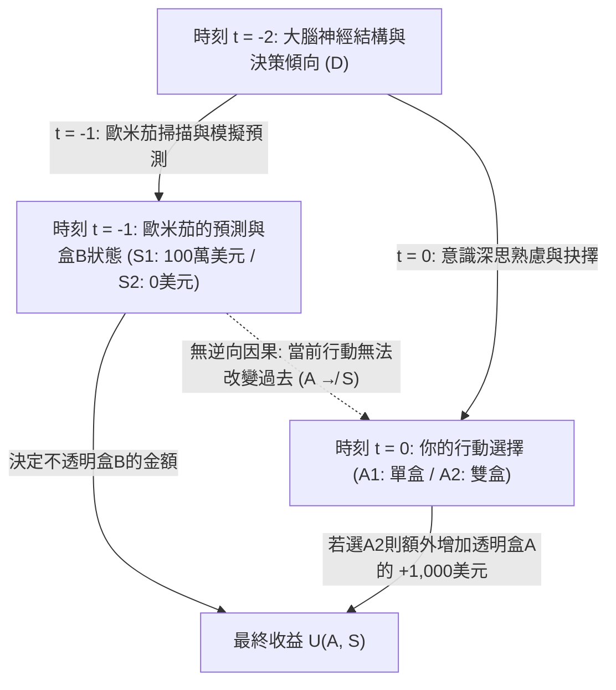
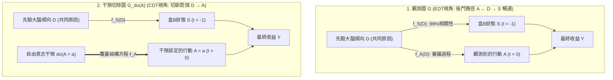

## 1. 撕裂人類理性共識的思想實驗：紐科姆悖論（Newcomb's Paradox, 1960–1969）

1960年，美國勞倫斯利弗莫爾國家實驗室的理論物理學家<strong>威廉·紐科姆（William A. Newcomb）</strong>在思考賽局理論（博弈論）與囚徒困境的深層結構時，構想出了一個看似簡單卻足以動搖現代理性選擇理論根基的思想實驗。1969年，哈佛大學哲學家<strong>羅伯特·諾齊克（Robert Nozick）</strong>在其里程碑式的論文<strong>《紐科姆問題與兩個選擇原則》（"Newcomb's Problem and Two Principles of Choice"）</strong>中首次將該問題正式引入學術界；隨後，馬丁·加德納（Martin Gardner）於1973年和1974年在《科學人》（*Scientific American*）專欄中對其進行了專題介紹，迅速引發了橫跨哲學、數理經濟學、統計學、理論物理學與電腦科學的曠世論戰。

諾齊克在1969年論文的開篇寫下了決策論歷史上最著名的一段評述：

> 「幾乎對每一個人來說，應該怎麼做都是完全清楚且顯而易見的。困難在於，人們在這個問題上似乎近乎一分為二，而且每個陣營中的大多數人都認為另一半人簡直是在犯傻。」
> —— <strong>Robert Nozick (1969)</strong>, *"Newcomb's Problem and Two Principles of Choice"*

為什麼一個僅包含兩個盒子、兩種行動與兩種世界狀態的單次賽局，會讓諾貝爾經濟學獎得主、頂級分析哲學家與人工智慧科學家分裂成勢不兩立的兩派？讓我們首先嚴格定義這一賽局的數學與物理結構。

---

### 1.1 標準實驗設定：兩個盒子與超級預言者歐米茄（$\Omega$）

在你的面前放著兩個盒子：<strong>透明盒子 A（Transparent Box A）</strong>與<strong>不透明盒子 B（Opaque Box B）</strong>。

1. <strong>透明盒子 A</strong>：由透明玻璃製成，你可以清楚地看到裡面確實裝著 <strong>$\$1,000$（一千美元）</strong>現金。
2. <strong>不透明盒子 B</strong>：由密封金屬製成，外部無法窺視其內部。你確切地知道，裡面要麼裝著 <strong>$\$1,000,000$（一百萬美元）</strong>，要麼是<strong>空的（$\$0$）</strong>。

在當前時刻 $t = 0$，你必須在以下兩種行動（Action $A$）中做出唯一選擇：

- <strong>單盒策略（One-Boxing, $A_1$）</strong>：放棄透明盒子 A，<strong>只拿走不透明盒子 B</strong>。
- <strong>雙盒策略（Two-Boxing, $A_2$）</strong>：<strong>同時拿走透明盒子 A 和不透明盒子 B</strong>。

賽局的核心角色是超級<strong>預言者歐米茄（Predictor Omega, $\Omega$）</strong>。$\Omega$ 擁有超高精度的全腦神經掃描儀或能夠完美模擬你大腦突觸權重的計算模擬器。在過去針對數千名受試者（無論其最終選擇單盒還是雙盒）的試驗中，$\Omega$ 的預測準確率經嚴格統計驗證高達 <strong>$99\%$（$p = 0.99$）</strong>。

<strong>昨天（時刻 $t = -1$）</strong>，$\Omega$ 掃描了你的大腦神經結構與決策傾向，對你今天（$t = 0$）的選擇做出了預測，並嚴格按照以下規則佈置了盒子 B：

- <strong>世界狀態 $S_1$（$\text{Pred}_1$：$\Omega$ 預測你會只拿盒子 B，即 $A_1$）</strong>：
  $\Omega$ 昨天在不透明盒子 B 中放入了 <strong>$\$1,000,000$</strong>。
- <strong>世界狀態 $S_2$（$\text{Pred}_2$：$\Omega$ 預測你會兩盒全拿，即 $A_2$）</strong>：
  $\Omega$ 昨天讓不透明盒子 B 保持<strong>空置（$\$0$）</strong>。

為了排除任何物理機關或詭辯，實驗嚴格滿足<strong>過去的因果封閉性（Causal Closure of the Past）</strong>：
1. <strong>不存在逆向因果（No Backward Causation）</strong>：$\Omega$ 昨天完成預測並放置好鈔票後便已離開地球。今天你在 $t = 0$ 伸手觸碰盒子 A 的動作，絕不可能透過時間倒流或隱蔽機械裝置使盒子 B 裡的100萬美元憑空消失（$A \not\to S$）。
2. <strong>狀態的物理確定性</strong>：此時此刻，盒子 B 裡的錢要麼已經是 $\$1,000,000$（$S_1$），要麼已經是 $\$0$（$S_2$）。
3. <strong>效用線性</strong>：你的目標是最大化所獲得的貨幣效用（設 $U(\$x) = x$）。

其 $2 \times 2$ 報酬矩陣（Payoff Matrix）如下表所示：

| 你今天的選擇（時刻 $t = 0$） | 狀態 $S_1$（$\text{Pred}_1$）：$\Omega$ 預測單盒 $A_1$（盒 B 有 $\$1,000,000$） | 狀態 $S_2$（$\text{Pred}_2$）：$\Omega$ 預測雙盒 $A_2$（盒 B 為 $\$0$） |
| :--- | :---: | :---: |
| <strong>$A_1$：只拿盒子 B（單盒派 / One-Boxing）</strong> | <strong>$\$1,000,000$</strong> | <strong>$\$0$</strong> |
| <strong>$A_2$：同時拿走盒子 A 和 B（雙盒派 / Two-Boxing）</strong> | <strong>$\$1,001,000$</strong> | <strong>$\$1,000$</strong> |

---

## 2. 第一大支柱：證據決策論（EDT）與「單盒派」的數學推導

單盒派（One-Boxers）的理論基石是由邏輯學家與哲學家<strong>理查德·傑弗里（Richard C. Jeffrey）</strong>在其1965年經典著作<strong>《決策的邏輯》（*The Logic of Decision*）</strong>中建立的<strong>證據決策論（Evidential Decision Theory, EDT）</strong>。

### 2.1 條件期望效用與「新聞價值（News Value）」

在傑弗里的統一布林代數框架中，世界狀態 $S_j$、行動 $A_i$ 與結果都是命題空間 $\mathcal{F}$ 中的命題。評估行動 $A_i$ 的理性標準是計算該命題為真時所帶來的<strong>證據條件期望效用（Evidential Conditional Expected Utility，即「新聞價值」）</strong>：

$$\text{EU}_{\text{EDT}}(A_i) = \sum_{j} \mathbb{P}(S_j \mid A_i)\, U(A_i, S_j)$$

其中 $\mathbb{P}(S_j \mid A_i) = \frac{\mathbb{P}(A_i \wedge S_j)}{\mathbb{P}(A_i)}$ 是標準的貝氏條件機率。
在紐科姆問題中，由於 $\Omega$ 的預測準確率為 $99\%$，給定你選擇單盒 $A_1$，狀態為 $S_1$ 的條件機率為 $\mathbb{P}(S_1 \mid A_1) = 0.99$，$\mathbb{P}(S_2 \mid A_1) = 0.01$；給定你選擇雙盒 $A_2$，條件機率為 $\mathbb{P}(S_1 \mid A_2) = 0.01$，$\mathbb{P}(S_2 \mid A_2) = 0.99$。代入公式可得：

$$\begin{aligned}
\text{EU}_{\text{EDT}}(A_1) &= 0.99 \times \$1,000,000 + 0.01 \times \$0 = \$990,000 \\
\text{EU}_{\text{EDT}}(A_2) &= 0.01 \times \$1,001,000 + 0.99 \times \$1,000 = \$10,010 + \$990 = \$11,000
\end{aligned}$$

兩者的期望收益差距高達 <strong>$\Delta \text{EU}_{\text{EDT}} = \$990,000 - \$11,000 = +\$979,000$</strong>！
更一般地，設盒 B 獎金為 $M$，盒 A 獎金為 $k$，預測準確率為 $p$，則單盒策略佔優的充要條件為：

$$p M > (1 - p)(M + k) + p k \iff (2p - 1)M > k \iff p > \frac{1}{2} + \frac{k}{2M}$$

當 $M = \$1,000,000, k = \$1,000$ 時，只要 $\Omega$ 的準確率 $p > 0.5005$（僅比擲硬幣高出 $0.05\%$），EDT 就嚴格指令選擇<strong>單盒（$A_1$）</strong>！這也引出了單盒派對雙盒派最著名的經驗主義嘲諷：<strong>「既然你們這麼聰明（理性），為什麼你們不富有呢？」（If you're so smart, why ain't you rich?）</strong>

---

## 3. 第二大支柱：因果決策論（CDT）、嚴格佔優原則與珀爾的 $do$-演算

面對單盒派的嘲諷，以<strong>阿蘭·吉巴德（Allan Gibbard）與威廉·哈珀（William Harper, 1978）</strong>、<strong>布萊恩·斯凱姆斯（Brian Skyrms, 1980）</strong>、<strong>大衛·劉易斯（David Lewis, 1981）</strong>、<strong>詹姆斯·喬伊斯（James Joyce, 1999）</strong>以及圖靈獎得主<strong>朱迪亞·珀爾（Judea Pearl, 2000）</strong>為代表的<strong>因果決策論（Causal Decision Theory, CDT）</strong>指出：EDT 犯下了將<strong>「診斷性統計相關（Diagnostic Correlation）」誤認為「因果效力（Causal Efficacy）」</strong>的致命錯誤。

### 3.1 嚴格佔優原則（Strict Dominance）與反事實條件句

根據薩維奇（Savage, 1954）的<strong>嚴格佔優原則</strong>：當世界狀態 $\{S_1, S_2\}$ 已經固定且不受當前行動 $A$ 的因果影響時，如果在每一個狀態 $S_j$ 下都有 $U(A_2, S_j) > U(A_1, S_j)$，則理性人必須選擇 $A_2$。
- 若盒 B 已有100萬美元（$S_1$）：拿兩盒得 $\$1,001,000 >$ 拿一盒得 $\$1,000,000$（多得 $+\$1,000$）。
- 若盒 B 是空的（$S_2$）：拿兩盒得 $\$1,000 >$ 拿一盒得 $\$0$（同樣多得 $+\$1,000$）。

為了在期望效用公式中剝離虛假的回溯性相關，吉巴德與哈珀（1978）用劉易斯的<strong>反事實條件機率 $\mathbb{P}(A_i \Box\!\to S_j)$</strong> 替代了條件機率 $\mathbb{P}(S_j \mid A_i)$；而朱迪亞·珀爾（2000）則在<strong>結構因果模型（Structural Causal Model, SCM）</strong>中使用<strong>干預算子 $do(A_i)$</strong> 給出了最嚴格的現代定義：

$$\text{EU}_{\text{CDT}}(A_i) = \sum_{j} \mathbb{P}(S_j \mid do(A_i))\, U(A_i, S_j)$$

### 3.2 共同原因分叉（Common-Cause Fork）與圖手術切除

在紐科姆問題的因果有向無環圖（DAG）中，你的先驗大腦神經傾向 $D$ 是昨天 $\Omega$ 的預測狀態 $S = f_S(D, U_S)$ 與今天你的選擇行動 $A = f_A(D, U_A)$ 的<strong>共同原因（Common Cause / Confounder）</strong>，構成典型的<strong>分叉結構（Fork: $S \leftarrow D \to A$）</strong>：

- 在 EDT 所使用的觀測條件機率 $\mathbb{P}(S \mid A)$ 中，對 $A$ 進行條件化會打開<strong>後門路徑（Back-door Path）$A \leftarrow D \to S$</strong>，產生非因果的診斷資訊回流。
- 在 CDT 所使用的干預機率 $\mathbb{P}(S \mid do(A_i))$ 中，珀爾的<strong>圖手術（Graph Surgery）</strong>切斷了進入節點 $A$ 的箭頭 $D \to A$。由於從 $A$ 到 $S$ 不存在任何有向因果路徑，後門路徑被徹底阻斷，從而嚴格成立：

$$\mathbb{P}(S_j \mid do(A_i)) = \mathbb{P}(S_j)$$

因此，設先驗機率 $\mathbb{P}(S_1) = \pi$，無論 $\pi \in [0, 1]$ 取何值，恆有：

$$\text{EU}_{\text{CDT}}(A_2) - \text{EU}_{\text{CDT}}(A_1) = \left(\$1,000,000\,\pi + \$1,000\right) - \$1,000,000\,\pi = +\$1,000 > 0$$

CDT 由此堅定主張：<strong>兩盒全拿（$A_2$）是唯一理性的選擇</strong>。至於為什麼雙盒派最終只拿到1,000美元，劉易斯的回答一針見血：那是因為 $\Omega$ 在昨天刻意懲罰了理性人、獎賞了非理性人；在一個獎賞非理性的世界裡，「曾經是非理性的」固然有利可圖，但在 $t = 0$ 面對已經鎖定的盒子時，理性的行動依然只能是拿走兩個盒子。

---

## 4. 醫學紐科姆問題（吸菸病變）與馬克斯·韋伯的喀爾文主義預定論

促使主流哲學界倒向 CDT 的決定性證據，是結構與紐科姆問題完全同構（$S \leftarrow D \to A$）的<strong>醫學紐科姆問題（Medical Newcomb Problems）</strong>。

### 4.1 斯凱姆斯的「吸菸病變（The Smoking Lesion, 1980）」

基於統計學家羅納德·費雪（Ronald Fisher）早年提出的「體質假說」，斯凱姆斯構想了如下場景：假設醫學已100%證實<strong>吸菸本身絕不會導致肺癌（$A_{\text{smoke}} \not\to C$）</strong>，但某種先天基因病變 $L$ 會以 $99\%$ 的機率同時導致兩個獨立後果：(1) 使人產生強烈的吸菸嗜好（$A_{\text{smoke}}$），以及 (2) 在晚年引發致命肺癌（$C$，效用為 $-1,000$）。同時，吸菸本身能帶來 $+1$ 單位的感官愉悅。

在此分叉結構 $C \leftarrow L \to A$ 中：
- <strong>證據決策論（EDT）</strong>計算出戒菸的期望效用為 $\text{EU}_{\text{EDT}}(A_{\text{abstain}}) = 0.01 \times (-1,000) = -10$，而吸菸的期望效用為 $\text{EU}_{\text{EDT}}(A_{\text{smoke}}) = 0.01 \times 1 + 0.99 \times (-999) = -989$。於是 EDT 荒謬地命令你：<strong>為了降低自己出生時就帶有先天致癌基因 $L$ 的條件機率，你今天必須戒菸！</strong>
- 這顯然是掩耳盜鈴式的自我欺騙（操縱症狀以假裝改變病因）。而 <strong>CDT</strong> 透過 $\mathbb{P}(C \mid do(A)) = \mathbb{P}(C)$ 立刻識別出吸菸不會改變先天基因，從而正確建議享受吸菸的 $+1$ 效用。

### 4.2 與馬克斯·韋伯《新教倫理與資本主義精神》喀爾文主義預定論的同構性

諾齊克（1969）指出，16世紀約翰·喀爾文（Jean Calvin）的<strong>雙重預定論（Predestination）</strong>與社會學家<strong>馬克斯·韋伯（Max Weber, 1905）</strong>所剖析的清教徒心理，正是歷史上規模最宏大的紐科姆問題：
1. 上帝在創世之前便已預定誰是<strong>選民（Elect, $S_1$：升入天堂）</strong>，誰是<strong>棄民（Reprobate, $S_2$：墮入地獄）</strong>。
2. 人在塵世的任何善行與禁慾苦修（$A_1$）都<strong>絕對無法因果地改變或購買上帝的預定（$A \not\to S$）</strong>。
3. 按照 CDT 的佔優邏輯，既然結局早已註定，信徒本應選擇塵世享樂（$A_2$）。然而歷史上的喀爾文宗信徒卻選擇了極端嚴苛的<strong>入世禁慾（Innerweltliche Askese, $A_1$）</strong>！正如韋伯所揭示的，清教徒受困於強烈的「獲救焦慮（Certitudo salutis）」，他們將勤勉與禁慾不視為獲救的<strong>「實在原因（Causa salutis）」</strong>，而是視為證明自己已被上帝揀選的<strong>「認識論診斷證據（Cognoscendi ratio）」</strong>（$\text{獲救預定 } S_1 \leftarrow \text{上帝恩典 } D \to \text{禁慾善行 } A_1$）。清教徒正是透過實踐 EDT（最大化 $\mathbb{P}(S_1 \mid A_1)$）來獲得自己屬於選民的心理確據！

---

## 5. 埃爾斯的「癢感辯護（Tickle Defense）」與大衛·劉易斯的「雙胞胎囚徒困境」

### 5.1 埃爾斯的「癢感辯護（The Tickle Defense, 1982）」與可批准性（Ratifiability）

為了拯救 EDT，哲學家<strong>埃勒里·埃爾斯（Ellery Eells, 1982）</strong>提出了著名的<strong>「癢感辯護」</strong>：在吸菸病變中，先天基因 $L$ 並非像條件反射一樣直接控制肌肉，而是先在意識中產生想抽菸的慾望/癢感 $T = (\mathcal{B}, \mathcal{D})$（信念與慾望），再由 $T$ 引導出行動 $A$（即因果鏈 $C \leftarrow L \to T \to A$）。
如果理性人在行動前透過內省（Introspection）擁有<strong>完全的自我知識（已知 $T$）</strong>，那麼根據馬可夫<strong>屏蔽準則（Screening-Off）</strong>，對中間節點 $T$ 的條件化會徹底阻斷 $A$ 與 $L$ 的相關性：

$$\mathbb{P}(C \mid A_{\text{smoke}}, T) = \mathbb{P}(C \mid A_{\text{abstain}}, T) = \mathbb{P}(C \mid T)$$

一旦相關性被 $T$ 屏蔽，EDT 就退化為 CDT！然而，在紐科姆問題中，如果 $\Omega$ 預測的是你在考慮完所有「癢感」之後最終下達決斷的機制本身，或者如傑弗里（1983）引入<strong>可批准性（Ratifiability）</strong>所表明的——一旦你確定自己決定選單盒 $\text{Decide}(A_1)$，在給定 $\text{Decide}(A_1)$ 的條件下改選雙盒 $A_2$ 又能多得 $\$1,000$——單盒策略便陷入不可批准（Unratifiable）的震盪之中。

### 5.2 大衛·劉易斯同構定理：「囚徒困境就是一個紐科姆問題」（1979）

1979年，<strong>大衛·劉易斯（David Lewis）</strong>發表了經典論文<strong>《Prisoners' Dilemma Is a Newcomb Problem》</strong>，證明了<strong>與心理雙胞胎（或執行相同原始碼的複製體）進行的單次囚徒困境，在數學結構上與紐科姆悖論 100% 同構！</strong>

| 你在房間1的選擇 | 雙胞胎選擇「合作（$\text{Twin } C_{\text{PD}}$）」（給予你 $\$1,000,000$） | 雙胞胎選擇「背叛（$\text{Twin } D_{\text{PD}}$）」（給予你 $\$0$） |
| :--- | :---: | :---: |
| <strong>$C_{\text{PD}}$：合作（放棄自己的 $\$1,000$）</strong> | <strong>$\$1,000,000$</strong> | <strong>$\$0$</strong> |
| <strong>$D_{\text{PD}}$：背叛（拿走自己的 $+\$1,000$）</strong> | <strong>$\$1,001,000$</strong> | <strong>$\$1,000$</strong> |

- <strong>動作映射</strong>：合作 $C_{\text{PD}} \leftrightarrow$ 單盒 $A_1$；背叛 $D_{\text{PD}} \leftrightarrow$ 雙盒 $A_2$。
- <strong>狀態映射</strong>：雙胞胎合作 $\leftrightarrow$ $\Omega$ 預測單盒並放入100萬美元（$S_1$）；雙胞胎背叛 $\leftrightarrow$ $\Omega$ 預測雙盒並置空（$S_2$）。
- 因為 $\Omega$ 在紐科姆問題中預測你的方法，本質上就是<strong>昨天在電腦裡執行了一個你的大腦模擬副本（雙胞胎）</strong>！這個副本是在昨天執行於 $\Omega$ 的模擬器中，還是今天坐在隔壁房間裡，僅僅是時空座標的平移。
- 劉易斯由此得出結論：既然單次囚徒困境中背叛（$D_{\text{PD}}$）嚴格佔優，紐科姆問題中也必須選擇雙盒（$A_2$）。相反，認知科學家<strong>道格拉斯·霍夫施塔特（Douglas Hofstadter, 1983）</strong>則提出<strong>超理性（Superrationality）</strong>：認識到雙方執行同一理性函數的智慧體必然共同收斂於柏拉圖最優的 $(C_{\text{PD}}, C_{\text{PD}})$ 與單盒策略（$A_1$）。

---

## 6. 現代 AI 對齊前沿：功能決策論（FDT）與邏輯反事實

進入21世紀，隨著人工智慧與演算法賽局理論的發展，電腦科學家意識到：對於人類而言99%準確的大腦掃描儀或許是科幻，但<strong>對於軟體智慧體（AI Agent）而言，其原始碼被其他智慧體讀取或在沙箱中以 100% 精度模擬，是每天都在發生的工程現實！</strong>

2017年，機器智慧研究所（MIRI）的<strong>埃利澤·尤德考斯基（Eliezer Yudkowsky）</strong>與<strong>內特·索爾斯（Nate Soares）</strong>在吸收<strong>無時間決策論（TDT）</strong>與戴偉（Wei Dai）的<strong>無更新決策論（UDT）</strong>基礎上，正式提出<strong>功能決策論（Functional Decision Theory, FDT）</strong>。

### 6.1 FDT 的核心突破：對「數學函數 $\mathsf{F}$」而非「物理節點 $A$」進行干預

尤德考斯基與索爾斯指出，CDT 的根本錯誤在於將智慧體視為孤立時空點 $(x_0, t_0)$ 上的一個物理事件 $A$，從而在評估反事實 $do(A = A_2)$ 時，假設「昨天 $\Omega$ 模擬我的演算法 $\mathsf{F}(\mathcal{I})$ 輸出了 $A_1$，而今天同一個確定性演算法 $\mathsf{F}(\mathcal{I})$ 面對相同輸入卻輸出了 $A_2$」——這是一個<strong>邏輯上不可能的反事實世界</strong>！

FDT 將智慧體建模為抽象的<strong>數學決策函數 $\mathsf{F}: \mathcal{I} \to \mathcal{A}$</strong>，並對<strong>函數 $\mathsf{F}(\mathcal{I})$ 的輸出本身</strong>執行邏輯/功能干預 $do(\mathsf{F}(\mathcal{I}) = a)$：

$$\text{EU}_{\text{FDT}}(a) = \sum_{j} \mathbb{P}\!\left(S_j \;\middle|\; do(\mathsf{F}(\mathcal{I}) = a)\right) U(a, S_j)$$

1. <strong>在紐科姆問題中</strong>：因為 $\Omega$ 的預測 $S = f_S(\mathsf{F}(\mathcal{I}), U_S)$ 是函數 $\mathsf{F}(\mathcal{I})$ 的下游計算結果，設定 $do(\mathsf{F}(\mathcal{I}) = A_1)$ 會同時決定 $\Omega$ 模擬器的輸出與你今天的行動，故 $\text{EU}_{\text{FDT}}(A_1) = \$990,000 > \$11,000$，<strong>FDT 完美選擇單盒（$A_1$）並贏得100萬美元！</strong>
2. <strong>在吸菸病變問題中</strong>：先天基因病變 $L$ 是受精時決定的物理狀態，<strong>不是對你決策函數 $\mathsf{F}(\mathcal{I})$ 的模擬</strong>（$C \leftarrow L \to \mathcal{I} \to \mathsf{F}(\mathcal{I}) \to A$）。因此干預 $do(\mathsf{F}(\mathcal{I}) = a)$ 絕不會改變上游的基因 $L$，<strong>FDT 毫不猶豫地選擇吸菸（$A_{\text{smoke}}$）！</strong>
3. <strong>在透明盒紐科姆問題（帕菲特搭便車問題）與程式均衡（Program Equilibrium）中</strong>：即便盒 B 是透明的、你已親眼看見裡面的100萬美元（此時傳統 EDT 也會因觀察屏蔽了新聞價值而叛變為雙盒），FDT/UDT 透過對全局策略函數 $\mathsf{F}$ 進行事前無更新最佳化，依然堅定只拿盒 B；而在相互讀取原始碼的囚徒困境中，基於哥德爾自指與<strong>勒布定理（Löb's Theorem: $\square(\square P \to P) \to \square P$）</strong>構建的 `FairBot` 更能實現可形式化證明的相互合作。

### 6.2 三大決策理論（EDT / CDT / FDT）全景對比表

| 評估維度 / 經典困境 | 證據決策論（EDT — Jeffrey 1965） | 因果決策論（CDT — Lewis, Pearl） | 功能決策論（FDT / UDT — Yudkowsky & Soares 2017） |
| :--- | :--- | :--- | :--- |
| <strong>核心期望效用公式</strong> | $\sum_j \mathbb{P}(S_j \mid A_i)\, U(A_i, S_j)$ | $\sum_j \mathbb{P}(S_j \mid do(A_i))\, U(A_i, S_j)$ | $\sum_j \mathbb{P}(S_j \mid do(\mathsf{F}(\mathcal{I}) = a))\, U(a, S_j)$ |
| <strong>核心理性準則</strong> | 最大化行為的<strong>診斷性新聞價值</strong> | 最大化局部<strong>物理因果干預效力</strong> | 最大化<strong>決策函數 $\mathsf{F}$ 輸出的邏輯/功能反事實效力</strong> |
| <strong>1. 標準紐科姆悖論</strong> | <strong>只拿一盒（$A_1$）</strong>（獲 $\$1,000,000$） | <strong>兩盒全拿（$A_2$）</strong>（僅獲 $\$1,000$） | <strong>只拿一盒（$A_1$）</strong>（獲 $\$1,000,000$） |
| <strong>2. 醫學紐科姆（吸菸病變）</strong> | <strong>戒菸（$A_{\text{abstain}}$）</strong>（陷入改變基因的迷信） | <strong>吸菸（$A_{\text{smoke}}$）</strong>（正確識別基因不變，獲 $+1$） | <strong>吸菸（$A_{\text{smoke}}$）</strong>（基因非 $\mathsf{F}$ 的模擬，獲 $+1$） |
| <strong>3. 雙胞胎囚徒困境</strong> | <strong>合作（$C_{\text{PD}}$）</strong>（共同獲 $\$1,000,000$） | <strong>背叛（$D_{\text{PD}}$）</strong>（陷入 $\$1,000$ 納許均衡） | <strong>合作（$C_{\text{PD}}$）</strong>（同構函數輸出，獲 $\$1,000,000$） |
| <strong>4. 透明盒紐科姆 / 搭便車</strong> | <strong>兩盒全拿 / 拒付</strong>（觀察後貝氏更新導致獲 $\$0$） | <strong>兩盒全拿 / 拒付</strong>（佔優背叛導致獲 $\$0$） | <strong>只拿一盒 / 履約付款</strong>（無更新策略最佳化，獲 $\$1,000,000$） |

---

## 參考文獻（References）

- <strong>Nozick, R. (1969)</strong>. "Newcomb's Problem and Two Principles of Choice." In *Essays in Honor of Carl G. Hempel* (pp. 114–146).
- <strong>Jeffrey, R. C. (1965 / 1983)</strong>. *The Logic of Decision*. University of Chicago Press.
- <strong>Gibbard, A., & Harper, W. L. (1978)</strong>. "Counterfactuals and Two Kinds of Expected Utility."
- <strong>Lewis, D. (1979)</strong>. "Prisoners' Dilemma Is a Newcomb Problem." *Philosophy & Public Affairs*, 8(3), 235–240.
- <strong>Pearl, J. (2000 / 2009)</strong>. *Causality: Models, Reasoning, and Inference*. Cambridge University Press.
- <strong>Yudkowsky, E., & Soares, N. (2017)</strong>. "Functional Decision Theory: A New Theory of Instrumental Rationality." *arXiv:1710.05060*.
