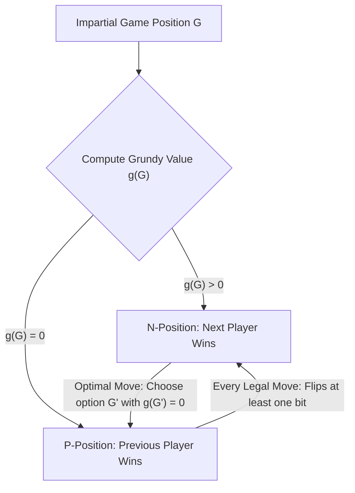
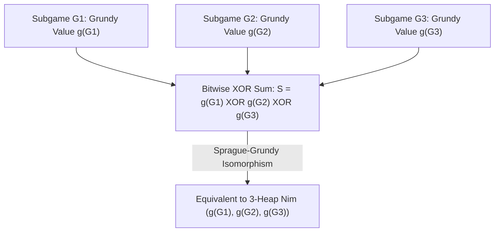

## مقدمة: الحتمية المطلقة خلف القواعد البسيطة — الألعاب التوافقية المحايدة

على طاولة توجد ثلاث كومات من الحصى تحتوي على $3$ و$4$ و$5$ حصيات على التوالي. يتناوب لاعبان على اللعب؛ وفي كل دور يختار اللاعب كومة واحدة ويسحب منها حصاة واحدة على الأقل (ويمكنه سحب الكومة بأكملها). الفائز هو من يسحب الحصاة الأخيرة. هذه هي <strong>لعبة نيم (Nim)</strong> الشهيرة التي خلّدها المخرج آلان رينيه في فيلمه الكلاسيكي *العام الماضي في مارينباد*. للوهلة الأولى تبدو اللعبة وكأنها صراع نفسي وتكتيكي، لكن في نظر الرياضيات فإن النتيجة محسومة بنسبة $100\,\%$ قبل أن تبدأ الحركة الأولى: فإذا أدرك اللاعب الأول اللامتغير الجبري الكامن في التمثيل الثنائي للأعداد، فإنه يستطيع فرض الفوز مهما فعل خصمه.

في الرياضيات الحديثة تُسمى هذه الفئة <strong>الألعاب التوافقية المحايدة (Impartial Combinatorial Games)</strong>، وهي تخضع لخمس مسلّمات أساسية: (1) يتناوب لاعبان على الحركة؛ (2) <strong>معلومات كاملة (Perfect Information)</strong> بلا أوراق مخفية؛ (3) <strong>حتمية (Deterministic)</strong> بلا نرد أو حظ؛ (4) <strong>الحياد (Impartiality)</strong>، بمعنى أن مجموعة الحركات القانونية المتاحة من أي وضعية هي نفسها تماماً لكلا اللاعبين (خلافاً للألعاب الحزبية Partisan Games مثل الشطرنج أو الغو حيث يحرك كل لاعب قطعه الخاصة فقط)؛ و(5) <strong>الانتهاء المحدود</strong>، مما يضمن انتهاء كل مباراة في عدد منتهٍ من الخطوات على بيان موجه خالٍ من الدورات (DAG). وتحت القاعدة القياسية — <strong>اتفاقية اللعب العادي (Normal Play Convention)</strong> — يخسر أول لاعب يعجز عن القيام بحركة قانونية (أي يفوز من يقوم بالحركة الأخيرة).

وباستخدام الاستقراء العكسي (مبرهنة زيرميلو)، تنقسم جميع وضعيات أي لعبة محايدة بشكل فريد إلى فئتين منفصلتين: <strong>مواقع-$\mathcal{P}$ (Previous-player winning، أي مواقع خاسرة للاعب الذي عليه الدور)</strong> و<strong>مواقع-$\mathcal{N}$ (Next-player winning، أي مواقع رابحة للاعب الذي عليه الدور)</strong>. تعريفها العودي بالغ الدقة: جميع الوضعيات النهائية التي لا حركات منها هي مواقع-$\mathcal{P}$؛ وتكون الوضعية موقع-$\mathcal{N}$ إذا وجدت منها حركة قانونية واحدة على الأقل تؤدي إلى موقع-$\mathcal{P}$؛ وتكون موقع-$\mathcal{P}$ إذا كانت <strong>جميع</strong> الحركات القانونية منها تقود حتماً إلى مواقع-$\mathcal{N}$.

---

## 1. اكتشاف تشارلز بوتون (1901): عملية XOR الثنائية (مجموع نيم)ولمّتا الثبات

عندما يزداد عدد الكومات وعدد الحصى إلى الملايين، يؤدي الاستقراء العكسي المباشر على بيان الحالات إلى انفجار أسي. في عام 1901 نشر عالم الرياضيات في جامعة هارفارد <strong>تشارلز ليونارد بوتون (Charles Leonard Bouton)</strong> ورقة بحثية تاريخية حلّت لعبة نيم بالكامل. فقد اكتشف أن السر يكمن في كتابة حجم كل كومة بالنظام الثنائي وحساب <strong>مجموع ”أو“ الحصرية للبتات (Bitwise XOR، ويُعرف بمجموع نيم Nim-sum)</strong>.

لأي وضعية $(n_1, n_2, \dots, n_k)$ نعرّف مجموع نيم بالصيغة $S = n_1 \oplus n_2 \oplus \dots \oplus n_k$. عملية $\oplus$ هي جمع ثنائي بدون حمل (carry-less addition) على الحقل المنتهي $\mathbb{F}_2 = 	ext{GF}(2)$ (وهي تبديلية وتجميعية وتحقق $x \oplus x = 0$). تنص مبرهنة بوتون على أن: <strong>وضعية نيم $(n_1, \dots, n_k)$ تكون موقعاً خاسراً (موقع-$\mathcal{P}$) إذا وفقط إذا كان مجموع نيم لها $S = 0$، وتكون موقعاً رابحاً (موقع-$\mathcal{N}$) إذا وفقط إذا كان $S 
eq 0$.</strong>

يعتمد البرهان على لمّتين جبريتين أنيقتين:
أولاً: <strong>انطلاقاً من أي وضعية تحقق $S = 0$، فإن أي حركة قانونية تقود حتماً إلى $S' 
eq 0$.</strong> إذا أنقص اللاعب الكومة رقم $i$ من $n_i$ إلى $n_i' < n_i$، فإن التمثيلين الثنائيين للعددين $n_i$ و$n_i'$ يختلفان في بت واحد على الأقل، ومن ثم فإن $n_i \oplus n_i' 
eq 0$. وعليه يكون مجموع نيم الجديد $S' = S \oplus n_i \oplus n_i' = 0 \oplus (n_i \oplus n_i') 
eq 0$. أي أن اللاعب الذي يواجه $S=0$ مضطر لتسليم وضعية رابحة $S' 
eq 0$ لخصمه.
ثانياً: <strong>انطلاقاً من أي وضعية تحقق $S 
eq 0$، توجد دائماً حركة قانونية واحدة على الأقل تجعل $S' = 0$.</strong> لننظر إلى <strong>البت الأكثر أهمية (Most Significant Bit, MSB)</strong> الذي قيمته $1$ في التمثيل الثنائي للعدد $S 
eq 0$، ولنفرض أنه في المنزلة $d$. بما أن البت $d$ في $S$ يساوي $1$، فلا بد أن يوجد عدد فردي (أي كومة واحدة على الأقل) من الكومات $n_i$ يكون البت $d$ فيها مساوياً لـ $1$ أيضاً. نختار هذه الكومة $n_i$ ونجعل حجمها الجديد $n_i' = n_i \oplus S$. وبما أن كلاً من $n_i$ و$S$ يملكان $1$ في المنزلة $d$، فإن عملية XOR تحوّل هذا البت في $n_i'$ إلى $0$ بينما تبقى جميع البتات الأعلى رتبة دون تغيير. إذن يتحقق قطعا المتباينة $n_i' < n_i$! إن سحب $n_i - (n_i \oplus S)$ حصاة هو حركة قانونية تماماً، ويصبح مجموع نيم الجديد $S' = S \oplus n_i \oplus n_i' = S \oplus n_i \oplus (n_i \oplus S) = 0$. في مثالنا الافتتاحي $(3, 4, 5)$ نجد $S = 3 \oplus 4 \oplus 5 = 2 = (010)_2 
eq 0$. البت الأعلى وزنه $2$ وهو موجود في $n_1 = 3 = (011)_2$، فيقوم اللاعب الأول بإنقاص الكومة الأولى إلى $n_1' = 3 \oplus 2 = 1$ تاركاً $(1, 4, 5)$ حيث $1 \oplus 4 \oplus 5 = 0$ ويضمن الفوز!

$$
S = n_1 \oplus n_2 \oplus \dots \oplus n_k = \bigoplus_{i=1}^k n_i
$$

$$
\begin{aligned}
n_1 = 3 &= (011)_2 \\
n_2 = 4 &= (100)_2 \\
n_3 = 5 &= (101)_2 \\
\hline
S = 3 \oplus 4 \oplus 5 &= (010)_2 = 2 \neq 0 \quad (\mathcal{N}\text{-position})
\end{aligned}
$$

$$
n_1' = n_1 \oplus S = 3 \oplus 2 = (011)_2 \oplus (010)_2 = (001)_2 = 1 < 3 \implies (1, 4, 5) \text{ has } 1 \oplus 4 \oplus 5 = 0 \quad (\mathcal{P}\text{-position})
$$

---

## 2. مبرهنة سبراغ-غراندي (1935/1939): كل لعبة محايدة متشاكلة مع لعبة نيم

بعد أكثر من ثلاثين عاماً من اكتشاف بوتون، توصّل رولاند سبراغ (1935) وباتريك مايكل غراندي (1939) بشكل مستقل إلى مبرهنة كونية مذهلة: <strong>ليست لعبة نيم وحدها، بل إن أي لعبة توافقية محايدة منتهية تحت اتفاقية اللعب العادي هي متشاكلة بنيوياً (isomorphic) مع كومة نيم واحدة ذات حجم معين!</strong>

لبناء هذا التشاكل نُدخل مفهوم <strong>القيمة الصغرى المستبعدة (Minimum Excluded Value, $	ext{mex}$)</strong> و<strong>عدد غراندي (Grundy Value أو Nimber)</strong>. لأي مجموعة جزئية منتهية من الأعداد الصحيحة غير السالبة $A \subset \mathbb{N}_0$، نعرّف $	ext{mex}(A)$ بأنه أصغر عدد صحيح غير سالب لا ينتمي إلى $A$ (مثلاً $	ext{mex}(\emptyset) = 0$ و$	ext{mex}(\{0, 1, 3\}) = 2$). ولأي وضعية $u$ في بيان اللعبة، يُعرّف عدد غراندي $\mathcal{G}(u)$ عودياً بأنه $	ext{mex}$ لمجموعة أعداد غراندي لجميع الوضعيات اللاحقة $v$ التي يمكن الوصول إليها في حركة واحدة.
وتنتج فوراً خاصيتان جوهريتان: (1) $\mathcal{G}(u) = 0$ إذا وفقط إذا لم يكن لأي وضعية لاحقة القيمة $0$، أي أن $u$ موقع-$\mathcal{P}$ خاسر؛ (2) إذا كان $\mathcal{G}(u) = g > 0$، فإنه لكل عدد صحيح $m$ يحقق $0 \le m < g$ توجد وضعية لاحقة واحدة على الأقل $v$ تحقق $\mathcal{G}(v) = m$. وهذا يطابق تماماً سلوك كومة نيم واحدة تحتوي على $g$ حصاة!

علاوة على ذلك، عندما ندمج عدة ألعاب محايدة مستقلة $G_1, G_2, \dots, G_k$ في <strong>مجموع انفصالي (Disjunctive Sum)</strong> $G = G_1 + G_2 + \dots + G_k$ (حيث يختار اللاعب في كل دور إحدى الألعاب الفرعية ويتحرك فيها حتى تنتهي جميع الألعاب)، تثبت <strong>مبرهنة سبراغ-غراندي</strong> أن عدد غراندي للعبة المركبة يساوي بالضبط مجموع XOR الثنائي لأعداد غراندي للألعاب الفرعية: $\mathcal{G}(G_1 + \dots + G_k) = \mathcal{G}(G_1) \oplus \dots \oplus \mathcal{G}(G_k)$. وبذلك تختزل أي لعبة معقدة على البيانات إلى حساب قيم $	ext{mex}$ وعملية XOR!

$$
\text{mex}(A) = \min \{ m \in \mathbb{N}_0 \mid m \notin A \}, \qquad \mathcal{G}(u) = \text{mex}\big\{ \mathcal{G}(v) \;\big|\; u \to v \big\}
$$

$$
\mathcal{G}(u) = 0 \iff u \in \mathcal{P}\text{-position}, \qquad \mathcal{G}(u) > 0 \iff u \in \mathcal{N}\text{-position}
$$

---

## 3. تطبيقات كلاسيكية وفخ اللعب العكسي (Misère Play)

تمنحنا مبرهنة سبراغ-غراندي أداة حاسمة لتحليل طيف واسع من الألعاب:
- <strong>ألعاب الطرح (Subtraction Games، لعبة باشيه)</strong>: يُسمح فقط بسحب من $1$ إلى $m$ حصاة في كل دور. ينتج دورياً $\mathcal{G}(n) = n mod (m+1)$، وتكون الوضعية خاسرة إذا وفقط إذا كان $n$ من مضاعفات $m+1$.
- <strong>ألعاب الانشطار: لعبة كايلز (Kayles) وشطرنج داوسون</strong>: في لعبة قوارير البولينغ *Kayles*، تصطف $n$ قارورة في صف واحد، وكل رمية تسقط إما قارورة واحدة أو قارورتين متجاورتين. تكمن الروعة الرياضية عندما تُسقط قارورة من وسط الصف: إذ ينشطر الصف الأصلي إلى <strong>صفين فرعيين مستقلين</strong> بطول $a$ و$b$! وبموجب مبرهنة سبراغ-غراندي، تكافئ الوضعية الجديدة المجموع الانفصالي للصفين الفرعيين، ويكون عدد غراندي لها هو $\mathcal{G}(a) \oplus \mathcal{G}(b)$ مباشرة. وبالبرمجة الديناميكية في زمن $O(n^2)$ نحسب المتتالية كاملة (والتي تصبح دورية بدور قدره $12$ بدءاً من $n \ge 72$).
- <strong>اتفاقية اللعب العكسي (Misère Play — من يسحب الحصاة الأخيرة يخسر)</strong>: ماذا يحدث لو عكسنا الشرط بحيث يخسر من يأخذ الحصاة الأخيرة؟ يظن الكثيرون خطأً أنه يكفي عكس مواقع $\mathcal{P}$ و$\mathcal{N}$. أثبت بوتون القاعدة الدقيقة للعبة <strong>نيم العكسية (Misère Nim)</strong>: طالما بقيت كومتان على الأقل بحجم أكبر من $1$، فإننا نلعب <strong>بنفس استراتيجية نيم العادية تماماً</strong> (أي نحافظ على $S = 0$). وفقط في الحركة الدقيقة التي ستترك لأول مرة <strong>جميع الكومات المتبقية بحجم $1$</strong> نعدّل الحركة لنترك <strong>عدداً فردياً من الكومات ذات الحجم $1$</strong> (أي $S = 1$)! أما في الألعاب المحايدة العامة تحت قاعدة Misère، فإن مبرهنة سبراغ-غراندي تنهار تماماً؛ ولم يتمكن العلماء من ترويضها جبرياً إلا في مطلع القرن الحادي والعشرين عبر نظرية <strong>خوارج قسمة ميزير (Misère Quotients)</strong> التي طورها ثين بلامبيك وآرون سيغل باستخدام المونويدات التبديلية.

| نوع اللعبة / المفهوم | البنية الرياضية / اللامتغير | شرط الفوز (موقع-$\mathcal{N}$) | التعقيد والمكانة النظرية |
| :--- | :--- | :--- | :--- |
| <strong>نيم القياسية (Normal Play)</strong> | مجموع XOR الثنائي $S = igoplus_{i=1}^k n_i$ | $S 
eq 0$ | $O(k)$ عمليات بت؛ أساس جميع الألعاب المحايدة |
| <strong>لعبة الطرح $S=\{1,\dots,m\}$</strong> | دالة غراندي الدورية $\mathcal{G}(n) = n mod (m+1)$ | $n 
ot\equiv 0 \pmod{m+1}$ | $O(1)$؛ متتالية $	ext{mex}$ دورية |
| <strong>لعبة كايلز (Kayles، انشطارية)</strong> | $	ext{mex}\{\mathcal{G}(a) \oplus \mathcal{G}(b)\}$ | $\mathcal{G}(n) 
eq 0$ (دورية بدور $12$ عند $n \ge 72$) | $O(n^2)$ بالبرمجة الديناميكية أو $O(1)$ بالدورية |
| <strong>المجموع الانفصالي للألعاب المحايدة</strong> | مبرهنة سبراغ-غراندي $\mathcal{G}(\sum G_i) = igoplus \mathcal{G}(G_i)$ | $igoplus_{i=1}^k \mathcal{G}(G_i) 
eq 0$ | متشاكلة مع نيم والفضاءات المتجهية على $\mathbb{F}_2$ |
| <strong>نيم العكسية (Misère Nim)</strong> | عكس الزوجية فقط في نهاية اللعب لكومات الحجم $1$ | $S 
eq 0$ إذا وجد $n_i > 1$؛ و$S = 0$ إذا كانت كلها $1$ | الألعاب العكسية العامة تتطلب Misère Quotients |

$$
\mathcal{G}(G_1 + G_2 + \dots + G_k) = \mathcal{G}(G_1) \oplus \mathcal{G}(G_2) \oplus \dots \oplus \mathcal{G}(G_k)
$$

$$
\mathcal{G}(\text{Kayles}(n)) = \text{mex}\Big\{ \mathcal{G}(a) \oplus \mathcal{G}(b) \;\Big|\; a + b = n - 1 \text{ or } a + b = n - 2 \Big\}
$$
