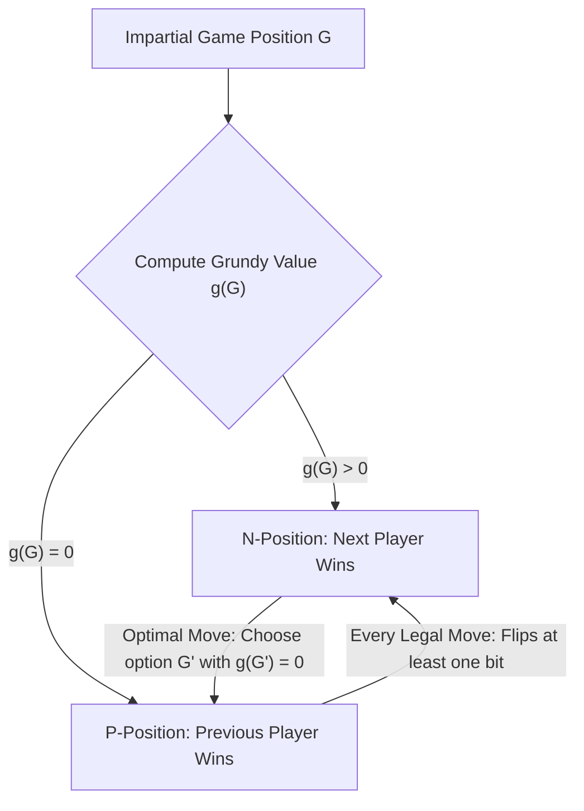
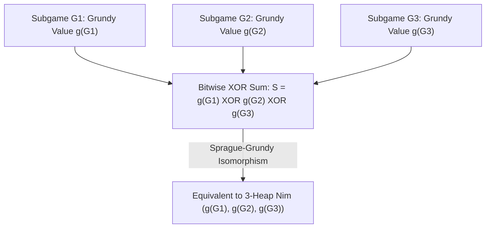

## Einleitung: Absolute Determiniertheit hinter einfachen Regeln — Neutrale kombinatorische Spiele

Auf einem Tisch liegen drei Steinhaufen mit $3$, $4$ und $5$ Steinen. Zwei Spieler ziehen abwechselnd; in jedem Zug wählt ein Spieler einen beliebigen Haufen und nimmt mindestens einen Stein (bis hin zum gesamten Haufen) weg. Wer den letzten Stein nimmt, gewinnt. Dies ist das jahrhundertealte Spiel <strong>Nim</strong>, das unter anderem durch Alain Resnais’ Filmklassiker *Letztes Jahr in Marienbad* weltberühmt wurde. Auf den ersten Blick wirkt es wie ein psychologisches Duell, doch aus Sicht der Mathematik steht der Sieger bereits vor dem ersten Zug mit $100\,\%$ Sicherheit fest: Sobald der erste Spieler die in der Binärdarstellung verborgene algebraische Invariante kennt, kann er bei jedem denkbaren Gegenzug des zweiten Spielers den Sieg erzwingen.

In der modernen Mathematik gehört Nim zur Klasse der <strong>neutralen kombinatorischen Spiele (Impartial Combinatorial Games)</strong>. Solche Spiele erfüllen fünf Axiome: (1) Zwei Spieler ziehen abwechselnd; (2) <strong>Vollständige Information (Perfect Information)</strong> ohne verdeckte Karten; (3) <strong>Determiniertheit</strong> ohne Zufallselemente wie Würfel; (4) <strong>Neutralität (Impartiality)</strong>, was bedeutet, dass in jeder Spielstellung für beide Spieler exakt dieselben legalen Züge erlaubt sind (im Gegensatz zu *parteiischen Spielen* wie Schach oder Go, bei denen Weiß nur weiße und Schwarz nur schwarze Steine bewegen darf); und (5) <strong>Endliche Terminierung</strong>, sodass jede Partie nach endlich vielen Zügen auf einem gerichteten azyklischen Graphen (DAG) endet. Unter der Standardregel — der <strong>Normalspiel-Konvention (Normal Play Convention)</strong> — verliert derjenige Spieler, der keinen legalen Zug mehr ausführen kann (äquivalent dazu gewinnt der Spieler, der den letzten Stein nimmt).

Durch Rückwärtsinduktion (Satz von Zermelo) zerfällt der Zustandsraum jedes neutralen kombinatorischen Spiels eindeutig in zwei disjunkte Klassen: <strong>$\mathcal{P}$-Positionen (Previous-player winning, Verluststellung für den am Zug befindlichen Spieler)</strong> und <strong>$\mathcal{N}$-Positionen (Next-player winning, Gewinnstellung für den am Zug befindlichen Spieler)</strong>. Ihre rekursive Struktur ist kristallklar: Alle Endstellungen ohne legale Züge sind $\mathcal{P}$-Positionen; eine Stellung ist genau dann eine $\mathcal{N}$-Position, wenn von ihr aus mindestens ein legaler Zug in eine $\mathcal{P}$-Position führt; und sie ist genau dann eine $\mathcal{P}$-Position, wenn <strong>jeder</strong> legale Zug unweigerlich in eine $\mathcal{N}$-Position führt.

---

## 1. Charles Boutons Durchbruch (1901): Bitweises XOR (Nim-Summe) und die zwei Invarianz-Lemmata

Bei vielen Haufen mit Millionen von Steinen führt eine naive Rückwärtsinduktion auf dem Spielgraphen zu einer exponentiellen Zustandsexplosion. Im Jahr 1901 veröffentlichte der Harvard-Mathematiker <strong>Charles Leonard Bouton</strong> eine bahnbrechende Arbeit, die Nim für beliebig viele Haufen und Steine vollständig löste. Er entdeckte, dass das Geheimnis darin liegt, die Haufengrößen im Binärsystem darzustellen und ihre <strong>bitweise Exklusiv-Oder-Summe (XOR, auch Nim-Summe genannt)</strong> zu berechnen.

Für eine Stellung $(n_1, n_2, \dots, n_k)$ ist die Nim-Summe definiert als $S = n_1 \oplus n_2 \oplus \dots \oplus n_k$. Die Operation $\oplus$ ist nichts anderes als die übertragsfreie binäre Addition über dem endlichen Körper $\mathbb{F}_2 = 	ext{GF}(2)$ (assoziativ, kommutativ und selbstinvers: $x \oplus x = 0$). Der Satz von Bouton besagt: <strong>Eine Nim-Stellung $(n_1, \dots, n_k)$ ist genau dann eine Verluststellung ($\mathcal{P}$-Position), wenn ihre Nim-Summe $S = 0$ beträgt, und genau dann eine Gewinnstellung ($\mathcal{N}$-Position), wenn $S 
eq 0$ gilt.</strong>

Der Beweis beruht auf zwei eleganten algebraischen Lemmata:
Erstens: <strong>Ausgehend von $S = 0$ führt jeder legale Zug zu $S' 
eq 0$.</strong> Wenn der Spieler am Zug den $i$-ten Haufen von $n_i$ auf $n_i' < n_i$ verkleinert, müssen sich $n_i$ und $n_i'$ in mindestens einem Binärbit unterscheiden, also gilt $n_i \oplus n_i' 
eq 0$. Die neue Nim-Summe lautet $S' = S \oplus n_i \oplus n_i' = 0 \oplus (n_i \oplus n_i') 
eq 0$. Wer bei $S=0$ am Zug ist, muss das Spiel also zwangsläufig in eine Stellung mit $S' 
eq 0$ überführen.
Zweitens: <strong>Ausgehend von $S 
eq 0$ existiert stets mindestens ein legaler Zug, der $S' = 0$ herstellt.</strong> Man betrachtet das <strong>höchstwertige gesetzte Bit (Most Significant Bit, MSB)</strong> von $S 
eq 0$ an der Stelle $d$. Da dieses Bit in $S$ den Wert $1$ hat, muss unter den Zahlen $n_1, \dots, n_k$ eine ungerade Anzahl (also mindestens ein Haufen $n_i$) an der Bitposition $d$ ebenfalls eine $1$ aufweisen. Wählt man diesen Haufen $n_i$ und setzt die neue Steinezahl auf $n_i' = n_i \oplus S$, so wird das $d$-te Bit von $n_i'$ von $1$ auf $0$ gekippt, während alle höherwertigen Bits unverändert bleiben. Folglich gilt streng $n_i' < n_i$! Dies ist ein gültiger Nim-Zug (man entfernt $n_i - (n_i \oplus S)$ Steine), und die resultierende Nim-Summe beträgt $S' = S \oplus n_i \oplus n_i' = S \oplus n_i \oplus (n_i \oplus S) = 0$. Im Eingangsbeispiel $(3, 4, 5)$ gilt $S = 3 \oplus 4 \oplus 5 = 2 = (010)_2 
eq 0$. Das MSB liegt auf Position $2$ (Wert $2$). Da $n_1 = 3 = (011)_2$ dort eine $1$ hat, reduziert der erste Spieler Haufen $1$ auf $n_1' = 3 \oplus 2 = 1$, erzeugt die Stellung $(1, 4, 5)$ mit $1 \oplus 4 \oplus 5 = 0$ und sichert sich den Sieg!

$$
S = n_1 \oplus n_2 \oplus \dots \oplus n_k = \bigoplus_{i=1}^k n_i
$$

$$
\begin{aligned}
n_1 = 3 &= (011)_2 \\
n_2 = 4 &= (100)_2 \\
n_3 = 5 &= (101)_2 \\
\hline
S = 3 \oplus 4 \oplus 5 &= (010)_2 = 2 \neq 0 \quad (\mathcal{N}\text{-position})
\end{aligned}
$$

$$
n_1' = n_1 \oplus S = 3 \oplus 2 = (011)_2 \oplus (010)_2 = (001)_2 = 1 < 3 \implies (1, 4, 5) \text{ has } 1 \oplus 4 \oplus 5 = 0 \quad (\mathcal{P}\text{-position})
$$

---

## 2. Der Satz von Sprague-Grundy (1935/1939): Jedes neutrale Spiel ist äquivalent zu Nim

Mehr als dreißig Jahre nach Bouton entdeckten Roland Sprague (1935) und Patrick Michael Grundy (1939) unabhängig voneinander einen universellen Hauptsatz der kombinatorischen Spieltheorie: <strong>Nicht nur Nim selbst, sondern jedes beliebige endliche neutrale kombinatorische Spiel unter der Normalspiel-Konvention ist strukturell exakt isomorph zu einem einzigen Nim-Haufen bestimmter Größe!</strong>

Um diese Isomorphie zu formulieren, definiert man den <strong>minimalen ausgeschlossenen Wert (Minimum Excluded Value, $	ext{mex}$)</strong> und die <strong>Grundy-Zahl (Grundy Value / Nimber)</strong>. Für eine endliche Teilmenge $A \subset \mathbb{N}_0$ nichtnegativer ganzer Zahlen ist $	ext{mex}(A)$ die kleinste nichtnegative ganze Zahl, die nicht in $A$ liegt (z. B. $	ext{mex}(\emptyset) = 0$, $	ext{mex}(\{0, 1, 3\}) = 2$). Für jeden Spielzustand $u$ wird seine Grundy-Zahl $\mathcal{G}(u)$ rekursiv als der $	ext{mex}$ der Grundy-Zahlen aller in einem Zug erreichbaren Nachfolgezustände $v$ definiert.
Aus dieser Definition folgen sofort zwei fundamentale Eigenschaften: (1) $\mathcal{G}(u) = 0$ gilt genau dann, wenn kein Nachfolger den Wert $0$ hat, d. h. $u$ ist eine $\mathcal{P}$-Position; (2) gilt $\mathcal{G}(u) = g > 0$, so existiert für jede ganze Zahl $m$ mit $0 \le m < g$ mindestens ein Nachfolgezustand $v$ mit $\mathcal{G}(v) = m$. Genau das entspricht einem einzelnen Nim-Haufen mit $g$ Steinen!

Kombinieren wir nun mehrere unabhängige neutrale Spiele $G_1, G_2, \dots, G_k$ zu einer <strong>disjunktiven Summe</strong> $G = G_1 + G_2 + \dots + G_k$ (in jedem Zug wählt ein Spieler genau eines der Teilspiele aus und führt dort einen legalen Zug aus, bis alle Teilspiele beendet sind), so beweist der <strong>Satz von Sprague-Grundy</strong>: Die Grundy-Zahl des Summenspiels ist exakt die bitweise XOR-Summe der Grundy-Zahlen der einzelnen Teilspiele! Selbst wenn ein Zug in einem Teilspiel die Grundy-Zahl vorübergehend *erhöhen* sollte (was dem Hinzufügen von Steinen zu einem Nim-Haufen entspräche), kann der Gegner diesen Zug im nächsten Schritt sofort neutralisieren, indem er auf den ursprünglichen kleineren Wert zurückzieht. Damit lässt sich jedes noch so komplexe Graphen- oder Zerlegungsspiel auf die Berechnung von $	ext{mex}$-Werten und eine einfache XOR-Verknüpfung reduzieren.

$$
\text{mex}(A) = \min \{ m \in \mathbb{N}_0 \mid m \notin A \}, \qquad \mathcal{G}(u) = \text{mex}\big\{ \mathcal{G}(v) \;\big|\; u \to v \big\}
$$

$$
\mathcal{G}(u) = 0 \iff u \in \mathcal{P}\text{-position}, \qquad \mathcal{G}(u) > 0 \iff u \in \mathcal{N}\text{-position}
$$

---

## 3. Klassische Anwendungen und die Tücken der Misère-Konvention

Der Satz von Sprague-Grundy liefert ein universelles Werkzeug für zahlreiche Spiele:
- <strong>Subtraktionsspiele (Subtraction Games, z. B. Bachet-Spiel)</strong>: Aus einem Haufen dürfen jeweils nur $1$ bis $m$ Steine genommen werden. Hier ergibt sich periodisch $\mathcal{G}(n) = n mod (m+1)$; eine Stellung ist genau dann verloren, wenn $n$ ein Vielfaches von $m+1$ ist.
- <strong>Teilungsspiele: Kayles und Dawsons Schach</strong>: Beim Kegelspiel *Kayles* stehen $n$ Kegel in einer Reihe; ein Wurf kann entweder $1$ einzelnen Kegel oder $2$ unmittelbar benachbarte Kegel umwerfen. Wirft man Kegel aus der Mitte einer Reihe um, so zerfällt die Reihe in <strong>zwei unabhängige Teilreihen</strong> der Längen $a$ und $b$! Nach dem Satz von Sprague-Grundy ist die neue Stellung die disjunktive Summe beider Teilreihen, sodass ihr Grundy-Wert direkt durch $\mathcal{G}(a) \oplus \mathcal{G}(b)$ gegeben ist. Mittels dynamischer Programmierung lässt sich $\mathcal{G}(n)$ in $O(n^2)$ berechnen (ab $n \ge 72$ ist die Folge sogar strikt periodisch mit der Periode $12$).
- <strong>Die Misère-Konvention (Misère Play — wer den letzten Stein nimmt, verliert)</strong>: Kehrt man die Gewinnbedingung um, erliegen viele dem Trugschluss, man müsse lediglich $\mathcal{P}$- und $\mathcal{N}$-Positionen vertauschen. Doch Bouton zeigte für <strong>Misère-Nim</strong> die exakte Modifikation: Solange noch mindestens zwei Haufen mit mehr als $1$ Stein existieren, spielt man <strong>exakt wie im normalen Nim</strong> (man hält $S = 0$ aufrecht). Erst bei demjenigen Zug, der zum ersten Mal eine Stellung hinterlässt, in der <strong>alle verbleibenden Haufen nur noch die Größe $1$ haben</strong>, weicht man ab und sorgt dafür, dass eine <strong>ungerade Anzahl von Einsen-Haufen</strong> (also $S = 1$) übrig bleibt! Für allgemeine neutrale Spiele bricht der Satz von Sprague-Grundy unter der Misère-Regel jedoch dramatisch zusammen; erst Anfang des 21. Jahrhunderts gelang es Thane Plambeck und Aaron Siegel mit der Theorie der <strong>Misère-Quotienten (Misère Quotients)</strong>, kommutative Monoide zur algebraischen Analyse allgemeiner Misère-Spiele zu entwickeln.

| Spieltyp / Konzept | Mathematische Struktur / Invariante | Gewinnbedingung ($\mathcal{N}$-Position) | Komplexität & Theoretische Bedeutung |
| :--- | :--- | :--- | :--- |
| <strong>Standard-Nim (Normal Play)</strong> | Bitweise XOR-Nim-Summe $S = igoplus_{i=1}^k n_i$ | $S 
eq 0$ | $O(k)$ Bitoperationen; Fundament aller neutralen Spiele |
| <strong>Subtraktionsspiel $S=\{1,\dots,m\}$</strong> | Modulare Grundy-Funktion $\mathcal{G}(n) = n mod (m+1)$ | $n 
ot\equiv 0 \pmod{m+1}$ | $O(1)$; periodische $	ext{mex}$-Folge |
| <strong>Kayles (Teilungsspiel)</strong> | $	ext{mex}\{\mathcal{G}(a) \oplus \mathcal{G}(b)\}$ | $\mathcal{G}(n) 
eq 0$ (ab $n \ge 72$ Periode $12$) | $O(n^2)$ DP bzw. $O(1)$ durch Periodizität |
| <strong>Disjunktive Summe neutraler Spiele</strong> | Satz von Sprague-Grundy $\mathcal{G}(\sum G_i) = igoplus \mathcal{G}(G_i)$ | $igoplus_{i=1}^k \mathcal{G}(G_i) 
eq 0$ | Isomorph zu Nim und Vektorräumen über $\mathbb{F}_2$ |
| <strong>Misère-Nim (Letzter Zug verliert)</strong> | Paritätsumkehr ausschließlich im Einsen-Endspiel | $S 
eq 0$ falls $\exists n_i > 1$; $S = 0$ falls alle $n_i = 1$ | Allgemeine Misère-Spiele erfordern Misère-Quotienten |

$$
\mathcal{G}(G_1 + G_2 + \dots + G_k) = \mathcal{G}(G_1) \oplus \mathcal{G}(G_2) \oplus \dots \oplus \mathcal{G}(G_k)
$$

$$
\mathcal{G}(\text{Kayles}(n)) = \text{mex}\Big\{ \mathcal{G}(a) \oplus \mathcal{G}(b) \;\Big|\; a + b = n - 1 \text{ or } a + b = n - 2 \Big\}
$$
